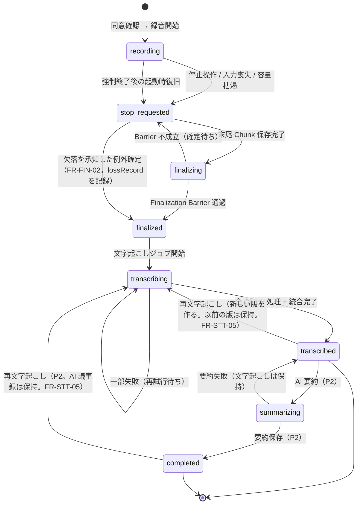

# MinutesMobile 要件定義書

| 項目 | 内容 |
| --- | --- |
| 版 | 1.0（初版） |
| 作成日 | 2026-11-14 |
| 対象 | iPhone 向けネイティブアプリ（SwiftUI） |
| 参照元 | PC/Web 版 Minutes 設計書（別リポジトリ `Minutes` の `docs/design-local-phase1.md`・`design-local-phase2.md`。以下 Minutes P1 / P2） |
| 関連文書 | [security-requirements.md](security-requirements.md)・[test-requirements.md](test-requirements.md)・[dependencies-and-costs.md](dependencies-and-costs.md) |
| ID 規約 | [../README.md](../README.md) §3 |

---

## 1. 目的・背景

### 1.1 目的

会議の音声を iPhone で録音し、**端末の外へデータを一切送らずに**、確定した文字起こし（Phase 2 で AI 議事録・手動ノート）まで作れるようにする。

### 1.2 背景

PC/Web 版 Minutes は、ブラウザ録音 → IndexedDB → `127.0.0.1` 常駐サーバー → ローカル STT（faster-whisper）→ ローカル LLM（Ollama）という構成で「完全ローカル処理」を実現している。MinutesMobile はその原則と障害耐性の設計をモバイルへ移植する。ただし PC サーバーには依存せず、iPhone 1 台で完結させる（UD-01）。

### 1.3 最重要原則

> **Recording is Source of Truth.**（Minutes P1 §1）

録音された音声ファイルが、端末内の処理で作るすべての成果物（文字起こし・AI 議事録）の原本である。これらは、どの段階で失敗しても録音から再生成できなければならない。

ただし**手動ノートは録音から再生成できない**。利用者が書いた内容であり、録音とは別の独立した原本として保存・復元・書き出しできるようにする（FR-NOT-05）。

成果物の依存順序（Source of Truth の順序。Minutes P2 §4）:

```text
録音 Chunk（WAV、原音）
      ↓ 文字起こし（端末内 STT）
文字起こしセグメント（Chunk 単位）
      ↓ 統合（Overlap 重複排除・時系列整列）
確定文字起こし（版番号付き）
      ↓ 端末内 LLM（Phase 2）
AI 議事録（版管理。上書きしない）

手動ノート（Phase 2。独立した原本。利用者所有。AI は書き込まない）
  ← AI 議事録・文字起こしからの反映は利用者操作のみ（FR-NOT-02・04）。録音からは再生成できない
```

---

## 2. 設計方針

| 方針 | 意味 | Minutes での対応 |
| --- | --- | --- |
| Local-First / Zero External Data Egress | 音声・文字起こし・要約・ノートは、どの処理段階でも端末の外へ出ない。例外は SEC-NET 群で列挙したものだけ | P1 §1、§4.4 |
| Recording-First | 録音の継続を他のすべての機能より優先する。文字起こし・UI・保存先の不調で録音を止めない | P1 §1（Backend-Optional Recording） |
| Fault-Tolerant | 割り込み・強制終了・ディスク逼迫・クラッシュが起きても、保存済みの録音を失わない。失う可能性がある範囲は上限を明示する | P1 §1 |
| At-Least-Once + 冪等 | 処理の再実行を前提とし、二重実行しても成果物が重複しない | P1 §11、P2 §10.5 |
| Device-Aware Degradation | 端末の機能（Apple Intelligence 対応可否・言語アセットの有無・温度状態・空き容量）に応じて機能を段階的に縮退させる。縮退しても録音は止めない | P2 §7（Hardware-Aware の読み替え） |
| 断定しない | 精度・速度・電池消費など環境依存の値は保証値にせず、実測して記録する | P1 §5、P2 §6 |

---

## 3. スコープとフェーズ

### 3.1 フェーズ定義

| フェーズ | ゴール | 主な機能 |
| --- | --- | --- |
| **MVP** | 録音を失わずに保存・確定し、確定後に端末内で文字起こしできる | 同意確認、録音、Chunk 保存、割り込み・中断対応、確定、起動時の復旧、文字起こし、文字起こし表示、会議一覧、書き出し、削除、設定 |
| **P2** | 確定文字起こしから AI 議事録と手動ノートを作れる | AI 要約（端末内 LLM）、Hallucination 除外 UI、手動ノート、会議検索、STT の代替エンジン |
| **P3** | 付加機能 | 録音中の文字起こし（Live STT）、話者分離、音声の圧縮保存、PC 版との連携（拡張点のみ） |

### 3.2 対象外（Out of Scope）

| 項目 | 理由 |
| --- | --- |
| iPad / visionOS / macOS / Android | UD-03 |
| 他アプリ（会議アプリなど）の音声の直接取得（Minutes の System Audio 相当） | iOS では他アプリの出力音声を取得する一般的な手段がない。画面収録の拡張機能は用途と審査の両面で不適。会議アプリの音声はスピーカー経由でマイクから録音される前提とする |
| クラウド同期・クラウド STT・クラウド LLM | UD-01、SEC-NET-01 |
| 複数利用者・アカウント管理 | 単一利用者の個人端末を前提にする（Minutes P1 §3.1） |
| App Store / TestFlight 配布 | UD-02。移行時に COST-01 を確認 |

---

## 4. 利用者・利用シーン

| 項目 | 内容 |
| --- | --- |
| 利用者 | 端末の所有者 1 名（会議の主催者または参加者） |
| 端末 | 利用者個人の iPhone（OS 27.2 以上。CON-01） |
| 主な利用シーン | 対面会議を机上の iPhone で録音する。オンライン会議の音声をスピーカー経由で録音する。録音中に画面をロックしたり、他のアプリへ切り替えたりする |
| 想定する会議長 | 標準 60 分、最大 120 分（NFR-REL-01・NFR-REL-02） |
| 想定する中断 | 着信、Siri、アラーム、他アプリの音声再生、AirPods の接続・切断、画面ロック、低電力モード、端末の高温、利用者による強制終了 |

---

## 5. 機能要件（FR）

表の列: **ID** / **要件** / **フェーズ** / **出典**。受入基準の詳細とテストは [test-requirements.md](test-requirements.md) で ID ごとに定める。

### 5.1 同意確認（CNS）

| ID | 要件 | フェーズ | 出典 |
| --- | --- | --- | --- |
| FR-CNS-01 | 録音開始の操作ごとに「この会議の参加者に録音の同意を得ましたか」の確認を表示し、確認したときだけ録音を開始する。確認を省略する設定は提供しない | MVP | P1 §3.9 |
| FR-CNS-02 | 確認した日時を会議メタデータ（`consentConfirmedAt`）に記録する | MVP | P1 §3.9 |
| FR-CNS-03 | 初回起動時に、ローカル保存でも残るリスク（端末の紛失・盗難、バックアップ設定、書き出したファイルの扱い、録音への同意は法域ごとに必要なこと）を説明する。あわせて、**録音はバックアップに含まれず、アプリを削除すると録音もすべて消えること、残したい録音は書き出しで保存すること**を説明する。P2 で手動ノートを提供する時点で、**手動ノートも同じくアプリの削除で消えること、残したいノートは Markdown の書き出し（FR-NOT-05 ③）で保存すること**を加える（SEC-DAT-03） | MVP | P1 §3.9 |

### 5.2 録音（REC）

| ID | 要件 | フェーズ | 出典 |
| --- | --- | --- | --- |
| FR-REC-01 | マイク音声を 16 kHz・16 bit PCM・モノラルに変換し、30 秒（480,000 サンプル）ごとに単独で再生できる WAV（Standalone WAV）の Chunk として保存する。停止時の末尾は 30 秒未満の Chunk として保存する | MVP | P1 §14〜§16 |
| FR-REC-02 | 入力のネイティブ sample rate（44.1 / 48 kHz など。経路変更で変わりうる）から 16 kHz への変換は、折り返し雑音を抑える方式で行う（単純な間引きは禁止）。品質基準は TST-AUD-02 | MVP | P1 §3.3 |
| FR-REC-03 | 各 Chunk に連番（`sequenceNo`、0 始まり・欠番なし）、録音開始からの開始・終了オフセット、サンプル数、バイト数、SHA-256、簡易 VAD スコアを記録する | MVP | P1 §7、§8、§3.2 |
| FR-REC-04 | 時刻の正は「録音開始からの累積サンプル数」とし、壁時計（`Date`）やタイマーの発火時刻に依存しない | MVP | P1 §8 |
| FR-REC-05 | 録音中は画面ロック中・他アプリ使用中（バックグラウンド）でも録音を継続する | MVP | P1 Invariant 8 の読み替え |
| FR-REC-06 | 録音中は経過時間・入力レベル・保存済み Chunk 数・空き容量の目安を表示する | MVP | P1 §3.6、P2 §18 |
| FR-REC-07 | 録音中の会議は同時に 1 件だけとする。録音中に別の録音を開始する操作は受け付けない | MVP | P1 meeting-lock の読み替え |
| FR-REC-08 | 録音に使った入力経路（内蔵マイク / 有線 / Bluetooth など）と、その変更履歴を会議メタデータに記録する | MVP | 新規（iOS 固有） |

### 5.3 割り込み・中断への対応（INT）

| ID | 要件 | フェーズ | 出典 |
| --- | --- | --- | --- |
| FR-INT-01 | 着信・Siri・アラームなどのオーディオ割り込みで入力が止まったら、それまでの音声を Chunk として保存し、割り込みの開始・終了時刻を「録音の空白区間」として記録する | MVP | P1 §19 の読み替え |
| FR-INT-02 | 割り込みが終わり OS が再開を許可したら、同じ会議の続きとして録音を自動で再開する。再開できなかったときは、録音が止まっていることを通知と画面で明示する | MVP | 新規（iOS 固有）、UD-08（OQ-01 を解決） |
| FR-INT-03 | 入力経路が変わったとき（AirPods の切断など）は、OS が選んだ次の入力で録音を継続し、経路変更を記録する。どの入力も使えなくなったときは保存済みの音声を確定可能な状態にして録音を停止し、停止理由を記録する | MVP | P1 `mic_ended` の読み替え |
| FR-INT-04 | オーディオのメディアサービスがリセットされたら、録音パイプラインを再構築して再開を試みる。失敗したら FR-INT-02 と同じく停止を明示する | MVP | 新規（iOS 固有） |
| FR-INT-05 | 停止理由（`manual` / `interruption_unresumed` / `no_input` / `disk_full` / `terminated` など）と検出時刻を会議メタデータに記録する | MVP | Minutes README の停止理由確認（`stopReason`）の読み替え |
| FR-INT-06 | マイク権限が未許可・拒否のときは録音を開始せず、設定アプリへの導線を表示する | MVP | P1 Browser DoD の読み替え |

### 5.4 Chunk 保存（SAV）

| ID | 要件 | フェーズ | 出典 |
| --- | --- | --- | --- |
| FR-SAV-01 | Chunk ファイルは「一時ファイルへ書き込み → 同期 → 正式名へ rename」の原子的な手順で保存し、書きかけのファイルを正式な Chunk として扱わない | MVP | P1 §12.1、§13 |
| FR-SAV-02 | ファイル配置は `{AppData}/recordings/{meetingId}/mic/{sequenceNo 6 桁}.wav` とし、会議ごとにメタデータ（`meeting.json` 相当）を同じディレクトリに置く | MVP | P1 §13 |
| FR-SAV-03 | 同じ `meetingId`・`sequenceNo` の Chunk を二重に書いても結果が 1 つになる（同一ハッシュなら冪等、異なるハッシュなら競合として記録） | MVP | P1 §11 |
| FR-SAV-04 | 空き容量を監視し、3 段階で縮退する。①残りが想定録音時間に足りなければ警告。②さらに少なければ最上位の警告を出し、新規録音の開始を確認付きにする。③書き込みが失敗したら Chunk をメモリ上に保持して再試行し、どの段階でも利用者が止めるまで録音を止めない。具体的な閾値は基本設計で決める | MVP | P1 §3.4、§21 の読み替え |
| FR-SAV-05 | メモリ上に保持した未保存 Chunk の件数を画面に表示する。アプリが終了するとこれは失われることを明示する | MVP | P1 §3.4 段階 3 |

### 5.5 停止・確定（FIN）

| ID | 要件 | フェーズ | 出典 |
| --- | --- | --- | --- |
| FR-FIN-01 | 停止操作で末尾 Chunk を保存し、会議を確定（finalize）する。自動の確定は次の条件をすべて満たしたときだけ行う（Finalization Barrier）。①連番が 0 から欠番なく続く。②全 Chunk のファイルが存在し、記録した SHA-256 と一致する。③メモリ上の未保存 Chunk が 0 件。Barrier を満たさない会議を確定できるのは、FR-FIN-02 の例外確定だけとする | MVP | P1 §22 |
| FR-FIN-02 | 確定条件を満たさない会議は「確定待ち」（`stop_requested`）として残し、理由（欠番・不一致・未保存件数）を表示する。利用者は再試行するか、欠落を承知で確定（**例外確定**）できる。例外確定は次のとおり扱う。①例外確定は Barrier を満たしたことにはしない。会議の状態は `finalized` とし、確定方式（`finalizationMode`: `barrier` / `acknowledged_loss`）を記録する。②欠落の内容（欠番の連番・ハッシュ不一致の連番・ファイル欠損の連番・確定時に破棄したメモリ上の未保存件数）と、利用者が承認した日時を会議メタデータ（`lossRecord`）に記録する。③欠番・ファイル欠損の区間は空白区間として扱い（FR-TRV-03）、ハッシュ不一致の Chunk は削除せず残したうえで文字起こしの対象から外す（SEC-INT-01）。④一覧・詳細画面で、例外確定した会議であることを表示する | MVP | P1 §22、Minutes README の「確定を中止」 |
| FR-FIN-03 | 会議の状態を次の状態遷移図に従って管理し、状態と遷移時刻を永続化する | MVP | P1 §22、P2 §9.6 |



### 5.6 起動時の復旧（RCV）

| ID | 要件 | フェーズ | 出典 |
| --- | --- | --- | --- |
| FR-RCV-01 | アプリ起動時に `recording` / `stop_requested` / `finalizing` のまま残った会議を検出し、保存済み Chunk を検証したうえで確定処理を再開する | MVP | P1 §23 |
| FR-RCV-02 | 書きかけの一時ファイルが残っていれば、ヘッダを検証・修復して救済できる範囲を Chunk として復元する。救済できない場合は削除せず隔離し、件数を表示する | MVP | P1 §23、P2 §23 |
| FR-RCV-03 | メタデータのストアが壊れていても、ファイル（`meeting.json` と WAV ヘッダ）から会議と Chunk の一覧を再構築できる | P2 | P2 §23（`doctor --rebuild`） |
| FR-RCV-04 | 処理中だった文字起こしジョブは、起動時に未完了として回収し、再実行する | MVP | P2 §9.3（Sweeper） |

### 5.7 文字起こし（STT）

| ID | 要件 | フェーズ | 出典 |
| --- | --- | --- | --- |
| FR-STT-01 | 確定済みの会議を、端末内の音声認識（第一候補: OS 標準の SpeechAnalyzer / SpeechTranscriber）で日本語の文字起こしにする。録音ファイルは読むだけで、変更・削除しない | MVP | P2 §10.1、UD-01 |
| FR-STT-02 | 文字起こしは Chunk 単位のジョブとして実行し、ジョブの状態（`pending` / `processing` / `succeeded` / `failed` / `skipped`）・試行回数・エラー分類を永続化する。途中で中断しても、未完了の Chunk から再開できる | MVP | P2 §9 |
| FR-STT-03 | Chunk 境界で切れる発話を拾うため、前の Chunk の末尾（既定 3 秒）を重ねて認識し、重なりで生じた重複を統合時に除外する。除外の判定は記録し、UI で確認できる。①Overlap は、直前の連番の Chunk が利用でき（欠番・ファイル欠損・ハッシュ不一致でない）、かつ両 Chunk の間に空白区間がない（時刻が連続している）場合だけ行う。②条件を満たさない場合は Overlap を付けず、後続 Chunk は先頭から通常どおり認識する（後続 Chunk 自体の先頭区間は正常な原音なので空白として扱わない。空白として扱うのは欠落した Chunk の区間だけ。FR-FIN-02 ③・FR-TRV-03）。③重複除外の判定は境界ごとに記録し、Overlap を行わなかった境界も「Overlap なし」とその理由（`missing` / `file_missing` / `hash_mismatch` / `gap` / `first_chunk`）を記録する（除外したセグメントは 0 件） | MVP | P1 §3.10、P2 §10.3、§11.3 |
| FR-STT-04 | セグメントは `(版番号, chunk, segmentIndex)` で一意にする。同じ版の中では `(chunk, segmentIndex)` の組で一意とし、同じジョブを再実行しても重複しない。版をまたいでセグメントを参照する場合（P2 の根拠セグメント ID など）は版番号と組にする（FR-STT-05 で以前の版を保持するため） | MVP | P2 §10.5 |
| FR-STT-05 | 統合した確定文字起こしは版番号付きで保存し、再実行で新しい版を作る。以前の版は保持する。再文字起こしは `transcribed` または `completed`（P2）から `transcribing` へ遷移して行い（FR-FIN-03）、新しい版が完成するまでは以前の版を表示し続ける。完了すると `transcribed` へ戻る。`completed` から再実行した場合も既存の AI 議事録は削除せず、各 AI 議事録はもとにした文字起こしの版番号を記録する | MVP | P2 §11 |
| FR-STT-06 | 音声認識が使えない状態（言語アセット未取得・非対応端末・OS 側の一時的な失敗）では、会議を `finalized` のまま待たせ、理由を表示する。録音と確定には影響させない | MVP | P2 §5.3、Invariant 3 |
| FR-STT-07 | 日本語の言語アセットが端末にない場合、OS 標準の取得手順を利用者の明示操作で開始する。開始前に「OS が音声認識モデルをダウンロードします。会議データは送信されません」と説明する（SEC-NET-03） | MVP | P2 §7.4 の読み替え |
| FR-STT-08 | セグメントごとに信頼度（取得できる場合）を保存し、低信頼度のセグメントを UI で区別して表示する | MVP | P1 §3.8、P2 §18 |
| FR-STT-09 | 文字起こしに使ったエンジン名・モデルや言語アセットの識別子・OS バージョンを会議ごとに記録し、画面に常時表示する | MVP | P1 §3.8、P2 §18 |
| FR-STT-10 | VAD スコアが低い Chunk は文字起こしのスキップ候補にできる。ただしスキップは `skipped` として記録し、原音は消さない。利用者は手動で文字起こしできる | P2 | P1 §3.2、P2 §13、Invariant 7 |
| FR-STT-11 | OS 標準の音声認識が使えない端末向けの代替エンジン（候補: WhisperKit、MIT ライセンス）を提供する。採否は基本設計で決める | P2 | P2 §7.2、dependencies-and-costs.md |
| FR-STT-12 | 文字起こしは利用者が開始を指示する。既定では確定直後に自動開始する設定とし、オフにもできる | MVP | 新規 |
| FR-STT-13 | 端末が高温（`serious` 以上）のとき、または低電力モードのときは、文字起こしの開始を延期する。延期を表示し、利用者が明示すれば実行できる | MVP | P2 §5.2 の読み替え |

### 5.8 文字起こし表示（TRV）

| ID | 要件 | フェーズ | 出典 |
| --- | --- | --- | --- |
| FR-TRV-01 | 確定文字起こしを時刻付きで表示する。セグメントをタップすると、その時刻から原音を再生できる | MVP | P2 §18 |
| FR-TRV-02 | 文字起こしに失敗した区間を「失敗区間」として表示し、区間単位で再試行できる | MVP | P2 §18 |
| FR-TRV-03 | 録音の空白区間（割り込み中など）を文字起こし上に区別して表示する | MVP | FR-INT-01 |

### 5.9 AI 議事録（SUM）

| ID | 要件 | フェーズ | 出典 |
| --- | --- | --- | --- |
| FR-SUM-01 | 確定文字起こしから、端末内 LLM（候補: Apple Foundation Models のオンデバイスモデル）で要約・論点・決定事項・アクションアイテムを生成する。端末外のモデル（Private Cloud Compute・クラウドモデル）は使わない（SEC-NET-02） | P2 | P2 §12、UD-01 |
| FR-SUM-02 | LLM が一度に扱える長さ（コンテキスト長）を実行時に取得し、超える場合は分割して要約し、その結果を統合する（Map-Reduce） | P2 | P2 §12.3 |
| FR-SUM-03 | 出力は構造化スキーマで受け取り、検証する。各項目は根拠となるセグメント ID（`sourceSegmentIds`）を持ち、実在しない ID を含む項目は除外して `rejected` に保持し、件数を警告表示する。除外項目は利用者が確認して手動で採用できる | P2 | P1 §3.8、P2 §12.5 |
| FR-SUM-04 | 担当者・期限は文字起こしに出現する表現だけから採る。AI に人名を推定させない | P2 | P2 §12.5、Invariant 9 |
| FR-SUM-05 | AI 議事録は版管理し、再生成は新しい版の追加とする。以前の版と差分を表示できる | P2 | P2 §12.7 |
| FR-SUM-06 | 使用したモデルと既知の弱点の注記を常時表示する | P2 | P1 §3.8、P2 §12.6 |
| FR-SUM-07 | Apple Intelligence が非対応・無効の端末では要約機能を無効にし、理由を表示する。文字起こしまでの機能は影響を受けない | P2 | Invariant 2 |

### 5.10 手動ノート（NOT）

| ID | 要件 | フェーズ | 出典 |
| --- | --- | --- | --- |
| FR-NOT-01 | 会議ごとに利用者が編集できる手動ノートを持つ。AI・バックグラウンド処理はノートに書き込まない | P2 | P2 §19、Invariant 6 |
| FR-NOT-02 | AI 議事録からノートへの反映は、利用者の「先頭に追加」「差分を見る」「破棄」の操作に限る。新しい AI 議事録ができてもノートは変えず、通知だけを出す | P2 | P2 §19 |
| FR-NOT-03 | ノートは編集のたびに自動保存（debounce 1〜2 秒）する。連続して編集が続き debounce が延期され続けても、最後の保存から最大保存間隔（5 秒）を超える前に保存する。正常な終了とバックグラウンドへの遷移では、debounce や最大保存間隔を待たずに未保存の編集を直ちに保存（flush）する。強制終了・クラッシュで失う可能性がある編集は、最後の保存以降の分に限り、その上限は最大保存間隔（5 秒分）とする。**この上限は保存が成功している間だけの保証である。** 保存が失敗した場合は次のとおり扱う。①未保存の編集をメモリ上に保持し、編集を続けられるようにする（破棄しない）。②失敗を直ちに画面に表示する。表示には「最後に保存できた時刻」「保存できていない編集があり、アプリが終了すると失われること」「利用者がすべきこと（空き容量の確保など）」を含める（NFR-UX-04）。③保存の再試行は、最大保存間隔ごとの自動の再試行と、表示の「再試行」の操作で行う。バックグラウンドへの遷移でも再試行する。④失敗が続く間に失う可能性があるのは最後に保存できた時点以降の編集で、上限の時間は保証しない。利用者は表示から未保存の内容をコピー（SEC-PLT-01 の型を通す）して退避できる。⑤保存に成功したら表示を消し、5 秒の上限の保証に戻る | P2 | P2 §19 |
| FR-NOT-04 | 文字起こしのセグメントを選んでノートへ引用できる | P2 | P2 §19（Live STT からの「議事録へ追加」の読み替え） |
| FR-NOT-05 | 手動ノートは録音から再生成できない独立した原本として扱う。①会議ディレクトリ内にノート単独のファイルとして保存し、メタデータのストアが壊れてもそのファイルから復元できる（FR-RCV-03）。②文字起こし・AI 議事録の再生成や会議の再確定でノートのファイルを変更・削除しない（削除は FR-MTG-03 の会議削除だけ）。③利用者の明示操作で Markdown として書き出せる（FR-EXP-03 の表示を伴う） | P2 | 新規（Recording is Source of Truth の例外） |

### 5.11 会議一覧・管理（MTG）

| ID | 要件 | フェーズ | 出典 |
| --- | --- | --- | --- |
| FR-MTG-01 | 会議を新しい順に一覧表示し、タイトル・日時・長さ・状態（録音中 / 確定待ち / 文字起こし中 / 完了など）を示す | MVP | P2 §18 |
| FR-MTG-02 | 会議タイトルは録音前・後に編集できる。未入力なら日時から既定名を付ける | MVP | Minutes UI |
| FR-MTG-03 | 会議を削除できる。削除は確認付きとし、録音・文字起こし・要約・ノート・一時ファイルをすべて消す（SEC-DAT-05） | MVP | 新規 |
| FR-MTG-04 | 会議をタイトルと文字起こしの本文で検索できる | P2 | 新規 |

### 5.12 書き出し（EXP）

| ID | 要件 | フェーズ | 出典 |
| --- | --- | --- | --- |
| FR-EXP-01 | 利用者の明示操作で、会議の録音（Chunk の WAV 一式、または連結した 1 ファイル）を共有シート経由で書き出せる。複数ファイルは 1 つのアーカイブにまとめる | MVP | Minutes README の ZIP 書き出し |
| FR-EXP-02 | 文字起こしをテキスト（タイムスタンプ付き）または Markdown で書き出せる | MVP | 新規 |
| FR-EXP-03 | 書き出し前に「書き出したファイルは本アプリの保護の外に出ます」と表示する（SEC-DAT-06） | MVP | P1 §3.9 |
| FR-EXP-04 | メモリ上にしか残っていない未保存 Chunk を、緊急書き出しで保存できる | MVP | P1 §3.4、`exportMemoryBacklog()` |

### 5.13 設定（SET）

| ID | 要件 | フェーズ | 出典 |
| --- | --- | --- | --- |
| FR-SET-01 | 端末の対応状況（音声認識の可否・日本語アセットの有無・Apple Intelligence の可否・空き容量・録音データの使用量）を表示する | MVP | P2 §7.1 の読み替え |
| FR-SET-02 | 確定後の自動文字起こしのオン / オフを設定できる | MVP | FR-STT-12 |
| FR-SET-03 | 強制終了などで失う可能性のある音声の上限（NFR-REL-04）と、データの保存場所・バックアップから除外していること・アプリを削除すると録音が消えることを明記する。P2 では、手動ノートもアプリの削除で消えること、残すには Markdown の書き出し（FR-NOT-05 ③）が必要なことを加える | MVP | P1 §3.5、§20 |
| FR-SET-04 | アプリのロック（Face ID / パスコード）を任意で設定できる | P2 | SEC-APP-02 |

---

## 6. 非機能要件（NFR）

### 6.1 信頼性（REL）

| ID | 要件 | フェーズ | 出典 |
| --- | --- | --- | --- |
| NFR-REL-01 | 60 分の連続録音（画面ロック・バックグラウンドを含む）で、全 Chunk の連番が欠けず、各 Chunk が単独で再生でき、SHA-256 が一致する | MVP | P1 §24.2 |
| NFR-REL-02 | 120 分の録音から文字起こし完了まで、手動の再試行なしに完走する | P2 | P2 §29 Step 2-i |
| NFR-REL-03 | 文字起こし中にアプリを強制終了しても、再起動後に未完了ジョブから再開し、重複セグメントが生じない | MVP | P2 §26.4 |
| NFR-REL-04 | 録音中の強制終了・クラッシュで失う音声は、直近の未保存区間に限る。上限は 1 Chunk（30 秒）とし、基本設計でさらに短くする方法（書きかけファイルへの逐次追記など）を検討する | MVP | P1 §3.5 |
| NFR-REL-05 | どの縮退状態でも、利用者の操作なしに録音を停止しない（入力がない・書き込み先がないなど物理的に続けられない場合を除く） | MVP | P1 §3.4 |

### 6.2 性能（PRF）

| ID | 要件 | フェーズ | 出典 |
| --- | --- | --- | --- |
| NFR-PRF-01 | 音声入力のコールバック内では、メモリ確保・ロック待ち・ファイル I/O・メインスレッドへの同期待ちを行わない（音切れの防止） | MVP | P1 §14.2 |
| NFR-PRF-02 | 録音開始（同意確認の後）から音声の取り込み開始までの時間を実測して記録する。目標は 1 秒以内とする（保証値ではない） | MVP | P1 §5 の流儀 |
| NFR-PRF-03 | 文字起こしの実時間比（処理時間 / 音声長）を端末・エンジン別に記録する。数値は保証しない | MVP | P2 §6、§27 |
| NFR-PRF-04 | 60 分の会議の一覧表示・文字起こし表示はスクロールが滑らかであること（長いリストは遅延読み込み） | MVP | 新規 |

### 6.3 容量（CAP）

| ID | 要件 | フェーズ | 出典 |
| --- | --- | --- | --- |
| NFR-CAP-01 | 録音のデータ量は 1 時間あたり約 110 MiB（16 kHz × 16 bit × モノラル）を前提に、空き容量の警告閾値を計算する | MVP | P1 §26 |
| NFR-CAP-02 | 設定画面に会議ごとと全体のデータ使用量を表示する | MVP | 新規 |
| NFR-CAP-03 | 圧縮保存（可逆圧縮。WAV の SHA-256 は保持）は Phase 3 で検討する | P3 | P2 §22 |

### 6.4 電力・発熱（PWR）

| ID | 要件 | フェーズ | 出典 |
| --- | --- | --- | --- |
| NFR-PWR-01 | 60 分録音時の電池消費と温度状態の推移を実測して記録する。数値は保証しない | MVP | P1 §5 の流儀 |
| NFR-PWR-02 | 録音中は重い処理（文字起こし・要約）を実行しない（Live STT は P3 で実測してから判断） | MVP | P2 §20 |
| NFR-PWR-03 | 長時間の文字起こしは、OS のバックグラウンド処理の仕組みを使い、端末の状態（温度・電池・低電力モード）に従う | MVP | 新規、OQ-03 |

### 6.5 使いやすさ・アクセシビリティ（UX）

| ID | 要件 | フェーズ | 出典 |
| --- | --- | --- | --- |
| NFR-UX-01 | Dynamic Type・VoiceOver・ダークモードに対応し、録音開始と停止のボタンは VoiceOver で一意に読み上げられる | MVP | 新規 |
| NFR-UX-02 | 録音状態（録音中 / 一時停止 / 停止）は色だけに頼らず、文字とアイコンでも示す | MVP | 新規 |
| NFR-UX-03 | 録音中であることを、アプリの外でも確認できるようにする。①Live Activity が使える場合: ロック画面とダイナミックアイランドに録音の状態（録音中 / 中断中）と経過時間を表示する。②Live Activity が使えない場合（Personal Team で動かないなど。OQ-04）: アプリ内の表示と、OS が表示する録音インジケータで確認できることを条件とし、ロック画面とダイナミックアイランドに状態と経過時間を出すことは求めない。中断は予約したローカル通知（FR-INT-02）で知らせる。②の場合は、ロック画面では OS のインジケータしか見えないことを設定画面に明記する。どちらの場合も D1〜D3 を表示しない（SEC-PLT-07） | MVP | 新規 |
| NFR-UX-04 | エラー表示は「何が起きたか・録音は無事か・利用者がすべきこと」を含める | MVP | P1 §3.6 |

### 6.6 ローカライズ（L10N）

| ID | 要件 | フェーズ | 出典 |
| --- | --- | --- | --- |
| NFR-L10N-01 | UI は日本語を基本とし、文字列は String Catalog で管理する（将来の英語化に備える） | MVP | 新規 |
| NFR-L10N-02 | 文字起こしの言語は日本語を既定とする。他言語は P2 以降で検討する | MVP | 新規 |

### 6.7 保守性（MNT）

| ID | 要件 | フェーズ | 出典 |
| --- | --- | --- | --- |
| NFR-MNT-01 | Swift 6 言語モードと厳格な並行性チェックでビルドし、警告ゼロを保つ（現状の `SWIFT_VERSION 5.0` を変更する。CON-04） | MVP | 新規 |
| NFR-MNT-02 | 録音・保存・文字起こし・要約の各層は protocol で境界を切り、テストで差し替えられるようにする（TST-GEN-04） | MVP | Minutes CLAUDE.md「タイマーは依存注入する」 |
| NFR-MNT-03 | 外部の依存は最小限にし、OS 標準のフレームワークを優先する。追加の手順は dependencies-and-costs.md §4 に従う | MVP | UD-05 |
| NFR-MNT-04 | 設計書と実装を同期させる。設計書のコード片を変えたら、同じ作業で実装と本文も直す | MVP | Minutes CLAUDE.md §3 |
| NFR-MNT-05 | メタデータのスキーマはバージョン管理し、アプリ更新時に既存データを失わずに移行できる | MVP | P2 §8.2 |

---

## 7. 不変条件（Invariant）

Minutes P2 §25 の Invariant 1〜10 を変更せずに継承し、iOS での読み替えを示す。設計とテストはこれを破らない。

| ID | Minutes の Invariant | MinutesMobile での意味 | 主な担保要件 |
| --- | --- | --- | --- |
| INV-01 | Live STT failure ≠ Recording failure | 録音中の文字起こし（P3）が失敗しても録音は止まらない。録音経路は文字起こしの状態を参照しない | FR-REC-05、NFR-PWR-02 |
| INV-02 | AI failure ≠ Transcript loss | 要約の失敗・検証エラーは文字起こしに触れない | FR-SUM-03、FR-SUM-07 |
| INV-03 | STT failure ≠ Recording loss | 文字起こしは録音ファイルを読むだけで、失敗しても録音を変更・削除しない | FR-STT-01、FR-STT-06 |
| INV-04 | Queue failure ≠ Job metadata loss | ジョブの状態は永続化した表が唯一の記録で、アプリの終了で失われない | FR-STT-02、FR-RCV-04 |
| INV-05 | Duplicate delivery ≠ Duplicate transcript | 同じジョブを二重に実行しても、セグメントは重複しない | FR-STT-04、FR-SAV-03 |
| INV-06 | AI regeneration ≠ Manual note overwrite | AI 議事録を再生成しても手動ノートは変わらない | FR-NOT-01、FR-NOT-02 |
| INV-07 | VAD false negative ≠ Original audio loss | VAD の判定でスキップしても原音は削除しない | FR-STT-10 |
| INV-08 | Browser tab hidden ≠ timer-based recording failure | **画面ロック・バックグラウンド遷移で録音が壊れない**。時刻はサンプル数で数え、タイマーに依存しない | FR-REC-04、FR-REC-05 |
| INV-09 | Speaker source ≠ Speaker identity | 入力経路（内蔵マイク / Bluetooth）は話者ではない。話者分離（P3）の ID はラベルで、名前は利用者が付ける | FR-SUM-04、FR-REC-08 |
| INV-10 | Queue ≠ Source of Truth | ジョブ表が消えても録音から再生成できる | FR-RCV-03 |

---

## 8. Minutes（PC/Web）→ MinutesMobile（iOS）対応表

基本設計で技術を選ぶときの出発点。iOS 側は**候補**であり、最終決定は基本設計書で行う。決定の結果は [../02-basic-design/README.md](../02-basic-design/README.md) §2・§3 と、各基本設計書の設計決定（`BD-xxx-nn`）を参照する。

| 領域 | Minutes（PC/Web） | MinutesMobile（iOS）候補 | 注意点 |
| --- | --- | --- | --- |
| 音声取得 | AudioWorklet + `pcm-chunker` | AVAudioEngine の入力 tap、または iOS 27 の音声取り込み API | tap のコールバックはリアルタイム制約下で動く（NFR-PRF-01） |
| リサンプリング | 自作 FIR（Blackman 窓）+ 分数位相補間 | AVAudioConverter（品質を TST-AUD-02 で検証）。不足なら自作 | 経路変更で入力 sample rate が変わる |
| 一時保存 | IndexedDB（メタ + Blob） | アプリ sandbox のファイル + 永続メタデータ（SwiftData または SQLite） | ファイル保護クラス（SEC-DAT-01） |
| 恒久保存 | `127.0.0.1` 常駐サーバー + SQLite | 端末内のファイル + メタデータ（同上） | サーバーへの再送の仕組みは不要になる。代わりに Barrier は端末内のファイル検証で行う |
| ページ離脱 | `beforeunload` / `pagehide` | シーンのフェーズ変化（`scenePhase`）、バックグラウンド遷移 | iOS は離脱確認ダイアログを出せない。強制終了は検知できない前提で設計する |
| 録音の継続 | タブ非表示でも Worklet が動く | Background Modes の `audio` + AVAudioSession | 割り込みで入力は止まる（FR-INT 群） |
| 入力喪失 | `MediaStreamTrack` の `ended` → 停止 | オーディオ経路の変化・割り込み・メディアサービスのリセット | AirPods が外れても内蔵マイクで継続できる点が Web と異なる |
| 容量逼迫 | IndexedDB クォータの 3 段階縮退 | 空きディスク容量（重要用途向けの空き容量）の監視 | 端末の空き容量は他アプリと共有 |
| 異常終了後の復旧 | IndexedDB の会議・Chunk を走査 | 起動時に会議ディレクトリとメタデータを照合 | 一時ファイルの扱い（FR-RCV-02） |
| STT | faster-whisper（サーバー） | SpeechAnalyzer / SpeechTranscriber（OS 標準）。代替: WhisperKit | 言語アセットは OS が管理・ダウンロード（SEC-NET-03） |
| VAD | RMS 簡易 + Silero（サーバー） | RMS 簡易（録音時）。高精度化は P2 で検討 | — |
| ジョブ基盤 | SQLite の `processing_jobs`（lease / retry / sweeper） | 永続メタデータ上のジョブ表 + 起動時回収 | 実行時間の制約（OQ-03） |
| 要約 | Ollama（ローカル HTTP） | Foundation Models のオンデバイスモデル | 非対応端末あり。コンテキスト長は端末差あり。外部モデル接続を使わない |
| 手動ノート | BlockNote | SwiftUI のテキスト編集（リッチテキストの範囲は基本設計で決める） | AI は書かない |
| 外部通信の遮断 | CSP + `assertLocalHost()` + `redirect: "error"` | 通信コードを持たない設計 + 通信の一元化 + 自動テスト | SEC-NET 群 |
| 認証トークン | 起動ごとのトークン（`0600`） | 不要（サーバーなし）。将来 PC 連携時は Keychain | SEC-KEY-01 |
| System Audio | `getDisplayMedia` | 対象外（§3.2） | — |

---

## 9. 制約・前提（CON）

| ID | 内容 | 出典 |
| --- | --- | --- |
| CON-01 | 最低 OS は iOS 27.2（現在の Xcode プロジェクトの設定値）。下げる場合は、OS 標準の音声認識と LLM の提供条件を再確認する | プロジェクト設定 |
| CON-02 | 配布は無料の Personal Team による個人実機への導入のみ。署名は約 7 日で失効するため、再インストールが必要。Personal Team で使えない capability に依存しない | UD-02 |
| CON-03 | 対象デバイスは iPhone のみ。現在のプロジェクト設定（対象デバイス `1,2,7` = iPhone / iPad / visionOS）を iPhone のみに変更する（実装着手時に実施） | UD-03 |
| CON-04 | Swift のバージョン設定を 5.0 から Swift 6 言語モードに変更する（実装着手時に実施） | NFR-MNT-01 |
| CON-05 | 要約（P2）は Apple Intelligence に対応し、かつ有効な端末に限られる | Web 確認（§11.2） |
| CON-06 | 利用者は単一。アカウント・ログインはない | P1 §3.1 |
| CON-07 | サードパーティー製品は無償で使えるものに限る。費用が発生するものはオーナーの確認を得てから採用する | UD-05 |
| CON-08 | 開発環境は Xcode（iOS 27 SDK 以上）。Xcode と SDK の版は基本設計着手時に確認して記録する | UD-05 |
| CON-09 | **最初の実録音の前に Bundle Identifier を確定する。** 現在は Xcode テンプレートの仮の値（`devplaceholder.$(PROJECT_UNIQUE_VALUE…)`）で、変わるとアプリのデータ領域が別物になり、既存の録音を読めなくなる。確定後は変更しない | SEC-DAT-03、CON-02 |

---

## 10. 断定しない事項と実測で担保する事項

Minutes P1 §5・P2 §6 と同じく、環境に依存する事項は保証値にせず、実測と記録で担保する。

| 事項 | 断定しない理由 | 担保の方法 |
| --- | --- | --- |
| 画面ロック中・バックグラウンドで録音が途切れない | OS の資源管理・他アプリ・割り込みに依存する | 60 分の実機試験（TST-DEV-01）。空白区間を記録する（FR-INT-01） |
| 割り込み後に自動再開できる | 割り込みの種類と OS の判断で再開の可否が変わる | 再開できなかった回数と理由を記録する |
| SpeechTranscriber の日本語精度・速度 | 端末・話者・音質・雑音で変わる | エンジン・端末別に実時間比と信頼度を記録する（NFR-PRF-03） |
| オンデバイス LLM がスキーマに常に従う | モデル・入力長で準拠率が変わる | スキーマ検証の失敗率を記録する。失敗時の扱いは FR-SUM-03 |
| 長時間の文字起こしがバックグラウンドで完了する | OS のバックグラウンド実行の制約に依存する | ジョブを Chunk 単位にし、中断しても再開できるようにする（FR-STT-02） |
| AVAudioConverter の変換品質 | 設定と実装に依存する | 折り返し雑音の試験（TST-AUD-02） |
| 電池消費と発熱 | 端末・環境温度に依存する | 実測（NFR-PWR-01） |

---

## 11. 確認済みの技術情報（確認日 2026-11-14）

基本設計の着手時に再確認する（[../README.md](../README.md) §4）。

### 11.1 音声認識（SpeechAnalyzer / SpeechTranscriber）

- iOS 26 で導入された OS 標準の音声認識 API で、端末内で動作する。音声認識モデルは OS がダウンロード・管理する。
- 提供開始時から日本語に対応している。
- iOS 27 で、ライブ音声向けの入力 API が追加された（Apple のサンプルは実機の iOS 27 以降が必要）。
- 出典:
  - [Apple Developer: SpeechAnalyzer](https://developer.apple.com/documentation/speech/speechanalyzer)
  - [WWDC25: Bring advanced speech-to-text to your app with SpeechAnalyzer](https://developer.apple.com/videos/play/wwdc2025/277/)
  - [Add Pipe: A Quick Look at Apple's SpeechAnalyzer API](https://blog.addpipe.com/apple-speechanalyzer-api/)
- 未確認: iOS 27 時点の対応ロケール一覧。基本設計で Apple の公式文書から確認する（OQ-05）。

### 11.2 端末内 LLM（Foundation Models）

- Apple Intelligence と同じオンデバイスモデル（約 3B パラメータと報じられている）を Swift から呼び出すフレームワーク。日本語に対応する。
- Apple Intelligence に対応し、機能が有効で、言語が対応言語の端末でだけ動く。
- iOS 27 では、コンテキスト長が端末ごとに異なるため、実行時に確認する必要がある。
- iOS 27 では、Private Cloud Compute の大きなモデルやクラウドの外部モデルも同じ API から使える。本アプリでは**使用を禁止する**（SEC-NET-02）。
- 出典:
  - [Apple Developer: iOS 27 の最新情報](https://developer.apple.com/jp/ios/whats-new/)
  - [Classmethod: Apple Foundation Models 3 の紹介](https://dev.classmethod.jp/articles/afm3-introduction/)
- 注意: 一部の情報は二次情報。P2 の基本設計で Apple の公式文書から確認する（OQ-06）。

### 11.3 代替の音声認識（WhisperKit）

- WhisperKit は Argmax のオープンソース SDK（`argmax-oss-swift`）に統合された。最新は v1.1.0（2026-08-06）。
- ライセンスは MIT。同梱されている一部のコードは Apache-2.0。
- 有償の「WhisperKit Pro / Argmax Pro SDK」は別製品で、独自ライセンス。**使用しない**。
- 出典:
  - [Swift Package Registry: argmax-oss-swift](https://swiftpackageregistry.com/argmaxinc/argmax-oss-swift)
  - [GitHub: argmaxinc/WhisperKit](https://github.com/argmaxinc/WhisperKit)
- 注意: 採用前にリポジトリの LICENSE を直接確認する（dependencies-and-costs.md §4）。

### 11.4 基本設計での再確認（確認日 2026-11-14）

基本設計の着手時に、手元の iOS 27.2 SDK（Xcode 27.2 同梱）と Apple の公式ページで再確認した。結果は [../02-basic-design/architecture.md](../02-basic-design/architecture.md) §1 にまとめてある。要点は次のとおり。

- §11.1 の API（`SpeechAnalyzer`・`SpeechTranscriber`・`AssetInventory`）は SDK に存在し、iOS 27 で音声入力の変換・供給の型が追加されている。日本語の対応は API から実行時に問い合わせる設計にした（OQ-05）。
- §11.2 のとおり、端末外のモデル（`PrivateCloudComputeLanguageModel`）が同じフレームワークにある。静的解析で使用を禁止する（SEC-NET-02）。
- 継続処理タスク（`BGContinuedProcessingTaskRequest`）は iOS 26 以降で、GPU 資源の要求には専用の entitlement が要る。
- 無償アカウント（Personal Team）で使える capability は 9 項目で、Background modes と Data protection を含む。Push notifications・Time Sensitive Notifications・Siri は使えない。

---

## 12. 未解決事項（OQ）

「状態」の列は基本設計（2026-11-15）での結論を示す。結論の要約は [../02-basic-design/README.md](../02-basic-design/README.md) §3 にある。「実機で確定」は、設計は決めたが実機試験の結果で確定または見直すことを意味する。

| ID | 事項 | 決める場所 | 備考 | 状態 |
| --- | --- | --- | --- | --- |
| OQ-01 | 割り込み後の自動再開を、既定動作として確定してよいか。会議を分割するか、1 会議として続けるか | 基本設計（録音） | FR-INT-02 は「1 会議の続き + 空白区間の記録」を仮置き | 解決（UD-08。[recording.md](../02-basic-design/recording.md) §5） |
| OQ-02 | メタデータの保存方式（SwiftData か SQLite 直接か） | 基本設計（データ） | 一意制約・トランザクション・移行・ファイルからの再構築のしやすさで比較する | 解決（UD-09。[storage.md](../02-basic-design/storage.md) §3） |
| OQ-03 | 長時間の文字起こしに使う OS のバックグラウンド実行の仕組み（継続処理タスクなど）と、その制約 | 基本設計（ジョブ） | Personal Team で使えるかも確認する | 解決・実機で確定（[transcription.md](../02-basic-design/transcription.md) §9、TST-DEV-11） |
| OQ-04 | Live Activity（ロック画面の録音状態表示）を Personal Team で使えるか | 基本設計（UI） | 使えない場合はアプリ内表示と OS の録音インジケータで代替 | 解決・実機で確定（[ui.md](../02-basic-design/ui.md) §8、TST-DEV-12） |
| OQ-05 | iOS 27 の SpeechTranscriber の日本語ロケールの提供状況と、言語アセット取得の挙動 | 基本設計（STT） | §11.1 | 解決・実機で確定（[transcription.md](../02-basic-design/transcription.md) §3、TST-STT-07） |
| OQ-06 | Foundation Models の日本語要約品質、コンテキスト長、外部モデルを確実に使わないための設定方法 | P2 基本設計 | §11.2、SEC-NET-02 | 持ち越し（P2。UD-07） |
| OQ-07 | 書き出しのアーカイブ形式（ZIP を OS 標準機能だけで作れるか） | 基本設計（書き出し） | サードパーティー製品を入れずに実現したい（UD-05） | 解決（[export.md](../02-basic-design/export.md) §4） |
| OQ-08 | 空き容量の警告閾値（何分ぶんの録音で警告するか） | 基本設計（保存） | NFR-CAP-01 を基準に決める | 解決・実機で確定（[storage.md](../02-basic-design/storage.md) §6、TST-DEV-06） |
| OQ-09 | 書きかけ Chunk の逐次追記で、強制終了時の損失上限を 30 秒より短くできるか | 基本設計（保存） | NFR-REL-04 | 解決・実機で確定（[storage.md](../02-basic-design/storage.md) §4、TST-DEV-05） |
| OQ-10 | ファイル保護クラスと、ロック中のバックグラウンド文字起こし・起動時の復旧をどう両立させるか（保護クラスを強めるタイミング、強めた後の再処理） | 基本設計（保存・文字起こし） | SEC-DAT-01・02、FR-STT-12、NFR-PWR-03 | 解決・実機で確定（[storage.md](../02-basic-design/storage.md) §7、TST-DEV-03・10） |

---

## 13. 用語集

| 用語 | 意味 |
| --- | --- |
| Chunk | 30 秒ごとに区切った録音の単位。単独で再生できる WAV ファイル |
| Standalone WAV | ヘッダを含み、それ単体で再生できる WAV ファイル |
| 確定（finalize） | 録音停止後、全 Chunk が揃っていることを検証して会議を確定すること |
| Finalization Barrier | 確定してよいかを判定する条件の集合（FR-FIN-01） |
| 空白区間 | 割り込みなどで録音できなかった時間帯 |
| セグメント | 音声認識が返す文単位の文字起こし結果 |
| Overlap | Chunk 境界の発話を拾うため、前の Chunk の末尾を重ねて認識する区間 |
| 言語アセット | OS が管理する音声認識用のモデルデータ |
| Hallucination | AI が根拠のない内容を生成すること。本アプリの検証（FR-SUM-03）で機械的に除外できるのは、**実在しない**根拠セグメント ID を示した項目だけである。実在する ID を示していても、その発話が項目の内容を裏付けているか、要約が正確かは検証しない。これらは利用者が根拠セグメントと照らして確認する必要がある（FR-SUM-06 の注記で示す） |
| Zero External Data Egress | 利用者のデータを端末の外へ一切送らないという方針 |
| Personal Team | Apple ID だけで使える無料の開発用署名。実機への導入は約 7 日で失効する |
