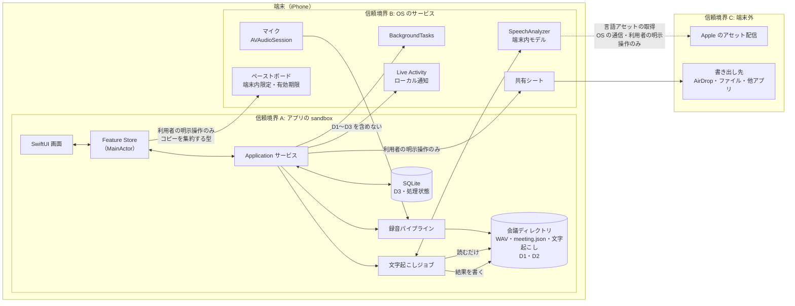

# MinutesMobile 基本設計書 ── アーキテクチャ

| 項目 | 内容 |
| --- | --- |
| 版 | 1.0（初版） |
| 作成日 | 2026-11-15（技術情報の確認日 2026-11-14） |
| 満たす要件 ID | FR-FIN-03、FR-REC-07、NFR-REL-05、NFR-PWR-02、NFR-MNT-01〜05、SEC-NET-01・05・06、SEC-DAT-07、SEC-LOG-01〜05、SEC-PLT-04・05、SEC-INP-03、TST-GEN-01〜08、INV-01〜10 |
| 解決する未解決事項 | —（個別の OQ は各文書で解決する。一覧は [README.md](README.md) §3） |
| 参照元 | Minutes P1 §1・§5・§6・§27、Minutes P2 §4・§6・§25 |
| 関連文書 | [recording.md](recording.md)・[storage.md](storage.md)・[transcription.md](transcription.md)・[ui.md](ui.md)・[export.md](export.md)・[dev-environment.md](dev-environment.md) |

本書は基本設計の入口である。全体の構成・層の境界・並行性・状態モデルと、**セキュリティとテストのシフトレフト注意点の総覧**（§12・§13）を定める。個別機能の設計は関連文書に置く。

設計決定には `BD-<領域>-nn` の ID を振る（[../README.md](../README.md) §3）。詳細設計はこの ID を引用して決定を逆引きする。

---

## 1. 設計の前提として確認した事実

満たす要件: CON-01・02・08

記憶ではなく一次情報で確認した（確認日 2026-11-14）。3 か月を過ぎたら再確認する。

| 事項 | 確認結果 | 出典 |
| --- | --- | --- |
| 開発環境 | Xcode 27.2（27B52）、iOS 27.2 SDK、Swift 6.4.2、最低 OS は iOS 27.2（CON-01） | 手元の `xcodebuild -version`・`swift --version`・プロジェクト設定 |
| 音声認識 | `SpeechAnalyzer`・`SpeechTranscriber`・`AssetInventory`・`SpeechDetector` は iOS 26 以降。`AnalyzerInputConverter`・`AssetInputSequenceProvider`・`CaptureInputSequenceProvider` は iOS 27 以降。`SpeechTranscriber` は `isAvailable`・`supportedLocales`・`installedLocales` と、結果の属性 `audioTimeRange`・`transcriptionConfidence` を持つ | iOS 27.2 SDK の `Speech.swiftinterface` |
| バックグラウンド処理 | `BGContinuedProcessingTaskRequest` は iOS 26 以降。前面のアプリから投入し、実行中はシステムが進行状況の UI を出す。タスクは進捗を報告し続ける必要があり、止まって見えると打ち切られうる。GPU 資源の要求には専用の entitlement が要る | SDK の `BGTaskRequest.h`・`BGTask.h` |
| 端末内 LLM | `SystemLanguageModel`（iOS 26 以降・オンデバイス）と `PrivateCloudComputeLanguageModel`（iOS 27 以降・端末外）が同じフレームワークにある | SDK の `FoundationModels.swiftinterface` |
| SQLite | OS 同梱は 3.54.0。オープン時に保護クラスを指定するフラグ（`SQLITE_OPEN_FILEPROTECTION_*`）がある | SDK の `sqlite3.h` |
| Personal Team で使える capability | 無償アカウントの列に印があるのは App groups・**Background modes**・**Data protection**・HealthKit・HomeKit・Inter-App Audio・Keychain sharing・Maps・Wireless Accessory Configuration の 9 項目。**Push notifications・Time Sensitive Notifications・Siri は使えない**。Live Activity と継続処理タスクは表に行がない（capability としては管理されていない） | [Apple: Supported capabilities (iOS)](https://developer.apple.com/help/account/reference/supported-capabilities-ios/) |
| 開発ツール | SwiftLint 0.65.1、SwiftFormat 0.64.7、gitleaks 8.30.1。いずれも MIT | [dev-environment.md](dev-environment.md) §5 |

**この確認から導いた設計上の制約:**

- 通知はローカル通知だけで設計する（Push は使えない）。
- 継続処理タスクで GPU 資源を要求しない（entitlement が無償アカウントの表にない）。
- Live Activity と継続処理タスクは「表に行がない＝制限の記載がない」に留まる。**Personal Team で動くことは実機で確かめるまで断定しない**（TST-DEV-11・12）。動かない場合の代替を各文書に用意する。

---

## 2. 全体構成

### 2.1 構成図と信頼境界

満たす要件: SEC-NET-01、SEC-NET-06、SEC-PLT-01、INV-03



境界を越えるデータは次の 5 経路だけである。これ以外の経路を作る変更は設計変更として扱う。

| 経路 | 越える境界 | 越えるデータ | 条件 | 要件 |
| --- | --- | --- | --- | --- |
| マイク入力 | B → A | 音声 | 同意確認の後、録音中だけ | SEC-PRV-02 |
| 音声認識 | A ↔ B | 音声と認識結果 | 端末内のモデルだけ。アプリは通信しない | FR-STT-01 |
| 言語アセットの取得 | B → C | モデル名など（OS が送る。会議データは含まない） | 利用者の明示操作で開始 | SEC-NET-03 |
| 書き出し | A → B → C | 利用者が選んだ会議のファイル | 利用者の明示操作。毎回警告を表示 | SEC-DAT-06 |
| クリップボード（コピー） | A → B | 利用者がコピーした文字起こし・ノート・会議タイトルの文字列 | 利用者の明示操作で、コピーを集約する型だけを通す。ペーストボードに端末内限定（ユニバーサルクリップボードへ同期しない）と有効期限を指定し、期限で消える。ただし、タイトルの入力欄（P2 ではノートの編集欄）で OS 標準の編集メニューからコピー・切り取りした内容はこの制御の外で、同じ Apple アカウントの他の端末（C）へ同期されうる（残る危険。[ui.md](ui.md) §7.3） | SEC-PLT-01 |

ロック画面に出る Live Activity と通知は信頼境界 B に表示されるため、D1〜D3 を載せない。例外は録音中（中断中を含む）の会議の経過時間だけ（SEC-PLT-07。[ui.md](ui.md) §8）。

### 2.2 層と責務

満たす要件: NFR-MNT-02、TST-GEN-04・06

| 層 | 責務 | 持たないもの | 実行コンテキスト |
| --- | --- | --- | --- |
| UI | 画面の描画、操作の受け付け | 状態の判断、I/O | MainActor |
| Feature Store | 画面ごとの表示状態（`@Observable`）。サービスからの通知を表示用の値に写す | ファイル・DB への直接アクセス | MainActor |
| Application サービス | 用途ごとの手順（録音の開始と停止、確定、復旧、文字起こしの進行、書き出し、削除）。副作用の実行 | 判断の規則（Domain へ委譲） | actor |
| Domain | **純粋なロジック**。状態遷移、Finalization Barrier、Chunk 分割、WAV の符号化と検証、統合と重複排除、再試行の判定、容量の縮退判定、入力の検証 | I/O、時刻の取得、乱数、OS の API | どこからでも呼べる（値型と関数） |
| Infrastructure | OS・ファイル・DB との接続（protocol の実装） | 判断の規則 | actor または専用の直列実行 |

依存の向きは UI → Store → サービス → Domain の一方向で、Infrastructure は protocol を介して注入する。Domain は他の層を参照しない。

### 2.3 モジュール構成

満たす要件: NFR-MNT-01・02、TST-CI-02

```text
MinutesMobile/                 # アプリターゲット: UI・Store・iOS 固有のアダプタ
MinutesMobileWidgets/          # Live Activity（ウィジェット拡張。UI の最後に追加）
Packages/MinutesKit/           # ローカル Swift Package（自作。サードパーティーではない）
  Sources/
    MinutesDomain/             # 純粋ロジック（Foundation のみ）
    MinutesStorage/            # SQLite・ファイル・SHA-256
    MinutesAudio/              # 変換・Chunk 組み立て・WAV
    MinutesTranscription/      # ジョブ・統合・エンジンの抽象
  Tests/
MinutesMobileTests/            # アプリ側の単体・結合（Swift Testing）
MinutesMobileUITests/          # XCUITest
scripts/  .githooks/           # ローカル検査（dev-environment.md）
```

ターゲットの最終的な分け方は詳細設計で確定する。分ける理由は BD-ARC-02 を参照。

---

## 3. 主要な設計決定

満たす要件: FR-REC-04、NFR-MNT-03、NFR-PWR-02、SEC-NET-01・04、SEC-DAT-01・02、SEC-LOG-03、TST-GEN-06、TST-SEC-07、INV-01・08・10

| ID | 決定 | 理由 | 退けた代替案 |
| --- | --- | --- | --- |
| BD-ARC-01 | 状態の判断はすべて Domain の純粋関数（状態 + 事象 → 次の状態 + 副作用の指示）に置き、サービスは指示を実行するだけにする | 全遷移を表形式のテストで網羅できる（TST-GEN-06）。実機でしか起きない事象も事象の値として再現できる | サービスの中で `if` を重ねる（組み合わせの取りこぼしをテストで見つけにくい） |
| BD-ARC-02 | 中核ロジックをローカル Swift Package に置く | ①アプリターゲットは既定の actor 分離が MainActor（現在のプロジェクト設定）で、ロジックを置くと意図せず MainActor に縛られる。②Package は Mac 上の `swift test` で動き、シミュレータを起動せずに数秒で回せる（TDD の Red → Green が速い）。③層の依存の向きをビルドで強制できる | すべてアプリターゲットに置く（テストが遅く、層の境界を破っても気づけない） |
| BD-ARC-03 | **D1・D2 は会議ディレクトリのファイルにだけ置く。共有の SQLite には D3 と処理状態だけを置く** | 共有 DB はロック中も書ける保護クラスに留める必要があり、`complete` にできない（SEC-DAT-01）。本文をファイルに寄せれば、処理が終わった会議を丸ごと `complete` に上げられる（SEC-DAT-02）。DB が壊れてもファイルから戻せる（INV-10） | 文字起こしセグメントを DB の表に置く（Minutes P2 §8.6 と同じ。本文が弱い保護クラスに残り続ける） |
| BD-ARC-04 | 時間軸を 2 本に分ける。音声の正は累積サンプル数（空白を含まない）。画面の時刻はそこに空白区間を足して導出する | 割り込みがあっても「時刻はサンプル数で数える」を保てる（FR-REC-04、INV-08）。§6 | 壁時計で Chunk の時刻を決める（時刻変更・スリープで狂う） |
| BD-ARC-05 | アプリのコードは通信 API を一切持たない。MVP には通信を集約する型も置かない | 通信しないことを静的解析と自動テストで機械的に確かめられる（SEC-NET-01）。集約型は P2 で代替 STT を採用するときに初めて作る（SEC-NET-04） | 将来のために通信層を先に用意する（使わないコードが攻撃面になる） |
| BD-ARC-06 | ログは型付きのイベント（列挙型）だけを受け付け、自由な文字列を渡せる入口を作らない | 本文・タイトル・絶対パスをログに書く経路をコンパイル時に塞げる（SEC-LOG-03）。出力を差し替えて検査できる（TST-SEC-07） | `logger.info("...\(value)")` を各所に書く（レビューでしか防げない） |
| BD-ARC-07 | MVP でアプリに組み込むサードパーティーライブラリは 0 件とする | OS 標準で足りる（NFR-MNT-03）。サプライチェーンの管理対象がなくなる（SEC-SUP 群） | GRDB・ZIP ライブラリなどの導入 |
| BD-ARC-08 | 録音中は文字起こしを実行しない。録音経路は文字起こしの状態を参照しない | 録音の継続を最優先にする（NFR-PWR-02、INV-01）。録音中に開始要求が来たら、録音の確定後まで延期する | 録音と並行して文字起こしを進める（発熱と音切れの危険。Live STT は P3 で実測してから判断） |

---

## 4. 並行性モデル（Swift 6）

満たす要件: NFR-MNT-01、NFR-PRF-01、TST-GEN-05

| 実行コンテキスト | 置くもの | してはいけないこと |
| --- | --- | --- |
| 音声コールバック（入力 tap） | ネイティブ形式のサンプルを事前確保したリングバッファへコピーする。カウンタを原子的に更新する | メモリ確保、ロック待ち、ファイル I/O、ログ出力、actor の呼び出し、MainActor への同期（NFR-PRF-01） |
| 録音パイプライン（専用の直列実行） | リングバッファの取り出し、変換、VAD、Chunk の組み立て、書きかけファイルへの追記 | UI の更新を待つこと、文字起こしの状態を参照すること |
| 保存（actor） | SQLite、Chunk の確定、ハッシュ計算、保護クラスの設定 | 録音パイプラインを待たせる長い処理（確定の検証は別の作業として実行する） |
| 文字起こし（actor） | ジョブの取得・実行・統合 | 録音ファイルの変更・削除（INV-03） |
| MainActor | Store と View | ファイル I/O、ハッシュ計算、DB アクセス |

規則:

- actor の間を渡すのは値型（`Sendable`）だけにする。`AVAudioPCMBuffer` などの参照型は境界を越えさせず、境界の手前で自前の値に写す。
- 非同期の応答は要求 ID または世代番号で対応付け、古い応答を別の要求の完了として扱わない（TST-GEN-05）。例: 録音セッションの世代、ジョブの試行回数（fencing）、文字起こしの実行番号。
- 録音パイプラインを起こす周期（初期値 100 ms）は**起こすための合図であって時計ではない**。時刻は取り出したサンプル数だけで数える（INV-08）。合図の方式は詳細設計で確定する。
- Swift 6 言語モード、厳格な並行性チェック、警告はエラー扱い（CON-04、TST-CI-01）。

---

## 5. 状態モデル

満たす要件: FR-FIN-03、FR-REC-07

状態は 3 種類あり、永続化するものとしないものを分ける。

| 状態 | 値 | 永続化 | 定義する文書 |
| --- | --- | --- | --- |
| 会議の状態 | `recording` / `stop_requested` / `finalizing` / `finalized` / `transcribing` / `transcribed`（P2: `summarizing` / `completed`） | する（SQLite と `meeting.json`） | [../01-requirements/requirements.md](../01-requirements/requirements.md) §5.5 の図をそのまま採用 |
| 録音セッションの状態 | `idle` / `preparing` / `capturing` / `interrupted` / `rebuilding` / `stopping` | しない（プロセス内だけ。割り込みの開始だけは空白区間として永続化する） | [recording.md](recording.md) §5 |
| ジョブの状態 | `pending` / `processing` / `succeeded` / `failed` / `skipped` | する（SQLite） | [transcription.md](transcription.md) §4 |

- 割り込み中も会議の状態は `recording` のままで、録音セッションの状態だけが `interrupted` になる（UD-08）。
- 録音中の会議は同時に 1 件（FR-REC-07）。プロセスが 1 つなので、Minutes の会議ロック（複数タブ対策）は不要になる。
- 削除の途中であることは状態ではなく削除要求の時刻（墓標）で表し、状態遷移図を変えない（[storage.md](storage.md) §9）。
- 状態遷移は次の形の純粋関数として書く（名称は仮。詳細設計で確定する）。

```swift
/// 許されない遷移は nil を返す。副作用は実行せず、指示として返す
func reduce(_ state: MeetingStatus, _ event: MeetingEvent) -> (next: MeetingStatus, effects: [MeetingEffect])?
```

---

## 6. 2 つの時間軸

満たす要件: FR-REC-04、FR-TRV-03、INV-08

| 時間軸 | 単位 | 何の正か | 空白区間 |
| --- | --- | --- | --- |
| 音声時刻 | 16 kHz のサンプル番号（録音開始からの累積） | Chunk の位置、セグメントの位置、原音の再生位置 | 含まない（空白の前後でサンプル番号は連続する） |
| 会議時刻 | ミリ秒 | 画面に出す経過時間、文字起こしの時刻表示 | 含む |

```text
開始時刻(ms) = s ÷ 16 + 位置が s 以下の空白区間の長さの合計    # サンプル s の開始時刻
終了時刻(ms) = e ÷ 16 + 位置が e 未満の空白区間の長さの合計      # 終了位置 e（e を含まない）の終了時刻
```

- 空白区間の位置は、空白の直後に来るサンプルの番号 k とする（空白は k − 1 と k の間にある）。
- 境界の規則: 空白の直前で終わる区間（終了位置 e = k）には、その空白の長さを足さない。再開後のサンプル k から始まる区間には足す。これで、空白の前で終わる発話の終了時刻は空白の手前に、再開後の発話の開始時刻は空白の後ろに置かれる。
- 空白区間の長さは単調時計で測る（空白にはサンプルがないため、ここだけは時計を使う）。壁時計は表示用の開始日時にだけ使う。
- 入力の取りこぼし（リングバッファのあふれ）は、落としたフレーム数から長さを計算して空白区間として記録する。
- FR-REC-03 の「録音開始からの開始・終了オフセット」は音声時刻で持ち、会議時刻は導出する。

---

## 7. 依存の注入点

満たす要件: TST-GEN-01・02・04・07、NFR-MNT-02

名称は仮で、詳細設計で確定する。本番の実装以外はすべてテスト用の差し替えを用意する。

| 注入するもの | 本番 | テストでの差し替え | 使う場所 |
| --- | --- | --- | --- |
| 壁時計・単調時計 | `Date`・連続時計 | 手動で進める時計 | 全体。実時間を待つテストは書かない |
| ID の生成 | UUID | 連番の固定値 | 会議 ID・ジョブ ID |
| 乱数（再試行のゆらぎ） | システム乱数 | 固定値 | 再試行の判定 |
| ルートディレクトリ | Application Support | テストごとの一時ディレクトリ | 保存全体 |
| 音声入力 | AVAudioEngine | 合成音声を流し込む入力 | 録音パイプライン |
| オーディオセッションの通知 | AVAudioSession | 割り込み・経路変更・リセットを任意の順で発火 | 録音セッション |
| 取り出しの合図 | 周期的な合図 | テストが手で 1 回ずつ進める | 録音パイプライン |
| 音声認識エンジン | SpeechAnalyzer | 決めた結果・エラーを返すエンジン | 文字起こし |
| 空き容量 | ボリュームの空き容量 | 任意の値 | 容量の縮退 |
| ファイル書き込みの失敗 | —（実際の失敗） | 指定回数だけ失敗させる | 保存・書き出し |
| 温度・低電力・保護データの可否 | ProcessInfo・UIApplication | 任意の値と変化の通知 | 文字起こしの延期、保護クラス |
| バックグラウンド実行 | BackgroundTasks | 開始・打ち切りを任意に発火 | 文字起こし |
| 状態表示（Live Activity・通知） | ActivityKit・ローカル通知 | 呼び出しを記録するだけ。通知の権限の状態（許可・未許可・拒否）を任意の値にする | 録音・文字起こし |
| ログの出力先 | `os.Logger` | メモリに貯めて検査 | 全体 |
| Apple Intelligence の可否 | OS への問い合わせ（手段は詳細設計で決める） | 任意の値（対応・非対応・無効） | 設定画面（MVP、FR-SET-01） |
| LLM（P2） | FoundationModels | 決めた応答を返す | 要約 |

---

## 8. エラーの扱い

満たす要件: SEC-LOG-04、NFR-UX-04、SEC-INP-03

- エラーは握りつぶさず、分類した型で返す。分類は「録音」「保存」「確定」「文字起こし」「書き出し」「永続データの不正」の単位で定義する（詳細設計）。
- 利用者に見せるときは「何が起きたか・録音は無事か・すべきこと」の 3 点に写す（[ui.md](ui.md) §6）。
- 永続データ（SQLite の行・`meeting.json`・WAV ヘッダ）を読むときは外部入力として検証し、強制キャストと強制アンラップを使わない。壊れたデータは「読めない会議」として一覧に残し、削除しない。
- エラーの値に D1〜D3（本文・タイトル・絶対パス）を含めない。含めてよいのは会議 ID・連番・件数・分類名だけとする。

---

## 9. Minutes から引き継ぐもの・不要になるもの

満たす要件: INV-01〜10、FR-REC-01、FR-SAV-04、FR-FIN-01、FR-STT-02・03

| Minutes の要素 | MinutesMobile での扱い |
| --- | --- |
| Recording is Source of Truth、Invariant 1〜10 | そのまま継承する |
| 30 秒 Chunk・Standalone WAV・SHA-256・連番 | そのまま継承する（[recording.md](recording.md)・[storage.md](storage.md)） |
| Finalization Barrier | 継承する。照合の相手がサーバーから端末内のファイルに変わる |
| ジョブの再試行・回収・冪等性 | 継承する。lease の取り合いは単一プロセスのため簡略化する（[transcription.md](transcription.md)） |
| Overlap と重複排除 | 継承する |
| IndexedDB とサーバーへの再送、保存 State Machine、バックエンドの死活監視 | **不要**。保存先が 1 つになる |
| 起動ごとの認証トークン、CSP、ホストの allowlist | **不要**。通信がない（BD-ARC-05） |
| 会議ロック（複数タブ） | **不要**（§5） |
| System Audio | 対象外（要件 §3.2） |
| クォータの 3 段階縮退 | 空き容量の 3 段階縮退に読み替える（[storage.md](storage.md) §6） |

---

## 10. P2・P3 の拡張点

満たす要件: FR-SUM-01、FR-NOT-05、FR-RCV-03、FR-MTG-04、FR-STT-10・11、FR-SET-04、SEC-NET-02、INV-01（P2・P3 の接続点の確保）

今回は設計しない（UD-07）。MVP の設計が妨げにならないよう、接続点だけ確保する。

| 機能 | 接続点 |
| --- | --- |
| AI 議事録（P2） | 会議ディレクトリに版ごとのファイルを置く。ジョブの種別を追加する。セグメント ID は決定的（連番と Chunk 内番号）なので根拠 ID に使える。モデルの指定は 1 か所に集約し、`PrivateCloudComputeLanguageModel` の使用を静的解析で禁止する（SEC-NET-02） |
| 手動ノート（P2） | 会議ディレクトリにノート単独のファイルを置く（FR-NOT-05）。文字起こし・要約の処理はこのファイルに触れない |
| 全件の再構築（P2） | 起動時の照合と同じ関数を全会議に適用する（[storage.md](storage.md) §8） |
| 会議検索（P2） | 本文の索引をどの保護クラスに置くかを P2 で決める（BD-ARC-03 と衝突しうる） |
| VAD によるスキップ・代替 STT（P2） | エンジンは protocol の背後にある。`SpeechDetector` を高精度 VAD の候補とする |
| アプリロック（P2） | ルートの画面に覆いを掛ける仕組み（[ui.md](ui.md) §7）を共用する |
| Live STT（P3） | `CaptureInputSequenceProvider`（iOS 27）が候補。録音経路とは別の入力として足す（INV-01） |

---

## 11. 断定しない事項

満たす要件: NFR-UX-03、NFR-PWR-03、SEC-DAT-01、TST-DEV-03・10〜12、TST-CI-02

| 事項 | 断定しない理由 | 担保の方法 |
| --- | --- | --- |
| Personal Team で Live Activity・継続処理タスクが動く | capability の表に行がないことしか確認できていない | 実機で確認（TST-DEV-11・12）。動かない場合の代替を設計済み |
| 音声コールバックが一定の間隔・一定の大きさで呼ばれる | OS・経路・負荷で変わる | バッファの長さを毎回見る。時刻はサンプル数で数える |
| ロック中に保護クラスを変更できる | 保護クラスの挙動はシミュレータで確かめられない | 実機で確認（TST-DEV-03・10） |
| Mac 上の `swift test` と実機で結果が一致する | 変換器・ファイルシステムの実装が異なりうる | 同じテストをシミュレータでも実行する（TST-CI-02）。実機試験で補う |

---

## 12. セキュリティ（シフトレフト注意点の総覧）

満たす要件: SEC-NET-01・05・06、SEC-DAT-07、SEC-LOG-01〜05、SEC-PLT-04・05

### 12.1 脅威と設計上の対策

| 脅威 | 設計での対策 | 定義する文書 |
| --- | --- | --- |
| T-01 紛失・盗難 | 処理が終わった会議を `complete` へ上げる。D1・D2 を共有 DB に置かない（BD-ARC-03） | [storage.md](storage.md) §7 |
| T-02 バックアップ経由の流出 | 保存ルートの作成を 1 か所に集約し、起動のたびに除外属性を検証・再設定する | [storage.md](storage.md) §7 |
| T-03 意図しない通信 | 通信 API を持たない（BD-ARC-05）。静的解析と通信ゼロの自動テスト | [dev-environment.md](dev-environment.md) §6 |
| T-04 OS 機能経由の流出 | サードパーティー製キーボードをアプリ全体で禁止。コピーは専用の入口だけ。Spotlight・Siri に渡さない | [ui.md](ui.md) §7 |
| T-05 ログ・スナップショットへの残留 | 型付きログ（BD-ARC-06）。バックグラウンド遷移時の覆い | [ui.md](ui.md) §7 |
| T-06 同意のない録音 | 同意確認を通らないと録音を開始できない状態遷移にする | [recording.md](recording.md) §5 |
| T-07 改ざん・破損 | SHA-256 を保存時に記録し、確定・書き出し・文字起こしの前に検証する | [storage.md](storage.md) §5 |
| T-09 パス操作 | パスは会議 ID（UUID）と連番だけで組み立てる。タイトルは書き出しのファイル名にだけ使い、無害化する | [storage.md](storage.md) §2、[export.md](export.md) §5 |
| T-10 依存の混入 | 組み込み依存 0 件（BD-ARC-07）。開発ツールは版を固定して照合 | [dev-environment.md](dev-environment.md) §5 |
| T-12 削除の取り残し | 会議のデータを 1 つのディレクトリに集め、削除を墓標で再開可能にする | [storage.md](storage.md) §9 |

T-08（プロンプトインジェクション）と T-11（秘密情報）は P2・P3 の対象で、MVP には該当する経路がない。

### 12.2 設計・実装で必ず確認する注意点

各文書の「セキュリティ」節に詳細がある。ここは横断の一覧である。

| No. | 注意点 | 確認する工程 |
| --- | --- | --- |
| NS-01 | 新しいファイルを作るときは、必ず保存ルートを管理する型を通す。`FileManager` で直接ディレクトリを作ると、バックアップ除外と保護クラスが付かない | 設計・レビュー・静的解析 |
| NS-02 | 録音中に書くファイルと SQLite を `complete` にしない。ロックした瞬間に書けなくなり、録音が壊れる | 設計・実機（TST-DEV-03） |
| NS-03 | D1・D2 を SQLite・`UserDefaults`・ログ・通知・Live Activity・エラーの値に入れない | 設計・レビュー・単体 |
| NS-04 | SwiftUI の標準のテキスト選択を D2 に使わない。標準のコピーはユニバーサルクリップボードへ流れる | 設計・静的解析 |
| NS-05 | `ShareLink` を使わない。完了を受け取れず、一時ファイルを確実に消せない | 設計・静的解析 |
| NS-06 | ロック画面に出るもの（Live Activity・通知）に会議タイトルを出さない | 設計・実機 |
| NS-07 | FoundationModels を使う時点で、端末外のモデルの型を静的解析で禁止する | P2 の設計・静的解析 |
| NS-08 | 永続データは読むたびに検証する。型と範囲が合わなければ「読めない会議」として扱い、クラッシュも削除もしない | 実装・単体（TST-RCV-04） |
| NS-09 | ハッシュが合わない Chunk を黙って上書き・削除しない。記録して残す | 設計・単体 |
| NS-10 | 利用者の入力（タイトル）をパスの組み立てに使わない | 設計・単体（TST-SEC-06） |
| NS-11 | 削除の対象に新しいデータを足し忘れない。会議のデータは必ず会議ディレクトリの下に置く | 設計・結合（TST-SEC-05） |
| NS-12 | 実機で録音した音声をリポジトリ・試験記録に入れない | 運用 |

---

## 13. テスト観点（シフトレフト注意点の総覧）

満たす要件: TST-GEN-01〜08

### 13.1 テストの配置

| レベル | 対象 | 実行 |
| --- | --- | --- |
| 単体（Package） | Domain の全ロジック、SQLite のラッパー、変換と Chunk 分割、統合 | Mac 上の `swift test`（数秒）。コミットごと |
| 結合（Package・アプリ） | 一時ディレクトリを使った保存・確定・復旧・削除、合成音声での録音パイプライン | シミュレータ。コミットごと |
| UI | 同意確認、録音の開始と停止、権限の拒否、確定待ち、書き出し | シミュレータ。PR ごと |
| 実機 | ロック中の録音、割り込み、経路変更、強制終了、長時間、通信ゼロ、保護クラス | 個人の iPhone。機能の完成時 |

### 13.2 設計・実装で必ず確認する注意点

| No. | 注意点 | 対応する要件 |
| --- | --- | --- |
| NT-01 | 実装より先に、対応する異常系のテストを書いて失敗させる（Red の確認） | test-requirements.md §1 |
| NT-02 | 時刻・タイマー・UUID・乱数を直接呼ばない。直接呼ぶと、そのコードは実時間を待たないとテストできなくなる | TST-GEN-01・07 |
| NT-03 | テストごとに一意の一時ディレクトリと一意の DB ファイルを使う。Swift Testing は並列に走る | TST-GEN-02 |
| NT-04 | 状態遷移は表（状態 × 事象）で網羅し、許されない遷移が拒否されることも確かめる | TST-GEN-06、TST-FIN-03 |
| NT-05 | 古い応答・遅れて届いた応答を必ずテストする（世代番号・実行世代の不一致） | TST-GEN-05 |
| NT-06 | 「2 回実行しても結果が 1 つ」を、保存・ジョブ・統合・復旧・削除のすべてで確かめる | INV-05、TST-SAV-02、TST-STT-03 |
| NT-07 | 途中で落ちた状態からの再開を確かめる。書き込みの各段階で失敗を注入する | TST-SAV-01、TST-RCV-01〜03 |
| NT-08 | 試験用の音声は合成する。既知の周波数・既知のサンプル数にすれば、結果を数値で検証できる | TST-GEN-08 |
| NT-09 | シミュレータで確かめられないもの（保護クラス・割り込み・バックグラウンド継続・マイクの経路）を単体テストの合格で済ませない。実機試験の記録を完了条件にする | test-requirements.md §5・§6 |
| NT-10 | テスト名かタグに要件 ID を入れる | TST-GEN-03 |
| NT-11 | Mac 上の `swift test` だけで済ませない。同じテストをシミュレータでも走らせる | TST-CI-02 |
| NT-12 | 性能・電池・精度の値を合否の条件にしない。記録して傾向を見る | 要件 §10 |

---

## 14. 詳細設計への申し送り

満たす要件: —（詳細設計への引き継ぎ事項。満たす要件はない）

- 型・protocol の名称と、Package のターゲット分割を確定する。
- 録音パイプラインを起こす合図の方式を確定する（§4）。
- エラー分類の列挙と、利用者向けの文言への写像を確定する（§8）。
- 型付きログのイベント一覧と、各値の privacy 指定を確定する（BD-ARC-06）。
- 要件 ID ↔ テストの対応表を文書ごとに作る。

---

## 15. 出典

満たす要件: —（出典の一覧。満たす要件はない）

- iOS 27.2 SDK（Xcode 27.2 同梱）の `Speech.swiftinterface`・`FoundationModels.swiftinterface`・`BGTaskRequest.h`・`BGTask.h`・`sqlite3.h`（確認日 2026-11-14）
- [Apple: Supported capabilities (iOS)](https://developer.apple.com/help/account/reference/supported-capabilities-ios/)（確認日 2026-11-14）
- [Apple Developer: SpeechAnalyzer](https://developer.apple.com/documentation/speech/speechanalyzer)
- Minutes `docs/design-local-phase1.md`・`docs/design-local-phase2.md`（別リポジトリ・読み取り専用）
