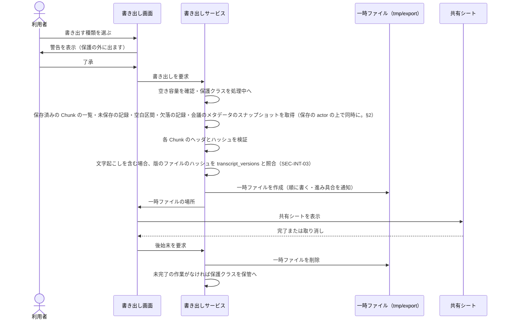

# MinutesMobile 基本設計書 ── 書き出し

| 項目 | 内容 |
| --- | --- |
| 版 | 1.0（初版） |
| 作成日 | 2026-11-15（技術情報の確認日 2026-11-14） |
| 満たす要件 ID | FR-EXP-01〜04、SEC-DAT-06、SEC-INP-02、SEC-INT-01・03 |
| 解決する未解決事項 | OQ-07 |
| 参照元 | Minutes P1 §3.4・§3.9・§4.5、Minutes `src/export/zip.ts` |
| 関連文書 | [architecture.md](architecture.md)・[storage.md](storage.md)・[ui.md](ui.md) |

書き出しは、会議のデータを**ファイルとして**アプリの保護の外へ出す唯一の経路である（[architecture.md](architecture.md) §2.1）。文字列のコピー（クリップボード）は別の経路で、本書の対象外とする（端末内限定と有効期限を付けて渡す。SEC-PLT-01、[ui.md](ui.md) §7.3）。録音はバックアップに含まれないので、利用者が録音を残す手段も書き出しだけである。

---

## 1. 設計決定

満たす要件: FR-EXP-01・03、SEC-DAT-05・06、SEC-INT-01、SEC-INP-02 ／ 解決: OQ-07

| ID | 決定 | 理由 | 退けた代替案 |
| --- | --- | --- | --- |
| BD-EXP-01 | 複数ファイルのアーカイブは、無圧縮（stored）の ZIP を自作する（Minutes `src/export/zip.ts` の移植）。CRC-32 は OS 同梱の zlib を使う（OQ-07） | サードパーティーを入れずに済む（UD-05）。WAV はほとんど圧縮できない。中身と順序を自分で決められ、出力をバイト単位で試験できる | §4.2 の表 |
| BD-EXP-02 | アーカイブは一時ファイルへ順に書き出す。全体をメモリに載せない | 120 分の会議は約 220 MiB ある | メモリ上で組み立てる（Minutes はブラウザの Blob で組み立てている） |
| BD-EXP-03 | 一時ファイルは保存ルートの `tmp/export/{meetingId}/{exportId}/` に作り、共有の完了・取り消しで削除する。残った場合は次の起動で削除する。会議 ID をディレクトリ名に含め、会議の削除では `tmp/export/{meetingId}/` を丸ごと消す | 保護の外に複製を残さない（SEC-DAT-06）。保存ルートの下なのでバックアップ除外と保護クラスが付く。会議との対応をパスで決めるので、DB の記録に頼らず削除の対象を特定できる（SEC-DAT-05） | OS の一時ディレクトリ（管理から外れる） |
| BD-EXP-04 | 書き出しのたびに「書き出したファイルは本アプリの保護の外に出ます」を表示する。表示を省く設定は作らない | FR-EXP-03 | 初回だけ表示する |
| BD-EXP-05 | 書き出す前に各 Chunk の SHA-256 を検証する。合わないものがあれば利用者に知らせ、目録に印を付ける。黙って除外も修復もしない。目録を持たない連結した録音（単独の WAV）に合わない Chunk を含める場合は、WAV の中の注記のチャンクと外側のファイル名の印で不一致を示す（§2） | SEC-INT-01。単独の WAV だけを受け取った側も不一致を確かめられるようにする | 検証せずに書き出す。連結した録音では不一致を示さない（受け取った側が改変を知る手段がない） |
| BD-EXP-06 | アーカイブの中の名前は固定の規則（連番など）だけで作る。会議タイトルを使うのは外側のファイル名だけで、純粋関数で無害化する | 展開先でのパス操作を防ぐ（SEC-INP-02、T-09） | 中の名前にもタイトルを使う |
| BD-EXP-07 | 書き出しの前に空き容量を確認する（アーカイブは元とほぼ同じ大きさ）。足りなければ作成を始めずに理由を表示する。ただし、緊急書き出し（§7）のメモリ上のデータを共有シートへ直接渡す経路には適用しない（一時ファイルを作らないので容量を使わず、容量が足りないときこそ使う経路のため） | 途中で書けなくなるのを避ける。録音中の空き容量を圧迫しない | 確認せずに始める |
| BD-EXP-08 | 書き出し中は会議を処理中の保護クラスにする（保管中なら一時的に戻す） | 転送の途中でロックされても読める（[storage.md](storage.md) §7.1） | 保管中のまま読む |

---

## 2. 書き出しの種類

満たす要件: FR-EXP-01・02・04

| 種類 | 中身 | 形式 | 対象の状態 |
| --- | --- | --- | --- |
| 録音一式 | 保存済みの全 Chunk の WAV と目録。メモリ上にしかない未保存の Chunk は含めない（下の注） | ZIP（§4） | 録音中以外のすべて（確定待ちも含む。救い出しのため） |
| 連結した録音 | 保存済みの全 Chunk を順につないだ 1 つの WAV。未保存の Chunk は含めない | WAV（16 kHz・16 bit・モノラル）。大きさに上限がある（下の注） | 同上 |
| 文字起こし（テキスト） | 時刻つきの本文 | `.txt`（UTF-8） | 文字起こしの版があるとき |
| 文字起こし（Markdown） | 見出しと時刻つきの本文 | `.md`（UTF-8） | 同上 |
| 緊急書き出し | メモリ上にしかない未保存の Chunk | WAV または ZIP（§7） | メモリ上に未保存の Chunk を保持している間（録音中・停止直後・確定待ちのいずれでも。状態で制限しない） |

- **保存済みの Chunk と未保存の記録は、書き出しの開始時の 1 つの観測（スナップショット）で決める。** 書き出しサービスは、§3 の検証の前に、保存の actor の上で 1 回の問い合わせとして、保存済みの Chunk の一覧（連番・開始サンプル・サンプル数・記録したハッシュ）と、メモリ上の未保存 Chunk と永続化した未保存の記録（連番・開始サンプル・サンプル数）を同時に取得する。**同じ観測で、再生位置の式（下）と目録（§4.1）・文字起こしの書き出し（§8）・ファイル名（§5）に使う値もすべて取得する:** 空白区間の一覧（位置・開始時刻・終了時刻・長さ・理由。長さが不明なものを含む）、欠落の記録（`lossRecord`・隔離した連番・長さが不明な欠落）、会議のメタデータ（タイトル・開始日時・確定方式・入力経路の履歴・会議の状態）。**この取得は、中断点（`await`）を含まない actor の 1 つのメソッドの中で行い、保存済みの Chunk の一覧と未保存の記録は、DB を読まずに、保存の actor がメモリ上に持つ現在の状態（[storage.md](storage.md) §5.1）から取る。** DB とファイルへの書き込みの I/O は actor の応答を止めずに行うので、DB の内容は actor の状態より遅れうる（登録や未保存の記録の削除を状態に反映した後、DB の書き込みがまだ終わっていない）。DB を読むと、その登録が抜けた古い内容を返しうるので使わない。actor の状態に反映済みの登録・追加・削除は、DB の書き込みが終わっていなくてもスナップショットに含める。 actor は `await` で中断すると、その間に同じ actor の別の処理（保存の再試行の成功）を実行しうるので、actor の上で取るだけでは割り込みを防げない。保存の再試行の成功は Chunk の登録と未保存の記録の削除を 1 つの取引で行い、メモリ上の保持の解放もその actor の上で行うので（[storage.md](storage.md) §5.1・§6）、中断点のない 1 つのメソッドの中で actor の状態から取れば（空白区間・欠落の記録・会議のメタデータも、同じメソッドの中で同じ時点の値を読む。actor の状態に持たない値は、同じメソッドの中の 1 つの読み取りの取引で読む）、ある Chunk が保存済みと未保存のどちらにも現れないスナップショットや、保存の再試行の成功の前と後の状態を混ぜて同じ Chunk を保存済みと未保存の両方に数えるスナップショットはできない。**ただし、一部だけ救済した連番（[storage.md](storage.md) §8 の未保存の記録の照合の②。救済した WAV が元の範囲より短い）は、正しい状態として同じ連番で両方に現れる。** 救済済みの WAV は保存済みの Chunk の一覧に、元の範囲と救済済みの範囲を持つ未保存の記録は未保存の記録に入り、スナップショットは両方をそのまま持つ（どちらかで他方を消さない）。ZIP には救済済みの WAV を 1 回だけ入れる。目録（§4.1）には、その連番を保存済みの Chunk（救済済みの範囲）と、含めていない未保存の記録（元の範囲と、残りの欠落 = 元の範囲 − 救済済みの範囲）の両方として記録し、欠落の一覧には残りの欠落だけを入れる。連結した録音では、救済済みの WAV を 1 回だけ入れ、残りの欠落だけを無音で補う（下の欠落区間の規則）。救済済みのサンプルを欠落にも数えず、残りの欠落を救済済みの範囲と重ねない。ZIP・連結した録音・目録（§4.1）・連結した録音の再生位置・文字起こしの書き出しの空白区間と欠落区間の行・外側のファイル名は、このスナップショットだけから作る。書き出しの途中でタイトルの変更・空白区間の記録の更新（割り込みの記録の置き換えなど）があっても、その書き出しには反映しない（同じ書き出しの中で、目録と再生位置が別の時点の空白区間を使わない）。書き出しの途中で保存の再試行が成功しても（[storage.md](storage.md) §6 の段階 3）、その書き出しの中身と目録は変えない。その Chunk はスナップショットのとおり「含めていない（未保存）」として目録に記録され、連結した録音では無音で補われる（ZIP にも目録にも現れない Chunk を作らない）。再試行で保存された分を含めるには、書き出しをやり直す。スナップショットの後に会議ディレクトリに現れたファイルは、スナップショットにない限り書き出さない。
- **録音一式と連結した録音の対象は、保存済みの Chunk（会議ディレクトリの正式名の WAV）だけとする。** 確定待ちの会議でメモリ上に保持している未保存の Chunk（[storage.md](storage.md) §6 の段階 3・物理的な限界）は、§3 の検証（ファイルのヘッダとハッシュ）の対象にならないので含めず、緊急書き出し（§7）で出す。未保存の Chunk がある会議で録音一式・連結した録音を作るときは、作成の前に未保存の件数と「この分は含まれないので緊急書き出しで保存してください」を表示し、緊急書き出しへの操作を出す。目録（§4.1）には未保存の Chunk の連番・開始サンプル・サンプル数を「含めていない（未保存）」として記録する。連結した録音では、その区間を下の規則の無音で補う（理由は未保存）。
- **欠落区間と空白区間を区別して書き出す。** 欠落区間（FR-FIN-02 ③。録音した後で音声を失った区間）は音声時刻の中にあり、下の規則で無音を補う。空白区間（FR-INT-01。割り込みなどで録音していなかった時間帯）は音声時刻に含まれず、無音を補わない。目録（§4.1）と文字起こしの書き出し（§8）では、両者を別の区分（欠落区間 / 空白区間）として記録し、同じ一覧に混ぜない。ハッシュが合わない Chunk は音声が残っているので欠落区間に含めない（BD-EXP-05）。
- **欠落区間は、その区間のサンプル数ぶんの無音で補う。** 対象は欠番・ファイル欠損・ヘッダが不正な Chunk・復旧時に隔離した Chunk・未保存の Chunk、および同じ連番の Chunk が一部だけ救済された場合の残りの欠落である。連結した録音では、各保存済み WAV の位置をその開始サンプル（DB の記録）で決め、**保存済み WAV で覆われない区間だけ**を無音にする。**ここでいう保存済み WAV は、ヘッダの検証（[storage.md](storage.md) §4）に通る正式名の WAV に限る**（ハッシュが合わない WAV は含める。ハッシュの記録がない WAV は、下の「検証できない Chunk」の規則で利用者が含めることを選んだ場合だけ含める）。正式名の WAV でもヘッダが不正なものは覆う範囲に数えず、その Chunk の範囲（DB の記録の開始サンプル・サンプル数）を欠落区間として無音で補う（下の重なりの検査でも、ヘッダが不正な WAV は保存済み WAV として扱わないので、それだけで作成を止めない）。欠落の元の区間は、DB の Chunk の記録、未保存の記録の元の範囲（[storage.md](storage.md) §8 の照合）と `lossRecord`、欠番の場合は前後の Chunk の終了・開始のサンプル番号から特定する。一部だけ救済した連番では、元の範囲から救済済みの WAV の範囲を除いた部分のすべて（救済済みの範囲の前に残る欠落と後に残る欠落のどちらも。両方に残れば 2 つの区間）を、それぞれの位置と長さで無音にする。救済済みのサンプルは 1 回だけ出力し、無音と重ねない（同じ範囲を WAV と無音の両方で出力しない）。保存済み WAV の範囲どうし、または WAV と欠落の範囲が重なる場合は記録の不整合として作成を止め、理由を表示する。欠落した区間は音声時刻（[architecture.md](architecture.md) §6）の中にあるので、無音で補えば、連結した録音の位置と音声時刻が一致し、下の再生位置の式がそのまま成り立つ。ハッシュが合わない Chunk は、BD-EXP-05 のとおり中身をそのまま入れる。補った区間（連番・位置・長さ・理由）は目録（§4.1）に入れる。連結した録音は目録を持たないので、単独の WAV を受け取った側も補った箇所を識別できるよう、補った区間を WAV の中の注記（下の `LIST` チャンクの `ICMT`）にも、連番・開始サンプル・サンプル数・理由（`missing` / `file_missing` / `invalid_header` / `quarantined` / `unsaved` / `unverified`）の固定の書式で入れる（例: `MinutesMobile loss: seq=000005 start=2400000 samples=480000 reason=missing`）。
- **長さが不明な欠落は、無音で補わない。** 復旧時に隔離した Chunk の記録は連番だけで、元の範囲（開始サンプル・サンプル数）を持たない（[storage.md](storage.md) §8 の書きかけの救済）。後に保存済みの Chunk がある場合は、上の規則のとおり前後の Chunk の終了・開始のサンプル番号から区間が決まる。**欠ける連番が続く場合**（隔離した Chunk・欠番が 2 つ以上続く場合。両者が混ざる場合を含む）に前後の保存済みの Chunk から決まるのは、続いた連番の全体の区間（前の Chunk の終了から後の Chunk の開始まで）だけで、各連番の開始サンプル・サンプル数は決まらない。①各連番の位置と長さを推定しない（既定の長さ 480,000 サンプルで割り振らない。割り込みの境界の短い Chunk がありうるため）。②連結した録音には全体の区間の長さの無音を 1 つ補う。③目録（§4.1）の欠落の一覧と `ICMT` には、全体を 1 項目として、連番の範囲・全体の開始サンプル・全体のサンプル数・連番ごとの理由を入れ、各連番の位置と長さが「不明」であることを示す（`ICMT` の例: `MinutesMobile loss: seq=000005-000007 start=2400000 samples=1440000 reason=quarantined,missing,quarantined per-chunk=unknown`。理由は連番の順に `,` で並べる。連番が 1 つの場合は従来の書式のまま）。④文字起こしの書き出し（§8）も全体を 1 つの欠落区間として、全体の長さで書く。後に保存済みの Chunk がない末尾の欠落でも、それが未保存の Chunk で、未保存の記録（[storage.md](storage.md) §8 の照合）に開始サンプルとサンプル数が残っている場合は、その範囲を欠落区間（理由 `unsaved`）として使い、連結した録音ではそのサンプル数の無音を補う（長さが不明な欠落として扱わない。前後の Chunk から決める必要がないため）。未保存の記録から開始サンプルとサンプル数を特定できない場合は、長さを推定せず、次の長さが不明な欠落の扱い（連結した録音の作成を止め、録音一式を案内する）に従う。それ以外で後に保存済みの Chunk がない場合（末尾の Chunk の隔離など）は区間の終わりを記録から決められないので、長さを「不明」とする。このとき、①推定値（Chunk の既定の長さ・ファイルの大きさなど）で長さを決めて無音を補わない。②目録（§4.1）の欠落の一覧に、その連番・分かる範囲の開始サンプル・長さ「不明」・理由（隔離）を入れる。③連結した録音は作成を止め、「長さが分からない欠落があるため、連結した録音を作れません。録音一式で書き出してください」を表示する（無音の長さを決められず、補わずに短くすると欠落を隠すため）。録音一式（ZIP）は作成でき、保存済みの Chunk をそのまま入れる。新しい永続の記録（隔離した Chunk の範囲など）は足さない。割り込みの開始の途中で終了した会議で、復旧時に記録した長さが不明な欠落（理由 `interruption_drain`。[storage.md](storage.md) §8）も同じ扱いにする。
- **連結した録音の大きさの上限。** WAV（RIFF）は大きさを 4 バイト（符号なし 32 bit）の欄で持つ。RIFF の欄の値（ファイル全体 − 8 バイト ＝ 36 + `data` のバイト数 + 注記（ハッシュの不一致・補った欠落区間）の `LIST` チャンクのバイト数（ある場合。チャンクの見出しを含む））が 4,294,967,295 以下になる範囲だけを作る。16 bit・モノラルでは `data` が 2 バイトの倍数なので、`LIST` チャンクがない場合の総サンプル数の上限は 2,147,483,629（約 37 時間 16 分）である。`LIST` チャンクがある場合は、その大きさの分だけ上限が下がる（判定は `LIST` チャンクの大きさを含めて行う）。総サンプル数は、保存済みの Chunk のバイト数ではなく、**欠落区間と未保存の Chunk の区間を無音で補った後の**総サンプル数で、作成を始める前に判定する。上限を超える場合は作成を始めずに理由（「連結した録音は 1 つの WAV の大きさの上限を超えるため作れません」）を表示する。複数の WAV への分割は行わない（分割すると再生位置の式が 1 ファイルで成り立たなくなるため）。録音一式（ZIP）が §4.3 の上限の範囲で作れる場合は、録音一式での書き出しを案内する（ZIP の上限は欠落の無音を含まない合計で決まり、WAV の上限とは別に判定する）。この上限は書き出しの規則で、録音の長さを制限しない（録音を止める規則は設けない）。
- **検証できない Chunk（ヘッダの検証に通るが、ハッシュの記録がない・読めない WAV）。** [storage.md](storage.md) §3.1・§4 では、照合できないものとして `invalid` になる（記録を再計算で作らない）。書き出しでも、このような WAV の音声を黙って含めない。§3 の検証で件数を示し、含めるかを利用者が選ぶ。①含めない場合（既定）は、その Chunk の範囲（DB の記録の開始サンプル・サンプル数）を欠落区間（理由 `unverified`）として扱い、連結した録音では無音で補う。録音一式の ZIP にも入れない。②含める場合は、ハッシュが合わない Chunk と同じく中身をそのまま入れ、受け取った側にも分かる印を付ける。目録（§4.1）では検証の結果を「検証できない（ハッシュの記録なし）」とする。連結した録音では、下の `LIST` チャンクの `ICMT` に固定の書式で入れ（例: `MinutesMobile unverified: seq=000004 start=1920000 samples=480000`）、外側のファイル名（§5）の拡張子の前に `_unverified` を付ける。ハッシュの不一致の項目・欠落の項目と同じ 1 つの `ICMT` に `;`（直後に空白 1 つ）で区切って並べる。どちらを選んでも、検証できない音声を印なしに書き出さない。
- **ハッシュが合わない Chunk を含む連結した録音（BD-EXP-05）。** 連結した録音には目録が付かないので、合わない Chunk を含めて作る場合は、WAV の中と外の両方で不一致を示す。①`data` チャンクの**後ろ**に `LIST` チャンク（形式 `INFO`）を 1 つ置き、その `ICMT`（注記）に、固定の書式の ASCII だけで不一致の内容を入れる（例: `MinutesMobile hash-mismatch: seq=000003 start=1440000 samples=480000; seq=000007 start=3360000 samples=480000`。連番・開始サンプル・サンプル数。会議タイトルなどのメタデータは入れない）。`data` の前には置かない（`data` の開始位置を 44 バイト目のまま保ち、下の再生位置の式と、`LIST` を読まない再生ソフトでの位置を変えないため）。RIFF の大きさの欄は `LIST` チャンクを含めた値にする。②外側のファイル名（§5）の拡張子の前に `_hash-mismatch` を付ける（中を読まない利用者にも分かるようにする）。③合わない Chunk がない場合は名前の印を付けない。合わない Chunk も、含めた検証できない Chunk も、補った欠落区間もない場合は `LIST` チャンクも付けない（通常の書き出しのバイト列を変えない）。不一致と欠落の両方がある場合は、同じ 1 つの `ICMT` に、不一致の項目と欠落の項目を `;`（直後に空白 1 つ）で区切って並べる。注記はファイル名と同じく受け取った側で書き換えられうるので、改変の検出の保証ではなく、不一致を知らせる手段として扱う（録音一式の目録と Chunk ごとのハッシュも、同じく改変の検出を保証しない。§4.1）。
- 連結した録音には空白区間ぶんの無音を入れない（長い中断で巨大になるため）。そのため、空白区間より後では会議時刻と WAV の再生位置がずれる。再生位置は、会議時刻 t（ms）から、各空白区間について「開始からの、t と終了の早い方までの長さ」（0 未満なら 0）を差し引いて求める: `再生位置（サンプル） = (t − Σ max(0, min(t, 空白区間の終了時刻) − 空白区間の開始時刻)) × 16`（会議時刻と空白区間の時刻・長さはミリ秒。[architecture.md](architecture.md) §6。16 を掛けて 16 kHz のサンプル数に換算する）。この 1 本の式で、空白区間より前の会議時刻は何も差し引かず、空白区間の中の会議時刻はその空白区間の開始位置に、再開した時刻（空白区間の終了と同じ会議時刻）以降は空白区間の長さ全体を差し引いた位置に対応する（再開した直後の音声の位置が空白区間の長さだけ後ろにずれない）。例: 会議時刻 60 秒から 660 秒まで（600,000 ms）の空白区間があり、660 秒で再開した場合、会議時刻 660 秒の再生位置は (660,000 − 600,000) × 16 = 960,000 サンプル（60 秒）で、空白区間の中の会議時刻 300 秒も空白区間の開始位置の 60 秒に対応する。単独の WAV を使う利用者も対応を確かめられるよう、空白区間の位置と長さを目録（§4.1）に入れ、文字起こしの書き出し（§8）の空白区間と欠落区間の行に連結した録音での位置を併記する。
- 文字起こしの書き出しには、失敗区間・空白区間・欠落区間を、それぞれ区別できる文で明示する（欠落を黙って渡さない。空白区間を欠落と、欠落区間を中断と書かない）。
- P2 では手動ノートの Markdown（FR-NOT-05）と AI 議事録を足す。

---

## 3. 手順

満たす要件: FR-EXP-01〜03、SEC-DAT-06



- 検証で合わない Chunk があった場合は、作成の前に件数を表示し、続けるか利用者が選ぶ。**この選択の対象は、ヘッダの検証（[storage.md](storage.md) §4）に通り、ハッシュだけが合わない Chunk に限る。** 続ける場合はそのまま含め、目録に印を付ける。連結した録音では、注記の `LIST` チャンクとファイル名の印を付ける（BD-EXP-05、§2）。ヘッダが不正な Chunk はこの選択の対象にせず、続けても中身を音声として含めない。**ハッシュの記録がない・読めない Chunk（検証できない Chunk。§2）は、ハッシュが合わない Chunk とは別の件数として示し、含めるかを別に選ばせる**（既定は含めない）。含めない場合は §2 のとおり欠落区間（理由 `unverified`）とし、含める場合は目録・注記・ファイル名の印（§2・§5）を付ける。利用者が選ばないまま作成を始めない（黙って含めない・黙って除かない）。§2 のとおり欠落区間（理由 `invalid_header`）として扱い、連結した録音ではその Chunk の範囲を無音で補う（ハッシュの不一致の印・注記の対象にしない）。
- 文字起こしの版のファイルがハッシュの記録と合わない場合は、その版を書き出さない（含めて続ける選択肢も出さない）。破損していることと再文字起こしの操作を示す。録音だけの書き出しは続けられる（[transcription.md](transcription.md) §6.2、SEC-INT-03）。
- 書き出しの途中で失敗・中止した場合も、一時ファイルを削除する。削除した後、完了・取り消しの場合と同じく、その会議に未完了の作業がなければ保護クラスを保管へ戻す（[storage.md](storage.md) §7.1 の保管の条件。ロック中なら保留し、解除を検知してから行う）。
- 共有シートの完了が届かなかった場合（アプリが終了したなど）は、次の起動の復旧で `tmp/export/` を丸ごと削除する（[storage.md](storage.md) §8 の手順 8）。書き出しのために処理中の保護クラスに戻した会議は、そのままでは保管に戻らないので、同じ復旧の手順 9 で、未完了の作業がなければ保管（`complete`）に戻す（ロック中の起動なら保留し、解除を検知してから行う）。

---

## 4. アーカイブ

満たす要件: FR-EXP-01 ／ 解決: OQ-07

### 4.1 中身

```text
{外側のファイル名}.zip
  mic/000000.wav
  mic/000001.wav
  ...
  manifest.json            # 目録（最後のエントリ）
```

エントリの順序は、Chunk の WAV（連番の順）を先にすべて書き、目録（`manifest.json`）を**最後に**書く。目録が持つ書き出したバイト列の SHA-256 は、各 WAV を ZIP に書きながら計算した値なので、すべての WAV を書き終えてから目録を作れば、WAV を読み直さずに済む（目録を先に書くと、その値を求めるために WAV を書く前に一度読むか、書いた後に読み直す必要がある）。

目録（`manifest.json`）は、§2 の書き出しの開始時のスナップショット（保存済みの Chunk の一覧と未保存の記録を、保存の actor の上で同時に取得したもの）だけから作り、ZIP に入れる Chunk と同じ一覧を使う（書き出しの途中で保存の再試行が成功した Chunk は、スナップショットのとおり「含めていない（未保存）」とする）。目録には、会議のタイトル・開始日時・総サンプル数（長さが不明な欠落がある場合は既知の分だけで、そのことを示す）・確定方式と欠落の記録（長さが不明な欠落は長さを「不明」とする。§2）、Chunk ごとの連番・開始サンプル・サンプル数・記録した SHA-256（保存時のハッシュの記録の値）・検証の結果・**書き出したバイト列の SHA-256**（ZIP に入れた WAV のバイト列から、書き込みながら計算した値。ZIP に書いたのと同じ 1 回の読み取りから計算し、読み直さない）、含めていない未保存の Chunk（連番・開始サンプル・サンプル数。§2）、空白区間、入力経路の履歴、アプリと形式の版を入れる。受け取った側が、欠落の有無と、転送・保管の途中での意図しない破損（ビット化け・途中で切れたファイルなど）を自分で確かめられるようにする。**転送の途中の破損は、受け取った WAV のバイト列を書き出したバイト列の SHA-256 と比べて確かめる。** 記録した SHA-256 と合わない Chunk を利用者が含めることを選んだ場合（§3）は、記録した SHA-256 との照合は書き出す前から合わないので転送の破損の判定に使えないが、書き出したバイト列の SHA-256 とは、転送で壊れていなければ一致する。合う Chunk では、2 つの値は同じになる。**目録のハッシュは改変の検出を保証しない。** 目録は同じ ZIP の中にあり、ZIP を書き換えられる者は音声と目録のハッシュを一緒に書き換えられるので、同じ ZIP の中のハッシュとの照合が一致しても、改変されていないことの証明にはならない（想定する脅威の範囲は SEC-INT-01 と同じ）。改変の検出に使えるのは、照合に使うハッシュを ZIP とは別の信頼できる経路で受け取った場合に限る（MVP はその経路を提供しない）。署名などの認証付きの完全性検証は MVP では行わない（行う場合は SEC-INT-01 の再評価と合わせて要件に加える）。

### 4.2 方式の比較

| 方式 | 追加の依存 | 中身の制御 | 試験のしやすさ | 判定 |
| --- | --- | --- | --- | --- |
| 無圧縮 ZIP を自作 | なし | できる（名前・順序・日時を決められる） | 出力をバイト単位で検証できる | **採用** |
| OS のファイル連携機能でディレクトリを ZIP にする | なし | できない（ディレクトリを丸ごと。隔離や書きかけを除くには複製が要る） | 形式の細部が文書化されていない | 不採用 |
| 連結した WAV だけにする | なし | — | — | 併用（Chunk ごとのハッシュを渡せないので単独では不十分） |
| サードパーティーの ZIP ライブラリ | あり | できる | — | 不採用（UD-05、BD-ARC-07） |

### 4.3 形式の決まり

| 項目 | 設計 |
| --- | --- |
| 圧縮 | なし（stored）。暗号化・コメントなし |
| 名前 | ASCII の固定の規則だけ（`manifest.json`・`mic/{連番 6 桁}.wav`）。UTF-8 の印を立てる |
| 日時 | 全エントリを会議の開始日時に固定する（同じ入力から同じバイト列になる） |
| 書き方 | エントリごとに、ヘッダ → データを順に書き、CRC-32 は読みながら計算する。WAV のエントリを連番の順にすべて書き（書き出したバイト列の SHA-256 も同じ 1 回の読み取りで計算する）、その後に計算した SHA-256 を入れた目録のエントリを書き、最後に中央ディレクトリを書く（§4.1） |
| 上限 | ZIP64 は実装しない。合計が 4 GiB 以上（約 37 時間分）・エントリが 65,535 件以上になる場合は、作成せずに理由を表示する |

---

## 5. ファイル名

満たす要件: SEC-INP-02

外側のファイル名は `{タイトル}_{開始日時 yyyyMMdd-HHmm}.{拡張子}` とし（ハッシュが合わない Chunk を含む連結した録音は `{タイトル}_{開始日時 yyyyMMdd-HHmm}_hash-mismatch.wav`、検証できない Chunk を含めた連結した録音は `…_unverified.wav`、両方を含む場合は `…_hash-mismatch_unverified.wav`。§2）、タイトルは次の純粋関数で無害化する。

| 順 | 処理 |
| --- | --- |
| 1 | Unicode を正規化する |
| 2 | パス区切り（`/`・`\`・`:`）、制御文字、改行を取り除く。Windows でファイル名に使えない記号（`?`・`*`・`"`・`<`・`>`・`\|`）も取り除く |
| 3 | 先頭のドットと、前後の空白・ドットを取り除く |
| 4 | OS が予約する名前（`CON`・`NUL` など。受け取った側が Windows の場合に備える）を避ける |
| 5 | 長さを制限する（初期値: UTF-8 で 80 バイト。文字の途中で切らない） |
| 6 | 空になったら既定名（`会議`）にする |

`../` を含むタイトルでも、できるのは 1 つのファイル名だけで、ディレクトリをまたがない（TST-SEC-06）。

---

## 6. 一時ファイルの寿命

満たす要件: SEC-DAT-06

| 時点 | 動作 |
| --- | --- |
| 作成 | `tmp/export/{meetingId}/{exportId}/` を保存ルートの管理の下に作る（バックアップ除外・処理中の保護クラス）。`{meetingId}` は書き出す会議の ID（UUID の形式を検証する）、`{exportId}` は書き出しごとに注入した UUID 生成器で作る。緊急書き出し（§7）も同じ規則に従う |
| 共有の完了・取り消し | そのディレクトリを削除する |
| 書き出しの失敗・中止 | 同上 |
| 次の起動 | `tmp/export/` の下をすべて削除する |
| 会議の削除 | 削除を始めた時点から、書き出し中かどうかにかかわらず、その会議の新しい書き出しの要求を拒否する。書き出し中なら続けて中止し、中止の完了を待つ。そのうえで `tmp/export/{meetingId}/` を丸ごと削除する（[storage.md](storage.md) §9 の手順 2） |

共有先に渡ったファイルは、アプリからは消せない。警告（BD-EXP-04）で利用者に伝える。

---

## 7. 緊急書き出し

満たす要件: FR-EXP-04

書き込みに失敗してメモリ上に保持している Chunk（[storage.md](storage.md) §6 の段階 3）を、利用者の操作で外へ出す。

- 対象はメモリ上の PCM で、確定時と同じ手順でヘッダを付けて WAV にする。連番と開始サンプルは保持したものを使う。
- **書き出し中の PCM の保護:** 利用者が緊急書き出しを選んだ時点で、対象の Chunk のメモリ上の PCM への参照を書き出しの側で確保し、書き出しの完了（成功・失敗・取り消し）まで、その PCM の解放を保留する（複製は作らない。保持の上限に近い状態でメモリの使用量を倍にしないため）。書き出し中に保存の再試行（[storage.md](storage.md) §6）が成功しても、解放の保留は書き出し中の Chunk の PCM に作用せず、書き出しは選んだ時点の PCM を最後まで読む。保存の成功は、未保存の件数と未保存の記録には通常どおり反映する（Barrier の判定は変わらない）。解放を保留している PCM は、書き出しの完了まで保持の上限の計算（[storage.md](storage.md) §6 の物理的な限界）に含める。
- 1 件なら WAV、複数ならアーカイブにする。ディスクに一時ファイルを作れない場合に備え、メモリ上のデータを共有シートへ直接渡す経路を用意する。
- **直接渡す経路では、空き容量の確認（BD-EXP-07）による拒否を行わない。** 緊急書き出しは書き込みが失敗している（容量が枯渇しているなど）ときに使うので、容量の不足で拒否すると唯一の救い出しの手段が使えなくなる。一時ファイルを作る経路で容量が足りない場合は、拒否する代わりに直接渡す経路を案内する。通常の書き出し（録音一式・連結した録音・文字起こし）の容量不足の拒否は変えない。
- 書き出しに成功しても、メモリ上の保持は解放しない（保存先への書き込みが成功するまで保持する）。書き出した分であることは記録する。
- 録音中でも実行できる。録音を止めない。

---

## 8. 文字起こしの形式

満たす要件: FR-EXP-02

```text
{会議タイトル}
開始: 2026-11-14 10:00 ／ 長さ: 58:12 ／ エンジン: SpeechTranscriber（ja-JP）／ 版: 2

[00:00:12] 仕様について確認します。
[00:05:30] （録音が中断していました。約 2 分。連結した録音では 00:05:30 の位置）
[00:07:41] （この区間は文字起こしに失敗しました）
[00:12:00] （この区間の録音は失われました。約 30 秒。連結した録音では 00:10:00 の位置から無音）
[00:58:12] （録音が中断していました。中断の長さは不明。連結した録音では 00:56:12 の位置）
```

- 時刻は会議時刻（空白区間を含む。[architecture.md](architecture.md) §6）。
- Markdown は、タイトルを見出し、上の情報を箇条書きにし、本文は同じ行の形にする。本文中の記号はそのまま出し、マークアップとして解釈されうる文字はエスケープする。
- 例外確定した会議は、冒頭に欠落の概要を入れる。
- 長さが不明な欠落（§2）は「（この区間の録音は失われました。長さは不明）」とし、長さと連結した録音での位置を書かない（連結した録音は作らないため）。
- 長さが「不明」として記録された空白区間（割り込み中に終了した会議。[storage.md](storage.md) §8）は「（録音が中断していました。中断の長さは不明）」とし、推定値や「約 N 分」を書かない。この空白区間は録音の末尾にあり後に音声がないので、連結した録音での位置（末尾）は書ける。冒頭の「長さ」は既知の分だけとし、「末尾の中断の長さは不明」を添える（[storage.md](storage.md) §8）。

---

## 9. 断定しない事項

満たす要件: FR-EXP-01・04、SEC-DAT-06

| 事項 | 断定しない理由 | 担保の方法 |
| --- | --- | --- |
| 自作の ZIP がどの環境でも展開できる | 展開する側の実装による | macOS・Windows・iOS の標準機能で展開する試験を行う（結合・手動） |
| 共有シートの完了が必ず届く | アプリが終了すると届かない | 次の起動での削除（§6） |
| 大きなファイルを共有先が受け取れる | 共有先のアプリによる | 連結した録音とアーカイブの両方を用意する |
| 2 GiB を超える連結した録音をどの再生ソフトでも開ける | 大きさの欄を符号付きとして読む実装がある | 上限（§2）は仕様の 4 GiB で決める。2 GiB を超える場合の再生は保証しない |
| メモリ上のデータを共有シートへ直接渡せる | 共有先によってはファイルを要求する | 実機で確認する。渡せない共有先がある場合は画面に示す |

---

## 10. セキュリティ

満たす要件: SEC-DAT-06、SEC-NET-01、SEC-INT-01、SEC-INP-02、FR-EXP-03

| 観点 | 設計 | 要件・脅威 |
| --- | --- | --- |
| 明示操作 | 書き出しは利用者の操作からだけ。自動の書き出し・同期は作らない | SEC-DAT-06、SEC-NET-01 |
| 警告 | 毎回表示する（BD-EXP-04） | FR-EXP-03 |
| 一時ファイル | 保存ルートの下。完了・取り消し・次の起動で削除（§6） | SEC-DAT-06、T-12 |
| 完全性 | 書き出し前に検証し、結果を目録に入れる（BD-EXP-05） | SEC-INT-01、T-07 |
| ファイル名 | 無害化の純粋関数。中の名前は固定の規則（§5） | SEC-INP-02、T-09 |
| 目録の中身 | 会議のメタデータを含む（D3）。書き出しは利用者の意思なので含めるが、機器の名前などアプリが記録していない情報は入らない | [recording.md](recording.md) BD-REC-07 |

**設計・実装時の注意点:**

- 書き出しの入口を 1 つにする。共有シートを別の場所から直接呼ばない（警告と後始末を必ず通す）。
- 隔離したファイル・書きかけのファイル・SQLite のファイルを書き出しの対象に含めない。
- 書き出しの記録（いつ・どの種類を）をログに残す場合、タイトルとファイル名を入れない。
- P2 で AI の生の応答を保存する場合、書き出しの対象から外す（Minutes P2 §8.7 の方針）。

---

## 11. テスト観点

満たす要件: FR-EXP-01〜04、TST-SAV-04、TST-SEC-05・06

| 試験 | 方法 |
| --- | --- |
| ZIP の形式 | 既知の入力から作ったバイト列を期待値と比べる（日時を固定しているので一致する）。CRC-32 を既知の値で検証する。上限（4 GiB・65,535 件）で作成を拒否すること |
| ZIP の展開 | 作ったアーカイブを OS の標準機能で展開し、各ファイルのハッシュが元と一致し、目録の書き出したバイト列の SHA-256 と一致すること。記録した SHA-256 と合わない Chunk を含めて書き出した場合も、展開した WAV が書き出したバイト列の SHA-256 と一致し、記録した SHA-256 とは一致しないこと。展開した WAV を 1 バイト変えると、書き出したバイト列の SHA-256 と一致しなくなること |
| 連結した録音 | Chunk の合計サンプル数と一致し、`AVAudioFile` で開けること。欠番・ファイル欠損・不正なヘッダの Chunk を含む会議で、その区間が同じサンプル数の無音で補われ、後続のセグメントの再生位置が §2 の式と一致すること。補った区間が目録に入り、WAV の `LIST`（`INFO`）チャンクの `ICMT` にも連番・開始サンプル・サンプル数・理由が固定の書式で入ること（`data` は 44 バイト目から始まり、外側のファイル名に `_hash-mismatch` が付かないこと）。正式名の WAV でヘッダが不正な Chunk があっても、重なりの検査で作成が止まらず、その範囲が無音で補われること。同じ連番の Chunk が一部だけ救済された会議（未保存の記録の元の範囲より短い WAV）で、救済済みのサンプルがそのまま 1 回だけ入り、その前と後に残る欠落（救済済みの範囲が元の開始より後から始まる場合の先頭の欠落を含む）だけが無音で補われ、後続の Chunk の位置がずれないこと |
| 連結した録音の上限 | 書き込み先を差し替え、無音で補った後の総サンプル数がちょうど 2,147,483,629 なら作成を始め、RIFF の欄が 4,294,967,294（上限以下）になること。1 サンプル多いと作成を始めずに理由が表示されること。注記（不一致・補った欠落区間）の `LIST` チャンクがある場合は、その大きさを含めて判定し、`LIST` を含めると上限を超える総サンプル数で拒否されること。保存済みの Chunk の合計は上限以下でも、欠落の無音を補うと上限を超える会議で拒否されること。録音一式が §4.3 の上限内なら、その案内が出ること |
| TST-SEC-06（ファイル名） | `../`・`/`・制御文字・Windows で使えない記号（`?`・`*`・`"`・`<`・`>`・`\|`）・先頭のドット・予約名・非常に長いタイトル・絵文字・空文字を渡す |
| 一時ファイル | 完了・取り消し・失敗・途中での終了のそれぞれで、`tmp/export/` に何も残らないこと。書き出しの一時ファイルを残した状態で会議を削除し、`tmp/export/{meetingId}/` が残らず、他の会議の一時ファイルが消えないこと（TST-SEC-05） |
| 完全性 | Chunk を 1 バイト変えてから書き出し、警告が出て目録に印が付くこと。同じ会議から連結した録音を作ると、`data` の後ろの `LIST`（`INFO`）チャンクの `ICMT` に、その連番・開始サンプル・サンプル数が固定の書式で入り（タイトルが入らない）、`data` が 44 バイト目から始まり、RIFF の大きさの欄が `LIST` を含めたファイル全体 − 8 と一致し、`AVAudioFile` で開けて長さが変わらず、外側のファイル名に `_hash-mismatch` が付くこと。不一致も補った欠落区間もない会議では `LIST` チャンクが付かず、不一致がない会議には名前の印が付かないこと（欠落区間だけを補った会議には `LIST` が付き、名前の印は付かない） |
| 連続した欠落 | 途中の 3 つの連番を隔離・欠番にした会議（前後に保存済みの Chunk がある。割り込みの境界の短い Chunk を含む）で書き出す。連結した録音に全体の区間の長さの無音が 1 つだけ入り、後続の Chunk の位置がずれないこと。目録と `ICMT` に連番の範囲・全体の範囲・連番ごとの理由が 1 項目で入り、各連番の位置と長さが「不明」とされること（480,000 サンプルで割り振った値が入らないこと） |
| 検証できない Chunk | ヘッダは正しいがハッシュの記録がない WAV を含む会議で書き出す。作成の前に、ハッシュの不一致とは別の件数で示され、選ばないと作成が始まらないこと。含めない場合は ZIP に入らず、連結した録音でその範囲が無音（理由 `unverified`）で補われること。含める場合は目録に「検証できない」、連結した録音の `ICMT` に `MinutesMobile unverified:` の項目が入り、外側のファイル名に `_unverified` が付くこと |
| 一部だけ救済した連番のスナップショット | 未保存の記録の元の範囲より短い WAV を救済した会議で書き出す。スナップショットの保存済みの一覧と未保存の記録の両方に同じ連番が残り、ZIP に救済済みの WAV が 1 回だけ入り、目録の欠落の一覧に残りの欠落だけが入ること。重なりの検査で作成が止まらないこと |
| 再生位置の式 | 会議時刻 60〜660 秒の空白区間がある会議で、会議時刻 660 秒（再開した時刻）の再生位置が 60 秒（960,000 サンプル）、空白区間の中の 300 秒も 60 秒、空白区間より前の 30 秒は 30 秒になること |
| 長さが不明な欠落 | 末尾の Chunk を隔離した（記録は連番だけの）会議で書き出す。連結した録音は作成されずに理由が表示され、推定の長さの無音が入らないこと。録音一式は作成でき、目録の欠落の一覧にその連番と長さ「不明」が入ること。文字起こしの書き出しが長さを書かないこと。途中の Chunk を隔離した会議では、前後の Chunk から決まる区間が無音で補われること。末尾の Chunk が未保存で、未保存の記録に開始サンプルとサンプル数がある会議では、連結した録音が作成され、末尾にそのサンプル数の無音が理由 `unsaved` で補われること。未保存の記録から範囲を特定できない場合は、連結した録音が作成されずに録音一式が案内されること |
| 未保存の Chunk がある会議 | 確定待ちでメモリに未保存の Chunk を保持した会議から録音一式・連結した録音を作る。作成の前に未保存の件数と緊急書き出しの案内が出ること、ZIP に未保存の Chunk が入らず目録に「含めていない（未保存）」として連番と範囲が入ること、連結した録音ではその区間が同じサンプル数の無音で補われること |
| 書き出し中の保存の再試行 | 未保存の Chunk がある会議で録音一式の書き出しを始め、スナップショットの取得の後・ZIP の完成の前に、その Chunk の保存の再試行を成功させる（保存を差し替えて順序を決める）。その Chunk が ZIP に入らず、目録に「含めていない（未保存）」として入ること（ZIP にも目録にもない Chunk がないこと）。連結した録音では同じ区間が無音で補われること。書き出しをやり直すと、その Chunk が保存済みとして入ること |
| スナップショットの原子性 | スナップショットの取得の直前に同じ Chunk の保存の再試行を actor に依頼しておき、取得を中断点のない 1 つのメソッドとして実行する。その Chunk が保存済みと未保存のちょうど一方に現れ（どちらにもない・両方にある状態にならない）、目録と ZIP がそれに従うこと。保存の再試行の成功を actor の状態に反映した後、DB の書き込みの完了を差し替えで止めた状態でスナップショットを取り、その Chunk が保存済みとして現れ、未保存の記録に残らないこと（DB の遅れた内容を読まないこと）。スナップショットの取得の後・書き出しの完成の前に、タイトルを変え、空白区間の記録を更新する（保存を差し替えて順序を決める）。目録・再生位置・文字起こしの書き出しの行・外側のファイル名が、すべてスナップショットの時点の値で作られること |
| 確定待ちの緊急書き出し | 確定待ち（`stop_requested`）でメモリに未保存の Chunk を保持した会議で、緊急書き出しの操作が出て実行できること |
| TST-SAV-04（緊急書き出し） | 書き込みを失敗させてメモリに保持させ、書き出したファイルが再生できること。保持が解放されないこと。緊急書き出しの途中で保存の再試行を成功させても、書き出し中の Chunk の PCM が解放されず、書き出したファイルが選んだ時点の PCM と一致し、書き出しの完了後に解放されること。空き容量を 0 に差し替えても、直接渡す経路が拒否されずに使えること（通常の書き出しは拒否されること） |
| 警告（FR-EXP-03） | UI テスト: 警告を了承しないと共有シートが出ないこと |
| 文字起こしの形式 | 空白区間・失敗区間・例外確定を含む版から、期待どおりの文ができること |
| 容量 | 空き容量が足りないとき、作成を始めずに理由を表示すること |

**設計・実装時の注意点:**

- 書き出しの試験でも、テストごとの一時ディレクトリを保存ルートとして使う。
- 大きな入力の試験は、実際に数百 MB を書かずに済むよう、書き込み先を差し替えて上限の判定だけを検証する。
- 共有シートそのものは自動テストの対象にしにくい。入口（警告）と後始末（削除）を単体・UI テストで押さえ、共有先への受け渡しは実機で確認する。

---

## 12. 詳細設計への申し送り

満たす要件: —（詳細設計への引き継ぎ事項。満たす要件はない）

- ZIP の各ヘッダのバイト配置（Minutes `src/export/zip.ts` を基準にする）。
- 目録の項目と形式の版。
- 書き出しの開始時のスナップショット（保存済みの Chunk の一覧と未保存の記録を、保存の actor の中断点を含まない 1 つのメソッドの中で、DB を読まずに actor のメモリ上の状態から取得する問い合わせ）の型と、書き出しの途中の保存の再試行の成功がスナップショットを変えないことの保証の方法（§2・§4.1）。
- 共有シートを包む部品と、完了の受け取り方。
- メモリ上のデータを直接渡す経路の実装。
- 連結した録音の注記（不一致・補った欠落区間）の `LIST`（`INFO`）チャンクのバイト配置（`ICMT` の終端の NUL と、偶数長にするための詰め物を含む。詰め物の 1 バイトで総サンプル数の上限が変わるため、上限の判定と同じ計算にする）。

---

## 13. 出典

満たす要件: —（出典の一覧。満たす要件はない）

- Minutes `src/export/zip.ts`（無圧縮 ZIP の実装）、`docs/design-local-phase1.md` §3.4・§4.5
- iOS 27.2 SDK の `zlib.h`（CRC-32）（確認日 2026-11-14）。SDK はローカルのファイルで、版数（27.2）は `xcodebuild -showsdks` で確かめた（[dev-environment.md](dev-environment.md) §2）
