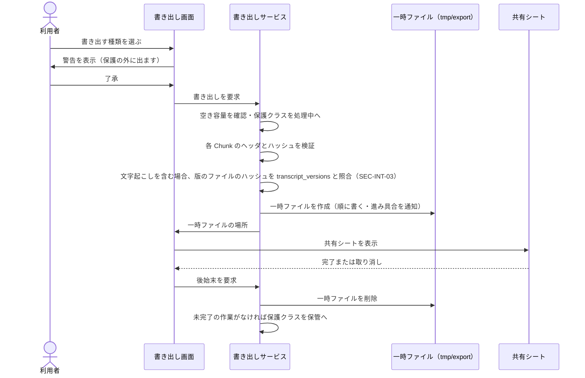

# MinutesMobile 基本設計書 ── 書き出し

| 項目 | 内容 |
| --- | --- |
| 版 | 1.0（初版） |
| 作成日 | 2026-11-15（技術情報の確認日 2026-11-14） |
| 満たす要件 ID | FR-EXP-01〜04、SEC-DAT-06、SEC-INP-02、SEC-INT-01・03 |
| 解決する未解決事項 | OQ-07 |
| 参照元 | Minutes P1 §3.4・§3.9・§4.5、Minutes `src/export/zip.ts` |
| 関連文書 | [architecture.md](architecture.md)・[storage.md](storage.md)・[ui.md](ui.md) |

書き出しは、データがアプリの保護の外へ出る唯一の経路である（[architecture.md](architecture.md) §2.1）。録音はバックアップに含まれないので、利用者が録音を残す手段も書き出しだけである。

---

## 1. 設計決定

満たす要件: FR-EXP-01・03、SEC-DAT-05・06、SEC-INT-01、SEC-INP-02 ／ 解決: OQ-07

| ID | 決定 | 理由 | 退けた代替案 |
| --- | --- | --- | --- |
| BD-EXP-01 | 複数ファイルのアーカイブは、無圧縮（stored）の ZIP を自作する（Minutes `src/export/zip.ts` の移植）。CRC-32 は OS 同梱の zlib を使う（OQ-07） | サードパーティーを入れずに済む（UD-05）。WAV はほとんど圧縮できない。中身と順序を自分で決められ、出力をバイト単位で試験できる | §4.2 の表 |
| BD-EXP-02 | アーカイブは一時ファイルへ順に書き出す。全体をメモリに載せない | 120 分の会議は約 220 MiB ある | メモリ上で組み立てる（Minutes はブラウザの Blob で組み立てている） |
| BD-EXP-03 | 一時ファイルは保存ルートの `tmp/export/{meetingId}/{exportId}/` に作り、共有の完了・取り消しで削除する。残った場合は次の起動で削除する。会議 ID をディレクトリ名に含め、会議の削除では `tmp/export/{meetingId}/` を丸ごと消す | 保護の外に複製を残さない（SEC-DAT-06）。保存ルートの下なのでバックアップ除外と保護クラスが付く。会議との対応をパスで決めるので、DB の記録に頼らず削除の対象を特定できる（SEC-DAT-05） | OS の一時ディレクトリ（管理から外れる） |
| BD-EXP-04 | 書き出しのたびに「書き出したファイルは本アプリの保護の外に出ます」を表示する。表示を省く設定は作らない | FR-EXP-03 | 初回だけ表示する |
| BD-EXP-05 | 書き出す前に各 Chunk の SHA-256 を検証する。合わないものがあれば利用者に知らせ、目録に印を付ける。黙って除外も修復もしない | SEC-INT-01 | 検証せずに書き出す |
| BD-EXP-06 | アーカイブの中の名前は固定の規則（連番など）だけで作る。会議タイトルを使うのは外側のファイル名だけで、純粋関数で無害化する | 展開先でのパス操作を防ぐ（SEC-INP-02、T-09） | 中の名前にもタイトルを使う |
| BD-EXP-07 | 書き出しの前に空き容量を確認する（アーカイブは元とほぼ同じ大きさ） | 途中で書けなくなるのを避ける。録音中の空き容量を圧迫しない | 確認せずに始める |
| BD-EXP-08 | 書き出し中は会議を処理中の保護クラスにする（保管中なら一時的に戻す） | 転送の途中でロックされても読める（[storage.md](storage.md) §7.1） | 保管中のまま読む |

---

## 2. 書き出しの種類

満たす要件: FR-EXP-01・02・04

| 種類 | 中身 | 形式 | 対象の状態 |
| --- | --- | --- | --- |
| 録音一式 | 保存済みの全 Chunk の WAV と目録。メモリ上にしかない未保存の Chunk は含めない（下の注） | ZIP（§4） | 録音中以外のすべて（確定待ちも含む。救い出しのため） |
| 連結した録音 | 保存済みの全 Chunk を順につないだ 1 つの WAV。未保存の Chunk は含めない | WAV（16 kHz・16 bit・モノラル） | 同上 |
| 文字起こし（テキスト） | 時刻つきの本文 | `.txt`（UTF-8） | 文字起こしの版があるとき |
| 文字起こし（Markdown） | 見出しと時刻つきの本文 | `.md`（UTF-8） | 同上 |
| 緊急書き出し | メモリ上にしかない未保存の Chunk | WAV または ZIP（§7） | 録音中・停止直後で、未保存があるとき |

- **録音一式と連結した録音の対象は、保存済みの Chunk（会議ディレクトリの正式名の WAV）だけとする。** 確定待ちの会議でメモリ上に保持している未保存の Chunk（[storage.md](storage.md) §6 の段階 3・物理的な限界）は、§3 の検証（ファイルのヘッダとハッシュ）の対象にならないので含めず、緊急書き出し（§7）で出す。未保存の Chunk がある会議で録音一式・連結した録音を作るときは、作成の前に未保存の件数と「この分は含まれないので緊急書き出しで保存してください」を表示し、緊急書き出しへの操作を出す。目録（§4.1）には未保存の Chunk の連番・開始サンプル・サンプル数を「含めていない（未保存）」として記録する。連結した録音では、その区間を下の規則の無音で補う（理由は未保存）。
- **欠落した区間は、その区間のサンプル数ぶんの無音で補う。** 対象は欠番・ファイル欠損・ヘッダが不正な Chunk・復旧時に隔離した Chunk・未保存の Chunk、および同じ連番の Chunk が一部だけ救済された場合の残りの欠落である。連結した録音では、各保存済み WAV の位置をその開始サンプル（DB の記録）で決め、**保存済み WAV で覆われない区間だけ**を無音にする。欠落の元の区間は、DB の Chunk の記録、未保存の記録の元の範囲（[storage.md](storage.md) §8 の照合）と `lossRecord`、欠番の場合は前後の Chunk の終了・開始のサンプル番号から特定する。一部だけ救済した連番では、元の範囲から救済済みの WAV の範囲を除いた部分（救済済みの範囲の後に残る欠落）だけを、その位置と長さで無音にする。救済済みのサンプルは 1 回だけ出力し、無音と重ねない（同じ範囲を WAV と無音の両方で出力しない）。保存済み WAV の範囲どうし、または WAV と欠落の範囲が重なる場合は記録の不整合として作成を止め、理由を表示する。欠落した区間は音声時刻（[architecture.md](architecture.md) §6）の中にあるので、無音で補えば、連結した録音の位置と音声時刻が一致し、下の再生位置の式がそのまま成り立つ。ハッシュが合わない Chunk は、BD-EXP-05 のとおり中身をそのまま入れる。補った区間（連番・位置・長さ・理由）は目録（§4.1）に入れる。
- **長さが不明な欠落は、無音で補わない。** 復旧時に隔離した Chunk の記録は連番だけで、元の範囲（開始サンプル・サンプル数）を持たない（[storage.md](storage.md) §8 の書きかけの救済）。後に保存済みの Chunk がある場合は、上の規則のとおり前後の Chunk の終了・開始のサンプル番号から区間が決まる。後に保存済みの Chunk がない場合（末尾の Chunk の隔離など）は区間の終わりを記録から決められないので、長さを「不明」とする。このとき、①推定値（Chunk の既定の長さ・ファイルの大きさなど）で長さを決めて無音を補わない。②目録（§4.1）の欠落の一覧に、その連番・分かる範囲の開始サンプル・長さ「不明」・理由（隔離）を入れる。③連結した録音は作成を止め、「長さが分からない欠落があるため、連結した録音を作れません。録音一式で書き出してください」を表示する（無音の長さを決められず、補わずに短くすると欠落を隠すため）。録音一式（ZIP）は作成でき、保存済みの Chunk をそのまま入れる。新しい永続の記録（隔離した Chunk の範囲など）は足さない。
- 連結した録音には空白区間ぶんの無音を入れない（長い中断で巨大になるため）。そのため、空白区間より後では会議時刻と WAV の再生位置がずれる。再生位置は `再生位置（サンプル） = 会議時刻（サンプル） − その時刻より前に終わった空白区間の長さの合計` で求める（空白区間の中の会議時刻は、その空白区間の開始位置に対応する）。単独の WAV を使う利用者も対応を確かめられるよう、空白区間の位置と長さを目録（§4.1）に入れ、文字起こしの書き出し（§8）の空白区間と欠落した Chunk の区間の行に連結した録音での位置を併記する。
- 文字起こしの書き出しには、失敗区間・空白区間・欠落した Chunk の区間を文で明示する（欠落を黙って渡さない）。
- P2 では手動ノートの Markdown（FR-NOT-05）と AI 議事録を足す。

---

## 3. 手順

満たす要件: FR-EXP-01〜03、SEC-DAT-06



- 検証で合わない Chunk があった場合は、作成の前に件数を表示し、続けるか利用者が選ぶ。続ける場合はそのまま含め、目録に印を付ける（BD-EXP-05）。
- 文字起こしの版のファイルがハッシュの記録と合わない場合は、その版を書き出さない（含めて続ける選択肢も出さない）。破損していることと再文字起こしの操作を示す。録音だけの書き出しは続けられる（[transcription.md](transcription.md) §6.2、SEC-INT-03）。
- 書き出しの途中で失敗・中止した場合も、一時ファイルを削除する。
- 共有シートの完了が届かなかった場合（アプリが終了したなど）は、次の起動の復旧で `tmp/export/` を丸ごと削除する（[storage.md](storage.md) §8）。

---

## 4. アーカイブ

満たす要件: FR-EXP-01 ／ 解決: OQ-07

### 4.1 中身

```text
{外側のファイル名}.zip
  manifest.json            # 目録
  mic/000000.wav
  mic/000001.wav
  ...
```

目録（`manifest.json`）には、会議のタイトル・開始日時・総サンプル数（長さが不明な欠落がある場合は既知の分だけで、そのことを示す）・確定方式と欠落の記録（長さが不明な欠落は長さを「不明」とする。§2）、Chunk ごとの連番・開始サンプル・サンプル数・SHA-256・検証の結果、含めていない未保存の Chunk（連番・開始サンプル・サンプル数。§2）、空白区間、入力経路の履歴、アプリと形式の版を入れる。受け取った側が、欠落と改変の有無を自分で確かめられるようにする。

### 4.2 方式の比較

| 方式 | 追加の依存 | 中身の制御 | 試験のしやすさ | 判定 |
| --- | --- | --- | --- | --- |
| 無圧縮 ZIP を自作 | なし | できる（名前・順序・日時を決められる） | 出力をバイト単位で検証できる | **採用** |
| OS のファイル連携機能でディレクトリを ZIP にする | なし | できない（ディレクトリを丸ごと。隔離や書きかけを除くには複製が要る） | 形式の細部が文書化されていない | 不採用 |
| 連結した WAV だけにする | なし | — | — | 併用（Chunk ごとのハッシュを渡せないので単独では不十分） |
| サードパーティーの ZIP ライブラリ | あり | できる | — | 不採用（UD-05、BD-ARC-07） |

### 4.3 形式の決まり

| 項目 | 設計 |
| --- | --- |
| 圧縮 | なし（stored）。暗号化・コメントなし |
| 名前 | ASCII の固定の規則だけ（`manifest.json`・`mic/{連番 6 桁}.wav`）。UTF-8 の印を立てる |
| 日時 | 全エントリを会議の開始日時に固定する（同じ入力から同じバイト列になる） |
| 書き方 | エントリごとに、ヘッダ → データを順に書き、CRC-32 は読みながら計算する。最後に中央ディレクトリを書く |
| 上限 | ZIP64 は実装しない。合計が 4 GiB 以上（約 37 時間分）・エントリが 65,535 件以上になる場合は、作成せずに理由を表示する |

---

## 5. ファイル名

満たす要件: SEC-INP-02

外側のファイル名は `{タイトル}_{開始日時 yyyyMMdd-HHmm}.{拡張子}` とし、タイトルは次の純粋関数で無害化する。

| 順 | 処理 |
| --- | --- |
| 1 | Unicode を正規化する |
| 2 | パス区切り（`/`・`\`・`:`）、制御文字、改行を取り除く。Windows でファイル名に使えない記号（`?`・`*`・`"`・`<`・`>`・`\|`）も取り除く |
| 3 | 先頭のドットと、前後の空白・ドットを取り除く |
| 4 | OS が予約する名前（`CON`・`NUL` など。受け取った側が Windows の場合に備える）を避ける |
| 5 | 長さを制限する（初期値: UTF-8 で 80 バイト。文字の途中で切らない） |
| 6 | 空になったら既定名（`会議`）にする |

`../` を含むタイトルでも、できるのは 1 つのファイル名だけで、ディレクトリをまたがない（TST-SEC-06）。

---

## 6. 一時ファイルの寿命

満たす要件: SEC-DAT-06

| 時点 | 動作 |
| --- | --- |
| 作成 | `tmp/export/{meetingId}/{exportId}/` を保存ルートの管理の下に作る（バックアップ除外・処理中の保護クラス）。`{meetingId}` は書き出す会議の ID（UUID の形式を検証する）、`{exportId}` は書き出しごとに注入した UUID 生成器で作る。緊急書き出し（§7）も同じ規則に従う |
| 共有の完了・取り消し | そのディレクトリを削除する |
| 書き出しの失敗・中止 | 同上 |
| 次の起動 | `tmp/export/` の下をすべて削除する |
| 会議の削除 | 削除を始めた時点から、書き出し中かどうかにかかわらず、その会議の新しい書き出しの要求を拒否する。書き出し中なら続けて中止し、中止の完了を待つ。そのうえで `tmp/export/{meetingId}/` を丸ごと削除する（[storage.md](storage.md) §9 の手順 2） |

共有先に渡ったファイルは、アプリからは消せない。警告（BD-EXP-04）で利用者に伝える。

---

## 7. 緊急書き出し

満たす要件: FR-EXP-04

書き込みに失敗してメモリ上に保持している Chunk（[storage.md](storage.md) §6 の段階 3）を、利用者の操作で外へ出す。

- 対象はメモリ上の PCM で、確定時と同じ手順でヘッダを付けて WAV にする。連番と開始サンプルは保持したものを使う。
- 1 件なら WAV、複数ならアーカイブにする。ディスクに一時ファイルを作れない場合に備え、メモリ上のデータを共有シートへ直接渡す経路を用意する。
- 書き出しに成功しても、メモリ上の保持は解放しない（保存先への書き込みが成功するまで保持する）。書き出した分であることは記録する。
- 録音中でも実行できる。録音を止めない。

---

## 8. 文字起こしの形式

満たす要件: FR-EXP-02

```text
{会議タイトル}
開始: 2026-11-14 10:00 ／ 長さ: 58:12 ／ エンジン: SpeechTranscriber（ja-JP）／ 版: 2

[00:00:12] 仕様について確認します。
[00:05:30] （録音が中断していました。約 2 分。連結した録音では 00:05:30 の位置）
[00:07:41] （この区間は文字起こしに失敗しました）
[00:12:00] （この区間の録音は失われました。約 30 秒。連結した録音では 00:10:00 の位置から無音）
```

- 時刻は会議時刻（空白区間を含む。[architecture.md](architecture.md) §6）。
- Markdown は、タイトルを見出し、上の情報を箇条書きにし、本文は同じ行の形にする。本文中の記号はそのまま出し、マークアップとして解釈されうる文字はエスケープする。
- 例外確定した会議は、冒頭に欠落の概要を入れる。
- 長さが不明な欠落（§2）は「（この区間の録音は失われました。長さは不明）」とし、長さと連結した録音での位置を書かない（連結した録音は作らないため）。

---

## 9. 断定しない事項

満たす要件: FR-EXP-01・04、SEC-DAT-06

| 事項 | 断定しない理由 | 担保の方法 |
| --- | --- | --- |
| 自作の ZIP がどの環境でも展開できる | 展開する側の実装による | macOS・Windows・iOS の標準機能で展開する試験を行う（結合・手動） |
| 共有シートの完了が必ず届く | アプリが終了すると届かない | 次の起動での削除（§6） |
| 大きなファイルを共有先が受け取れる | 共有先のアプリによる | 連結した録音とアーカイブの両方を用意する |
| メモリ上のデータを共有シートへ直接渡せる | 共有先によってはファイルを要求する | 実機で確認する。渡せない共有先がある場合は画面に示す |

---

## 10. セキュリティ

満たす要件: SEC-DAT-06、SEC-NET-01、SEC-INT-01、SEC-INP-02、FR-EXP-03

| 観点 | 設計 | 要件・脅威 |
| --- | --- | --- |
| 明示操作 | 書き出しは利用者の操作からだけ。自動の書き出し・同期は作らない | SEC-DAT-06、SEC-NET-01 |
| 警告 | 毎回表示する（BD-EXP-04） | FR-EXP-03 |
| 一時ファイル | 保存ルートの下。完了・取り消し・次の起動で削除（§6） | SEC-DAT-06、T-12 |
| 完全性 | 書き出し前に検証し、結果を目録に入れる（BD-EXP-05） | SEC-INT-01、T-07 |
| ファイル名 | 無害化の純粋関数。中の名前は固定の規則（§5） | SEC-INP-02、T-09 |
| 目録の中身 | 会議のメタデータを含む（D3）。書き出しは利用者の意思なので含めるが、機器の名前などアプリが記録していない情報は入らない | [recording.md](recording.md) BD-REC-07 |

**設計・実装時の注意点:**

- 書き出しの入口を 1 つにする。共有シートを別の場所から直接呼ばない（警告と後始末を必ず通す）。
- 隔離したファイル・書きかけのファイル・SQLite のファイルを書き出しの対象に含めない。
- 書き出しの記録（いつ・どの種類を）をログに残す場合、タイトルとファイル名を入れない。
- P2 で AI の生の応答を保存する場合、書き出しの対象から外す（Minutes P2 §8.7 の方針）。

---

## 11. テスト観点

満たす要件: FR-EXP-01〜04、TST-SAV-04、TST-SEC-05・06

| 試験 | 方法 |
| --- | --- |
| ZIP の形式 | 既知の入力から作ったバイト列を期待値と比べる（日時を固定しているので一致する）。CRC-32 を既知の値で検証する。上限（4 GiB・65,535 件）で作成を拒否すること |
| ZIP の展開 | 作ったアーカイブを OS の標準機能で展開し、各ファイルのハッシュが元と一致すること |
| 連結した録音 | Chunk の合計サンプル数と一致し、`AVAudioFile` で開けること。欠番・ファイル欠損・不正なヘッダの Chunk を含む会議で、その区間が同じサンプル数の無音で補われ、後続のセグメントの再生位置が §2 の式と一致すること。補った区間が目録に入ること。同じ連番の Chunk が一部だけ救済された会議（未保存の記録の元の範囲より短い WAV）で、救済済みのサンプルがそのまま 1 回だけ入り、その後に残る欠落だけが無音で補われ、後続の Chunk の位置がずれないこと |
| TST-SEC-06（ファイル名） | `../`・`/`・制御文字・Windows で使えない記号（`?`・`*`・`"`・`<`・`>`・`\|`）・先頭のドット・予約名・非常に長いタイトル・絵文字・空文字を渡す |
| 一時ファイル | 完了・取り消し・失敗・途中での終了のそれぞれで、`tmp/export/` に何も残らないこと。書き出しの一時ファイルを残した状態で会議を削除し、`tmp/export/{meetingId}/` が残らず、他の会議の一時ファイルが消えないこと（TST-SEC-05） |
| 完全性 | Chunk を 1 バイト変えてから書き出し、警告が出て目録に印が付くこと |
| 長さが不明な欠落 | 末尾の Chunk を隔離した（記録は連番だけの）会議で書き出す。連結した録音は作成されずに理由が表示され、推定の長さの無音が入らないこと。録音一式は作成でき、目録の欠落の一覧にその連番と長さ「不明」が入ること。文字起こしの書き出しが長さを書かないこと。途中の Chunk を隔離した会議では、前後の Chunk から決まる区間が無音で補われること |
| 未保存の Chunk がある会議 | 確定待ちでメモリに未保存の Chunk を保持した会議から録音一式・連結した録音を作る。作成の前に未保存の件数と緊急書き出しの案内が出ること、ZIP に未保存の Chunk が入らず目録に「含めていない（未保存）」として連番と範囲が入ること、連結した録音ではその区間が同じサンプル数の無音で補われること |
| TST-SAV-04（緊急書き出し） | 書き込みを失敗させてメモリに保持させ、書き出したファイルが再生できること。保持が解放されないこと |
| 警告（FR-EXP-03） | UI テスト: 警告を了承しないと共有シートが出ないこと |
| 文字起こしの形式 | 空白区間・失敗区間・例外確定を含む版から、期待どおりの文ができること |
| 容量 | 空き容量が足りないとき、作成を始めずに理由を表示すること |

**設計・実装時の注意点:**

- 書き出しの試験でも、テストごとの一時ディレクトリを保存ルートとして使う。
- 大きな入力の試験は、実際に数百 MB を書かずに済むよう、書き込み先を差し替えて上限の判定だけを検証する。
- 共有シートそのものは自動テストの対象にしにくい。入口（警告）と後始末（削除）を単体・UI テストで押さえ、共有先への受け渡しは実機で確認する。

---

## 12. 詳細設計への申し送り

満たす要件: —（詳細設計への引き継ぎ事項。満たす要件はない）

- ZIP の各ヘッダのバイト配置（Minutes `src/export/zip.ts` を基準にする）。
- 目録の項目と形式の版。
- 共有シートを包む部品と、完了の受け取り方。
- メモリ上のデータを直接渡す経路の実装。

---

## 13. 出典

満たす要件: —（出典の一覧。満たす要件はない）

- Minutes `src/export/zip.ts`（無圧縮 ZIP の実装）、`docs/design-local-phase1.md` §3.4・§4.5
- iOS 27.2 SDK の `zlib.h`（CRC-32）（確認日 2026-11-14）
