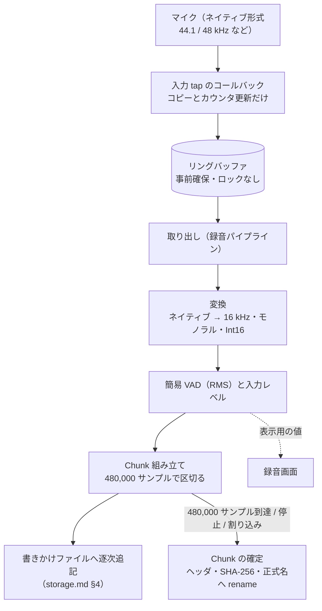
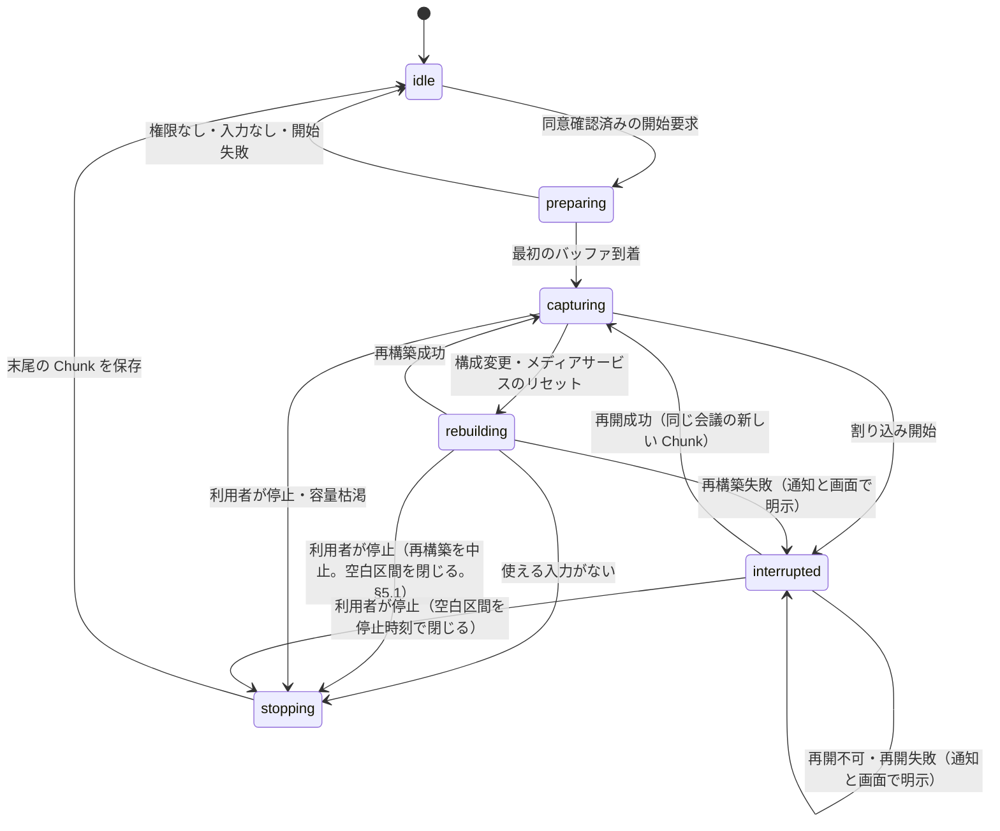

# MinutesMobile 基本設計書 ── 録音

| 項目 | 内容 |
| --- | --- |
| 版 | 1.0（初版） |
| 作成日 | 2026-11-15（技術情報の確認日 2026-11-14） |
| 満たす要件 ID | FR-CNS-02、FR-REC-01〜08、FR-INT-01〜06、NFR-REL-01・04、NFR-PRF-01・02、NFR-PWR-01、SEC-PRV-01・02、INV-01・07・08・09 |
| 解決する未解決事項 | OQ-01（UD-08 で決定） |
| 参照元 | Minutes P1 §3.2・§3.3・§5・§8・§14・§19 |
| 関連文書 | [architecture.md](architecture.md)・[storage.md](storage.md)・[ui.md](ui.md) |

本書は、マイクの音声を 16 kHz・16 bit・モノラルの Chunk にするまでと、割り込み・経路変更への対応を定める。Chunk をファイルへ書く手順は [storage.md](storage.md) §4 にある。

---

## 1. 設計決定

満たす要件: FR-REC-01・02・08、FR-INT-01〜03、NFR-PRF-01、NFR-MNT-03、SEC-PRV-02

| ID | 決定 | 理由 | 退けた代替案 |
| --- | --- | --- | --- |
| BD-REC-01 | 音声の取り込みは AVAudioEngine の入力 tap で行い、入力のネイティブ形式のまま受け取る | サンプル単位で扱えるので、Chunk の境界・連番・ハッシュを自分で決められる | AVAudioRecorder（サンプルに触れず、30 秒ちょうどで区切れない）。`CaptureInputSequenceProvider`（音声認識への入力専用） |
| BD-REC-02 | コールバックでは、事前に確保したリングバッファ（ロックなし・書き手 1・読み手 1）へコピーするだけにする。変換以降は録音パイプラインが取り出して行う | 音切れの防止（NFR-PRF-01）。tap のコールバックはメインスレッド以外で呼ばれる | コールバックの中で変換・保存する（メモリ確保とファイル I/O が入る） |
| BD-REC-03 | 16 kHz への変換は AVAudioConverter を最高品質の設定で使う。TST-AUD-02（折り返し成分 -40 dB 以下）を満たさなければ、Minutes の FIR（Blackman 窓の windowed-sinc）を移植する | OS 標準を優先する（NFR-MNT-03）。品質は断定せず試験で決める | 最初から自作する。単純な間引き（FR-REC-02 で禁止） |
| BD-REC-04 | 割り込み後は同じ会議の続きとして自動で再開する。割り込みの開始時に、それまでの音声を短い Chunk として確定し、中断中を空白区間として記録する | UD-08。会議が分断されない | 会議を分割する。自動再開しない |
| BD-REC-05 | 割り込みの開始時に「録音が中断している」ローカル通知を予約し、再開できたら取り消す | 中断中にアプリがサスペンドされると、その時点では通知を出せない。予約しておけば届く。Push は Personal Team で使えない | 再開に失敗した時点で通知を出す（サスペンド中は実行されない） |
| BD-REC-06 | オーディオセッションは category `record`・mode `default` とし、Bluetooth（HFP）の入力を許可する。システムの警告音による割り込みを避ける設定と、経路の切断で割り込ませない設定を有効にする | §3 | §3 の表 |
| BD-REC-07 | 入力経路は種別だけを記録し、機器の名前は記録しない | 機器の名前には所有者の名前が入りうる（例:「◯◯の AirPods」） | 名前も記録する |
| BD-REC-08 | 録音の開始 API は「同意確認の値」を引数に取り、その値は同意確認の手順でしか作れない型にする | 同意を通らずに録音を始めるコードが書けない（SEC-PRV-02、T-06） | 開始前にフラグを確認する（確認を忘れても動いてしまう） |

---

## 2. 録音パイプライン

満たす要件: FR-REC-01〜04、NFR-PRF-01

| 段 | 設計 |
| --- | --- |
| コールバック | バッファの長さは毎回読む（一定と仮定しない）。あふれたら書き込まずに、落とした位置（入力の累積フレーム番号）と落としたフレーム数を組で記録する。連続するあふれは 1 組にまとめる |
| リングバッファ | 容量の初期値はネイティブ形式で 5 秒分。あふれの組は、書き込めたフレームと同じ順序で取り出し側へ渡す（固定長の記録列を事前に確保する）。取り出し側は、組の位置までのサンプルを処理した時点で 16 kHz のサンプル番号に換算し、その位置に空白区間（理由 `overrun`）を開く。未処理の音声が残る間に複数回あふれても、各空白区間は保存済みの音声の間の正しい位置に入り、会議時刻（[architecture.md](architecture.md) §6）と空白の表示に反映される |
| 取り出し | 起こす合図の周期は初期値 100 ms。合図が遅れても、失われるのは容量を超えた分だけで、時刻は狂わない |
| 変換 | 入力形式ごとに変換器を 1 つ持つ。入力形式が変わったら、古い変換器に残ったサンプルを吐き出してから新しい変換器を作る。多チャンネルの入力はモノラルにまとめる |
| Chunk 組み立て | 純粋ロジック（Domain）。入力の区切り方によらず、末尾以外はちょうど 480,000 サンプル。確定の要求（停止・割り込み）が来たら、その時点までを短い Chunk にする。0 サンプルの Chunk は作らない |
| 保持 | 組み立て中の Chunk の PCM（最大 960,000 バイト）はメモリにも持つ。ハッシュ計算と、書き込み失敗時の保持（[storage.md](storage.md) §6）に使う。**取り出しと変換は、書きかけファイルへの追記（[storage.md](storage.md) §4）の完了を待たない。** 変換した PCM をこの保持に入れてから追記を依頼し、追記の遅れ・失敗で取り出しを止めない（止めるとリングバッファがあふれて音声を失う。NFR-PRF-01）。まだ追記していない PCM もこの保持にあるので、追記・確定が終わらない場合の扱い（未保存 Chunk としての保持。§5.1・[storage.md](storage.md) §6）はこの保持から行う |

---

## 3. オーディオセッションの設定

満たす要件: FR-REC-05、FR-INT-01・03

| 項目 | 設定 | 理由 | 見直す条件 |
| --- | --- | --- | --- |
| category | `record` | 録音専用であることが明確。録音中は再生しない | 他アプリの再生で頻繁に中断される場合は、`playAndRecord` と他アプリとの混在を検討する（出力経路への副作用を実機で確認してから） |
| mode | `default` | 遠くの話者も拾えるよう、OS の自動利得を使う | 音質の比較（`measurement`・`videoRecording`）を実機で行い、文字起こしの結果で決める |
| Bluetooth（HFP）入力 | 許可する | 要件が Bluetooth 入力を想定している（FR-INT-03、TST-DEV-04） | HFP は帯域が狭い。品質を記録し、問題があれば内蔵マイクの優先を検討する |
| システムの警告音による割り込み | 避ける設定を有効にする（`setPrefersNoInterruptionsFromSystemAlerts`） | 着信の呼び出し音だけで録音が止まるのを減らす。通話に出た場合は割り込まれる | — |
| 経路の切断による割り込み | 割り込ませない設定にする（`setPrefersInterruptionOnRouteDisconnect` を無効） | AirPods が外れても、次の入力で録音を続ける（FR-INT-03） | — |
| sample rate・バッファ長 | 指定しない（OS の値を実行時に読む） | 16 kHz や固定長を仮定しない | — |
| 有効化・無効化 | 録音の開始で有効化し、会議の確定可能な状態になったら無効化する | 録音していない間はマイクを開かない（SEC-PRV-02）。OS の録音インジケータが消える | — |

再生（文字起こしのセグメントから原音を聞く。FR-TRV-01）は録音中には行わず、別のセッション設定（`playback`）で行う（[ui.md](ui.md) §4.4）。

---

## 4. 録音の開始と停止

満たす要件: FR-CNS-02、FR-REC-05・07、FR-INT-06、NFR-PRF-02

開始の順序（途中で失敗したら、そこで止めて理由を表示する）:

1. 同意確認（[ui.md](ui.md) §4.2）。確認した時刻を「同意確認の値」に持たせる（BD-REC-08）。
2. 録音中の会議がないことを確認する（FR-REC-07）。
3. マイク権限を確認する。未決定なら要求し、拒否なら設定アプリへの導線を表示して終わる（FR-INT-06）。
4. 空き容量を確認する（[storage.md](storage.md) §6。段階 2 なら確認を挟む）。
5. 会議を作る（会議 ID の発番、ディレクトリ、`meeting.json`、DB の行。状態は `recording`、`consentConfirmedAt` を記録）。
6. 実行中の文字起こしがあれば中止し、処理中の Chunk の中止の完了を確かめてから、オーディオセッションを有効化し、入力を開始する（[transcription.md](transcription.md) §8）。
7. 最初のバッファが届いたら録音セッションを `capturing` にする。手順 1 の完了からここまでの時間を単調時計で測って記録する（NFR-PRF-02。目標 1 秒、保証値ではない）。

手順 6 でオーディオセッションを有効化した後に失敗した場合（入力の開始の失敗、最初のバッファが届かない、など。待つ時間の上限は詳細設計で決める）も、そこで止めて失敗の理由（分類）を表示する。そのうえで、入力を開始していれば止め、tap を外し、オーディオセッションを無効化する（録音していない間にマイクを開いたままにしない。SEC-PRV-02）。録音セッションは `idle` に戻す（§5 の `preparing --> idle`）。手順 6 で文字起こしを中止していた場合は、入力を止めてセッションを無効化した後に、文字起こしの開始条件を評価し直させる（中断したジョブを `pending` のまま残さない。[transcription.md](transcription.md) §8）。

手順 5 の後で開始に失敗し、音声が 1 サンプルもなければ、その会議は一覧に残さず削除する（件数だけ記録する）。

停止の順序: 入力を止める → リングバッファに残ったサンプル（あふれの記録を含む）をすべて取り出し終えるのを待つ → 変換器の残りを吐き出す → 末尾の Chunk を確定する → オーディオセッションを無効化する → 会議を `stop_requested` にして確定へ進む（[storage.md](storage.md) §5）。

**`capturing` からの通常の停止（利用者の停止・`no_input`・容量の枯渇）でも、末尾の Chunk の確定（`.part` への追記の完了・最終のヘッダの書き込み・同期・rename・登録。[storage.md](storage.md) §4）の待機に、§5.1 の割り込みの開始の行と同じ時間の上限を適用する。** 排出と変換は `.part` への追記を待たないので（§2）、上限までに受け付け済みのサンプルをすべて変換して §2 の保持に入れる。上限までに確定が完了しない場合は、§5.1 と同じく、完了していない追記と確定を書き込みの失敗として扱い、その Chunk の PCM（§2 の保持にある全体）をメモリ上の未保存 Chunk として保持して未保存の記録に残す（[storage.md](storage.md) §6 の段階 3・§5.1）。確定の完了を待たずにオーディオセッションを無効化し、会議を `stop_requested` にする（I/O の遅れでマイクを開いたままにしない。SEC-PRV-02）。会議は Barrier の不成立で確定待ちに残る。遅れて完了した確定の結果は §5.1 と同じく保存の actor が同じ連番の記録と照合し、二重に登録しない。

`interrupted` から停止する場合（割り込みの後、再開しないまま利用者が停止した場合）は、会議を `stop_requested` にする前に、開いている空白区間を停止時刻で閉じる。終了位置のサンプル番号は開始位置と同じ（中断中は音声がない）、終了時刻は停止を受け付けた時刻（壁時計。表示用）、長さは割り込みの開始から停止を受け付けるまでの単調時計の経過時間とし、「再開したか」は「いいえ」とする。停止理由は `manual`。**会議を `stop_requested` にするときに、予約済みの中断通知（BD-REC-05）を取り消す。** 再開の成功による取り消しだけに頼らない（再開しないまま停止すると、取り消す機会がなく、停止した後に「アプリを開くと再開を試みます」が届いてしまう）。取り消しは停止の経路によらず行う（`interrupted` からの停止、`rebuilding` 中の利用者の停止、`rebuilding` からの `no_input` での停止、容量の枯渇による停止を含む）。起動時の復旧で `recording` の会議を `stop_requested` にする場合（[storage.md](storage.md) §8 の手順 5）も、その会議の中断通知が未配信のまま残っていれば取り消す。

---

## 5. 録音セッションの状態遷移

満たす要件: FR-INT-01〜05、NFR-REL-05

プロセス内だけの状態で、純粋関数として実装する（[architecture.md](architecture.md) §5）。会議の状態は、この図のどこにいても `recording` のままである。

### 5.1 事象ごとの扱い

満たす要件: FR-INT-01〜05、FR-SAV-04、FR-RCV-01、NFR-REL-05

| 事象 | 扱い | 記録 |
| --- | --- | --- |
| 割り込みの開始（着信・Siri・アラーム・他アプリの音声など） | **最初に、割り込みの通知を受け取った時刻（事象時刻。単調時計と壁時計の両方）を記録する。** 空白区間の開始時刻と、長さを測る起点にはこの事象時刻を使い、排出・確定を終えた後の時刻を使わない（排出にかかった時間を空白に含めないため）。**事象時刻の記録の直後、排出・確定より前に中断通知を予約する（BD-REC-05）**（排出・確定の途中でサスペンドされても通知が届くようにするため）。続けて、§4 の停止の順序と同じく、リングバッファに残った受け付け済みのサンプル（あふれの記録を含む）をすべて取り出し終えるのを待つ。そのうえで変換器の残りを吐き出し、それまでの音声を短い Chunk として確定する（割り込みの境界より前の音声を落とさず、再開後の Chunk にも混ぜない）。空白区間を開く（開始時刻は事象時刻）。**この開始の処理（排出・短い Chunk の確定・空白区間の開設）の途中で利用者の停止要求が届いた場合は、開始の処理がすべて完了するまで停止を保留し、完了してから §4 の `interrupted` からの停止の順序で処理する**（開いた空白区間を停止時刻で閉じ、予約した中断通知を取り消し、停止理由は `manual`）。**開始の処理の途中で停止要求と割り込みの終了の通知の両方が届いた場合は、届いた順によらず、開始の処理の完了後に停止を先に処理する。停止要求を受け付けた後は、割り込みの終了の処理（下の行の①セッションの有効化・②入力の再開）を行わない**（録音をやめる利用者の操作の後にマイクを開かない。SEC-PRV-02）。停止の処理の後に届いた・保留していた終了の通知は記録するだけで捨て、空白区間と中断通知は §4 の停止の順序のとおり（空白区間は停止時刻で閉じ、中断通知は取り消す）にし、終了の通知で変えない。保留している間に新たな音声は受け付けない。排出する量はリングバッファの容量（5 秒分）で上限があるが、`.part` への追記と Chunk の確定（ファイルへの書き込み・同期）は I/O の遅れで長引きうるので、**開始の処理（短い Chunk の確定の待機を含む）には、停止要求の有無にかかわらず、リングバッファの容量とは別に時間の上限を設ける**（値は詳細設計で決める。§4 の開始の失敗の待機と同じ扱い）。停止要求の保留と、下の行の割り込みの終了の通知の保留も、この上限までで終わる（確定の I/O の遅れで、停止も再開も止まったままにしない）。上限までに開始の処理が完了しない場合は、①排出と変換（リングバッファからの取り出しと 16 kHz への変換。§2 のとおり `.part` への追記の完了を待たないので、ファイルの I/O で止まらない）は打ち切らずに完了させ、受け付け済みのサンプルを 1 つも捨てない（変換した PCM は §2 の保持に入る）。②完了していない `.part` への追記と Chunk の確定は書き込みの失敗と同じく扱い（追記の完了を待って停止・再開を阻まない）、その Chunk の PCM（§2 の保持にある、追記していない分を含む全体）をメモリ上の未保存 Chunk として保持し、未保存の記録に残す（[storage.md](storage.md) §6 の段階 3・§5.1）。③そのうえで空白区間を開き（開始時刻は事象時刻）、開始の処理を完了したものとして扱う。停止要求を受け付けていれば §4 の `interrupted` からの停止の順序へ進む。受け付けていなければ `interrupted` で待ち、保留中の割り込みの終了の通知があれば、下の行の①〜④（再開）へ進む（再開後の音声は次の連番の新しい Chunk に入り、保持した未保存 Chunk に混ざらない）。保持した未保存 Chunk は、録音を続ける間は [storage.md](storage.md) §6 の段階 3 の再試行の対象になり、停止した場合は容量の枯渇の行と同じく停止後もメモリに残し、会議は Barrier の不成立で確定待ちに残る（再試行・緊急書き出し・欠落を承知した確定ができる）。遅れて完了した確定の結果は保存の actor が同じ連番の記録と照合し、同じハッシュなら保持分を解放し、同じ取引で未保存の記録（`unsaved_chunks` と `meeting.json`）も消して、二重に登録しない（[storage.md](storage.md) §4 の冪等性・§5.1。記録を消すので、その Chunk は Barrier の不成立の理由に残らない）。開始の処理の途中で停止の処理を始めると、閉じる空白区間がまだ開いていない、または排出中の Chunk が二重に確定されるため | 空白区間（開始位置のサンプル番号・開始時刻（事象時刻）・理由） |
| 割り込みの終了（OS が再開を許可） | **割り込みの開始の処理（上の行の、排出・短い Chunk の確定・空白区間の開設）がすべて完了するまで、終了の処理を始めない。** 開始の処理の途中で終了の通知が届いた場合は保留し、開始の処理が完了してから行う（再開した入力のサンプルが排出前の旧いサンプルや確定前の Chunk に混ざらず、閉じる空白区間が必ず開いているようにするため）。**ただし、利用者の停止要求を受け付けていれば（保留中を含む）、下の①〜④を行わず、通知を記録して捨てる**（上の行のとおり停止を先に処理する）。そのうえで次の順に行う: ①セッションを有効化する → ②入力を再開する（取り出し側は、④が完了するまで再開後のサンプルを Chunk の組み立てに渡さずに保持する） → ③中断通知を取り消す → ④空白区間を閉じる（終了位置は再開後の最初のサンプル） → 保持したサンプルを Chunk の組み立てに渡す。**②以降のどこかで失敗した場合（入力の再開、中断通知の取り消し、空白区間の閉鎖のいずれの失敗も含む）は、入力を止めて tap を外し、セッションを無効化する**（再開した入力を開いたまま `interrupted` に戻らない。SEC-PRV-02）。保持した再開後のサンプルは Chunk に入れずに捨てる（空白区間が開いたままなので、会議時刻はずれない）。空白区間は開いたままにする。中断通知は取り消さない（③で取り消した後に④が失敗した場合は、同じ内容で予約し直して、取り消していない状態に戻す）。そのうえで下の「再開の許可なし・再開に失敗」の行に従う。①で失敗した場合は入力を開いていないので、セッションの無効化だけを行って同じ行に従う。連番は続きから | 空白区間の長さ |
| 割り込みの終了（再開の許可なし・再開に失敗） | `interrupted` のまま待つ。画面に「録音が止まっています」と再開・停止の操作を出す。予約した通知はそのまま届く | 再開できなかった回数と理由 |
| アプリが前面に戻った（`interrupted` のとき） | 終了の通知が届いていなくても再開を試みる。順序は「割り込みの終了（OS が再開を許可）」と同じ（開始の処理の完了を待ってから①〜④。利用者の停止要求を受け付けていれば再開を試みない） | — |
| 経路の変更（AirPods の切断など）で入力形式が変わらない | 録音を続ける | 経路の履歴 |
| 経路の変更で入力の構成が変わった（エンジンが止まる） | `rebuilding` へ。次の順序で行う: ①入力を止め、tap を外す → ②リングバッファに残った旧形式のサンプル（あふれの記録を含む）をすべて取り出し終えるのを待つ（新しい形式で処理を始める前に済ませ、旧形式のサンプルを新しい変換器に渡さない） → ③既存の変換器の残りを吐き出す → ④入力形式を読み直し、変換器と tap を作り直して再開する。止まっていた間は空白区間（理由 `route_change`） | 経路の履歴・空白区間 |
| 使える入力がなくなった | 保存済みの音声を確定可能な状態にして停止する | 停止理由 `no_input` |
| メディアサービスのリセット | `rebuilding` へ。経路の変更で入力の構成が変わった場合と同じく、次の順序で行う: ①入力を止め、tap を外す → ②リングバッファに残ったサンプル（あふれの記録を含む）をすべて取り出し終えるのを待つ → ③既存の変換器の残りを吐き出す（リセット前の音声を落とさず、作り直した後の変換器に渡さない） → ④セッションとエンジンを最初から作り直し、入力形式を読み直して、変換器と tap を作り直して再開する。止まっていた間は空白区間。失敗したら `interrupted` と同じ表示にする | 空白区間（理由 `media_reset`） |
| 容量の枯渇（メモリ上の保持が上限に達した） | §4 の停止の順序で止める（[storage.md](storage.md) §6）。末尾の Chunk の書き込みも失敗した場合は、上限を超えても末尾の 1 件に限りメモリに保持して未保存に加える（停止後は保持が増えない）。保持中の未保存 Chunk はメモリに残したまま会議を `stop_requested` にし、確定へ進む。Barrier は未保存の件数で不成立になり、確定待ちに残る（[storage.md](storage.md) §5）。保存の再試行・失敗時の扱いは [storage.md](storage.md) §6 の「物理的な限界」に従う。これは NFR-REL-05 の例外（物理的に続けられない場合）で、FR-SAV-04 ③の例外に当たる。**停止したことを利用者に知らせる。** 画面に停止と理由を表示し、アプリが背面にある場合は即時のローカル通知（文言は [ui.md](ui.md) §8。会議タイトルを入れない）を出す。§4 の停止の順序で中断通知を取り消しても、この通知は取り消さない。通知の権限がない場合は §5.2 と同じく、前面に戻ったときに画面で示す | 停止理由 `disk_full` |
| 利用者の停止 | §4 の停止の順序。**`rebuilding` 中に届いた停止要求は、再構築の完了を待たずに直ちに処理する（保留しない）。** 再構築の①〜③（入力の停止・排出・変換器の吐き出し）の途中なら、それを終えたところで④を行わずに停止へ進む（①〜③は §4 の停止の順序と同じ処理で、排出する量はリングバッファの容量（5 秒分）で上限がある）。**①〜③と、停止で行う末尾の Chunk の確定の待機にも、割り込みの開始の行と同じ時間の上限を適用する。** 上限に達した場合も同じ手順（排出と変換は `.part` への追記を待たずに完了させて受け付け済みのサンプルを捨てず、完了していない `.part` への追記と Chunk の確定は未保存 Chunk としてメモリに保持して未保存の記録に残し、停止へ進む）で扱う。④の途中なら作り直しを中止し、遅れて届いた再構築の完了は世代で捨てる。**④で入力をまだ再開していなければ**、末尾の Chunk を確定し、開いている空白区間（`route_change` / `media_reset`）を `interrupted` からの停止（§4）と同じ規則で停止時刻で閉じる。**④で入力を再開していれば**、再開後の音声も §4 の停止の順序で保存する（再開した時点で変換器は作り直してあり、会議の音声を捨てる理由がないため。Recording-First）。順序は、入力を止める → それまでに受け付けたサンプル（あふれの記録を含む）をすべて取り出し終えるのを待つ → 空白区間を閉じる（**再開後のサンプルが 1 つ以上届いていれば**、再開後の最初のサンプルで閉じる。割り込みの終了の④と同じで、長さは事象時刻から再開までの単調時計の経過時間。**停止までに再開後のサンプルが 1 つも届いていなければ**、入力を再開する前の停止と同じく停止時刻で閉じる。終了位置のサンプル番号は開始位置と同じ、長さは事象時刻から停止を受け付けるまでの単調時計の経過時間） → 取り出したサンプルを変換して Chunk の組み立てに渡し、変換器の残りを吐き出す → tap を外す → 末尾の Chunk を確定する、とする。どちらの場合も、そのあとオーディオセッションを無効化して会議を `stop_requested` にする | 停止理由 `manual` |
| アプリの終了（強制終了・クラッシュ） | その場では検知できない前提にする。次の起動で復旧する（[storage.md](storage.md) §8） | 停止理由 `terminated`（開いたままの空白区間があれば `interruption_unresumed`） |

停止理由は必ず検出時刻と組で記録する（FR-INT-05）。

### 5.2 割り込み中の待ち方

満たす要件: FR-INT-02、NFR-REL-05

- `interrupted` で待つ時間に上限は設けない。利用者が再開または停止するまで待つ（NFR-REL-05）。
- 中断通知を予約してから届くまでの時間は設計値（初期値 60 秒）とし、TST-DEV-02 の結果で見直す。短い割り込み（数秒で戻る）では通知が出ない。
- 通知の権限がない場合（未許可・拒否）は中断通知を予約できず、アプリが背面にある間に再開できなくても通知では知らせられない（FR-INT-02 の例外）。代わりに次で知らせる。①初回説明で、許可しないと背面での停止を知らせられないことを伝える（[ui.md](ui.md) §4.1）。②録音の開始時（同意確認の画面）に権限の状態を読み、許可されていなければ「通知が許可されていないため、アプリが背面にある間に録音が止まっても知らせられません」と設定アプリへの導線を表示する。録音の開始は妨げない（[ui.md](ui.md) §4.2）。③Live Activity が使える場合は「中断中」を表示する（通知の権限がない場合にも表示されるかは実機で確かめる。§11）。④前面に戻ったときに、画面で「録音が止まっています」と再開・停止の操作を出す（§5.1 の「アプリが前面に戻った」）。背面にいる間に即時に知らせる手段がないことは残る危険とし、その間の空白区間は記録に残る。

---

## 6. 時刻・Chunk の情報

満たす要件: FR-REC-03・04、INV-08

| 項目 | 決め方 |
| --- | --- |
| `sequenceNo` | 0 から 1 ずつ増える。割り込みをまたいでも続き番号 |
| 開始・終了の位置 | 16 kHz のサンプル番号（累積）。会議時刻は空白区間を足して導出する（[architecture.md](architecture.md) §6） |
| サンプル数 | 通常 480,000。末尾と割り込み直前だけ短い |
| バイト数 | 44 + サンプル数 × 2（通常 960,044） |
| SHA-256 | ファイル全体（ヘッダを含む）。確定時に、最終のヘッダを書いて同期した後のファイル全体から計算し、最終のヘッダとメモリ上の PCM をファイル上と同じ順序で連結したバイト列から計算した期待値と照合する（PCM だけのハッシュとは比べない。[storage.md](storage.md) §4） |
| VAD | §7 |
| 開始日時（表示用） | 録音開始時の壁時計 + 会議時刻。Chunk の位置の計算には使わない |

単調時計での経過時間（ms）と「総サンプル数 ÷ 16（ms に換算）+ 空白区間の長さの合計（ms）」の差を Chunk ごとに記録する（補正はしない。TST-DEV-01 ③の判定に使う）。

---

## 7. 簡易 VAD と入力レベル

満たす要件: FR-REC-03・06、INV-07

- 10 ms ごとの RMS を対数で 0〜1 に写し、しきい値とハングオーバーで有声・無声を判定する（Minutes P1 §3.2 と同じ方式）。Chunk ごとに `vadScore` と `hasVoice` を記録する。
- しきい値は設計値（初期値 0.15）で、文字起こしの結果と突き合わせて見直す。
- MVP では VAD を表示と記録にだけ使う。文字起こしのスキップ（FR-STT-10）は P2 で、その場合も原音は消さない（INV-07）。
- 入力レベルは取り出しのたびに計算し、録音画面へ送る（表示の更新は毎秒 10 回以下）。
- 録音画面へ送るスナップショット（累積サンプル数（16 kHz）・閉じた空白区間の長さの合計（ms。会議時刻と同じ単位。[architecture.md](architecture.md) §6）・録音セッションの状態・入力レベル。[ui.md](ui.md) BD-UI-02）は、取り出しのたびに送るほか、**録音セッションの状態が変わった時点**（割り込みによる中断の開始・再開、再構築の開始・完了、停止処理の開始、停止など。§5）にも、取り出しの有無にかかわらず直ちに送る。状態の変化による送信は毎秒 10 回の間引きの対象にしない（中断中は取り出しが起きないため、取り出しのときだけ送ると「中断中」が画面に届かない）。

---

## 8. 入力経路の記録

満たす要件: FR-REC-08、INV-09

録音の開始時と経路が変わるたびに、次を会議のメタデータに追記する: サンプル番号、入力の種別（内蔵マイク / 有線 / Bluetooth / USB / その他）、ネイティブの sample rate、チャンネル数、変更の理由。機器の名前は記録しない（BD-REC-07）。入力経路は話者ではない（INV-09）。

---

## 9. バックグラウンドでの継続

満たす要件: FR-REC-05、NFR-REL-01

- Background Modes の `audio` を有効にする（Personal Team で使える。[architecture.md](architecture.md) §1）。録音の開始は前面での利用者操作に限る。
- 画面ロック・他アプリへの切り替えでは、録音に関して何もしない（セッションを無効化しない）。
- ロック中も Chunk と DB に書けるよう、保護クラスを選ぶ（[storage.md](storage.md) §7）。
- アプリが終了されるときの通知は届く保証がないため、当てにしない。届いた場合に限り、組み立て中の Chunk を確定する。

---

## 10. 実測して記録する値

満たす要件: NFR-PRF-02、NFR-PWR-01

| 値 | 記録の単位 | 用途 |
| --- | --- | --- |
| 開始から取り込み開始までの時間 | 録音ごと | NFR-PRF-02 |
| 入力のネイティブ sample rate・チャンネル数 | 経路ごと | 変換の検証 |
| リングバッファのあふれ（回数・フレーム数） | 録音ごと | 音切れの検出 |
| 時計とサンプル数の差 | Chunk ごと | TST-DEV-01 ③ |
| 割り込みの回数・再開できなかった回数と理由 | 録音ごと | 要件 §10 |
| 電池残量・温度状態 | 開始時・終了時と Chunk ごと | NFR-PWR-01 |

記録先は SQLite の計測用の表で、D1〜D3 を含めない（[storage.md](storage.md) §3）。

---

## 11. 断定しない事項

満たす要件: FR-REC-02・05、FR-INT-02・03、NFR-REL-01

| 事項 | 断定しない理由 | 担保の方法 |
| --- | --- | --- |
| 割り込みの終了がアプリに届く | 中断中にサスペンドされると届かない場合がある | 前面復帰時にも再開を試みる。予約した通知（BD-REC-05）。TST-DEV-02 |
| 割り込みの後に再開が許可される | 割り込みの種類と OS の判断による | 再開できなかった回数と理由を記録する |
| 経路の切断で録音が止まらない | 設定の効き方は OS と機器による | TST-DEV-04 |
| AVAudioConverter の変換品質 | 設定と実装に依存する | TST-AUD-02。不足なら FIR を移植（BD-REC-03） |
| category `record`・mode `default` が会議の録音に最適 | 部屋・機器・話者の距離で変わる | §3 の「見直す条件」。実機で比較して記録する |
| ロック中・バックグラウンドで 60 分録音できる | OS の資源管理に依存する | TST-DEV-01 |
| 通知の権限がない場合にも Live Activity の「中断中」が表示される | Live Activity の許可と通知の許可の関係を実機で確かめていない | TST-DEV-12 で通知を許可しない状態も確かめて記録する。表示されない場合も、§5.2 の①②④で知らせる |

---

## 12. セキュリティ

満たす要件: SEC-PRV-01・02

| 観点 | 設計 | 要件・脅威 |
| --- | --- | --- |
| 同意のない録音 | 開始 API は同意確認の値がないと呼べない（BD-REC-08）。確認を省略する設定は作らない | SEC-PRV-02、T-06、FR-CNS-01 |
| マイクを開く範囲 | セッションの有効化は録音の開始、無効化は停止。録音していない間は入力を開かない | SEC-PRV-02 |
| 録音中であることの明示 | 画面・Live Activity・OS の録音インジケータ。割り込みで止まったときも表示を変える | SEC-PRV-02、NFR-UX-03 |
| 利用目的の文言 | `NSMicrophoneUsageDescription` に、端末内だけで処理し外部へ送らないことを具体的に書く（文言は [dev-environment.md](dev-environment.md) §3） | SEC-PRV-01 |
| 経路の情報 | 機器の名前を記録しない（BD-REC-07） | SEC-LOG-03 の趣旨 |
| 音声データ | パイプラインの外へ出さない。ログ・計測値に音声の中身を入れない | SEC-LOG-03 |

**設計・実装時の注意点:**

- 録音の開始経路を 1 つにする。画面・Live Activity・将来の Siri 連携など、別の入口を足すときも必ず同意確認を通す。
- 通知の文言に会議タイトルを入れない（[ui.md](ui.md) §8）。
- 録音の再開（割り込み後）は、利用者が開始した同じ会議に限る。新しい会議を自動で始めない。

---

## 13. テスト観点

満たす要件: TST-AUD-01〜06、TST-INT-01〜07、TST-DEV-01・02・04、NFR-PRF-01

| 試験 | 単体で再現する方法 | 実機でしか確かめられないこと |
| --- | --- | --- |
| TST-AUD-01（WAV ヘッダ） | 符号化の関数にサンプルを渡し、バイト配置を検証する | — |
| TST-AUD-02（折り返し・通過帯域） | 48 kHz・44.1 kHz の 12 kHz 正弦波を合成し、出力の 4 kHz 付近の成分を測る。同じ形式で通過帯域の正弦波（1 kHz・3 kHz）を合成し、出力の振幅が入力と ±0.5 dB 以内であることを測る | 実機の変換器でも同じ結果になること |
| TST-AUD-03（境界） | 入力を不規則な長さで区切って流し、Chunk のサンプル数・欠落・重複を検証する。割り込みの確定要求も混ぜる | — |
| TST-AUD-04（単体再生） | 保存した Chunk を `AVAudioFile` で開く | — |
| TST-AUD-05（sample rate の変化） | 途中で入力形式を変え、出力のサンプル番号が連続することを検証する。境界の前後に周波数の違う既知の合成音を入れ、出力の総サンプル数が期待値と一致し、両方の周波数の成分が該当区間に残ること（境界で音声が欠けないこと） | Bluetooth の接続・切断（TST-DEV-04） |
| TST-AUD-06（時刻の正） | 壁時計を進める・戻す。Chunk の位置が変わらないこと | — |
| TST-INT-01〜05・07 | 通知を差し替え、状態遷移の表（状態 × 事象）を網羅する。許されない遷移の拒否も検証する | 着信・Siri・アラーム（TST-DEV-02） |
| TST-INT-06（権限） | 権限の状態（未決定・拒否・許可）と、許可の要求の結果を差し替える（UI テスト）。未決定では同意確認の後に要求し、許可されなければ開始しないこと | — |
| 状態の変化の通知（BD-UI-02） | 取り出しを止めた状態で割り込みの開始・終了・停止を届け、それぞれの直後に変化の後の状態を持つスナップショットが 1 件送られること。間引きの間隔の中で状態が変わっても捨てられないこと | — |
| 開始の失敗（セッションの有効化の後） | 入力の開始を失敗させる・最初のバッファを届けない。理由が表示され、入力の停止とセッションの無効化が指示され、`idle` に戻ること | 失敗後に OS の録音インジケータが消えること |
| NFR-PRF-01 | コールバックに入れてよい処理を 1 つの関数に閉じ込め、レビューの対象を限定する。あふれの計数を単体で検証する。未処理の音声が残る間に 2 回以上あふれさせ、各空白区間の位置と長さ、前後のサンプル番号が連続することを検証する | 60 分録音で音切れがないこと（TST-DEV-01） |

**設計・実装時の注意点:**

- 状態遷移の試験は、通知の順序が入れ替わった場合（終了が先に届く、同じ通知が 2 回届く）も含める。割り込みの開始の排出・確定の途中で終了の通知を届け、終了の処理が開始の処理の完了まで保留され、再開後のサンプルが割り込み前の Chunk に混ざらず、空白区間が開いてから閉じられることを検証する。
- 割り込みの開始の排出・確定の途中で利用者の停止要求を届け、停止が開始の処理の完了まで保留されること、完了後に空白区間が開いてから停止時刻で閉じられ、割り込み前の Chunk が 1 回だけ確定され、中断通知の取り消しが指示され、停止理由が `manual` になることを検証する。
- 割り込みの開始の処理と `rebuilding` の①〜③の途中で停止を要求し、`.part` への追記と Chunk の確定（書き込み・同期）をそれぞれ時間の上限より長く止める（時計を注入して進める）。追記を止めても排出と変換が進むこと（追記の完了を待たないこと）も確かめる。上限で停止へ進み、受け付け済みのサンプルが失われず、確定できなかった Chunk が未保存としてメモリに保持されて未保存の記録に残り、会議が確定待ちになること。遅れて確定が完了した場合に二重に登録されないこと。
- 停止要求のないまま割り込みの開始の処理で `.part` への追記と短い Chunk の確定（書き込み・同期）をそれぞれ時間の上限より長く止め（時計を注入して進める）、上限の後に割り込みの終了の通知を届ける（上限より前に届けて保留させる場合も確かめる）。上限で排出と変換が完了して受け付け済みのサンプルが失われず、確定できなかった Chunk が未保存としてメモリに保持されて未保存の記録に残り、空白区間が事象時刻で開かれてから、終了の通知で①〜④の再開へ進むこと。再開後のサンプルが次の連番の Chunk に入り、未保存の Chunk に混ざらないこと。遅れて確定が完了した場合に、同じ連番・同じハッシュの記録と照合されて保持分と未保存の記録が解放され、二重に登録されないこと。
- 割り込みの終了の処理で、入力の再開・中断通知の取り消し・空白区間の閉鎖をそれぞれ失敗させる。どの場合も入力の停止・tap の取り外し・セッションの無効化が指示され、空白区間が開いたまま、中断通知が予約された状態で `interrupted` に戻り、再開後のサンプルが Chunk に入らないこと。
- メディアサービスのリセットで、リセットの前に受け付けたサンプル（あふれの記録を含む）がすべて排出・変換されてから作り直しが始まり、作り直した後の変換器に旧いサンプルが渡らないこと。
- `interrupted` から停止したとき（再開しないまま）、`rebuilding` 中に利用者が停止したとき、`rebuilding` から `no_input` で停止したとき、容量の枯渇で停止したとき、起動時の復旧で `stop_requested` にしたときのそれぞれで、予約済みの中断通知の取り消しが指示されることを検証する（通知の予約と取り消しは差し替える）。
- 容量の枯渇で停止したとき、中断通知の取り消しと停止の通知（[ui.md](ui.md) §8）の送信が両方指示され、停止の通知は取り消されないこと（停止の経路で中断通知を取り消す処理が、停止の通知まで取り消さないこと）。通知の権限がない場合は停止の通知を指示せず、前面に戻ったときの画面の表示になること。
- 通知の権限を未許可・拒否に差し替えると、中断通知を予約しないこと。録音の開始・割り込みの扱いは権限がある場合と同じであること（FR-INT-02 の例外。§5.2）。
- 古い世代の応答を捨てることを検証する（再構築の完了が、次の再構築の開始後に届く場合など）。
- `capturing` から利用者が停止し、末尾の Chunk の `.part` への追記と確定（書き込み・同期）をそれぞれ時間の上限より長く止める（時計を注入して進める）。上限でオーディオセッションの無効化と `stop_requested` への遷移が指示され、受け付け済みのサンプルが失われず、末尾の Chunk が未保存としてメモリに保持されて未保存の記録に残り、会議が確定待ちになること。遅れて確定が完了した場合に二重に登録されないこと。
- 割り込みの開始の排出・確定の途中で、停止要求 → 割り込みの終了の通知の順に届ける（逆の順も確かめる）。開始の処理の完了後に停止が先に処理され、セッションの有効化と入力の再開が指示されない（停止の後に入力が開かない）こと、空白区間が停止時刻で閉じられ、中断通知の取り消しが指示され、後から処理した終了の通知で空白区間と中断通知の状態が変わらないこと。
- `rebuilding` の④で入力を再開した直後（再開後のサンプルが 1 つも届く前）に停止を要求する。空白区間が停止時刻で閉じられ（終了位置は開始位置と同じ）、再開後のサンプルが届いた後の停止では再開後の最初のサンプルで閉じられること。
- `rebuilding` の①〜③の途中と④の途中のそれぞれで停止を要求する。再構築の完了を待たずに `stopping` へ進み、④が行われない（または中止され、遅れて届いた完了が捨てられる）こと、④で入力を再開する前の停止では、空白区間が停止時刻で閉じられること。④で入力を再開した後の停止では、入力が止められ、停止までに受け付けた再開後のサンプルが排出・変換されて末尾の Chunk に入り（欠落・重複がない）、空白区間が再開後の最初のサンプルで閉じられてから tap が外されること。どちらも停止理由が `manual` になること。
- 合成音声は周波数とサンプル数が既知のものを使い、数値で合否を決める。聞いて確かめる試験にしない。
- シミュレータのマイクは Mac の入力で、iPhone の経路や sample rate とは異なる。録音パイプラインの試験は入力を差し替えて行う。

---

## 14. 詳細設計への申し送り

満たす要件: —（詳細設計への引き継ぎ事項。満たす要件はない）

- リングバッファの実装（原子操作の方法）と、取り出しを起こす合図の方式。あふれの記録列の容量と、記録列自体があふれた場合の扱い。
- 変換器の設定値、モノラル化の方法、入力形式が変わるときの吐き出しの手順。
- 状態遷移の表（状態 × 事象 × 副作用）の全件。
- 空白区間の理由の一覧（割り込みの理由、`overrun`、`route_change`、`media_reset`）。
- 中断通知の文言と予約までの時間。
- 割り込みの開始の処理（停止要求がない場合を含む）・再構築の途中に届いた停止の待機の時間の上限（§5.1）。

---

## 15. 出典

満たす要件: —（出典の一覧。満たす要件はない）

- iOS 27.2 SDK の `AVAudioSession.h`・`AVAudioSessionTypes.h`・`AVAudioNode.h`・`AVAudioConverter.h`（確認日 2026-11-14）。割り込みの理由、経路変更の理由、入力の種別、割り込みに関する 2 つの設定を確認した
- Minutes `docs/design-local-phase1.md` §3.2・§3.3・§8・§14
