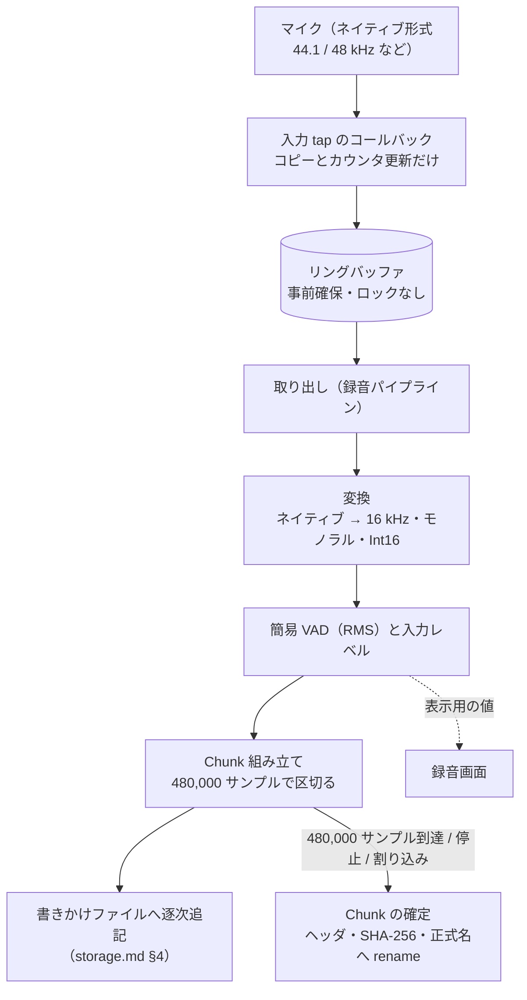
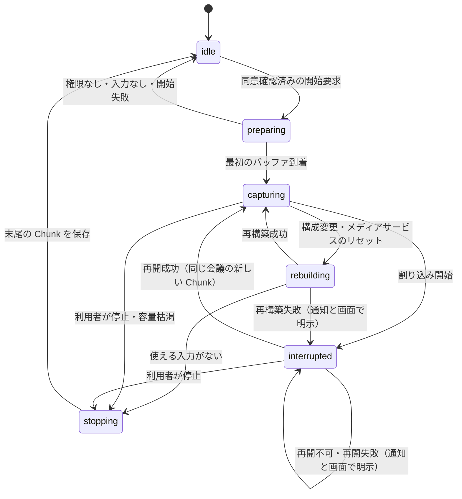

# MinutesMobile 基本設計書 ── 録音

| 項目 | 内容 |
| --- | --- |
| 版 | 1.0（初版） |
| 作成日 | 2026-11-15（技術情報の確認日 2026-11-14） |
| 満たす要件 ID | FR-CNS-02、FR-REC-01〜08、FR-INT-01〜06、NFR-REL-01・04、NFR-PRF-01・02、NFR-PWR-01、SEC-PRV-01・02、INV-01・07・08・09 |
| 解決する未解決事項 | OQ-01（UD-08 で決定） |
| 参照元 | Minutes P1 §3.2・§3.3・§5・§8・§14・§19 |
| 関連文書 | [architecture.md](architecture.md)・[storage.md](storage.md)・[ui.md](ui.md) |

本書は、マイクの音声を 16 kHz・16 bit・モノラルの Chunk にするまでと、割り込み・経路変更への対応を定める。Chunk をファイルへ書く手順は [storage.md](storage.md) §4 にある。

---

## 1. 設計決定

| ID | 決定 | 理由 | 退けた代替案 |
| --- | --- | --- | --- |
| BD-REC-01 | 音声の取り込みは AVAudioEngine の入力 tap で行い、入力のネイティブ形式のまま受け取る | サンプル単位で扱えるので、Chunk の境界・連番・ハッシュを自分で決められる | AVAudioRecorder（サンプルに触れず、30 秒ちょうどで区切れない）。`CaptureInputSequenceProvider`（音声認識への入力専用） |
| BD-REC-02 | コールバックでは、事前に確保したリングバッファ（ロックなし・書き手 1・読み手 1）へコピーするだけにする。変換以降は録音パイプラインが取り出して行う | 音切れの防止（NFR-PRF-01）。tap のコールバックはメインスレッド以外で呼ばれる | コールバックの中で変換・保存する（メモリ確保とファイル I/O が入る） |
| BD-REC-03 | 16 kHz への変換は AVAudioConverter を最高品質の設定で使う。TST-AUD-02（折り返し成分 -40 dB 以下）を満たさなければ、Minutes の FIR（Blackman 窓の windowed-sinc）を移植する | OS 標準を優先する（NFR-MNT-03）。品質は断定せず試験で決める | 最初から自作する。単純な間引き（FR-REC-02 で禁止） |
| BD-REC-04 | 割り込み後は同じ会議の続きとして自動で再開する。割り込みの開始時に、それまでの音声を短い Chunk として確定し、中断中を空白区間として記録する | UD-08。会議が分断されない | 会議を分割する。自動再開しない |
| BD-REC-05 | 割り込みの開始時に「録音が中断している」ローカル通知を予約し、再開できたら取り消す | 中断中にアプリがサスペンドされると、その時点では通知を出せない。予約しておけば届く。Push は Personal Team で使えない | 再開に失敗した時点で通知を出す（サスペンド中は実行されない） |
| BD-REC-06 | オーディオセッションは category `record`・mode `default` とし、Bluetooth（HFP）の入力を許可する。システムの警告音による割り込みを避ける設定と、経路の切断で割り込ませない設定を有効にする | §3 | §3 の表 |
| BD-REC-07 | 入力経路は種別だけを記録し、機器の名前は記録しない | 機器の名前には所有者の名前が入りうる（例:「◯◯の AirPods」） | 名前も記録する |
| BD-REC-08 | 録音の開始 API は「同意確認の値」を引数に取り、その値は同意確認の手順でしか作れない型にする | 同意を通らずに録音を始めるコードが書けない（SEC-PRV-02、T-06） | 開始前にフラグを確認する（確認を忘れても動いてしまう） |

---

## 2. 録音パイプライン

満たす要件: FR-REC-01〜04、NFR-PRF-01

| 段 | 設計 |
| --- | --- |
| コールバック | バッファの長さは毎回読む（一定と仮定しない）。あふれたら書き込まずに落としたフレーム数を数える |
| リングバッファ | 容量の初期値はネイティブ形式で 5 秒分。あふれは空白区間（理由 `overrun`）として記録する（[architecture.md](architecture.md) §6） |
| 取り出し | 起こす合図の周期は初期値 100 ms。合図が遅れても、失われるのは容量を超えた分だけで、時刻は狂わない |
| 変換 | 入力形式ごとに変換器を 1 つ持つ。入力形式が変わったら、古い変換器に残ったサンプルを吐き出してから新しい変換器を作る。多チャンネルの入力はモノラルにまとめる |
| Chunk 組み立て | 純粋ロジック（Domain）。入力の区切り方によらず、末尾以外はちょうど 480,000 サンプル。確定の要求（停止・割り込み）が来たら、その時点までを短い Chunk にする。0 サンプルの Chunk は作らない |
| 保持 | 組み立て中の Chunk の PCM（最大 960,000 バイト）はメモリにも持つ。ハッシュ計算と、書き込み失敗時の保持（[storage.md](storage.md) §6）に使う |

---

## 3. オーディオセッションの設定

満たす要件: FR-REC-05、FR-INT-01・03

| 項目 | 設定 | 理由 | 見直す条件 |
| --- | --- | --- | --- |
| category | `record` | 録音専用であることが明確。録音中は再生しない | 他アプリの再生で頻繁に中断される場合は、`playAndRecord` と他アプリとの混在を検討する（出力経路への副作用を実機で確認してから） |
| mode | `default` | 遠くの話者も拾えるよう、OS の自動利得を使う | 音質の比較（`measurement`・`videoRecording`）を実機で行い、文字起こしの結果で決める |
| Bluetooth（HFP）入力 | 許可する | 要件が Bluetooth 入力を想定している（FR-INT-03、TST-DEV-04） | HFP は帯域が狭い。品質を記録し、問題があれば内蔵マイクの優先を検討する |
| システムの警告音による割り込み | 避ける設定を有効にする（`setPrefersNoInterruptionsFromSystemAlerts`） | 着信の呼び出し音だけで録音が止まるのを減らす。通話に出た場合は割り込まれる | — |
| 経路の切断による割り込み | 割り込ませない設定にする（`setPrefersInterruptionOnRouteDisconnect` を無効） | AirPods が外れても、次の入力で録音を続ける（FR-INT-03） | — |
| sample rate・バッファ長 | 指定しない（OS の値を実行時に読む） | 16 kHz や固定長を仮定しない | — |
| 有効化・無効化 | 録音の開始で有効化し、会議の確定可能な状態になったら無効化する | 録音していない間はマイクを開かない（SEC-PRV-02）。OS の録音インジケータが消える | — |

再生（文字起こしのセグメントから原音を聞く。FR-TRV-01）は録音中には行わず、別のセッション設定（`playback`）で行う（[ui.md](ui.md) §4.4）。

---

## 4. 録音の開始と停止

満たす要件: FR-CNS-02、FR-REC-05・07、FR-INT-06、NFR-PRF-02

開始の順序（途中で失敗したら、そこで止めて理由を表示する）:

1. 同意確認（[ui.md](ui.md) §4.2）。確認した時刻を「同意確認の値」に持たせる（BD-REC-08）。
2. 録音中の会議がないことを確認する（FR-REC-07）。
3. マイク権限を確認する。未決定なら要求し、拒否なら設定アプリへの導線を表示して終わる（FR-INT-06）。
4. 空き容量を確認する（[storage.md](storage.md) §6。段階 2 なら確認を挟む）。
5. 会議を作る（会議 ID の発番、ディレクトリ、`meeting.json`、DB の行。状態は `recording`、`consentConfirmedAt` を記録）。
6. オーディオセッションを有効化し、入力を開始する。
7. 最初のバッファが届いたら録音セッションを `capturing` にする。手順 1 の完了からここまでの時間を単調時計で測って記録する（NFR-PRF-02。目標 1 秒、保証値ではない）。

手順 5 の後で開始に失敗し、音声が 1 サンプルもなければ、その会議は一覧に残さず削除する（件数だけ記録する）。

停止の順序: 入力を止める → 変換器の残りを吐き出す → 末尾の Chunk を確定する → オーディオセッションを無効化する → 会議を `stop_requested` にして確定へ進む（[storage.md](storage.md) §5）。

---

## 5. 録音セッションの状態遷移

満たす要件: FR-INT-01〜05、NFR-REL-05

プロセス内だけの状態で、純粋関数として実装する（[architecture.md](architecture.md) §5）。会議の状態は、この図のどこにいても `recording` のままである。

### 5.1 事象ごとの扱い

| 事象 | 扱い | 記録 |
| --- | --- | --- |
| 割り込みの開始（着信・Siri・アラーム・他アプリの音声など） | 変換器の残りを吐き出し、それまでの音声を短い Chunk として確定する。空白区間を開く。中断通知を予約する（BD-REC-05） | 空白区間（開始位置のサンプル番号・開始時刻・理由） |
| 割り込みの終了（OS が再開を許可） | セッションを有効化し、入力を再開する。成功したら空白区間を閉じ、通知を取り消す。連番は続きから | 空白区間の長さ |
| 割り込みの終了（再開の許可なし・再開に失敗） | `interrupted` のまま待つ。画面に「録音が止まっています」と再開・停止の操作を出す。予約した通知はそのまま届く | 再開できなかった回数と理由 |
| アプリが前面に戻った（`interrupted` のとき） | 終了の通知が届いていなくても再開を試みる | — |
| 経路の変更（AirPods の切断など）で入力形式が変わらない | 録音を続ける | 経路の履歴 |
| 経路の変更で入力の構成が変わった（エンジンが止まる） | `rebuilding` へ。入力形式を読み直し、変換器と tap を作り直して再開する。止まっていた間は空白区間（理由 `route_change`） | 経路の履歴・空白区間 |
| 使える入力がなくなった | 保存済みの音声を確定可能な状態にして停止する | 停止理由 `no_input` |
| メディアサービスのリセット | `rebuilding` へ。セッションとエンジンを最初から作り直す。失敗したら `interrupted` と同じ表示にする | 空白区間（理由 `media_reset`） |
| 容量の枯渇（メモリ上の保持が上限に達した） | 停止する（[storage.md](storage.md) §6） | 停止理由 `disk_full` |
| 利用者の停止 | §4 の停止の順序 | 停止理由 `manual` |
| アプリの終了（強制終了・クラッシュ） | その場では検知できない前提にする。次の起動で復旧する（[storage.md](storage.md) §8） | 停止理由 `terminated`（開いたままの空白区間があれば `interruption_unresumed`） |

停止理由は必ず検出時刻と組で記録する（FR-INT-05）。

### 5.2 割り込み中の待ち方

- `interrupted` で待つ時間に上限は設けない。利用者が再開または停止するまで待つ（NFR-REL-05）。
- 中断通知を予約してから届くまでの時間は設計値（初期値 60 秒）とし、TST-DEV-02 の結果で見直す。短い割り込み（数秒で戻る）では通知が出ない。
- 通知の権限がない場合は、画面と Live Activity の表示だけになる。初回説明でこの点を伝える（[ui.md](ui.md) §4.1）。

---

## 6. 時刻・Chunk の情報

満たす要件: FR-REC-03・04、INV-08

| 項目 | 決め方 |
| --- | --- |
| `sequenceNo` | 0 から 1 ずつ増える。割り込みをまたいでも続き番号 |
| 開始・終了の位置 | 16 kHz のサンプル番号（累積）。会議時刻は空白区間を足して導出する（[architecture.md](architecture.md) §6） |
| サンプル数 | 通常 480,000。末尾と割り込み直前だけ短い |
| バイト数 | 44 + サンプル数 × 2（通常 960,044） |
| SHA-256 | ファイル全体（ヘッダを含む）。確定時にメモリ上の PCM から計算する |
| VAD | §7 |
| 開始日時（表示用） | 録音開始時の壁時計 + 会議時刻。Chunk の位置の計算には使わない |

単調時計での経過時間と「総サンプル数 ÷ 16,000 + 空白区間の合計」の差を Chunk ごとに記録する（補正はしない。TST-DEV-01 ③の判定に使う）。

---

## 7. 簡易 VAD と入力レベル

満たす要件: FR-REC-03・06、INV-07

- 10 ms ごとの RMS を対数で 0〜1 に写し、しきい値とハングオーバーで有声・無声を判定する（Minutes P1 §3.2 と同じ方式）。Chunk ごとに `vadScore` と `hasVoice` を記録する。
- しきい値は設計値（初期値 0.15）で、文字起こしの結果と突き合わせて見直す。
- MVP では VAD を表示と記録にだけ使う。文字起こしのスキップ（FR-STT-10）は P2 で、その場合も原音は消さない（INV-07）。
- 入力レベルは取り出しのたびに計算し、録音画面へ送る（表示の更新は毎秒 10 回以下）。

---

## 8. 入力経路の記録

満たす要件: FR-REC-08、INV-09

録音の開始時と経路が変わるたびに、次を会議のメタデータに追記する: サンプル番号、入力の種別（内蔵マイク / 有線 / Bluetooth / USB / その他）、ネイティブの sample rate、チャンネル数、変更の理由。機器の名前は記録しない（BD-REC-07）。入力経路は話者ではない（INV-09）。

---

## 9. バックグラウンドでの継続

満たす要件: FR-REC-05、NFR-REL-01

- Background Modes の `audio` を有効にする（Personal Team で使える。[architecture.md](architecture.md) §1）。録音の開始は前面での利用者操作に限る。
- 画面ロック・他アプリへの切り替えでは、録音に関して何もしない（セッションを無効化しない）。
- ロック中も Chunk と DB に書けるよう、保護クラスを選ぶ（[storage.md](storage.md) §7）。
- アプリが終了されるときの通知は届く保証がないため、当てにしない。届いた場合に限り、組み立て中の Chunk を確定する。

---

## 10. 実測して記録する値

満たす要件: NFR-PRF-02、NFR-PWR-01

| 値 | 記録の単位 | 用途 |
| --- | --- | --- |
| 開始から取り込み開始までの時間 | 録音ごと | NFR-PRF-02 |
| 入力のネイティブ sample rate・チャンネル数 | 経路ごと | 変換の検証 |
| リングバッファのあふれ（回数・フレーム数） | 録音ごと | 音切れの検出 |
| 時計とサンプル数の差 | Chunk ごと | TST-DEV-01 ③ |
| 割り込みの回数・再開できなかった回数と理由 | 録音ごと | 要件 §10 |
| 電池残量・温度状態 | 開始時・終了時と Chunk ごと | NFR-PWR-01 |

記録先は SQLite の計測用の表で、D1〜D3 を含めない（[storage.md](storage.md) §3）。

---

## 11. 断定しない事項

| 事項 | 断定しない理由 | 担保の方法 |
| --- | --- | --- |
| 割り込みの終了がアプリに届く | 中断中にサスペンドされると届かない場合がある | 前面復帰時にも再開を試みる。予約した通知（BD-REC-05）。TST-DEV-02 |
| 割り込みの後に再開が許可される | 割り込みの種類と OS の判断による | 再開できなかった回数と理由を記録する |
| 経路の切断で録音が止まらない | 設定の効き方は OS と機器による | TST-DEV-04 |
| AVAudioConverter の変換品質 | 設定と実装に依存する | TST-AUD-02。不足なら FIR を移植（BD-REC-03） |
| category `record`・mode `default` が会議の録音に最適 | 部屋・機器・話者の距離で変わる | §3 の「見直す条件」。実機で比較して記録する |
| ロック中・バックグラウンドで 60 分録音できる | OS の資源管理に依存する | TST-DEV-01 |

---

## 12. セキュリティ

満たす要件: SEC-PRV-01・02

| 観点 | 設計 | 要件・脅威 |
| --- | --- | --- |
| 同意のない録音 | 開始 API は同意確認の値がないと呼べない（BD-REC-08）。確認を省略する設定は作らない | SEC-PRV-02、T-06、FR-CNS-01 |
| マイクを開く範囲 | セッションの有効化は録音の開始、無効化は停止。録音していない間は入力を開かない | SEC-PRV-02 |
| 録音中であることの明示 | 画面・Live Activity・OS の録音インジケータ。割り込みで止まったときも表示を変える | SEC-PRV-02、NFR-UX-03 |
| 利用目的の文言 | `NSMicrophoneUsageDescription` に、端末内だけで処理し外部へ送らないことを具体的に書く（文言は [dev-environment.md](dev-environment.md) §3） | SEC-PRV-01 |
| 経路の情報 | 機器の名前を記録しない（BD-REC-07） | SEC-LOG-03 の趣旨 |
| 音声データ | パイプラインの外へ出さない。ログ・計測値に音声の中身を入れない | SEC-LOG-03 |

**設計・実装時の注意点:**

- 録音の開始経路を 1 つにする。画面・Live Activity・将来の Siri 連携など、別の入口を足すときも必ず同意確認を通す。
- 通知の文言に会議タイトルを入れない（[ui.md](ui.md) §8）。
- 録音の再開（割り込み後）は、利用者が開始した同じ会議に限る。新しい会議を自動で始めない。

---

## 13. テスト観点

| 試験 | 単体で再現する方法 | 実機でしか確かめられないこと |
| --- | --- | --- |
| TST-AUD-01（WAV ヘッダ） | 符号化の関数にサンプルを渡し、バイト配置を検証する | — |
| TST-AUD-02（折り返し） | 48 kHz・44.1 kHz の 12 kHz 正弦波を合成し、出力の 4 kHz 付近の成分を測る | 実機の変換器でも同じ結果になること |
| TST-AUD-03（境界） | 入力を不規則な長さで区切って流し、Chunk のサンプル数・欠落・重複を検証する。割り込みの確定要求も混ぜる | — |
| TST-AUD-04（単体再生） | 保存した Chunk を `AVAudioFile` で開く | — |
| TST-AUD-05（sample rate の変化） | 途中で入力形式を変え、出力のサンプル番号が連続することを検証する | Bluetooth の接続・切断（TST-DEV-04） |
| TST-AUD-06（時刻の正） | 壁時計を進める・戻す。Chunk の位置が変わらないこと | — |
| TST-INT-01〜05・07 | 通知を差し替え、状態遷移の表（状態 × 事象）を網羅する。許されない遷移の拒否も検証する | 着信・Siri・アラーム（TST-DEV-02） |
| TST-INT-06（権限） | 権限の状態を差し替える（UI テスト） | — |
| NFR-PRF-01 | コールバックに入れてよい処理を 1 つの関数に閉じ込め、レビューの対象を限定する。あふれの計数を単体で検証する | 60 分録音で音切れがないこと（TST-DEV-01） |

**設計・実装時の注意点:**

- 状態遷移の試験は、通知の順序が入れ替わった場合（終了が先に届く、同じ通知が 2 回届く）も含める。
- 古い世代の応答を捨てることを検証する（再構築の完了が、次の再構築の開始後に届く場合など）。
- 合成音声は周波数とサンプル数が既知のものを使い、数値で合否を決める。聞いて確かめる試験にしない。
- シミュレータのマイクは Mac の入力で、iPhone の経路や sample rate とは異なる。録音パイプラインの試験は入力を差し替えて行う。

---

## 14. 詳細設計への申し送り

- リングバッファの実装（原子操作の方法）と、取り出しを起こす合図の方式。
- 変換器の設定値、モノラル化の方法、入力形式が変わるときの吐き出しの手順。
- 状態遷移の表（状態 × 事象 × 副作用）の全件。
- 空白区間の理由の一覧（割り込みの理由、`overrun`、`route_change`、`media_reset`）。
- 中断通知の文言と予約までの時間。

---

## 15. 出典

- iOS 27.2 SDK の `AVAudioSession.h`・`AVAudioSessionTypes.h`・`AVAudioNode.h`・`AVAudioConverter.h`（確認日 2026-11-14）。割り込みの理由、経路変更の理由、入力の種別、割り込みに関する 2 つの設定を確認した
- Minutes `docs/design-local-phase1.md` §3.2・§3.3・§8・§14
