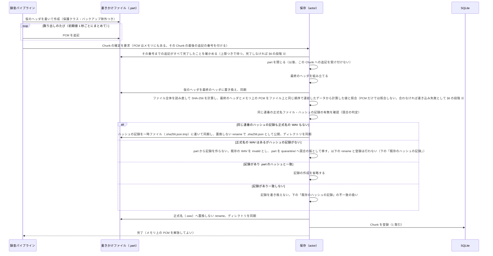
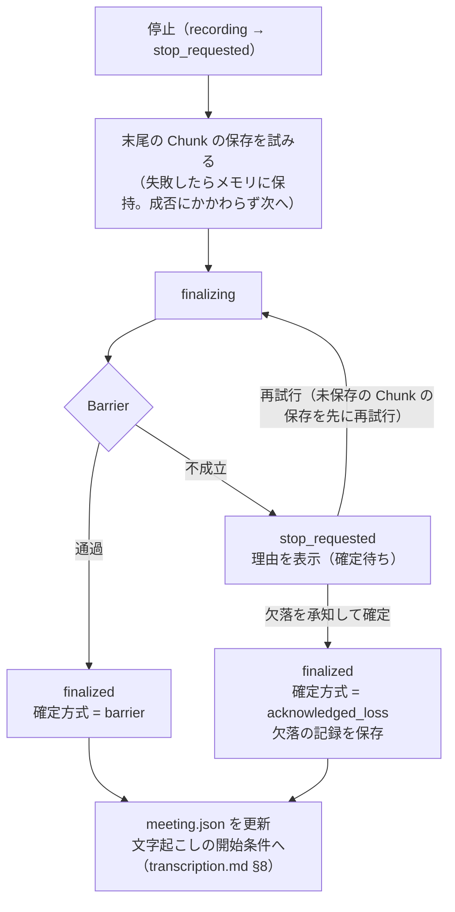
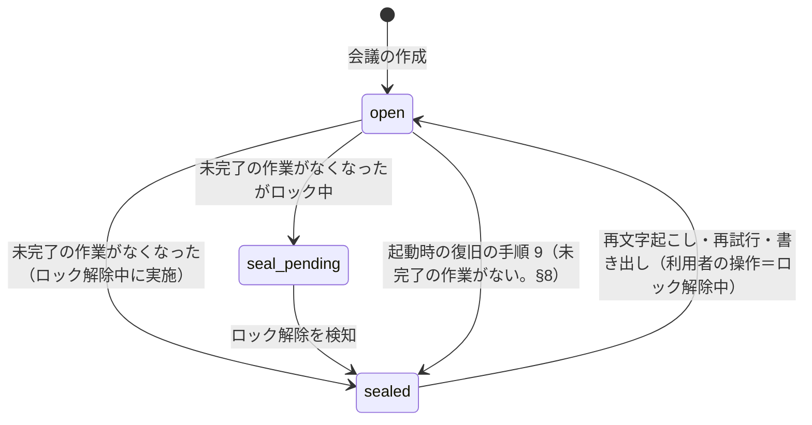

# MinutesMobile 基本設計書 ── 保存・確定・復旧

| 項目 | 内容 |
| --- | --- |
| 版 | 1.0（初版） |
| 作成日 | 2026-11-15（技術情報の確認日 2026-11-14） |
| 満たす要件 ID | FR-CNS-02、FR-SAV-01〜05、FR-FIN-01〜03、FR-RCV-01・02・04、FR-MTG-03、NFR-REL-04、NFR-CAP-01・02、NFR-MNT-05、SEC-DAT-01〜05、SEC-INP-01・03、SEC-INT-01・02、INV-04・05・10 |
| 解決する未解決事項 | OQ-02（UD-09 で決定）、OQ-08、OQ-09、OQ-10 |
| 参照元 | Minutes P1 §3.4・§11・§13・§16・§21〜§23・§26、Minutes P2 §8・§23 |
| 関連文書 | [architecture.md](architecture.md)・[recording.md](recording.md)・[transcription.md](transcription.md)・[export.md](export.md) |

---

## 1. 設計決定

満たす要件: FR-SAV-01・03・04、FR-RCV-01・02、FR-MTG-03、NFR-REL-04、SEC-DAT-01〜03・05、SEC-INP-01、INV-08・10 ／ 解決: OQ-02・09・10

| ID | 決定 | 理由 | 退けた代替案 |
| --- | --- | --- | --- |
| BD-STO-01 | メタデータは iOS 同梱の SQLite を、薄い自作ラッパー経由で直接使う（UD-09） | 追加の依存がない。オープン時に保護クラスを明示できる。一意制約の違反を「競合」として検出できる（FR-SAV-03）。Minutes P2 の表とジョブ設計を移植しやすい | SwiftData（一意制約に当たると暗黙に上書きする。保護クラスの指定が間接的）。GRDB（サードパーティーの管理対象が増える） |
| BD-STO-02 | **原本はファイル、SQLite は作り直せる索引と処理状態**とする。D1・D2 は SQLite に入れない（BD-ARC-03） | DB が壊れてもファイルから戻せる（INV-10）。処理が終わった会議を丸ごと `complete` に上げられる（SEC-DAT-02） | 文字起こしを DB の表に置く |
| BD-STO-03 | 組み立て中の Chunk を書きかけファイル（`.part`）へ逐次追記する。起動時の復旧でヘッダを直して Chunk として救済する（OQ-09） | 強制終了で失う音声を、30 秒から書き込み周期（初期値 1 秒）程度まで縮められる | 30 秒たまってから一度に書く（損失上限が 30 秒のまま） |
| BD-STO-04 | 保護クラスは会議ごとに 2 段階で切り替える。処理中は `completeUntilFirstUserAuthentication`、未完了の作業がなくなったら `complete`。SQLite は常に前者（OQ-10） | ロック中の録音・文字起こしと、保管時の保護を両立する（SEC-DAT-01・02）。§7 | 最初から `complete`（ロックで録音が壊れる）。常に弱いまま（紛失時の保護が弱い） |
| BD-STO-05 | 保存ルートとその下のディレクトリは 1 つの型だけが作り、作成時にバックアップ除外と保護クラスを付ける。起動のたびに属性を検証し、外れていれば付け直す | 付け忘れを構造で防ぐ（SEC-DAT-03） | 各所で `FileManager` を使う |
| BD-STO-06 | パスは会議 ID（UUID）と連番だけから組み立てる。利用者の入力はパスに使わない | パス操作の余地をなくす（SEC-INP-01、T-09） | タイトルをディレクトリ名に使う |
| BD-STO-07 | 空き容量の確認は Chunk の確定のたびに行う（タイマーで監視しない） | 録音の進行（サンプル数）に連動し、バックグラウンドでも止まらない（INV-08） | 定期タイマーで監視する |
| BD-STO-08 | 起動時の復旧と DB の再構築は、同じ「照合」の関数（ディレクトリと DB を突き合わせる）で実装する | 復旧の経路を 1 つにして、試験の対象を絞る。P2 の全件再構築（FR-RCV-03）は対象を全会議に広げるだけで済む | 復旧と再構築を別々に作る |
| BD-STO-09 | 削除は「墓標を立てる → ディレクトリを消す → DB の行を消す」の順で行い、途中で落ちても次の起動で続きを行う | 取り残しを防ぐ（SEC-DAT-05、T-12） | DB の行を先に消す（落ちるとファイルだけが残り、誰も消さなくなる） |

---

## 2. ファイル配置

満たす要件: FR-SAV-02、SEC-DAT-04、SEC-INP-01

```text
{Application Support}/MinutesMobile/          # 保存ルート（バックアップ除外）
  db/
    minutes.sqlite                            # + -wal・-shm
    rebuild-pending                           # 全会議の照合が終わっていない印（DB の外。§3.3・§8）
  recordings/
    {meetingId}/                              # 会議ディレクトリ。会議のデータはすべてこの下
      meeting.json                            # 会議のメタデータのスナップショット
      mic/
        000000.wav                            # 確定済みの Chunk（6 桁の連番）
        000000.sha256.json                    # 保存時のハッシュの記録（連番・開始サンプル・サンプル数・SHA-256。DB の外の独立した記録）
        000007.wav.part                       # 書きかけ（録音中だけ存在する）
      stt/
        run-0001/000000.json                  # Chunk ごとの認識結果（transcription.md §5）
      transcript/
        v0001.json                            # 確定文字起こし（版ごと）
        v0001.sha256.json                     # 版のハッシュの記録（DB の外の独立した記録。transcription.md §6.2）
      quarantine/                             # 救済できなかった書きかけなど（削除しない）
  quarantine/                                 # 壊れた DB の退避先
  tombstones/
    {meetingId}                               # 削除要求の記録（DB の外。§9）
  tmp/
    export/{meetingId}/{exportId}/            # 書き出し用の一時ファイル（export.md §6）
```

- `Documents` は使わない。「ファイル」アプリやパソコンとの共有を有効にしない（SEC-DAT-04）。
- `{meetingId}` は UUID の形式であることを検証してから使う。連番は 0〜999,999 の整数に限る。
- P2 の AI 議事録（`summary/`）と手動ノート（`notes/`）も会議ディレクトリの下に置く（[architecture.md](architecture.md) §10）。

---

## 3. 永続データの構成

満たす要件: NFR-MNT-05、SEC-INP-03、INV-04・10

### 3.1 何をどこに置くか

| データ | 区分 | 置き場所 | 原本か |
| --- | --- | --- | --- |
| 音声（Chunk） | D1 | `mic/*.wav` | 原本 |
| 会議のメタデータ（タイトル・日時・同意の時刻・空白区間・経路の履歴・停止理由・確定方式・欠落の記録） | D3 | `meeting.json` | 原本（DB の行はここから作り直せる） |
| Chunk ごとの認識結果・確定文字起こし | D2 | `stt/`・`transcript/` | 録音から再生成できる |
| 会議・Chunk・空白区間・ジョブ・版の索引と状態 | D3 と処理状態 | SQLite | 索引（ジョブの状態だけは SQLite が唯一の記録。INV-04） |
| 設定値 | D4 | `UserDefaults`（許可した鍵だけ） | — |
| 計測値 | D5 相当 | SQLite | — |

`meeting.json` は、会議の作成・空白区間・経路の変更・未保存の記録の追加と解消（§5.1）・停止・確定、および文字起こしの開始と完了のたびに原子的に書き換える（Chunk ごとには書かない）。文字起こしの開始は `transcribing` への遷移（最初の文字起こし・再文字起こし・失敗区間の再試行。実行番号のディレクトリを作り、DB の取引を確定した後）、完了は `transcribed` への遷移（版のファイルを保存し、DB の取引を確定した後）で、どちらも会議の状態を `meeting.json` に記録する（[transcription.md](transcription.md) §2・§7）。失敗区間の再試行では、再試行の対象の実行番号（選んだ連番・選ばなかった失敗区間の連番・再試行の元にした版の番号と組）も DB の取引の前に `meeting.json` に記録し、完了で消す。再文字起こし（全体）の開始では、その DB の取引の前に消す（DB を作り直しても再試行の対象を失わず、古い記録で別の実行番号の行を作らないため。[transcription.md](transcription.md) §7）。DB を作り直したときは、この状態から会議の行を作るので、`transcribing` の会議は §8 の手順 7 でジョブの不足分が作られて文字起こしが再開する。DB の取引の後・`meeting.json` の書き換えの前に落ちた場合は、次の起動の照合（§8 の手順 4）で DB の状態を `meeting.json` に書き直す（DB が正しい間は DB を正とする）。Chunk の一覧は WAV ファイルとハッシュの記録（`{連番}.sha256.json`）から作り直せる（連番はファイル名、サンプル数はヘッダ、開始サンプルはハッシュの記録、VAD は再計算）。**ハッシュの記録は、その Chunk の開始サンプルも持つ。** 記録は §4 の保存の順序のとおり、その WAV の正式名への rename より前に作って公開するので、正式名の WAV には同じ確定の手順で作った開始サンプルの記録が必ず伴う。DB を作り直すときは、`audio_chunks` の開始サンプルをこの記録の値から戻す（`unsaved_chunks` や前後の Chunk のサンプル数の累計から推定しない。割り込みの境界の短い Chunk や欠番があっても、位置を正しく戻すため）。開始サンプルを持たない・読めない記録は、ハッシュの記録がない場合と同じく照合できないものとして `invalid` にする。**ハッシュは再計算した値で置き換えない。** 保存時の値はハッシュの記録にあり、作り直すときは現在の WAV から再計算した値をこの記録と照合する。合わなければ `hash_mismatch` とする（保存後の改変・破損を、DB を作り直した後も検出できる）。ハッシュの記録がない・読めない Chunk は、照合できないものとして `invalid` にする（記録を再計算で作らない）。文字起こしの版の索引（`transcript_versions`）も同じ考え方で、版のハッシュは独立した記録（`transcript/v{版}.sha256.json`）から復元し、記録がない・読めない版は `invalid` にする（[transcription.md](transcription.md) §6.2）。

### 3.2 SQLite の表（概要）

列の定義は詳細設計で確定する。Minutes P2 §8 からの読み替えを示す。

| 表 | 主な内容 | 一意制約 | Minutes P2 との差 |
| --- | --- | --- | --- |
| `schema_version` | 適用済みの移行の番号 | — | 同じ |
| `meetings` | ID、タイトル、状態、同意の時刻、開始日時、停止理由と検出時刻、総サンプル数、確定方式、確定日時、保護の状態、現在の文字起こしの版、待機の理由、削除要求の時刻 | ID | サーバー関連の列を除く。確定方式・保護の状態・削除要求を追加 |
| `audio_chunks` | 会議 ID、連番、開始サンプル、サンプル数、バイト数、SHA-256、VAD、ファイルの状態（`present` / `missing` / `hash_mismatch` / `invalid` / `quarantined`。`quarantined` は復旧時に救済できずに隔離した書きかけ。§8） | （会議 ID、連番） | `source`・サーバー VAD を除く |
| `chunk_conflicts` | 同じ連番で異なるハッシュが来た記録 | — | 新規（FR-SAV-03） |
| `unsaved_chunks` | 会議 ID、連番、開始サンプル、サンプル数、保持を始めた時刻、原因の分類（書き込めずにメモリに保持した Chunk。保存に成功したら消す。§5.1） | （会議 ID、連番） | 新規（FR-SAV-05） |
| `recording_gaps` | 会議 ID、空白の番号、位置のサンプル番号、長さ（ms。会議時刻と同じ単位）、理由、開始日時、再開したか | （会議 ID、空白の番号） | 新規（FR-INT-01） |
| `route_events` | 会議 ID、サンプル番号、入力の種別、sample rate、理由 | — | 新規（FR-REC-08） |
| `processing_jobs` | [transcription.md](transcription.md) §4 | 同上 | 状態を FR-STT-02 の 5 種に整理 |
| `transcript_versions` | 会議 ID、版、実行番号、エンジン情報、件数、ファイルのハッシュ | （会議 ID、版） | 新規（本文はファイル側） |
| `usage_metrics` | 計測値（[recording.md](recording.md) §10 など） | — | 同じ趣旨 |

Minutes の `transcript_segments` に当たる表は作らない（BD-STO-02）。

### 3.3 接続と移行

| 項目 | 設計 |
| --- | --- |
| 接続 | 書き込みの接続は 1 本で、保存の actor が持つ。WAL、外部キー有効。同期は `NORMAL`。電源断（OS のクラッシュを含む）で直近のコミット済みの取引を失う場合があるが、DB は壊れない。失った取引のうち、ファイルを原本とする情報（Chunk の登録など）は §8 の照合で戻る。会議の状態は、§8 の手順 4 で DB を正として `meeting.json` を DB に合わせるので、DB に残った状態に戻る。**そのため、DB から失われた文字起こしの開始（`transcribing` への遷移とジョブ行の作成。§3.1）は復元されない。** `meeting.json` が `transcribing` を記録していても、会議は開始前の状態（`finalized` / `transcribed`）に戻り、利用者が改めて開始・再試行の操作を行うまで文字起こしは始まらない（作られかけた `stt/run-*/` は実行番号の採番で飛ばす。[transcription.md](transcription.md) §4.3） |
| 保護クラス | オープン時のフラグで `completeUntilFirstUserAuthentication` を指定する。`-wal`・`-shm` の属性も起動時に検証する |
| 取引 | 状態の変更は 1 取引にまとめる（例: Chunk の登録と総サンプル数の更新） |
| 文の組み立て | すべてパラメータの束縛を使う。文字列の連結で SQL を作らない |
| 移行 | 番号順に、1 つの移行を 1 取引で適用する。移行の前に DB の複製を 1 世代だけ残す（NFR-MNT-05）。複製は SQLite のオンラインバックアップ API（`sqlite3_backup_init`・`_step`・`_finish`）で作り、WAL にだけあるコミット済みの取引も含める（DB ファイルだけをファイルとして複製しない）。`sqlite3_backup_step` が `SQLITE_DONE` を返し、`_finish` が成功したことを確かめてから移行を始める |
| 壊れた DB | 開けない・整合性の検査に通らない場合は、削除せず `quarantine/` へ退避し、新しい DB を作って §8 の照合で作り直す。順序は ①全会議の照合が終わっていない印（`db/rebuild-pending`）を原子的に作り、ファイルと `db/` ディレクトリを同期する → ②壊れた DB（`-wal`・`-shm` を含む）を `quarantine/` へ退避する → ③新しい DB を作る、とする（**印は退避より先に作る**）。①の前に落ちた場合は壊れた DB がそのまま残り、次の起動で同じ判定からやり直す。①の後に落ちた場合（退避の前でも後でも）は印が残るので、次の起動で全会議を照合する（§8 の手順 2）。印は全会議の照合が完了してから消す |
| `meeting.json` | 形式の版番号を持つ。読むときに型と範囲を検証し、合わなければ「読めない会議」として一覧に出す（削除しない。TST-RCV-04） |

---

## 4. Chunk の保存

満たす要件: FR-SAV-01・03、NFR-REL-04、SEC-INT-01



録音パイプラインは追記を依頼するだけで、追記の完了を待たずに次の取り出しへ進む（[recording.md](recording.md) §2 の保持。追記の遅れでリングバッファをあふれさせない）。まだ追記していない PCM と、追記を終えて確定（上の図の「完了」）を待つ PCM はメモリ上の保持にあり、**§6 の保持の上限に数える**（上限に達した場合の扱いは §6 の物理的な限界）。「完了」の後でも、緊急書き出しが対象として選んだ Chunk の PCM は書き出しの完了まで解放しない（[export.md](export.md) §7）。

**確定は、その Chunk の `.part` への追記がすべて完了してから始める。** 確定の要求は、その Chunk の最後の追記の依頼の番号を持ち、保存の actor はその番号までの追記がすべて完了した（書き込みの成否が返った）ことを確かめてから、ヘッダの置き換え・SHA-256 の計算・rename を始める。待機には [recording.md](recording.md) §5.1 と同じ時間の上限を設ける。①上限までにすべての追記が成功すれば、`.part` を閉じて確定へ進む。②追記のいずれかが失敗した、または上限までに完了しなければ、確定を始めずに書き込みの失敗として §6 の段階 3 へ移す（メモリ上の PCM を未保存 Chunk として保持し、未保存の記録に残す。会議が録音中なら録音は続ける）。どちらの場合も、判定の時点でその Chunk の `.part` を閉じ、以後その Chunk への追記の依頼は書かずに捨てる（PCM はメモリ上の保持にあるので失わない）。**判定の時点で既に発行して完了していない書き込み（ファイルへの書き込みの呼び出しが戻っていないもの）は取り消せないので、取り消さず、完了を待つ対象として記録する。** その結果（成否）は世代で照合して捨て、確定・未保存の記録・未保存の件数には反映しない。**段階 3 の再試行は、その Chunk の発行済みの書き込みがすべて戻るまで始めない**（戻っていなければ、その機会の再試行では飛ばし、PCM をメモリに保持したまま次の機会に回す。戻らないまま止まっても、未保存として件数に数え、緊急書き出しで退避できる）。すべて戻った後の再試行は、古い `.part` に書き足さず、古い `.part` を消してから新しいファイルとして作り（既にあれば失敗する方法で作る）、メモリ上の PCM から書いて同期し、閉じた新しいファイルから SHA-256 を計算する。古い書き込みはすべて戻っており、古いファイルの記述子も閉じているので、遅れた書き込みが再試行のファイルとそのハッシュを変えることはない。こうして、照合（SHA-256）の後に同じ Chunk への追記が届くことはない。

| 観点 | 設計 |
| --- | --- |
| 原子性 | 正式名のファイルは、常に完全な Chunk である。書きかけは `.part` の名前でしか存在しない（FR-SAV-01） |
| 冪等性 | 同じ（会議 ID、連番）を再び登録しようとした場合、ハッシュが同じなら何もしない。異なれば先に登録されたものを残し、`chunk_conflicts` に記録する（FR-SAV-03）。黙って上書きしない |
| 置換しない確定 | 正式名への rename は、移動先が既にあれば失敗する方法で行う（`FileManager` の移動、または `renamex_np` の `RENAME_EXCL`。どちらを使うかと SDK での提供は詳細設計で確かめる）。ハッシュの記録も新規作成に限る。rename の前に同じ連番の正式名ファイルを調べ、①なければ確定する。②あってハッシュが同じなら、破棄する前に DB の行を確かめる。行がなければ（rename の後に登録が失敗した後の再試行など）その Chunk を登録してから新しい方を重複として破棄し、行があれば DB は変えずに破棄する。③あってハッシュが異なれば、既存のファイルと記録はそのまま残し、新しいファイルを会議の `quarantine/` に競合の版として移して `chunk_conflicts` に記録する。DB の競合の判定と同じく、先に確定した方を正とする。判定と rename の間に別の確定が割り込んだ場合は、置換しない rename が失敗する。このとき直ちに③とせず、既存の正式名ファイルを読み直してハッシュを計算し、同じなら②（DB の行の有無に応じて登録または重複として破棄）、異なる場合だけ③として扱う |
| 既存のハッシュの記録 | ハッシュの記録の作成の前に、同じ連番の記録（`.sha256.json`）の有無を確かめる。正式名の WAV がない場合（②の途中で落ちた後の再試行、§6 の段階 3 の再試行など）にも適用する。①記録がなく、正式名の WAV もなければ作成する。**正式名の WAV があって記録がない場合は、`.part` から記録を作らない**（作ると、既存の WAV を照合できないまま、`.part` の内容の記録がその連番の記録になる）。既存の WAV はファイルの状態を `invalid`（ハッシュの記録なし）にして残し（Barrier の不成立の理由になる）、`.part` は「置換しない確定」の③と同じく会議の `quarantine/` へ競合の版として移して `chunk_conflicts` に記録する。書き込み自体は成功しているので、メモリ上の PCM は解放し、未保存の件数に数えない。②記録があり、`.part` のハッシュと一致すれば、記録の作成を省略して WAV の置換しない rename と登録へ進む。③記録があり一致しなければ、記録は書き換えない（§12）。§8 の書きかけの救済と同じく、WAV の置換しない rename と登録を行い、ファイルの状態を `hash_mismatch` にして `chunk_conflicts` に記録する（Barrier の不成立の理由になり、確定待ちで利用者に示す）。書き込み自体は成功しているので、メモリ上の PCM は解放し、未保存の件数に数えない。正式名の WAV がある場合は、記録の扱いを本規則で決めたうえで、下の「置換しない確定」の判定に従う |
| 途中で落ちた場合 | ①追記中: `.part` が残る → §8 で救済。②ハッシュの記録の作成後・rename の前: `.part` とハッシュの記録が残る → §8 で救済し、記録と照合する。③rename の後・登録の前: 正式名のファイルと記録がある → §8 の照合で登録。④登録の後: 何もしない。ハッシュの記録の一時ファイル（`.sha256.json.tmp`）は記録として扱わない。公開の前に落ちて一時ファイルだけが残った場合は、§8 の照合でそれを削除し、記録がないものとして扱う |
| 損失の上限（OQ-09） | プロセスの終了（強制終了・クラッシュ）で失うのは、まだ追記していない分（リングバッファと、メモリ上の保持にあって追記を終えていない分）。追記が遅れずに進む間は取り出し 1 回分で、**目標は約 1 秒**。追記は取り出しを待たせないので、I/O が遅れると追記していない分が取り出し 1 回分を超えて増えうる（上限は組み立て中の Chunk の全体。追記の遅れは記録する）。電源断・OS のクラッシュでは、最後の同期より後の分。同期の周期は初期値 5 秒で、詳細設計で実測して決める |
| 保証値 | 上の値は目標である。要件の上限（1 Chunk = 30 秒。NFR-REL-04）は、TST-RCV-01・TST-DEV-05 で実測するまで変えない。設定画面に出す上限も実測後に更新する（FR-SET-03） |
| WAV ヘッダ | 44 バイト・16 kHz・16 bit・モノラル（Minutes P1 §16.1 と同じ配置）。読むときは 13 項目とサイズの整合を検証する（SEC-INT-02） |

---

## 5. 停止と確定

満たす要件: FR-FIN-01〜03、FR-SAV-05、SEC-INT-01

### 5.1 Finalization Barrier

純粋関数として実装する。入力は「DB の Chunk の一覧」「各ファイルの検査結果」「メモリ上の未保存 Chunk の件数」「永続化した未保存の記録（`unsaved_chunks` と `meeting.json` の和集合。連番と元の範囲）」、出力は「通過」または「不成立の理由の一覧」。

| 条件 | 検査 | 不成立の理由 |
| --- | --- | --- |
| 連番が 0 から欠番なく続く | DB の連番を数える | 欠番の連番 |
| 全 Chunk のファイルが存在する | 会議ディレクトリを調べる（`quarantined` の行は下の隔離の条件で扱う） | ファイル欠損の連番 |
| ヘッダが正しい | §4 の検証 | 不正なヘッダの連番 |
| 復旧時に救済できずに隔離した Chunk がない | ファイルの状態が `quarantined` の行を数える（§8 の書きかけの救済） | 隔離した連番 |
| SHA-256 が記録と一致する | ファイルを読み直して計算する | 不一致の連番 |
| メモリ上の未保存 Chunk が 0 件で、永続化した未保存の記録も 0 件 | 保存の actor に問い合わせる。加えて、未保存の記録（`unsaved_chunks` と `meeting.json`）を数える | 未保存の件数。復旧時に判明した失われた Chunk の連番 |

**未保存の記録:** 再起動するとメモリ上の件数は必ず 0 になるため、メモリへの問い合わせだけでは、保持していた末尾の Chunk が失われたことを再起動後に検出できない（途中の Chunk なら、後の Chunk との欠番で分かる）。そこで、Chunk の書き込みに失敗してメモリに保持し始めた時点（§6 の段階 3）で、その連番・開始サンプル・サンプル数・原因の分類を DB の `unsaved_chunks` に記録し、`meeting.json` にも同じ内容を書く（DB を作り直しても失われないように）。保存に成功したら、同じ取引で記録を消し、`meeting.json` からも消す。

**記録の書き込みと保存の成功の順序:** 未保存の記録の追加・削除（`unsaved_chunks` と `meeting.json` の両方）と、Chunk の登録（保存の成功）は、すべて保存の actor の上で 1 件ずつ直列に行う（再試行・停止の後の書き込みも含め、ほかの文脈から直接書かない）。**追加は、実行する時点で、同じ会議・同じ連番の Chunk が登録済みかを同じ取引の中で確かめ、登録済みなら書かない**（記録を戻さない）。そのため、保存の成功より前に依頼した追加が、保存の成功の後に実行されても、その Chunk を `unsaved_chunks` と `meeting.json` に戻さない。`meeting.json` の書き換えは、actor の上で DB の取引の結果から作った内容で行い、古い内容から作った書き換えで新しい内容を上書きしない。Barrier（下）の入力の未保存の記録も同じ actor から読むので、保存済みの Chunk と未保存の記録の両方に同じ連番が現れる状態を観測しない。

- 起動時の照合（§8）で記録が残っていれば、その Chunk はメモリとともに失われたものとする（救済できるファイルがあれば先に救済する。記録を消すのは、救済した WAV のサンプル数が記録と一致した場合だけで、短ければ足りない分を欠落として残す。§8 の照合の表）。残った連番は**失われた Chunk** として Barrier の不成立の理由になり、会議を `finalized` にしない。会議は確定待ち（`stop_requested`）に残り、利用者が欠落を承知して確定する（FR-FIN-02）までそのままにする。失われた連番は `lossRecord` に含める。
- 記録の書き込み自体が失敗した場合は、次の Chunk の確定のたびに再試行する。予備（§6）を DB のために残すので書ける前提にするが、断定しない（§11）。記録を書けていない間は、段階 3 の表示に「未保存の記録も残せていないため、アプリが終了すると、失われたことも後から分からない」ことを加える。記録を書けないまま終了した Chunk は再起動後に検出できず、Barrier を止められない。この場合の自動の確定は FR-FIN-01 ④〜⑥ のとおり許容し、`lossRecord` には記録しない。

**書き込みの I/O の遅れと actor の応答:** 保存の actor は、未保存の記録と保存済みの Chunk の一覧の現在の内容をメモリ上の状態として持ち、追加・削除・登録の順序と内容はこの状態の上で 1 件ずつ決める（上の直列の規則と、追加の時点の登録済みの確認はこの状態で行う）。`unsaved_chunks` と `meeting.json` へのファイル・DB の書き込みの I/O は、actor の応答を止めずに行い、actor は I/O の完了を待つ間も、Barrier の入力の問い合わせと書き出しのスナップショット（[export.md](export.md) §2）にメモリ上の状態から答える（止まった I/O で、確定待ちの判定・書き出し・画面の表示を止めない）。書き出しのスナップショットは従来どおり中断点（`await`）を含まない actor の 1 つのメソッドで取る（[export.md](export.md) §2 の規則は変えない。I/O の完了を待たないことで、そのメソッドが待たずに答えられる）。
- 各書き込みには、actor が対象（同じ会議・同じ連番の記録）ごとに発行する**試行の連番**を付ける。書き込みが時間の上限を超えたら、I/O の完了を待たずに actor の状態で失敗として扱う（記録を書けていない状態にし、上の「記録の書き込み自体が失敗した場合」と同じく、段階 3 の表示と再試行の対象にする）。
- 遅れて届いた完了（成功・失敗）は actor の上で試行の連番と照合し、その対象の最新の試行でなければ状態に反映しない（古い試行の結果で、新しい試行の結果や、その後の追加・削除・登録を戻さない）。ファイルの内容が古い書き込みで置き換わる場合の扱いは、下の `meeting.json` の世代の規則による。
- 再試行は新しい試行の連番で行い、止まったままの古い書き込みの完了を待たない。再試行が古い書き込みより先に終わることは前提にしない（どちらの完了が先でも、上の照合で状態は最新の試行に従う）。
- **`meeting.json` はファイル全体の世代で書く。** `meeting.json` は 1 つのファイルに複数の記録（未保存の記録・割り込みの記録・空白区間・状態など）を持つので、記録ごとの試行の連番では、別の記録のために始めた古い書き込みが後から rename を終えて、新しい内容を上書きするのを防げない。そこで、actor は `meeting.json` の書き込みのたびに会議ごとのファイル全体の世代（単調に増える番号）を発行し、内容は発行の時点の actor の状態の全体から作る（一時ファイルに書いて同期し、rename で置き換える）。**公開（rename）の順序は、完了の通知の順に頼らず、公開の時点で世代によって強制する。** 各会議の `meeting.json` の rename は、会議ごとに 1 つの直列の公開の文脈（会議ごとの直列のキューなど。詳細設計で決める）で 1 件ずつ行い、その文脈が公開済みの最大の世代を持つ。rename の直前に、その書き込みの世代が公開済みの世代より大きいかを確かめ、大きければ rename して公開済みの世代を更新し、そうでなければ rename せずに一時ファイルを消して「古い世代として公開しなかった」と完了を返す（時間の上限で失敗として扱った書き込みが、その後に新しい世代が公開されてから同期を終えても、新しい内容を上書きしない）。一時ファイルへの書き込みと同期は公開の文脈の外で並行してよく、確認と rename だけを直列にする。公開の文脈は actor の応答を止めない（actor は完了の通知を受け取るだけ）。actor は、完了を確認した最大の世代（完了済みの世代）を会議ごとに持つ。①完了済みの世代より大きい世代の成功が届いたら、完了済みの世代をそれに更新する。②完了済みの世代より小さい世代の成功が届いたら（古い書き込みが新しい書き込みの後に rename を終えた可能性がある）、ファイルの内容が古い世代のものになっている可能性があるとして捨てずに扱い、actor の現在の状態から新しい世代で書き直す。③失敗と、時間の上限による失敗は、その世代より新しい世代を発行していなければ、新しい世代で再試行する（発行していれば、新しい世代の結果に任せる）。公開の時点の確認により、古い世代が新しい世代の後に rename を終えることは起きないが、②は防御として残す（公開済みの世代は再起動で失われるので、起動後の最初の書き込みは、起動時の照合（§8）で読んだ内容を基に新しい世代として書く）。「古い世代として公開しなかった」完了は成功として扱わず、③の失敗とも数えない（新しい世代の結果に任せる）。古い世代の内容から作ったファイルで新しい状態を上書きしたままにはしない。
- 時間の上限の値と、I/O を行う実行の文脈（専用のキュー・別の actor など）は詳細設計で決める。

120 分の会議で約 220 MiB を読み直す。メインスレッドの外で行い、進み具合を表示する。

### 5.2 確定の流れ



- 確定待ちからの再試行では、Barrier を評価し直す前に、メモリ上に保持している未保存の Chunk の保存を古い順に再試行する（§4 の手順。既存のハッシュの記録がある場合の分岐を含め、同じ規則を使う。§6 の段階 3 と同じ）。保存に成功した Chunk は未保存の件数から除き（未保存の記録も消す。§5.1）、その後に Barrier を評価する。
- 例外確定（FR-FIN-02）では、欠番・ファイル欠損・ハッシュ不一致・不正なヘッダ・復旧時に隔離した Chunk の連番、確定時に破棄したメモリ上の未保存 Chunk の件数と各 Chunk の連番・開始サンプル・サンプル数（破棄の前にメモリ上の保持から取る。FR-FIN-02 ②）、復旧時に判明した失われた Chunk の連番（§5.1 の未保存の記録）、承認の日時を `lossRecord` として `meeting.json` と DB に保存する。
- ハッシュが合わない Chunk・ヘッダが不正な Chunk は削除せずに残し、文字起こしの対象から外す。欠番・ファイル欠損の区間は、割り込みの空白区間とは別の欠落区間（FR-FIN-02 ③）として記録・表示する（[transcription.md](transcription.md) §6）。書き出しでの扱いの違い（欠落区間は無音で補い、空白区間は補わない）は [export.md](export.md) §2 にある。
- 確定方式は一覧と詳細画面に表示する（[ui.md](ui.md) §4.5）。

---

## 6. 空き容量の縮退

満たす要件: FR-SAV-04・05、NFR-CAP-01、NFR-REL-04・05 ／ 解決: OQ-08

録音のデータ量は 1 秒あたり 32,000 バイト（1 分あたり 1.92 MB、1 時間あたり約 110 MiB）。空き容量は重要用途向けの値（`volumeAvailableCapacityForImportantUsage`）を使う。

```text
録音できる残り時間（分） = (空き容量 − 予備) ÷ 1.92 MB
```

| 段階 | 条件（設計値・初期値） | 動作 |
| --- | --- | --- |
| 予備 | 200 MB | DB・文字起こしの結果・書き出しの一時ファイルのために残す |
| 段階 1（警告） | 開始時: 残り 120 分未満。録音中: 残り 30 分未満 | 「あと約 N 分録音できます」を表示する。録音は続ける |
| 段階 2（最上位の警告） | 残り 10 分未満 | 最上位の警告を表示する。新しい録音の開始は確認つきにする。録音中なら続ける |
| 段階 3（書き込み失敗） | Chunk の書き込みが失敗した | Chunk をメモリ上に保持して録音を続ける。保持を始めた Chunk を未保存の記録に残す（§5.1）。件数を表示し、「アプリが終了するとこの分は失われる」と明示する（FR-SAV-05）。次の Chunk の確定のたびに、古い順に書き込みを再試行する |
| 物理的な限界 | メモリ上の保持が上限（初期値 20 Chunk 分 ＝ 約 10 分・約 18 MiB）に達した。保持の量は、未保存 Chunk と、`.part` への追記を終えていない PCM（組み立て中の Chunk の追記待ちの分。§4）と、追記を終えたが確定（ヘッダの置き換え・SHA-256 の計算・rename。§4）を終えていない確定待ちの Chunk の PCM（確定に失敗したときに再試行がメモリ上の PCM から書くために保持している分）と、緊急書き出しのために解放を保留している PCM（保存に成功した後も、書き出しの完了まで。[export.md](export.md) §7）の合計のバイト数で数える。確定待ちの PCM は、その Chunk の確定が完了してメモリから解放されるまで計算の対象に含める。追記が遅れ続けて追記待ちの PCM が増えた場合も、確定が遅れて確定待ちの PCM が増えた場合も、この上限で止める | 録音を停止する（停止理由 `disk_full`。FR-SAV-04 ③・NFR-REL-05 の例外。停止したことを画面と通知で知らせる。[recording.md](recording.md) §5.1）。会議は `stop_requested` になり、保持中の Chunk はメモリに残したまま確定待ちにする（Barrier は未保存の件数で不成立）。**保存の再試行:** §5.2 の確定待ちからの再試行と同じ手順（古い順。§4 の規則）で行う。自動では、前面への復帰時と、空き容量が「保持分のバイト数 + 予備」以上になったことを確定待ちの画面の表示時に検知したときに 1 回行う。利用者はいつでも再試行を操作できる（空き容量が足りない間は、容量を空ける必要があることを併せて示す）。**再試行が失敗した場合:** 確定待ちのまま保持を続け、未保存の件数と「アプリが終了するとこの分は失われる」ことを表示し、緊急書き出し（[export.md](export.md) §7）と欠落を承知した確定（FR-FIN-02）を選べるようにする。緊急書き出しは保持分を書き出すだけで、未保存の記録は消さない（端末内の保存に成功するまで Barrier は通らない） |

- 値はすべて設計値で、差し替え可能にして単体テストで検証する（TST-SAV-03）。TST-DEV-06 の結果で見直す。
- 段階 3 の原因は容量だけとは限らない（権限・破損など）。原因によらず同じ動作にし、原因は分類して記録する。
- 物理的な限界で停止するとき、`.part` への追記を終えていない Chunk と、追記を終えて確定待ちの Chunk は §4 の確定の規則（追記の完了の待機と上限）で扱い、確定できなければ未保存 Chunk として未保存の記録に残し、未保存の件数に数える（[recording.md](recording.md) §4 の停止の待機の上限）。確定待ちのまま件数に数えずに残すことはしない（画面の未保存の件数と、終了すると失われる分を一致させるため）。
- メモリ上の保持に上限を置くのは、際限なく貯めると OS にアプリごと終了させられ、保持分をすべて失うためである（NFR-REL-05 の「物理的に続けられない場合」）。
- **NFR-REL-04 との関係:** メモリ上に保持している間に強制終了・クラッシュが起きると、保持分（上限の初期値で最大 20 Chunk ＝ 約 10 分）を失う。これは 1 Chunk の上限を超えるが、NFR-REL-04 の但し書き（書き込みに失敗して保持している間は 1 Chunk の上限を保証せず、失いうる件数を表示する）の範囲である。保持を 1 Chunk に絞ると、書き込みの失敗が 2 回続いた時点で録音を止めることになり、FR-SAV-04 ③（保持の上限に達した場合の例外を除き、利用者が止めるまで録音を止めない）と NFR-REL-05 に反するため、録音の継続を優先する。失いうる範囲は、段階 3 の表示の未保存の件数で利用者に示し、緊急書き出し（[export.md](export.md) §7）で退避できるようにする。

---

## 7. 保護クラスとバックアップ除外

満たす要件: SEC-DAT-01〜04 ／ 解決: OQ-10

### 7.1 保護クラスの切り替え

| 対象 | 状態 | 保護クラス | 理由 |
| --- | --- | --- | --- |
| SQLite（`-wal`・`-shm` を含む） | 常に | `completeUntilFirstUserAuthentication` | 録音中・文字起こし中にロックされても書ける。全会議で共有するので上げられない。D1・D2 を含まない（BD-STO-02） |
| 会議ディレクトリ（処理中） | 録音中〜文字起こし完了まで。書き出し中。再処理中 | `completeUntilFirstUserAuthentication` | ロック中に Chunk を書く・読む必要がある |
| 会議ディレクトリ（保管） | 未完了のジョブがなく、書き出し中でもない | `complete` | ロック中は読めない。紛失時の保護（T-01） |
| 手動ノート（`notes/`。P2） | 常に（保管の切り替えの対象外。下の注） | `completeUntilFirstUserAuthentication` | ロック中の flush を書ける（FR-NOT-03）。`complete` に上げる条件を設けるかは P2 の基本設計で決める |
| 書き出しの一時ファイル | 共有の完了まで | `completeUntilFirstUserAuthentication` | 転送中にロックされても続けられる。完了後に削除する |



- 切り替えは 1 つの型だけが行い、会議ディレクトリの下のファイルのうち `notes/` を除くすべて（SEC-DAT-02 の録音 Chunk・文字起こしを含む）と、今後作るファイルの既定の両方に適用する。
- **P2 の手動ノート（`notes/`）は保管（`complete`）への切り替えの対象外とし、常に `completeUntilFirstUserAuthentication` のままにする。** ノートは利用者が編集する原本で、画面のロックと同時に起きうるバックグラウンドへの遷移でも未保存の編集を直ちに保存（flush）する必要があり（FR-NOT-03）、`complete` ではロックした瞬間に書けなくなるため。ノートを `complete` に上げる条件（編集を閉じて flush が完了した後など）を設けるかは、P2 の基本設計で FR-NOT-03 の上限を満たすことを条件に決める（UD-07。P2 の接続点は [architecture.md](architecture.md) §10）。
- 保管中（`sealed`）の会議を再処理するのは、利用者の操作から始まる場合だけである。操作の時点で端末はロック解除されているので、そこで処理中（`open`）に戻してからジョブを作る。
- 原音の再生は利用者がアプリを開いているときだけなので、保管中のまま読める。
- 保管への切り替えをロック中に行えるかは確認できていない。ロック中なら保留（`seal_pending`）にして、解除を検知してから行う。

### 7.2 バックアップ除外

- 保存ルートに除外の属性を付ける。作成は 1 か所に集約する（BD-STO-05）。
- 起動のたびに、保存ルート・`db`・`recordings`・`tmp` の属性を検証し、外れていれば付け直して記録する（TST-SEC-04）。
- 除外の結果、アプリの削除・端末の復元・Personal Team の失効後の削除で録音はすべて消える。この点を初回説明と設定画面で明示する（[ui.md](ui.md) §4.1・§4.6）。

### 7.3 MVP で行わないこと

アプリ独自の暗号化（SEC-DAT-08）は行わない。P2 でアプリロックと合わせて再評価する。

---

## 8. 起動時の復旧

満たす要件: FR-RCV-01・02・04、SEC-INP-03、INV-10

起動のたびに、録音を開始できるようになる前に 1 回実行する。何度実行しても同じ結果になり、途中で落ちても次の起動で続きを行えるようにする。

| 順 | 処理 | 補足 |
| --- | --- | --- |
| 1 | 保存ルートの属性を検証する（§7.2） | — |
| 2 | DB を開く。開けなければ退避して空の DB を作る（§3.3） | 作り直した場合、または `db/rebuild-pending` が残っている場合（前回の起動で全会議の照合の途中に落ちた）は、手順 3 の後で全会議を照合する。照合は冪等なので、途中まで済んでいても最初からやり直してよい。全会議の照合が完了し、**かつ保護データを読めずに照合できなかった会議が残っていない場合にだけ**印を消す。保護データを読めない会議とは、ロック中の起動（バックグラウンドでの起動など）で、保管中（`complete`。§7.1）の `meeting.json` や Chunk などを保護クラスのために読めなかった会議をいう。そのような会議が 1 件でも残れば印を保持し、ロック解除後の起動で全会議を照合し直す。壊れていて読めない `meeting.json`（形式の検証に通らない）は「読めない会議」として一覧に出した時点で照合の済んだ会議として数え、印を残す理由にしない（ロック解除でも読めるようにならないため）。印があるうちは、手順 4 の対象を処理中の会議に限らない |
| 3 | 削除の続きを行う（§9） | `tombstones/` に記録のある会議と、DB に墓標のある会議。**照合・会議の行の作り直しより先に行う**（DB を作り直して墓標が失われても、削除途中の会議を `meeting.json` から復活させない） |
| 4 | `recording` / `stop_requested` / `finalizing` の会議を照合する。`transcribing` / `transcribed` の会議も対象にし、会議の状態を DB と `meeting.json` で比べ、`meeting.json` の状態が DB と異なる（古い）場合は DB の状態で `meeting.json` を原子的に書き直す | `recording` / `stop_requested` / `finalizing` の照合は下の表のとおり（変更しない）。`transcribing` / `transcribed` の会議で行うのは状態の比較と `meeting.json` の書き直しだけで（書き直しで失敗区間の再試行の実行番号の記録を消さない）、Chunk の照合は印がある場合（手順 2）を除いて行わない。DB を作り直した場合は DB が `meeting.json` から作られているので、書き直しは起きない（§3.1） |
| 5 | `recording` のまま残っていた会議を `stop_requested` にする | 停止理由は、開いたままの空白区間、または開始位置が未確定の割り込みの記録（下の表）があれば `interruption_unresumed`、なければ `terminated`。検出時刻は起動の時刻。開いたままの空白区間は下の「開いたままの空白区間」の規則で閉じる |
| 6 | Barrier を評価し、通れば `finalized` にする。通らなければ確定待ちとして残す | 例外確定は利用者の操作に限る |
| 7 | `processing` のまま残ったジョブを回収する。続けて、**起動のたびに**（DB を作り直したかどうかによらず）`transcribing` の会議の不足したジョブを作る。現在の実行番号（`meeting.json` に失敗区間の再試行の実行番号の記録があればその番号）で利用できる Chunk のうちジョブ行がないものだけに作り（再利用できる成功済みの結果ファイルがあれば `succeeded`、なければ `pending`。再利用の条件は Chunk のハッシュと Overlap の条件の一致。失敗区間の再試行の記録があれば、選んだ連番は `pending`、選ばなかった失敗区間の連番は `failed`。[transcription.md](transcription.md) §4.3）、既存のジョブ行は変更しない。DB の作り直しや不足分の作成の途中で落ちて、ジョブ行が一部だけ作られた状態からも、次の起動で同じ処理によって回復する | [transcription.md](transcription.md) §4.3 |
| 8 | 書き出しの一時ファイルを削除する | [export.md](export.md) §6 |
| 9 | 保留中の保護クラスの切り替えを行う（§7.1）。あわせて、処理中（`open`）のまま残った会議のうち、§7.1 の保管の条件（未完了のジョブがなく、書き出し中でもない）を満たすものを保管（`complete`）に切り替える。判定は手順 7（ジョブの回収と不足分の作成）と手順 8（書き出しの一時ファイルの削除）の後に行う（前回の起動の書き出しが残っていないこと、回収したジョブが未完了として数えられることを確かめてから判定する）。録音中・確定前（`recording` / `stop_requested` / `finalizing`）の会議と、未完了のジョブがある会議は対象にしない。手順 6 で `finalized` にした会議（確定の直後に文字起こしの開始条件を評価する。[transcription.md](transcription.md) §8）も対象にせず、その評価の後の通常の判定（§7.1）に任せる（保管にした直後に自動開始で処理中に戻すのを避ける） | 書き出しの途中でアプリが終了すると、共有の完了が届かず保管に戻す機会がない（[export.md](export.md) §3）。ロック解除中だけ行い、ロック中の起動では保留（`seal_pending`）にして、解除を検知してから同じ判定で行う |

**照合（ディレクトリと DB の突き合わせ）:**

| 見つけたもの | 扱い |
| --- | --- |
| 書きかけファイル（`.part`） | ファイルの長さからサンプル数を求め（端数は切り捨て）、末尾の端数バイトを切り捨ててファイルを完全なサンプルの境界（44 + サンプル数 × 2 バイト）まで切り詰め、同期する。そのうえでヘッダを書き直し、ハッシュを計算する。ハッシュの記録が既にあればそれと照合し（合わなければ `hash_mismatch` として残す）、なければ記録を作る。**作る記録の開始サンプルは、直前の連番の終わりとする**（Chunk は連番の順に書き、音声時刻は空白区間の前後でも連続するので、連番 n の開始は連番 n − 1 の終わりと一致する）: ①連番 0 は 0。②直前の連番が未保存の記録を持つなら、登録済みの WAV の有無にかかわらず、その元の範囲の終わり（一部だけ救済した連番では、登録済みの WAV は元の範囲より短く、WAV の終わりは次の連番の開始と一致しないため）。③直前の連番が未保存の記録を持たず登録済みなら、そのハッシュの記録の開始サンプル + サンプル数。④どれからも決められない場合（直前の連番が欠番・隔離で長さが分からないなど）は、開始サンプルを推定した記録を作らず、読めない場合と同じく隔離する。そのうえで §4 の置換しない確定を行い、登録する。0 サンプル・読めない場合は削除せず `quarantine/` へ移し、件数を表示する（FR-RCV-02）。**隔離した書きかけの連番は、`audio_chunks` にファイルの状態 `quarantined` として登録し、`meeting.json` の欠落の記録にも書く**（隔離したファイル名にも連番を残し、DB を作り直したときは `meeting.json` と会議の `quarantine/` から復元する）。隔離した連番は Barrier の不成立の理由になり（§5.1）、`lossRecord` に含める。末尾の Chunk の書きかけを隔離した場合、後に Chunk がないので欠番では検出できず、この記録がなければ欠落を承認しないまま `finalized` になるためである。§4 の競合の版として隔離したファイル（同じ連番の正式名の WAV が残っている）は、この扱いの対象にしない |
| 正式名のファイルがあるが DB に行がない | ヘッダを検証し、再計算したハッシュをハッシュの記録と照合して登録する（§3.1） |
| DB に行があるがファイルがない | ファイルの状態を `missing` にする（確定待ちの理由になる） |
| 未保存の記録（`unsaved_chunks`・`meeting.json`）が残っている | **記録の元の範囲（開始サンプル・サンプル数）は書き換えない。** まず DB と `meeting.json` の記録を連番ごとに和集合にする（同じ連番で元の範囲が食い違う場合は、両方を含む範囲を元の範囲とする。欠落を小さく見積もらないため）。同じ連番の書きかけ・正式名のファイルがあれば上の規則で救済・登録し、登録済みの WAV（前回までの起動で救済したものを含む）の範囲を、元の範囲と並べて「救済済みの範囲」として記録に書く（両方の記録に書き、既にあれば同じ値で上書きする）。欠落は毎回「元の範囲 − 救済済みの範囲」として元の範囲から求め、前回求めた欠落から差し引かない（同じ WAV を再起動のたびに照合しても欠落が縮まず、救済済みの範囲を二重に差し引かない）。救済済みの範囲は、各 WAV の実際の開始サンプルから終了サンプルまで（開始サンプル + サンプル数）の区間とし、救済したサンプルが元の開始サンプルから始まるとは仮定しない。欠落は「元の範囲（和集合）」から「救済済みの範囲（各 WAV の区間の和集合）」を区間として差し引いて求め、残った互いに重ならない区間をすべて欠落とする（先頭・途中・末尾のどこに残ってもよい）。①残る区間がなければ（救済済みの範囲が元の範囲を覆えば）、その連番の記録を消す。②残る区間があれば（書き込みが途中で失敗した `.part` を救済した場合など）、記録を消さず、残った区間のそれぞれ（開始サンプルと長さ）を欠落とする。③救済できなければ元の範囲全体を欠落とする。②・③の欠落（残った区間のすべて）は失われた Chunk の範囲として Barrier の不成立の理由にし（§5.1）、`lossRecord` に含める。救済した WAV が元の範囲より長い場合（WAV の区間が元の範囲の外にはみ出す場合を含む）は記録と合わないものとして `invalid` にする |
| ハッシュが記録と合わない・ヘッダが不正 | ファイルの状態を `hash_mismatch` / `invalid` にする。ファイルは残す |
| 会議ディレクトリはあるが DB に行がない | `tombstones/` に記録があれば作り直さない（手順 3 で削除する）。なければ `meeting.json` を検証して会議の行を作り、Chunk を照合する。`meeting.json` が読めなければ「読めない会議」として一覧に出す |
| 開いたままの空白区間（割り込み中に終了した会議） | 終了位置のサンプル番号は開始位置と同じにする（中断中は音声がない）。単調時計の値はプロセスの終了で失われ、長さを復元できないため、**長さと終了時刻は「不明」として記録し、推定値で埋めない**（`recording_gaps` と `meeting.json` の長さ・終了時刻は「不明」を表せる形にする）。「再開したか」は「いいえ」とする。この空白区間は録音の末尾にあるので（後に音声がない）、録音済みの音声のサンプル位置と、各セグメントの会議時刻（[architecture.md](architecture.md) §6）は変わらない。会議の長さの表示は既知の分だけとし、「末尾の中断の長さは不明」と示す |
| 開始位置が未確定の割り込みの記録（割り込みの開始の排出・確定の途中で終了した会議。[recording.md](recording.md) §5.1） | 空白区間の開始位置は、この表の上の規則で救済・登録した後の音声の末尾（保存済みの Chunk の終了位置と、未保存の記録の元の範囲の終わりのうち最も後ろ）とする。開始時刻は記録した事象時刻とする。そのうえで「開いたままの空白区間」と同じに扱う（終了位置は開始位置と同じ、長さと終了時刻は「不明」、「再開したか」は「いいえ」）。排出の途中で失われた音声のうち、`.part` に追記した分と未保存の記録にある分は、未保存の記録・書きかけの救済の規則（上の行）で救済・欠落として扱われ、空白区間には含めない。**リングバッファと組み立て中の Chunk にだけあった受け付け済みの音声**（`.part` に追記されず、未保存の記録にもない分）は、記録が未確定のまま残ったこと（排出・短い Chunk の確定が完了しなかったこと）から失われた可能性があるが、割り込みの記録は受け付けたサンプル数を持たないので、その量を記録から求められない。推定せず、空白区間の直前（上の音声の末尾）に長さが「不明」の欠落（理由 `interruption_drain`。0 サンプルだった可能性もあることを示す）を記録し、隔離した書きかけの連番と同じく Barrier の不成立の理由にし（§5.1）、`lossRecord` と `meeting.json` の欠落の記録に含める（確定待ちで利用者に示し、欠落の承認（FR-FIN-02）を求める）。書き出しでは長さが不明な欠落として扱う（[export.md](export.md) §2。連結した録音は作らず、録音一式を案内する）。記録を空白区間に置き換えたら、同じ取引でこの欠落を記録し、割り込みの記録を消す（何度復旧しても空白区間と欠落は 1 つずつ） |
| 音声が 1 サンプルもない会議 | 会議の `quarantine/` に隔離したデータがなく、未保存の記録（`unsaved_chunks`・`meeting.json`）もなく、**欠落の記録（`lossRecord`・`meeting.json` の欠落の記録。この表の上の行で記録した長さが不明な欠落 `interruption_drain` を含む）もなければ**、一覧に残さず削除する（件数だけ記録する）。隔離したデータがあれば自動では削除せず、利用者が確かめられるよう一覧に残す（削除は利用者の操作だけ）。**未保存の記録がある場合も自動では削除しない。** 録音した音声がメモリとともに失われたことを示すため、確定待ち（`stop_requested`）として一覧に残し、失われた範囲を示して欠落の承認（FR-FIN-02）を求める。**欠落の記録がある場合も同じく自動では削除せず**、確定待ちとして一覧に残し、欠落（長さが不明なものは長さ「不明」）を示して承認を求める（受け付けた音声が失われた可能性を、利用者が確かめないまま消さない） |

復旧の結果（検出した会議、救済した Chunk、隔離した件数）は起動後に 1 回表示する（[ui.md](ui.md) §4.7）。

MVP の照合は処理中の会議（`recording` / `stop_requested` / `finalizing`。`transcribing` / `transcribed` は状態の書き直しだけ）が対象で、DB を作り直した場合と `db/rebuild-pending` が残っている場合だけ全会議に広げる。利用者が明示的に全件を再構築する機能（FR-RCV-03）は P2 とする。

---

## 9. 削除

満たす要件: FR-MTG-03、SEC-DAT-05

1. 確認の後、DB の外の削除要求（`tombstones/{meetingId}`。会議 ID と要求の時刻だけを持つ）を原子的に作り、続けて `meetings` に削除要求の時刻（墓標）を記録する。この時点で一覧から消える。
2. その会議の書き出しの一時ファイル（`tmp/export/{meetingId}/` を丸ごと。[export.md](export.md) §6）を消す。
3. 会議ディレクトリを丸ごと消す（Chunk・ハッシュの記録・書きかけ・隔離・認識結果・文字起こし・`meeting.json`。P2 では要約とノートも）。
4. DB の行を消す（Chunk・空白区間・経路・ジョブ・版・競合の記録は連鎖して消える）。DB は `secure_delete` を有効にして開き、空き領域と WAL に消した行の内容を残さない。削除の取引の後に `PRAGMA wal_checkpoint(TRUNCATE)` を実行し、結果の busy が 0 で、書き戻したフレーム数が WAL のフレーム数と一致すること（checkpoint の完了）を確かめ、WAL の旧フレームが切り詰められた（WAL の大きさが 0 になった）ことを確かめる。完了を確認できなければ、他の読み取りの接続を閉じてから再試行する。それでも完了しなければ削除要求を残したまま手順 5 以降に進まず、次の起動で手順 2 から続ける。完了を確認するまで削除を成功として扱わない。
5. DB の複製から、その会議の情報を除く。①移行前の複製（§3.3）は、開いて同じ削除を行う。開けなければ複製を削除する。②`quarantine/` に退避した壊れた DB は行ごとの削除ができないので、ファイルごと削除する（会議のデータは原本のファイルから作り直せる。INV-10）。
6. DB の外の削除要求を消す。

- 録音中の会議は削除できない。
- **削除を始めた時点（確認の後、手順 1 の前）から、その会議の録音データと記録の書き込みを拒否する**（墓標を立てた後も拒否を続ける）。録音中でなくても、確定待ちの会議には、遅れて完了する確定・保存の再試行・未保存の記録の書き込みが残りうる（§4・§5.1・§6）。削除の開始は保存の actor の上で記録し（メモリ上の削除中の印。墓標を立てた後は墓標も同じ意味を持つ）、保存の actor は、その会議への次の書き込みのそれぞれの直前に削除中かを確かめ、削除中なら書かずに結果を捨てる: Chunk の `.part` への追記・最終のヘッダの書き込み・同期・正式名への rename・ハッシュの記録（`.sha256.json`）の作成・DB への登録、保存の再試行、未保存の記録（`unsaved_chunks`・`meeting.json`）・割り込みの記録・空白区間の記録の書き込み。確かめ方は、文字起こしの結果の書き込みの前に削除の開始を確かめるのと同じ（[transcription.md](transcription.md) §8）。**その会議のメモリ上の保持は、手順 1 の DB の外の削除要求を原子的に作り終えた（同期した）後に捨てる。** 削除の開始から削除要求の作成までの間は、上のとおり書き込みを拒否するが、保持は捨てない（削除要求を永続化する前に削除が止まった場合に、未保存の Chunk の PCM を失わないため）。作り終えた後に、保持している未保存の Chunk の PCM（緊急書き出しで解放を保留しているものを含む。緊急書き出しは下の書き出しの規則で中止し、中止の完了と削除要求の作成の両方の後に捨てる）、保存の再試行の予定、メモリに保持した割り込みの記録を破棄する。削除要求の作成に失敗した場合は削除を中止して理由を表示し、削除中の印を外して、保持と保存の再試行の予定を元どおり使う（拒否していた書き込みは、次の再試行から再び行う）。**手順 2・3 の前に、その会議について発行したすべての I/O を終わらせる。** 保存の actor は直列なので、削除の開始を actor の上で記録した後に始まる書き込みは上の確認で捨てられる。しかし §5.1 のとおり、I/O は actor の応答を止めずに行い、時間の上限を超えた書き込みの完了を待たずに新しい試行の連番・世代で再試行するので、削除の開始の時点で、同じ会議の I/O が複数（止まったままの古い試行と、その再試行・`meeting.json` の別の世代の書き込み・Chunk の確定など）同時に進んでいることがある。そこで保存の actor は、会議ごとに**発行済みの I/O の一覧**（発行した操作ごとの識別子。時間の上限で失敗として扱ったが I/O が戻っていないものを含む）を持ち、I/O が実際に戻った時点（成功・失敗・古い世代として公開しなかった、のいずれも）で一覧から外す。完了の通知を捨てること・時間の上限で失敗として扱うことは、一覧から外す理由にしない（I/O が戻るまでは、ファイルを作る・rename する可能性が残るため）。削除は、一覧のすべてが①I/O が戻った、または②安全に無効化された（I/O の文脈で実行を始める前の操作で、開始の直前に削除中の印を確かめて、ファイル・DB に一切触れずに終わることが確定したもの）のどちらかになるまで、手順 2 以降に進まない。待つ時間には録音の停止と同じ時間の上限を設け、上限までに一覧が空にならなければ削除要求を残したまま手順 2 以降に進まず、次の起動で手順 2 から続ける（再起動の後には、前の起動で発行した I/O は残らない）。待っている間に戻った I/O が作ったファイルは手順 3 で、行は手順 4 で消える。
- **削除を始めた時点（確認の後、手順 1 の前）から、ジョブの有無にかかわらず、その会議の文字起こしの開始・再試行・ジョブの不足分の作成（起動時の復旧の手順 7 を含む）を拒否する**（墓標を立てた後も拒否を続ける）。拒否をジョブの中止に依存させないのは、ジョブのない会議（`finalized`・`transcribed` など）でも、削除を始めてから墓標を立てるまでの間に文字起こしが始まり、会議ディレクトリに `stt/run-*/` を作らないようにするためである（下の書き出しの拒否と同じ考え方）。そのうえで、文字起こし中の会議（処理中・待機中のジョブがある会議）は、手順 1 の前に文字起こしを中止する。中止を始めた時点から、その会議の新しいジョブの実行開始・再試行・不足分の作成を受け付けない。処理中のジョブは中止し、その実行世代を無効にする（[transcription.md](transcription.md) §4.3）。保存の actor が中止の完了（エンジンの実行が止まり、結果ファイル・版のファイルへの書き込みが進行していないこと）を返すまで待ってから、手順 1・2 へ進む。**中止の後に遅れて届いた認識結果・統合の結果は保存しない。** 結果の保存は、実行世代の照合（一致しないので捨てる）に加えて、保存の actor が会議に墓標・中止中の印がないこと、会議ディレクトリが存在することを確かめてから行う。満たさなければ結果ファイルを書かず、ジョブの状態も変えずに捨てる。会議ディレクトリや `stt/run-*/` を作り直さない（ディレクトリの作成は保存ルートの型だけが行い、墓標のある会議には作らない）。
- **削除を始めた時点（確認の後、手順 1 の前）から、書き出し中かどうかにかかわらず、その会議の新しい書き出しの要求を拒否する**（墓標を立てた後も拒否を続ける）。拒否を書き出しの中止に依存させないのは、書き出し中でない会議でも、削除を始めてから墓標を立てるまでの間に新しい書き出しが始まらないようにするためである。そのうえで、書き出し中の会議（一時ファイルの作成中、または共有シートの表示中）なら書き出しを中止する。作成中なら書き込みを止め、共有シートは閉じて取り消しとして扱い、書き出しサービスが中止の完了（一時ファイルへの書き込みが止まったこと）を返すまで待つ。この待ち方は変えない。中止の完了を待ってから（書き出し中でなければ拒否を始めてから）、手順 1（墓標）・手順 2 の順に進む。一時ファイルは手順 2 でまとめて削除する（中止の後に書き出しが一時ファイルを作り直すことはない）。
- 途中で落ちた場合は、次の起動で削除要求（DB の外の記録、または DB の墓標）のある会議について手順 2 から続ける（BD-STO-09）。DB を作り直して墓標が失われても、DB の外の削除要求から続けられる（§8 の手順 3）。
- 削除後に、その会議 ID に関わるファイル・行が 0 件であることを自動テストで確かめる（TST-SEC-05）。会議のデータを会議ディレクトリの外に置く変更は、この試験の対象を必ず更新する。

---

## 10. データ使用量の表示

満たす要件: NFR-CAP-02、FR-SET-01

会議ごとの使用量は Chunk のバイト数の合計と付随ファイルの大きさから、全体は保存ルートの合計から求める。値は一覧と設定を開いたときに計算し、常時監視はしない。

---

## 11. 断定しない事項

満たす要件: SEC-DAT-01・02、NFR-REL-04、FR-SAV-04

| 事項 | 断定しない理由 | 担保の方法 |
| --- | --- | --- |
| `completeUntilFirstUserAuthentication` でロック中に書ける | 保護クラスの挙動はシミュレータで確かめられない | TST-DEV-03（ロック中の録音）。この結果で BD-STO-04 を確定する |
| ロック中に文字起こしがファイルを読める | 同上 | TST-DEV-10 |
| `meeting.json` が終了の時点で最新の世代の内容になっている | 古い世代の書き込みが新しい世代の後に rename を終え、書き直し（§5.1 の `meeting.json` の世代の規則の②）の前にプロセスが終了すると、古い世代の内容が残る | DB が残っていれば DB の記録を正として使う。DB を作り直す場合に限り、`meeting.json` の古い内容（解消済みの未保存の記録など）から復元しうる。解消済みの未保存の記録が戻った場合は Barrier が不成立になる側に倒れ、§8 の照合で救済できるファイルを確かめる（録音を失う側には倒れない） |
| `complete` への切り替えがロック中にできるか | 確認できていない | できない前提で保留の仕組みを置く（§7.1）。実機で確認する |
| 強制終了で失う音声が約 1 秒に収まる | OS の書き込みの扱いに依存する | TST-RCV-01・TST-DEV-05 で実測する |
| 書き込みに失敗する状況で、未保存の記録は書ける | 容量の枯渇では DB と `meeting.json` の書き込みも失敗しうる | 予備（§6）を残す。記録が書けなかった末尾の Chunk は再起動後に検出できないので、段階 3 の表示で「アプリが終了すると失われる」と示す。TST-DEV-06 で確かめる |
| 空き容量の値が実際の書き込み可否と一致する | OS の推定値である | 書き込み失敗の捕捉（段階 3）を最後の防衛線にする |
| 同期の周期を短くしても電池・性能に影響しない | 端末による | 詳細設計で実測して周期を決める |

---

## 12. セキュリティ

満たす要件: SEC-DAT-01〜05・07、SEC-INT-01・02、SEC-INP-01・03

| 観点 | 設計 | 要件・脅威 |
| --- | --- | --- |
| ロック中の録音と保護の両立 | §7.1 の 2 段階。録音中のファイルと DB を `complete` にしない | SEC-DAT-01・02、T-01 |
| D1・D2 の置き場所 | 会議ディレクトリだけ。SQLite・`UserDefaults` に置かない | SEC-DAT-07、BD-STO-02 |
| バックアップ | 保存ルートを除外。起動時に検証・再設定 | SEC-DAT-03、T-02 |
| 外部からの可視性 | `Application Support` 以下。ファイル共有の設定を有効にしない | SEC-DAT-04 |
| 完全性 | SHA-256 を保存時に記録。確定・書き出し・文字起こしの前に検証。不一致は記録して残す | SEC-INT-01、T-07 |
| 不正なファイル | WAV ヘッダを読むたびに検証。不正なら文字起こしに渡さず `INVALID_AUDIO` として記録（削除しない） | SEC-INT-02 |
| パス | UUID と連番だけ。形式を検証してから使う | SEC-INP-01、T-09 |
| 永続データの読み込み | 型と範囲を検証。強制キャスト・強制アンラップを使わない | SEC-INP-03 |
| SQL | パラメータの束縛だけ | SEC-INP-03 の趣旨 |
| 削除 | §9。取り残しを自動テストで検出 | SEC-DAT-05、T-12 |

**設計・実装時の注意点:**

- 新しい種類のファイルを足すときは、①保存ルートを管理する型で作っているか、②会議ディレクトリの下にあるか（削除と保護クラスの切り替えの対象になるか）、③D1・D2 を DB に入れていないか、を確認する。
- 一時ファイルを `NSTemporaryDirectory` に作らない。バックアップ除外と保護クラスの管理から外れる。`tmp/` を使う。
- `quarantine/` の中身も D1 である。削除・保護クラス・書き出しの対象として扱う。
- ハッシュの不一致を「直す」処理を書かない。記録して利用者に見せる。
- DB の退避先（`quarantine/`）にも D3 が入っている。保存ルートの下に置き、属性を付ける。
- 自作の SQLite ラッパーは C の API を直接呼ぶ。束縛の型・文字列の寿命・エラーコードの確認を単体テストで押さえる。

---

## 13. テスト観点

満たす要件: TST-SAV-01〜03、TST-FIN-01〜03、TST-RCV-01・02・04、TST-SEC-04〜06、TST-DEV-03・05・06・08・10

| 試験 | 単体・結合で再現する方法 | 実機でしか確かめられないこと |
| --- | --- | --- |
| TST-SAV-01（原子性） | 追記・ヘッダの書き込み・rename・登録の各段階で失敗を注入し、正式名のファイルが「ない」か「完全」かを検証する | — |
| 追記の完了と確定 | 追記を遅らせたまま確定を要求する。追記がすべて完了するまでヘッダの置き換え・SHA-256 の計算・rename が始まらないこと。追記を上限より長く止める・失敗させると、確定せずに段階 3（未保存 Chunk・未保存の記録）になり、その後に届いた追記が `.part` に書かれず、再試行がメモリ上の PCM から書くこと。追記を止め続けて追記待ちの PCM と未保存 Chunk の合計が上限に達すると `disk_full` で止まり、追記を終えていない Chunk が未保存の記録に残ること。追記を終えた後の確定を遅らせ続け、確定待ちの PCM を含めた合計が上限に達した場合も `disk_full` で止まり、確定待ちのまま未保存の件数と「アプリが終了するとこの分は失われる」ことが表示されること。確定が完了した Chunk の PCM は合計から外れること | — |
| TST-SAV-02（冪等性） | 同じ Chunk を 2 回保存する。ハッシュを変えて保存し、競合の記録を検証する | — |
| TST-SAV-03（縮退） | 空き容量と書き込み失敗を差し替え、段階ごとの表示と、録音が止まらないことを検証する。上限に達したら `disk_full` で止まり、停止と理由が画面に示されること。背面にある場合は、通知が許可されていれば停止の通知の送信が指示され、許可されていなければ指示されずに前面に戻ったときの画面で示されること（通知の権限を差し替える） | 実際に容量の少ない端末（TST-DEV-06） |
| TST-FIN-01・02（Barrier） | 欠番・ファイル欠損・不正なヘッダ・ハッシュ不一致・未保存ありを 1 つずつ作る | — |
| 未保存の記録の追加と保存の成功の順序 | 未保存の記録の追加を依頼してから、その実行より先に同じ Chunk の保存の再試行を成功させる（actor の上の順序を差し替えて決める）。追加が実行されても `unsaved_chunks` と `meeting.json` に記録が戻らず、Barrier の入力の未保存の記録にその連番が現れないこと。逆の順（追加が先・保存が後）では、保存の成功で記録が消えること |
| 発行済みの書き込みと段階 3 の再試行 | Chunk の確定の待機を上限で打ち切り、その Chunk の書き込みを 1 つ戻らないままにする（書き込み先を差し替える）。戻るまで段階 3 の再試行が始まらず、PCM がメモリに残ること。戻った後の再試行が新しいファイルを作り、遅れて戻った古い書き込みの内容が再試行のファイルと SHA-256 に入らず、その結果が未保存の件数・記録を変えないこと |
| 開始位置が未確定の割り込みの記録の欠落 | 割り込みの記録を未確定のまま残して復旧する。空白区間が保存済みの音声の末尾で開き、その直前に長さが「不明」の欠落（`interruption_drain`）が 1 つだけ記録され、Barrier が不成立になること。2 回復旧しても空白区間と欠落が増えないこと |
| 音声のない会議の欠落の記録 | 保存済みの音声・隔離・未保存の記録がなく、`interruption_drain` の欠落の記録だけがある会議で復旧する。会議が削除されず確定待ち（`stop_requested`）で一覧に残り、欠落の承認を求めること。欠落の記録もない会議は従来どおり削除されること |
| 未保存の末尾の Chunk の喪失 | 末尾の Chunk の書き込みを失敗させてメモリに保持したまま落とし、復旧を実行する。未保存の記録から失われた連番が検出され、Barrier が通らず会議が `finalized` にならないこと。記録より短い `.part` だけが残った場合に、救済した分が登録され、足りない分が欠落として残って Barrier が通らないこと。救済した WAV の区間が元の開始サンプルより後から始まり、元の終了より前で終わる場合に、先頭と末尾の 2 つの残りの区間がどちらも欠落として記録され、Barrier の不成立の理由と `lossRecord` に両方が含まれること（救済したサンプルが元の開始から始まると仮定した計算にならないこと）。最初の Chunk から書き込めず音声が 0 サンプルの会議が、未保存の記録があるために削除されず、確定待ちとして一覧に残ること。欠落を承知して確定すると `lossRecord` にその連番が入ること。確定待ちでメモリに保持したままの未保存 Chunk を破棄して例外確定すると、`lossRecord` にその件数と各 Chunk の連番・開始サンプル・サンプル数が入ること（FR-FIN-02 ②）。DB を壊して作り直しても `meeting.json` の記録から同じ結果になること。保存に成功した場合に記録が消えること | — |
| 文字起こし中の状態の書き直し | `transcribing`・`transcribed` の会議で、DB の状態だけを進めて `meeting.json` を古いままにして起動する。手順 4 で `meeting.json` が DB の状態に直り、Chunk の照合などほかの処理が変わらないこと | — |
| TST-FIN-03（状態遷移） | 表（状態 × 事象）で全遷移と拒否を網羅する。欠番のある会議を例外確定し、`finalizationMode` が `acknowledged_loss`、承認日時と `lossRecord` が記録されること | — |
| TST-RCV-01（強制終了） | 録音の途中でパイプラインを捨て、復旧を実行する。失った分を数える | アプリ切り替え画面からの強制終了（TST-DEV-05） |
| 開始位置が未確定の割り込みの記録 | 割り込みの開始の排出・確定の途中で落としてから復旧する（2 回続けて復旧する場合も）。空白区間が救済した音声の末尾に 1 つだけでき、長さと終了時刻が「不明」で、停止理由が `interruption_unresumed` になること | — |
| 開いたままの空白区間 | 割り込み中の状態で落としてから復旧する。空白区間の終了位置が開始位置と同じで、長さと終了時刻が「不明」になり、既存の Chunk の位置とセグメントの会議時刻が変わらないこと | — |
| TST-RCV-02（書きかけ） | 途中までの `.part`、奇数バイトの `.part`、0 バイトの `.part`、ヘッダだけの `.part` を置いて復旧する。ハッシュの記録のない `.part` を救済した Chunk の記録が、直前の連番の終わり（割り込みの境界の短い Chunk の後でも）の開始サンプルを持ち、`invalid` にならないこと。直前の連番が一部だけ救済した WAV と未保存の記録を持つ会議では、未保存の記録の元の範囲の終わりが開始サンプルになること（WAV の終わりにならないこと）。直前の連番を隔離した会議では、開始サンプルを推定せずに隔離されること。奇数バイトの場合、ファイルの大きさがヘッダの値と一致するまで切り詰められること。音声が 0 サンプルで隔離データだけがある会議が、削除されず一覧に残ること。末尾の Chunk の `.part`（0 サンプル・読めない）を隔離した会議で、その連番が `quarantined` として記録され、Barrier が通らず `finalized` にならないこと。欠落を承知して確定すると `lossRecord` にその連番が入ること。DB を作り直しても同じ結果になること | — |
| TST-RCV-04（壊れたデータ） | 壊れた DB、古い形式・型の合わない `meeting.json` を置く。クラッシュしないこと | — |
| 全会議の照合の中断 | 壊れた DB を置いて起動し、印の作成の後・退避の前、退避の後・新しい DB の作成の前、全会議の照合の途中のそれぞれで落とす。どの場合も次の起動で全会議の照合が行われること。次の起動で `db/rebuild-pending` によって全会議の照合が再開され、処理中でない会議も DB に戻ること。完了後に印が消え、その次の起動では処理中の会議だけが照合されること。保管中の会議の `meeting.json`・Chunk の読み込みを保護クラスの理由で失敗させて全会議を照合し、照合が最後まで進んでも印が残ること、読み込みを成功させた次の起動で全会議が照合し直されてから印が消えること。壊れた `meeting.json` の会議だけが残る場合は印が消えること | 保管中の会議がある状態で、ロック中に起動したときの読み込み失敗（TST-DEV-03・10 と合わせて確かめる） |
| 文字起こしの状態の復元 | `transcribing`・`transcribed` の会議がある状態で DB を作り直す。`meeting.json` の状態から行が作られ、`transcribing` の会議の文字起こしが再開し、`transcribed` の会議が再び文字起こしされないこと。DB の取引の後・`meeting.json` の書き換えの前に落とした場合に、次の起動で `meeting.json` が DB に合わせて直ること | — |
| TST-SEC-04（除外） | 属性を外してから起動時の検証を実行する | バックアップから復元しても録音データが戻らないこと（TST-DEV-08） |
| 削除と発行済みの I/O | 確定待ちの会議で、未保存の記録の書き込みを時間の上限より長く止めて再試行を発行させ、古い試行と再試行の両方の I/O を止めたまま削除を始める（時計を注入して進める）。完了の通知を捨てただけでは手順 2 に進まず、両方の I/O が戻るまで会議ディレクトリが消されないこと。待つ時間の上限を過ぎた場合は削除要求が残って手順 2 に進まず、次の起動で手順 2 から続いて取り残しが 0 件になること。実行を始める前の操作が、開始の直前の確認でファイルに触れずに無効化されること | SEC-DAT-05 |
| TST-SEC-05（削除） | 削除の各段階で落とし、復旧後に取り残しが 0 件であること（会議ディレクトリ・DB の行に加え、書き出しの一時ディレクトリ `tmp/export/{meetingId}/` を含む）。墓標を記録した後に DB を壊して作り直し、会議が復活しないこと。一時ファイルの作成中・共有シートの表示中の会議を削除し、書き出しが中止されてから削除が進むこと、削除の後に `tmp/export/{meetingId}/` が作り直されないこと、削除を始めてから墓標を立てるまでの間と墓標の後の書き出しの要求が、書き出し中でない会議でも拒否されること。ジョブのない会議（`finalized`・`transcribed`）で、削除を始めてから墓標を立てるまでの間と墓標の後の文字起こしの開始・再試行・不足分の作成が拒否され、`stt/run-*/` が作られないこと。文字起こし中の会議を削除し、ジョブの中止の完了を待ってから手順 2 へ進むこと、中止の後に遅れて届いた認識結果・統合の結果が保存されず、会議ディレクトリと `stt/run-*/` が作り直されないこと。削除の後に、移行前の複製と退避した DB を復元しても、その会議 ID の行と本文が見つからないこと（DB ファイルのバイト列の検索を含む）。メモリに未保存の Chunk を保持した確定待ちの会議を削除し、保持した PCM・保存の再試行の予定・メモリ上の割り込みの記録が残らないこと。削除の開始の後に、遅れて完了した確定（追記・ヘッダ・rename・ハッシュの記録・登録）・保存の再試行・未保存の記録の書き込みを届け（保存を差し替えて順序を決める）、会議ディレクトリ・ハッシュの記録・DB の行・`unsaved_chunks` のどれも作られないこと。削除の開始の時点で実行中だった書き込みの完了を待ってから手順 2 へ進むこと。未保存の Chunk を保持した確定待ちの会議で削除を始め、手順 1 の削除要求の作成の前に止める・作成を失敗させると、保持（未保存の Chunk の PCM・保存の再試行の予定）が残り、作成に失敗した場合は削除が中止されて保存の再試行が再開されること。削除要求を作り終えた後に保持が捨てられること | — |
| ハッシュの記録 | DB を作り直す前に WAV を書き換え、作り直した後に `hash_mismatch` になること。記録がない Chunk が `invalid` になること。割り込みの境界の短い Chunk と欠番を含む会議で DB を作り直し、各 Chunk の開始サンプルがハッシュの記録の値で戻ること（`unsaved_chunks` が空でも同じ値になること）。開始サンプルのない記録の Chunk が `invalid` になること | — |
| 既存のハッシュの記録 | 正式名の WAV がなく、同じ連番の記録だけがある状態で確定する。一致する場合に記録が変わらず WAV が登録されること。一致しない場合に記録が変わらず、`hash_mismatch` と `chunk_conflicts` が記録され、未保存の件数に数えないこと。確定待ちの再試行でも同じ結果になること。正式名の WAV があり記録だけがない状態で同じ連番を確定すると、`.part` から記録が作られず、既存の WAV が `invalid` になり、`.part` が `quarantine/` へ移って `chunk_conflicts` に記録されること | — |
| ジョブの不足分の作成 | ジョブ行を一部だけ作った DB（作り直しの途中で落とした状態）で起動時の復旧を実行する。不足分だけが作られ、既存のジョブが変わらないこと。2 回実行しても件数が変わらないこと | — |
| 置換しない確定 | 同じ連番の正式名ファイルがある状態で確定する。ハッシュが同じ・異なるの両方で、既存のファイルが変わらず、異なる場合に両方のファイルと競合の記録が残ること。rename の後に登録を失敗させてから再試行し、ハッシュが同じ場合に DB に行が作られること。判定の後・rename の前に同じ連番の正式名ファイルを置いて rename を失敗させ、同じハッシュなら②（競合を記録しない）、異なるハッシュなら③になること | — |
| TST-SEC-06（パス） | 不正な会議 ID・連番を渡し、保存ルートの外に出ないこと | — |
| 書き込みの I/O の遅れ | 未保存の記録の書き込みの I/O を時間の上限より長く止める（時計を注入して進める）。止めている間も Barrier の入力と書き出しのスナップショットが I/O を待たずに返ること、上限で書き込みが actor の状態で失敗として扱われ、新しい試行の連番で再試行されること。止めた古い試行が再試行の後に成功・失敗で完了しても、記録の有無と保存済みの Chunk が変わらず、古い試行の内容でファイルが置き換わった場合は現在の状態で書き直されること。`meeting.json` では、世代 1 の書き込みを同期の前で止めたまま世代 2 を公開させ、その後に世代 1 の同期を終わらせる。公開の時点の確認で世代 1 が rename されず（一時ファイルが消え、`meeting.json` が世代 2 の内容のまま）、その完了が成功とも失敗とも数えられないこと。公開の確認を差し替えて外し、世代 1 の rename を後に終えさせた場合は、②により現在の状態から新しい世代で書き直され、最終の `meeting.json` が最新の状態になること。世代 1 の失敗の後に世代 2 を発行していれば、世代 1 を再試行しないこと | — |
| 保護クラス | 切り替えの判断（未完了の作業の有無・ロックの状態）を純粋関数にして検証する。書き出しの途中で落とした会議（処理中のまま・`tmp/export/` が残る）で起動時の復旧を実行し、手順 8 の後に保管へ切り替えられること、未完了のジョブが残る会議は切り替えられないこと、ロック中の起動では保留になり、解除の検知で切り替えられること | 属性が設計どおりで、ロック中に読み書きできること（TST-DEV-03・10） |

**設計・実装時の注意点:**

- 復旧と削除は「2 回実行しても同じ結果」と「途中で落ちても続きができる」を必ず試験する。
- テストごとに一意の一時ディレクトリと DB ファイルを使う。共有すると、並列実行で他のテストのファイルが混ざる。
- 移行の試験は、古い版の DB ファイルを作ってから適用し、既存のデータが残ることを検証する。
- 保護クラスはシミュレータで効かない。単体テストが通っても、実機試験の記録を完了条件にする。

---

## 14. 詳細設計への申し送り

満たす要件: —（詳細設計への引き継ぎ事項。満たす要件はない）

- 表の列・索引・制約、移行の番号付け。
- `meeting.json`・ハッシュの記録・DB の外の削除要求の項目と形式の版。
- 置換しない rename の実現方法（`FileManager` の移動か `renamex_np` か）と、競合の版のファイル名。
- SQLite ラッパーの API（束縛・取引・エラー）。
- 同期の方式と周期（§4）、段階ごとの閾値の最終値（§6）。
- `seal_pending` の解消を起こすきっかけ（ロック解除の通知・前面復帰）。
- 未保存の記録の書き込みの時間の上限の値と、I/O を行う実行の文脈（§5.1 の「書き込みの I/O の遅れと actor の応答」）。

---

## 15. 出典

満たす要件: —（出典の一覧。満たす要件はない）

- iOS 27.2 SDK の `sqlite3.h`（3.54.0、保護クラスのフラグ）、`NSFileManager.h`・`NSURL.h`（保護クラス・バックアップ除外・空き容量の鍵）、`UIApplication.h`（保護データの可否）（確認日 2026-11-14）。SDK はローカルのファイルで公開の URL はない。SQLite の版は `sqlite3.h` の `SQLITE_VERSION`、SDK の版（27.2）は `xcodebuild -showsdks` で確かめた（[dev-environment.md](dev-environment.md) §2、台帳 [dependencies-and-costs.md](../01-requirements/dependencies-and-costs.md) §2 の SQLite の行）
- [SQLite Release 3.54.0](https://sqlite.org/releaselog/3_54_0.html)（上流の 3.54.0 の公開記録。SDK に同梱された版そのものの根拠は上の `SQLITE_VERSION`。確認日 2026-11-18）
- [Apple: FileProtectionType](https://developer.apple.com/documentation/foundation/fileprotectiontype)（保護クラスの文書のページ。ページの存在を確認。確認日 2026-11-20）
- Minutes `docs/design-local-phase1.md` §3.4・§11・§13・§16・§21〜§23・§26、`docs/design-local-phase2.md` §8
