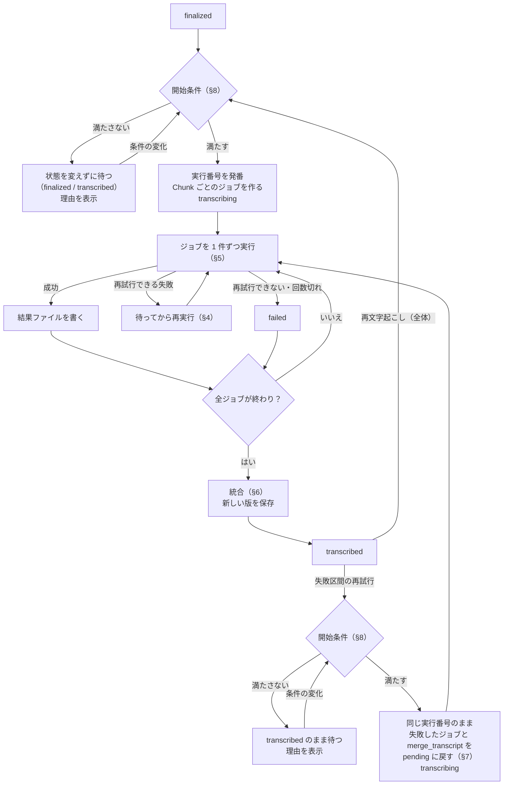
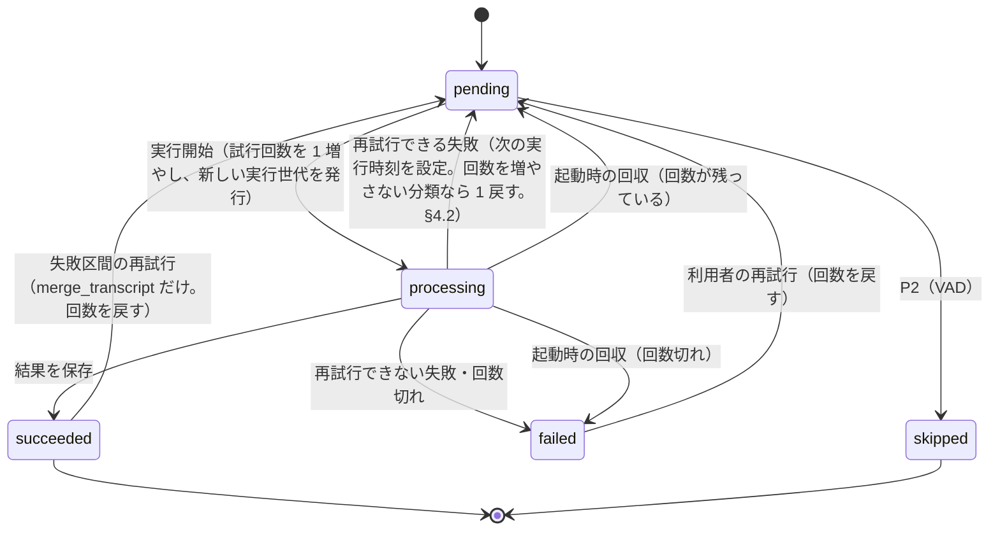

# MinutesMobile 基本設計書 ── 文字起こし

| 項目 | 内容 |
| --- | --- |
| 版 | 1.0（初版） |
| 作成日 | 2026-11-15（技術情報の確認日 2026-11-14） |
| 満たす要件 ID | FR-STT-01〜09・12・13、FR-TRV-02・03、FR-RCV-04、NFR-REL-03、NFR-PRF-03、NFR-PWR-02・03、NFR-L10N-02、SEC-NET-03、INV-03・04・05 |
| 解決する未解決事項 | OQ-03、OQ-05 |
| 参照元 | Minutes P1 §3.10、Minutes P2 §9〜§11 |
| 関連文書 | [architecture.md](architecture.md)・[storage.md](storage.md)・[ui.md](ui.md) |

FR-STT-10（VAD によるスキップ）と FR-STT-11（代替エンジン）は P2 で、本書では接続点だけを示す。

---

## 1. 設計決定

満たす要件: FR-STT-01・02・04〜06、FR-TRV-02、NFR-PWR-03、SEC-NET-01、INV-03・05 ／ 解決: OQ-03

| ID | 決定 | 理由 | 退けた代替案 |
| --- | --- | --- | --- |
| BD-STT-01 | 音声認識エンジンは protocol の背後に置く。本番の実装は `SpeechAnalyzer` + `SpeechTranscriber`（日本語）で、結果の時刻範囲と信頼度を要求する | OS 標準で端末内（FR-STT-01）。差し替えて単体テストできる（TST-GEN-04）。P2 の代替エンジンを足せる | エンジンの API をジョブから直接呼ぶ |
| BD-STT-02 | 認識は Chunk 単位のジョブにする。入力（前の Chunk の末尾 3 秒 + 当該 Chunk）は自前で組み立ててエンジンに渡す | 中断しても未完了の Chunk から再開できる（FR-STT-02）。Overlap のために 2 つのファイルをつなぐ必要がある | 会議全体を 1 本の入力として流す（途中で止まると最初からやり直し）。`AssetInputSequenceProvider`（1 つのファイルしか渡せない） |
| BD-STT-03 | Chunk ごとの認識結果は、会議ディレクトリの JSON ファイルに原子的に書く。SQLite にはジョブの状態だけを置く | ファイル名が一意キーになり、再実行しても重複しない（FR-STT-04、INV-05）。本文を DB に置かない（BD-ARC-03） | DB の表に `INSERT OR IGNORE`（Minutes P2 §10.5） |
| BD-STT-04 | 文字起こしの実行ごとに実行番号を振り、結果を実行番号別のディレクトリに置く | 再文字起こしの途中でも以前の版が壊れない。途中で落ちても古い結果と混ざらない（FR-STT-05） | 同じ場所に上書きする |
| BD-STT-05 | 全ジョブが終わり（成功・失敗・スキップのいずれか）になったら統合して `transcribed` にする。失敗した Chunk は失敗区間として表示し、区間単位で再試行できる | 一部の失敗で全体が見られなくなるのを避ける（FR-TRV-02）。自動の再試行が尽きるまでは `transcribing` で待つ | 失敗が 1 つでもあれば統合しない（Minutes P2 §9.5。利用者が選ぶまで何も見えない） |
| BD-STT-06 | 統合は純粋関数にし、同じ入力から必ず同じ結果を返す。規則は Minutes P2 §11 を移植する | 再現できる（TST-STT-04）。判定を記録して UI で確認できる | エンジンの結果の癖に合わせた場当たりの処理 |
| BD-STT-07 | バックグラウンドの継続には `BGContinuedProcessingTask` を使い、GPU 資源は要求しない。使えない・打ち切られた場合は、前面に戻ったときに未完了のジョブから再開する（OQ-03） | Chunk 単位なので、どこで止まっても失うのは処理中の 1 Chunk 分の計算だけ。GPU の entitlement は無償アカウントで使えない | バックグラウンドでの完走を前提にする |
| BD-STT-08 | エンジンが使えない間は会議を `finalized` のまま待たせ、ジョブを作らない | 録音と確定に影響させない（FR-STT-06、INV-03） | ジョブを作って失敗させ続ける |
| BD-STT-09 | 同時に実行するジョブは 1 件にする | 端末の発熱と電池（NFR-PWR-03）。順序が決まり、試験しやすい | 複数の Chunk を並列に認識する |
| BD-STT-10 | 旧来の `SFSpeechRecognizer` は使わない（静的解析で禁止する） | サーバーでの認識に切り替わる設定があり、端末外へ音声が出る余地がある（SEC-NET-01） | — |

---

## 2. 全体の流れ

満たす要件: FR-STT-01・02・05・12

---

## 3. エンジンの抽象と可否の判定

満たす要件: FR-STT-01・06・07・09、NFR-L10N-02、SEC-NET-03 ／ 解決: OQ-05

### 3.1 エンジンが答えること

| 問い | 本番の実装での調べ方 |
| --- | --- |
| この端末で使えるか | `SpeechTranscriber.isAvailable` |
| 日本語に対応しているか | `SpeechTranscriber.supportedLocale(equivalentTo:)` |
| 言語アセットは入っているか | `AssetInventory.status(forModules:)`（未対応 / 取得可能 / 取得中 / 導入済み） |
| エンジンの情報 | エンジン名、ロケール、OS の版とビルド番号 |

可否は次の 5 種に分類し、画面に理由を出す（FR-STT-06）。

| 可否 | 意味 | 利用者ができること |
| --- | --- | --- |
| `available` | 使える | — |
| `asset_missing` | 対応しているが言語アセットがない | 明示操作で取得を開始する（§3.2） |
| `unsupported_device` | この端末では使えない | なし（録音と書き出しは使える。P2 の代替エンジンを待つ） |
| `unsupported_locale` | 日本語に対応していない | なし |
| `temporarily_unavailable` | OS 側の一時的な失敗 | 後で再試行する |

OQ-05 の結論: 日本語の提供状況と言語アセットの有無は**実行時に判定する**設計にし、特定の版で提供されていることを前提にしない。実際に日本語で認識できることは実機で確かめる（TST-STT-07）。SDK にはアセットの版を取得する API が見当たらないため、FR-STT-09 の「言語アセットの識別子」は、ロケールと OS のビルド番号で代える。

### 3.2 言語アセットの取得

1. 設定画面または会議詳細に「日本語の音声認識モデルが必要です」と表示する。
2. 利用者が取得を選ぶと、開始前に「OS が音声認識モデルをダウンロードします。会議データは送信されません」と表示する（FR-STT-07）。
3. `AssetInventory.assetInstallationRequest(supporting:)` で要求を作り、取得と導入を実行する。進み具合を表示する。
4. 完了したら開始条件（§8）を評価し直す。

取得は OS が行う通信で、アプリのコードは通信しない（SEC-NET-03）。自動では開始しない。

---

## 4. ジョブ基盤

満たす要件: FR-STT-02、FR-RCV-04、NFR-REL-03、INV-04・05

### 4.1 ジョブの種類と状態

| 種類 | 単位 | 作る時点 |
| --- | --- | --- |
| `transcribe_chunk` | Chunk ごと | 文字起こしの開始時に全 Chunk 分。利用できない Chunk（欠番・ファイル欠損・ハッシュ不一致・不正なヘッダ）には作らず、理由を記録する |
| `merge_transcript` | 実行番号ごとに 1 件 | 全 `transcribe_chunk` が終わりになったとき。同じ実行番号で失敗区間を再試行した場合は、新しいジョブを作らず、既存の `merge_transcript` を `pending` に戻し、再試行した `transcribe_chunk` がすべて終わりになってから実行する（統合のたびに新しい版を保存する） |

状態は FR-STT-02 の 5 種。`skipped` は P2 の VAD スキップ用で、MVP では使わない。

ジョブの一意キーは（会議 ID、実行番号、種類、連番）。同じジョブを二重に作ろうとしても 1 件になる。

`processing` に入るたびに、ジョブに**実行世代**（注入した UUID 生成器で作る一意の値）を発行して記録する。実行世代は再試行・起動時の回収・利用者の再試行のいずれでも再利用しない。試行回数は再試行の上限の判定にだけ使い、応答の照合には使わない（回数を増やさない失敗や、利用者の再試行で回数を戻した後に、古い実行と同じ値になりうるため）。

### 4.2 失敗の分類と再試行

| 分類 | 例 | 再試行 | 試行回数 |
| --- | --- | --- | --- |
| `ASSET_MISSING` | 言語アセットが消えた | アセットの導入を待つ | 増やさない |
| `ENGINE_UNAVAILABLE` | OS 側の一時的な失敗 | 開始条件が戻るのを待つ | 増やさない |
| `SYSTEM_EXPIRED` | バックグラウンドの打ち切り、利用者の中止、高温・低電力による中断 | 次の機会に再開 | 増やさない |
| `INSUFFICIENT_RESOURCES` | 資源の不足 | 間隔を空けて再実行 | 増やす |
| `TIMEOUT` | 上限時間（初期値: 音声の長さの 10 倍）を超えた | 間隔を空けて再実行 | 増やす |
| `INVALID_AUDIO` | WAV ヘッダの不正、ハッシュの不一致 | **しない**。Chunk のファイルの状態を更新する | — |
| `INTERNAL` | その他 | 間隔を空けて再実行 | 増やす |

- 間隔は 2・5・10・30・60 秒に ±20% のゆらぎ（Minutes P2 §9.4 と同じ）。試行回数の上限は初期値 5。時計と乱数は注入する。
- 試行回数は `processing` に入るときに 1 増やす（実行中にアプリが落ちても、起動時の回収で数えられるようにするため。§4.3）。「増やさない」分類（`ASSET_MISSING`・`ENGINE_UNAVAILABLE`・`SYSTEM_EXPIRED`。録音の開始による中止とバックグラウンドの打ち切りを含む）で `pending` に戻すときは、同じ取引の中で、実行開始時に増やした 1 を戻す。これらの中止は、後の再試行の上限に数えない。戻す処理も実行世代の照合（§4.3）を通った通知に限る。
- 上限に達したら `failed`。失敗区間として表示し、利用者が再試行できる（FR-TRV-02）。
- **`merge_transcript` が `failed` になった場合**（再試行できない失敗・回数切れ）: 新しい版を保存できないので、会議は `transcribing` のまま（要件の状態遷移図の「一部失敗（再試行待ち）」）にし、会議詳細の状態の帯に「文字起こしの統合に失敗しました」と再試行の操作を出す（[ui.md](ui.md) §4.4）。以前の版があれば表示し続ける。利用者が再試行すると、新しいジョブを作らず、既存の `merge_transcript` を `pending` に戻して回数を戻す。統合は、その実行番号の `transcribe_chunk` がすべて終わり（成功・失敗・スキップ）になってから実行する（失敗区間の再試行と同時に行った場合は、再試行した `transcribe_chunk` が終わるまで待つ）。統合に成功したら新しい版を保存して `transcribed` にする。

### 4.3 起動時の回収と古い応答

- 起動時に `processing` のまま残っているジョブを回収する。試行回数が残っていれば `pending`、尽きていれば `failed`（分類 `INTERNAL`）にする。回数を見ずに戻すと、実行のたびにアプリを落とすジョブが永久に繰り返される（Minutes P2 §9.3）。
- **完了の通知はすべて実行世代で照合する。** 成功（結果の保存）に限らず、失敗（§4.2 のどの分類でも）・中止（`SYSTEM_EXPIRED`）・タイムアウトを含むすべての完了の通知について、状態・試行回数・次の実行時刻・失敗の分類を更新する前に、ジョブが今も `processing` で、現在の実行世代が通知の持つ実行世代と一致することを確かめる。一致しない通知は、結果ファイルを書かず、ジョブの状態・試行回数にも反映せずに捨てる（遅れて届いた古い実行の成功・失敗を、新しい実行の完了として扱わない。TST-GEN-05）。照合と更新は保存の actor の中で続けて行い、間に別の実行開始・回収・利用者の再試行が入らないようにする。
- **実行番号のディレクトリ:** 実行番号を発番したら、ジョブを作る前に `stt/run-{実行番号}/` を作る。結果がまだ 1 件も保存されていなくても消さない（§7 の結果ファイルの削除の対象にしない）。発番は DB の最大の実行番号と `stt/` にある最大の実行番号の大きい方 + 1 とする（ディレクトリの作成後・DB の更新前に落ちて空のディレクトリが残っても、番号が重ならない）。
- **ジョブの不足分の作成（[storage.md](storage.md) §3.3・§8 の手順 7）:** 起動のたびに、DB を作り直したかどうかによらず、`transcribing` の会議について行う。実行番号は、その会議のジョブ行があればその最大の実行番号（ジョブ行が複数の実行番号にまたがる場合も最大を使う）、なければ `stt/` にある最大の実行番号を使い、新しく発番しない（`stt/` がなければ 1）。§2・§4.1 と同じ方法で、利用できる Chunk のうちその実行番号の `transcribe_chunk` の行がないものにだけ作る。その実行番号の結果ファイルがあり、検証（§12）に通り、記録された Chunk の SHA-256 が現在のハッシュの記録と一致する Chunk は `succeeded` として、それ以外は `pending` として作る（成功済みの結果ファイルのない Chunk だけが再実行される）。既存のジョブ行は変更しない。一意キー（§4.1）により、何度実行しても重複しない。DB の作り直しや不足分の作成の途中で落ちてジョブ行が一部だけある場合も、次の起動で残りが作られる。`merge_transcript` は §4.1 のとおり、全 `transcribe_chunk` が終わりになり、その実行番号の `merge_transcript` がないときに作る。
- 結果ファイルの保存とジョブの状態の更新の間で落ちた場合、ジョブは再実行され、同じファイルを上書きする。結果は 1 つのままである（INV-05）。

---

## 5. Chunk の認識

満たす要件: FR-STT-01・03・04・08・09、INV-03

### 5.1 手順

| 順 | 処理 | 失敗時 |
| --- | --- | --- |
| 1 | 当該 Chunk のファイルを読み取り専用で開き、ヘッダを検証し、SHA-256 を記録と照合する | `INVALID_AUDIO` |
| 2 | Overlap の可否を判定する（§5.2）。可なら前の Chunk の末尾を読む（同じ検証を行う） | 前の Chunk が使えなければ Overlap なしで続ける |
| 3 | 16 kHz・Int16 の PCM をエンジンが受け付ける形式に変換し、入力の列として渡す | `INTERNAL` |
| 4 | 確定した結果を受け取る（途中経過の結果は要求しない） | 分類して §4.2 |
| 5 | Overlap の区間に完全に収まる結果を捨て、時刻を会議全体のサンプル番号に直す | — |
| 6 | 結果ファイルを原子的に書き、ジョブを `succeeded` にする | §4.3 |

録音ファイルは読むだけで、変更も削除もしない（INV-03）。エンジンのモデルは、会議の文字起こしが終わるまで保持する設定にして、Chunk ごとの読み込み直しを避ける（設定は詳細設計で確定する）。

### 5.2 Overlap

| 条件 | Overlap | 記録する理由 |
| --- | --- | --- |
| 直前の連番の Chunk が利用でき、間に空白区間がない | 前の Chunk の末尾 3 秒（48,000 サンプル。前の Chunk がそれより短ければ全体）を先頭につなぐ | — |
| 最初の Chunk | なし | `first_chunk` |
| 直前の連番が欠番 | なし | `missing` |
| 直前の Chunk のファイルがない | なし | `file_missing` |
| 直前の Chunk のハッシュが合わない | なし | `hash_mismatch` |
| 間に空白区間がある | なし | `gap` |

- Overlap なしの場合、後続の Chunk は先頭から通常どおり認識する。先頭の区間を空白として扱わない（FR-STT-03 ②）。
- つないだ入力の時刻 t（秒）は、`当該 Chunk の開始サンプル − Overlap のサンプル数 + t × 16,000` で会議全体のサンプル番号に直す。
- 結果のうち Overlap の区間の中で終わるものは捨てる（前の Chunk のジョブが担当する）。境界をまたぐものは残し、重複は統合で解決する。認識の段階で隣の Chunk の結果を見ない（ジョブを独立・冪等に保つため）。
- 直前の Chunk のヘッダが不正な場合の理由は、`hash_mismatch` に含めるか新しい理由を足すかを詳細設計で決める。足す場合は FR-STT-03 ③を同じ作業で更新する。

### 5.3 結果ファイル

`stt/run-{実行番号 4 桁}/{連番 6 桁}.json` に次を持つ（項目の定義は詳細設計）。

- 対象の Chunk の連番と SHA-256（どの音声に対する結果かの証跡）
- エンジンの情報（§3.1）と処理時間
- Overlap の適用の有無・理由・つないだサンプル数・捨てた結果の件数
- セグメントの配列（Chunk 内の番号、開始・終了のサンプル番号、本文、信頼度）

**セグメント**は、エンジンが返す確定した結果 1 件とする。セグメントの ID は「連番-Chunk 内の番号」で決定的に決まり、同じ版の中で一意である。以前の版を保持するので（§7）、版をまたいで参照する場合は版番号と組にする（FR-STT-04。P2 の根拠 ID も版番号と組で持つ）。

**信頼度**（FR-STT-08）は、結果の中の区間ごとの値を文字数で重み付けして平均する。取得できなければ「なし」として保存する。エンジン間・版の間で比べられる値ではないので、会議の中の相対的な目安としてだけ使う。低信頼度として表示するしきい値は設計値（初期値 0.4）で、実測して見直す。

---

## 6. 統合

満たす要件: FR-STT-03・05、FR-TRV-02・03

入力は「その実行番号の全結果ファイル」「Chunk の一覧と状態」「空白区間」「ジョブの最終状態」。出力は確定文字起こしの 1 つの版である。

### 6.1 重複の除外

隣り合う Chunk の境界の前後 3.5 秒に入るセグメントの組だけを比べる（会議全体の総当たりはしない）。

| 判定 | 定義 | 設計値 |
| --- | --- | --- |
| 時間の重なり | 重なる長さ ÷ 短い方の長さ | 0.5 以上 |
| 本文の類似 | 正規化した文字列の編集距離から求める（1 − 距離 ÷ 長い方の長さ）。どちらかが空なら 0 | 0.8 以上 |
| 包含 | 一方が他方の部分文字列で、長さの比が 0.3〜0.95 | — |

- 正規化（比較にだけ使う。表示は元の本文）: Unicode の NFKC、句読点・記号・空白の除去、英字の小文字化。長音・促音のゆれは同一視しない。
- 重なりと類似の両方を満たす組は重複とみなす。包含なら長い方を、そうでなければ信頼度の高い方を残し、同点なら前の Chunk 側を残す。
- しきい値に届かない組は別の発話として両方残す（取りこぼしより二重に残す方を選ぶ）。
- 判定は境界ごとに記録する。Overlap を行わなかった境界も「Overlap なし」と理由を記録し、除外は 0 件とする（FR-STT-03 ③）。

### 6.2 版のファイル

`transcript/v{版 4 桁}.json` は、それだけで表示できる内容を持つ。

| 内容 | 用途 |
| --- | --- |
| 採用したセグメント（ID・サンプル番号・本文・信頼度）を時刻順に | 表示・再生位置・書き出し |
| 除外したセグメントと、どのセグメントの重複とみなしたか | 判定の確認（FR-STT-03） |
| 境界ごとの記録（Overlap の有無・理由・除外の件数） | 同上 |
| 失敗した Chunk の区間 | 失敗区間の表示と再試行（FR-TRV-02） |
| 利用できなかった Chunk の区間と理由 | 空白の表示（FR-TRV-03、FR-FIN-02 ③） |
| 空白区間の写し | 空白の表示（FR-TRV-03） |
| エンジンの情報・実行番号・作成日時 | FR-STT-09 |

SQLite の `transcript_versions` には、版・実行番号・件数・ファイルのハッシュだけを置く（本文は置かない）。

---

## 7. 版管理と再文字起こし

満たす要件: FR-STT-05、FR-FIN-03

| 操作 | 実行番号 | 版 | 状態の遷移 |
| --- | --- | --- | --- |
| 最初の文字起こし | 1 | 1 | `finalized` → `transcribing` → `transcribed` |
| 失敗区間の再試行 | 同じ番号で、失敗した Chunk のジョブと、その実行番号の `merge_transcript` を `pending` に戻す（§4.1） | 完了時に +1 | `transcribed` → `transcribing` → `transcribed` |
| 再文字起こし（全体） | +1（全 Chunk のジョブを新しく作る） | 完了時に +1 | 同上 |

- 新しい版ができるまで、以前の版を表示し続ける。表示が読むのは版のファイルだけなので、処理の途中の結果が画面に混ざらない。
- 以前の版のファイルは消さない。
- **現在の実行番号の結果ファイルは消さない。** 版のファイルには重複を除いた後の結果しかなく、失敗区間の再試行の後の統合は、成功済みの Chunk の結果ファイルを読み直して行うため、混在した結果の版を保存しただけでは消せない。実行番号 r の結果ファイルを消してよいのは、r より新しい実行番号から版が保存され、r が失敗区間の再試行の対象でなくなった後に限る。
- 保管中（`complete`）の会議を再処理するときは、先に処理中の保護クラスに戻す（[storage.md](storage.md) §7.1）。
- P2 では `completed` からの再文字起こしも同じ手順で、AI 議事録は消さない。各 AI 議事録は、もとにした文字起こしの版を記録する。

---

## 8. 開始条件と延期

満たす要件: FR-STT-06・12・13、NFR-PWR-02

開始条件は純粋関数で評価する。満たさない場合は理由を返し、画面に表示する。

| 条件 | 満たさないとき | 利用者による上書き |
| --- | --- | --- |
| 録音中でない | 録音の確定まで延期する（BD-ARC-08） | できない |
| エンジンが使える（§3.1） | `finalized` のまま待つ | できない（アセットの取得はできる） |
| 温度状態が `serious` 未満 | 延期して表示する | できる（明示の操作で実行） |
| 低電力モードでない | 延期して表示する | できる |
| 自動開始が有効（確定の直後だけ評価） | 利用者が開始を指示するまで待つ | 設定で切り替える（FR-SET-02） |

- 評価し直すきっかけ: 録音の確定、前面への復帰、温度・電源の状態の変化、言語アセットの導入完了、利用者の操作。
- 実行中も、ジョブとジョブの間で温度と低電力を確かめる。延期の条件に入ったら次のジョブを始めず、状態は `transcribing` のまま理由を表示する（利用者が上書きした実行では確かめない）。
- **録音の開始は、実行中の文字起こしを止める**（BD-ARC-08）。ジョブの合間を待たず、処理中の Chunk を中止して `pending` に戻す（分類 `SYSTEM_EXPIRED`。試行回数を増やさない。遅れて届いた結果は実行世代の照合で捨てる。§4.3）。利用者が温度・低電力を上書きした実行にも適用する。会議の状態は `transcribing` のまま、停止の理由（録音中）を表示する。録音の確定後に本節の条件を評価し直し、満たせば中断したジョブから再開する。満たさなければ、その理由を表示して待つ。

---

## 9. バックグラウンドでの実行

満たす要件: NFR-PWR-03、FR-RCV-04 ／ 解決: OQ-03

| 局面 | 設計 |
| --- | --- |
| 前面で開始する（確定の直後、または利用者の操作） | 開始と同時に継続処理タスクを投入する。表示する題名に会議タイトルを入れない。進捗（完了した Chunk の数 ÷ 全体）を報告し続ける |
| アプリが背面に回る・画面がロックされる | 継続処理タスクが続く限り、ジョブを進める |
| システムが打ち切る | 処理中の Chunk を中止して `pending` に戻す（`SYSTEM_EXPIRED`）。前面に戻ったときに再開する |
| 投入が拒否される・使えない | 前面にいる間だけ進める。背面に回ったら止まり、前面に戻ったときに再開する |
| 背面で確定した（ロック中に停止したなど） | 前面に戻ったときに開始条件を評価する |
| アプリが終了した | 次の起動で回収して再開する（§4.3） |

- 継続処理タスクは、Background Modes の設定と、許可する識別子の宣言（末尾がワイルドカードの形）を必要とする。Background Modes は Personal Team で使える（[architecture.md](architecture.md) §1）。
- どの局面でも、Chunk 単位で状態が永続化されているので、失うのは処理中の 1 Chunk 分の計算だけである。
- 古典的な `BGProcessingTask`（OS が都合のよい時刻に起動する）は MVP では使わない。必要かどうかは TST-DEV-11 の結果で判断する。

---

## 10. 実測して記録する値

満たす要件: NFR-PRF-03

| 値 | 単位 |
| --- | --- |
| 実時間比（処理時間 ÷ 音声の長さ） | Chunk ごと。端末の機種・エンジン・OS の版とともに |
| 失敗の分類ごとの件数、再試行の回数 | 会議ごと |
| Overlap で除外した件数 | 版ごと |
| 低信頼度のセグメントの割合 | 版ごと |
| バックグラウンドで打ち切られた回数 | 会議ごと |

数値は保証しない。合否の条件にも使わない。

---

## 11. 断定しない事項

満たす要件: FR-STT-03・08、NFR-PRF-03、NFR-PWR-03

| 事項 | 断定しない理由 | 担保の方法 |
| --- | --- | --- |
| Personal Team で継続処理タスクを投入できる | capability の表に行がないことしか確認できていない。識別子のワイルドカードが一致しないという報告もある | TST-DEV-11。使えなければ「前面で進め、戻ったら再開」になる（設計済み） |
| バックグラウンド・ロック中に音声認識が動く | エンジンが GPU などの資源を必要とする場合、背面では制限されうる | TST-DEV-10・11 |
| 日本語の精度・速度 | 端末・話者・音質による | 実時間比と信頼度を記録する |
| 信頼度が取得できる・しきい値 0.4 が妥当 | エンジンの実装による | 取得できない場合の表示を用意する。実測して見直す |
| 30 秒の Chunk と 3 秒の Overlap が SpeechTranscriber に適している | エンジンの結果の区切り方による | 境界での取りこぼし・重複を記録して見直す（設計値として差し替え可能にする） |
| SpeechAnalyzer の利用に音声認識の許可（利用目的の文言）が要るか | SDK の宣言からは判断できない | 詳細設計で確認する（[dev-environment.md](dev-environment.md) §3） |

---

## 12. セキュリティ

満たす要件: SEC-NET-01・03、SEC-INT-01・02、SEC-LOG-03・04、SEC-INP-03、INV-03

| 観点 | 設計 | 要件・脅威 |
| --- | --- | --- |
| 端末内での認識 | `SpeechAnalyzer` だけを使う。`SFSpeechRecognizer` を静的解析で禁止する（BD-STT-10） | SEC-NET-01、T-03 |
| 言語アセットの取得 | 利用者の明示操作だけ。事前に説明を表示する。アプリは通信しない | SEC-NET-03 |
| 録音の保護 | ファイルは読み取り専用で開く。文字起こしの前後でハッシュが変わらないことを試験する | INV-03、TST-STT-01 |
| 完全性 | 認識の前にヘッダとハッシュを検証する。合わない Chunk は認識に渡さない | SEC-INT-01・02、T-07 |
| 本文の置き場所 | 会議ディレクトリだけ。SQLite・ログ・エラーの値・継続処理タスクの題名に入れない | BD-ARC-03、SEC-LOG-03 |
| エンジンのエラー | エラーの説明文をそのままログに出さない（発話が含まれうる）。分類とコードだけを記録する | SEC-LOG-03・04 |
| 結果ファイルの読み込み | 版のファイル・結果ファイルも永続データとして検証する | SEC-INP-03 |

**設計・実装時の注意点:**

- エンジンに渡す補助情報（固有名詞のリストなど）を足す場合、利用者の入力だけを使い、AI に生成させない（P2 以降）。
- 「処理中」の表示（継続処理タスクの題名・副題、通知）に会議タイトルを入れない。ロック画面に出る。
- 文字起こしの完了を知らせる通知を足す場合も、本文とタイトルを入れない。

---

## 13. テスト観点

満たす要件: TST-STT-01〜09、TST-RCV-03、TST-DEV-09〜11、TST-GEN-05

| 試験 | 単体・結合で再現する方法 | 実機でしか確かめられないこと |
| --- | --- | --- |
| TST-STT-01（録音を変えない） | 認識の前後で全 Chunk のハッシュを比べる | — |
| TST-STT-02（再開） | 途中でジョブの実行を止め、未完了の Chunk だけが再実行されること | — |
| TST-STT-03（重複しない） | 同じジョブを 2 回実行する。結果ファイルの保存直後に落として再実行する | — |
| TST-STT-04（重複の除外） | 境界で同じ発話が 2 回出る結果を差し替えで作る。同じ入力から同じ版ができること | — |
| TST-STT-05（使えない） | エンジンの可否を差し替える。会議が `finalized` のまま、録音と確定に影響しないこと | — |
| TST-STT-06（延期） | 温度・低電力を差し替える。利用者の上書きも。実行中に録音を開始し、処理中の Chunk が `pending` に戻ること（上書きした実行でも）、会議が `transcribing` のまま理由が出ること、録音の確定後に条件を満たせば再開すること | — |
| TST-STT-08（Overlap なし） | 欠番・ファイル欠損・ハッシュ不一致・空白区間を 1 つずつ作り、境界の記録と、後続の先頭が空白にならないこと | — |
| TST-STT-09（再文字起こし） | 状態の遷移、以前の版が残ること、完成まで以前の版が読めること。失敗を含む版を保存した後に失敗区間を再試行し、成功済みの区間の本文が新しい版に残ること | — |
| TST-RCV-03（回収） | `processing` のまま残した DB で起動時の回収を実行する。回数切れは `failed` になること | — |
| 試行回数の戻し | `SYSTEM_EXPIRED`（録音の開始・バックグラウンドの打ち切り）・`ASSET_MISSING`・`ENGINE_UNAVAILABLE` で中止を繰り返し、試行回数が実行前の値に戻り、上限に達しないこと。古い実行世代の中止の通知では回数が戻らないこと | — |
| 統合の失敗 | `merge_transcript` を回数切れで `failed` にする。会議が `transcribing` のまま理由と再試行の操作が出て、以前の版が表示され続けること。再試行で既存のジョブが `pending` に戻り（新しいジョブ行が増えない）、未完了の `transcribe_chunk` が終わってから統合され、新しい版が保存されること | — |
| TST-STT-07（実エンジン） | — | 端末内の音声合成で作った日本語を認識できること |
| バックグラウンド | 開始・打ち切り・拒否を差し替えて、状態が正しく戻ること | 継続処理タスクとロック中の動作（TST-DEV-10・11）、120 分の完走（TST-DEV-09） |

**設計・実装時の注意点:**

- 統合の試験は、判定の境界値（重なり 0.5、類似 0.8、包含の比 0.3・0.95、空文字列）を必ず含める。
- 遅れて届いた古い実行の結果・失敗・中止の通知が捨てられ、状態と試行回数が変わらないことを試験する（実行世代の不一致）。試行回数が同じになる場合（回数を増やさない失敗の後、利用者の再試行で回数を戻した後）も含める。
- エンジンを差し替えた試験だけで完了にしない。実エンジンの試験（TST-STT-07）の記録を完了条件にする。
- 時刻の変換（Overlap のずれ、空白区間の加算）は、既知の値で数値を検証する。

---

## 14. 詳細設計への申し送り

満たす要件: —（詳細設計への引き継ぎ事項。満たす要件はない）

- エンジンの protocol と、`SpeechAnalyzer` への入力の組み立て方（変換・モデルの保持の設定）。
- 結果ファイルと版のファイルの項目。
- ジョブの表の列、一意制約、次に実行するジョブの選び方。
- 統合の規則の擬似コードと設計値の最終値。
- 継続処理タスクの識別子と、進捗の報告の頻度。

---

## 15. 出典

満たす要件: —（出典の一覧。満たす要件はない）

- iOS 27.2 SDK の `Speech.swiftinterface`（`SpeechAnalyzer`・`SpeechTranscriber`・`AssetInventory`・`AssetInstallationRequest`・エラーコード）、`BGTaskRequest.h`・`BGTask.h`（確認日 2026-11-14）
- [Apple Developer Forums: 継続処理タスクの識別子のワイルドカードに関する報告](https://developer.apple.com/forums/thread/799126)（確認日 2026-11-14）
- [Apple Developer: SpeechAnalyzer](https://developer.apple.com/documentation/speech/speechanalyzer)
- Minutes `docs/design-local-phase2.md` §9〜§11
