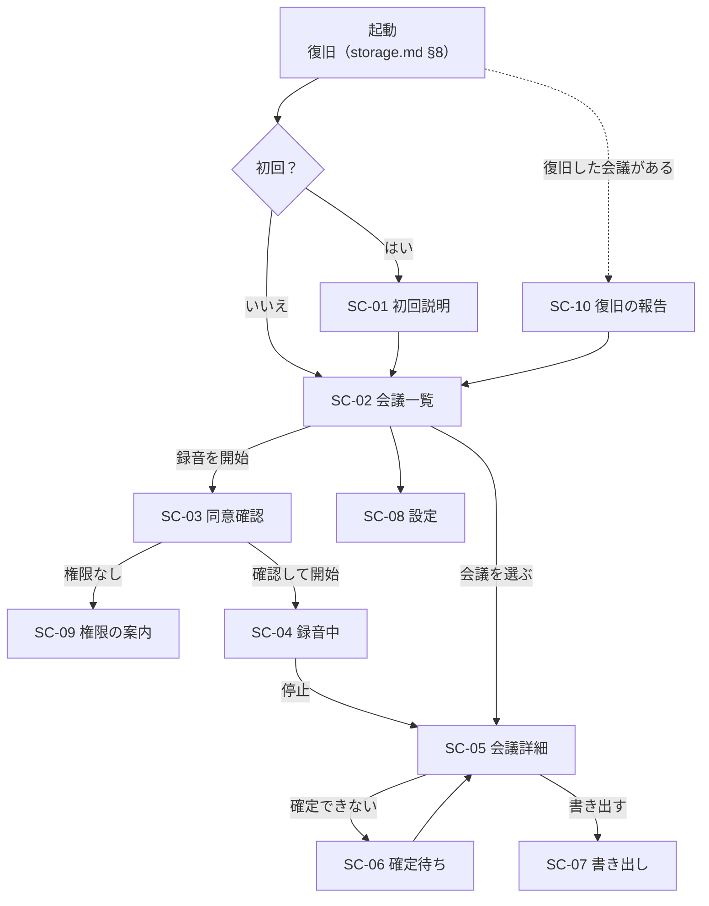

# MinutesMobile 基本設計書 ── 画面

| 項目 | 内容 |
| --- | --- |
| 版 | 1.0（初版） |
| 作成日 | 2026-11-15（技術情報の確認日 2026-11-14） |
| 満たす要件 ID | FR-CNS-01・03、FR-REC-06、FR-INT-06、FR-SAV-05、FR-FIN-02、FR-STT-07、FR-TRV-01〜03、FR-MTG-01〜03、FR-SET-01〜03、NFR-PRF-04、NFR-CAP-02、NFR-UX-01〜04、NFR-L10N-01、SEC-APP-01、SEC-PLT-01・02・06・07、SEC-PRV-02・04 |
| 解決する未解決事項 | OQ-04 |
| 参照元 | Minutes P1 §3.6・§3.9・§20、Minutes P2 §18 |
| 関連文書 | [architecture.md](architecture.md)・[recording.md](recording.md)・[storage.md](storage.md)・[transcription.md](transcription.md)・[export.md](export.md) |

画面の見た目（配色・余白・文言の最終形）は詳細設計で決める。本書は画面の種類、遷移、各画面が示す状態と操作、プライバシー保護のための UI の決まりを定める。

---

## 1. 設計決定

満たす要件: FR-REC-06、NFR-UX-03・04、SEC-APP-01、SEC-PLT-01・06・07、SEC-DAT-06、INV-08 ／ 解決: OQ-04

| ID | 決定 | 理由 | 退けた代替案 |
| --- | --- | --- | --- |
| BD-UI-01 | 画面は SwiftUI、表示状態は画面ごとの Store（`@Observable`・MainActor）に持つ。View は Store の値を描くだけにする | 表示の判断を Store に集めれば、View を起動せずに単体テストできる | View の中で状態を計算する |
| BD-UI-02 | 録音中の経過時間と入力レベルは、録音パイプラインから届く値で更新する。画面のタイマーで時間を数えない。**値の契約:** 録音パイプラインは、取り出しのたびに（毎秒 10 回以下に間引いて）、累積サンプル数（16 kHz）・閉じた空白区間の長さの合計・録音セッションの状態・入力レベルを持つスナップショット（Sendable）を Store へ渡す。**録音セッションの状態が変わった時点**（割り込みによる中断の開始・再開、再構築の開始・完了、停止処理の開始、停止など）では、取り出しの有無にかかわらず、間引きの対象にせず、変化の後の状態を持つスナップショットを直ちに渡す（中断中は取り出しが起きないので、取り出しのときだけ渡すと「中断中」が表示に届かない。[recording.md](recording.md) §7 と同じ契約）。開いている空白区間（中断中）の長さは合計に含めない。Store は経過時間（会議時刻）を `累積サンプル数 ÷ 16,000 + 閉じた空白区間の長さの合計` で導き、この値以外から時間を作らない。中断中は累積サンプル数も合計も増えないので表示は止まり、再開して空白区間が閉じた時点でその長さが加わる | 表示も「サンプル数が正」に揃える（INV-08）。中断中に時間が進んで見えるのを防ぐ | 画面のタイマーで 1 秒ずつ増やす |
| BD-UI-03 | ロック画面とダイナミックアイランドの表示に Live Activity を使う。Personal Team で動かない場合は、アプリ内の表示と OS の録音インジケータで代える（OQ-04） | NFR-UX-03。capability の表に制限の記載はないが、実機で確かめるまで断定しない | Live Activity を前提にして代替を用意しない |
| BD-UI-04 | ロック画面に出るもの（Live Activity・通知・継続処理タスクの題名）には、状態と経過時間だけを出し、会議タイトルと本文を出さない | ロック中でも他人が見られる（SEC-PLT-07、T-04・T-05） | タイトルを表示する |
| BD-UI-05 | アプリが前面でなくなった時点で、画面全体を覆いに切り替える。どの画面でも同じ仕組みで行う | アプリ切り替え画面のスナップショットに D1〜D3 を残さない（SEC-APP-01）。一覧のタイトルも対象 | 画面ごとに個別に隠す（付け忘れる） |
| BD-UI-06 | サードパーティー製キーボードをアプリ全体で禁止する。解除の設定は作らない | 入力内容を外部へ送れる（SEC-PLT-06、T-04）。OS の制御がアプリ単位なので、入力欄ごとの付け忘れが起きない | 入力欄ごとに制限する |
| BD-UI-07 | D2 と会議タイトルのコピーは専用の操作だけで行い、端末内限定と有効期限を付ける。SwiftUI の標準のテキスト選択を D2 と会議タイトルの表示に使わない。会議タイトルの入力欄で OS 標準の編集メニューからコピーする場合は制御の対象外とし、入力欄のコピーは制限しない（§7.3） | 標準のコピーはユニバーサルクリップボードで他の端末へ同期されうる（SEC-PLT-01） | 標準の選択とコピーを有効にする |
| BD-UI-08 | 共有シートは `UIActivityViewController` を包んで使う。`ShareLink` を使わない | 完了・取り消しを受け取って一時ファイルを消すため（SEC-DAT-06） | `ShareLink` |
| BD-UI-09 | 利用者に見せる問題は「何が起きたか・録音は無事か・すべきこと」の 3 点を持つ 1 つの型で表す | NFR-UX-04。3 点が欠けた表示を作れなくする | 画面ごとに文言を組み立てる |
| BD-UI-10 | 画面の向きは縦だけにする | 画面の組み合わせを減らし、試験の対象を絞る。机に置いて使う場面では向きが変わらない | 横向きにも対応する（現在のプロジェクト設定） |

---

## 2. 画面一覧

満たす要件: FR-CNS-01・03、FR-MTG-01、FR-REC-06、FR-SAV-05、FR-FIN-02、FR-TRV-01〜03、FR-EXP-01〜04、FR-SET-01〜03、FR-INT-06、FR-RCV-01・02、SEC-APP-01、SEC-PRV-04

| ID | 画面 | 主な内容 | 主な要件 |
| --- | --- | --- | --- |
| SC-01 | 初回説明 | 端末内で処理すること、残るリスク、バックアップ除外と削除で消えること（P2 では手動ノートを含む） | FR-CNS-03、SEC-PRV-04 |
| SC-02 | 会議一覧 | 会議の一覧（新しい順）、状態、録音の開始 | FR-MTG-01 |
| SC-03 | 同意確認 | 同意の確認、タイトルの入力（任意） | FR-CNS-01、FR-MTG-02 |
| SC-04 | 録音中 | 経過時間、入力レベル、Chunk 数、空き容量、警告、停止 | FR-REC-06、FR-SAV-05 |
| SC-05 | 会議詳細 | 状態、文字起こし、失敗区間、空白区間、再生、操作 | FR-TRV-01〜03 |
| SC-06 | 確定待ち | 確定できない理由、再試行、例外確定 | FR-FIN-02 |
| SC-07 | 書き出し | 形式の選択、警告、共有（[export.md](export.md)） | FR-EXP-01〜04 |
| SC-08 | 設定 | 端末の対応状況、自動文字起こし、保存場所と損失の上限、データ使用量 | FR-SET-01〜03 |
| SC-09 | 権限の案内 | マイク権限がないときの説明と設定アプリへの導線 | FR-INT-06 |
| SC-10 | 復旧の報告 | 起動時に見つけた会議と救済の結果 | FR-RCV-01・02 |
| SC-11 | 覆い | アプリが前面でないときに全画面を隠す | SEC-APP-01 |

---

## 3. 画面遷移

満たす要件: FR-CNS-01、FR-INT-06、FR-RCV-01、SEC-PLT-04

- 録音中（SC-04）は全画面で重ねて表示する。録音中に一覧へ戻ることはできるが、録音中であることを常に画面上部に示す。
- 録音中にアプリが再起動された場合は、その会議は復旧の対象になる（SC-10）。録音中の画面には戻らない。
- 外部からの起動経路（URL スキーム・ユニバーサルリンク・共有拡張）は作らない（SEC-PLT-04）。Live Activity をタップするとアプリが開くだけで、値は受け取らない。

---

## 4. 画面ごとの設計

### 4.1 初回説明（SC-01）

満たす要件: FR-CNS-03、SEC-PRV-04

次を順に説明し、最後まで進むと一覧へ進む。設定画面からいつでも読み直せる。

| 説明する内容 |
| --- |
| 録音・文字起こしはこの iPhone の中だけで行い、外部へ送信しない |
| それでも残るリスク: 端末の紛失・盗難、書き出したファイルの扱い |
| 録音への同意は、法域によって参加者全員の同意が必要な場合がある |
| **録音はバックアップに含まれない。アプリを削除すると録音はすべて消える。残したい録音は書き出しで保存する** |
| **（P2）手動ノートも同じくアプリの削除で消える。残したいノートは Markdown の書き出し（FR-NOT-05 ③）で保存する** |
| 録音が中断したときに知らせるため、通知の許可を求める（許可しなくても録音はできる） |

### 4.2 同意確認と録音の開始（SC-03）

満たす要件: FR-CNS-01、FR-MTG-02、FR-INT-06、SEC-PRV-02

- 録音の開始の操作ごとに「この会議の参加者に録音の同意を得ましたか」を表示する。確認を省略する設定は作らない。
- 確認すると、確認した時刻を持つ「同意確認の値」ができ、それを渡して録音を開始する（[recording.md](recording.md) BD-REC-08）。
- タイトルは任意で、空なら開始日時から既定名を付ける。長さと文字を検証する（§7.4）。
- 空き容量が段階 2 のときは、ここで確認を足す（[storage.md](storage.md) §6）。
- マイク権限が拒否されている場合は SC-09 を表示し、設定アプリへの導線を出す。

### 4.3 録音中（SC-04）

満たす要件: FR-REC-06、FR-SAV-05、NFR-UX-02

| 表示 | もとになる値 |
| --- | --- |
| 状態（録音中 / 中断中 / 再構築中 / 停止処理中）を文字とアイコンで | 録音セッションの状態 |
| 経過時間（会議時刻） | サンプル数と空白区間（BD-UI-02） |
| 入力レベル | 録音パイプライン |
| 保存済みの Chunk 数 | 保存の actor |
| 録音できる残り時間の目安 | 空き容量（[storage.md](storage.md) §6） |
| メモリ上の未保存 Chunk の件数と「アプリが終了すると失われる」こと | 段階 3 のときだけ |
| 入力の種別（内蔵マイク / Bluetooth など） | 経路の履歴 |

操作は「停止」と、中断中の「再開」。停止は誤操作を防ぐため確認を挟むか、長押しにする（詳細設計で決める）。中断中は「録音が止まっています」を最上位に表示する（FR-INT-02）。

### 4.4 会議一覧（SC-02）と会議詳細（SC-05）

満たす要件: FR-MTG-01〜03、FR-TRV-01〜03、FR-STT-08・09、NFR-PRF-04

**一覧:** タイトル、開始日時、長さ、状態（録音中 / 確定待ち / 文字起こし待ち / 文字起こし中 / 完了）、例外確定の印、読めない会議の印。削除は確認つき（[storage.md](storage.md) §9）。

**詳細:**

| 要素 | 設計 |
| --- | --- |
| 状態の帯 | 会議の状態と、待っている理由（言語アセットなし・高温・低電力・録音中など。[transcription.md](transcription.md) §8）。進み具合（完了した Chunk の数） |
| 文字起こし | 版のファイルを読み、セグメントを時刻つきで並べる。遅延読み込みにする（NFR-PRF-04） |
| 低信頼度 | 色だけに頼らず、印や書体でも区別する（FR-STT-08、NFR-UX-02） |
| 失敗区間 | 「この区間は文字起こしに失敗しました」と再試行の操作（FR-TRV-02）。再試行は利用者が選んだ区間だけを認識し直し、選ばなかった失敗区間は失敗区間のまま残す（[transcription.md](transcription.md) §7） |
| 統合の失敗 | 統合のジョブが失敗した場合は、状態の帯に「文字起こしの統合に失敗しました」と再試行の操作を出す。以前の版があれば表示し続ける（[transcription.md](transcription.md) §4.2） |
| 空白区間 | 「録音が中断していました（約 N 分）」と理由。欠落した Chunk の区間も同じ形で示す（FR-TRV-03） |
| 再生 | セグメントをタップすると、その位置から原音を再生する（FR-TRV-01）。録音中は再生できない |
| エンジンの情報 | エンジン名・ロケール・OS の版を常に表示する（FR-STT-09） |
| 重複の除外の記録 | 境界ごとの判定を確認できる画面へ進める（FR-STT-03） |
| 操作 | タイトルの編集、文字起こしの開始、再文字起こし、書き出し、削除、言語アセットの取得、延期の上書き。**文字起こしの開始**は、一度も文字起こししていない `finalized` の会議（自動開始が無効で、利用者の指示を待っている会議。[transcription.md](transcription.md) §8）から最初の実行を始める操作で、既存の版から新しい実行を作る再文字起こしとは別の操作として示す |

再生は、セグメントの開始サンプルから該当する Chunk とファイル内の位置を求めて行う。Chunk をまたぐ場合は次の Chunk を続けて再生する。

### 4.5 確定待ち（SC-06）

満たす要件: FR-FIN-02、NFR-UX-04

確定できない理由（欠番・ファイル欠損・ハッシュ不一致・不正なヘッダ・復旧時に隔離した録音・未保存の件数）を一覧で示し、「再試行」と「欠落を承知して確定」を出す。例外確定は、失われる範囲を表示したうえで確認を求める。例外確定した会議には、一覧と詳細に印を付ける。

### 4.6 設定（SC-08）

満たす要件: FR-SET-01〜03、NFR-CAP-02

| 区分 | 内容 |
| --- | --- |
| 端末の対応状況 | 音声認識の可否、日本語アセットの有無（取得の操作）、空き容量、録音データの使用量（全体と会議ごと） |
| 文字起こし | 確定後に自動で開始する（オン / オフ） |
| データについて | 保存場所はこのアプリの中だけであること、バックアップから除外していること、アプリを削除すると録音が消えること（P2 では手動ノートも消え、残すには Markdown の書き出しが必要なこと）、強制終了で失う可能性のある音声の上限 |
| 説明 | 初回説明の読み直し |

Apple Intelligence の可否（FR-SET-01）は P2 の要約と合わせて表示する。MVP では「要約は今後の版で提供」とだけ示す。サードパーティー製キーボードの解除やアプリロック（P2）の項目は置かない。

### 4.7 復旧の報告（SC-10）

満たす要件: FR-RCV-01・02

起動時の復旧で見つけた会議（録音の途中で終了したもの、確定待ちのもの）、救済した Chunk の数、隔離した件数を 1 回だけ表示する。確定できた会議はそのまま一覧に並び、確定待ちの会議は SC-06 へ進める。

---

## 5. Store と値の流れ

満たす要件: NFR-MNT-02

- サービスから Store へは、表示に必要な値（スナップショット）を流す。Store は最新の値だけを持ち、古い要求への応答を無視する（TST-GEN-05）。
- Store は I/O を持たない。Store の試験は、サービスを差し替えて値を流し込むだけで書ける。
- 録音中の値の更新は毎秒 10 回以下に抑える。

---

## 6. 問題の伝え方

満たす要件: NFR-UX-04、SEC-LOG-04

| 項目 | 内容 | 例 |
| --- | --- | --- |
| 何が起きたか | 利用者の言葉で | 「保存先の空き容量が不足しています」 |
| 録音は無事か | 無事 / 危険がある（範囲）/ 失われた（範囲） | 「録音は続いています。直近の 3 件はまだ保存できていません」 |
| すべきこと | 1 つか 2 つの操作 | 「不要なデータを削除するか、録音を停止して書き出してください」 |

- 重大度は 3 段階（お知らせ / 警告 / 最上位の警告）とし、色・アイコン・文字で示す。録音が止まっている・失われうる状態は常に最上位にする。
- 文言に内部の用語（Chunk・Barrier・ハッシュ）を出さない。言い換えは詳細設計で決める。
- 表示する文に D1〜D3 を埋め込まない（エラーの値がそもそも持たない。[architecture.md](architecture.md) §8）。

---

## 7. プライバシー保護の UI

### 7.1 スナップショットの保護

満たす要件: SEC-APP-01

アプリの状態が「前面で操作中」でなくなった時点で、ルートに置いた覆い（SC-11）を表示する。覆いにはアプリ名と録音の状態（録音中 / 停止中）だけを出す。前面に戻ったら外す。P2 のアプリロックは、この覆いの上に認証を足して実現する。

### 7.2 キーボード

満たす要件: SEC-PLT-06

アプリの起動時の設定で、キーボードの拡張機能をアプリ全体で拒否する（アプリのデリゲートが、拡張機能の種類ごとに許可するかを答える仕組みを使う）。OS 標準のキーボード（日本語入力を含む）はそのまま使える。解除の設定は作らない。P2 のノート・検索の入力欄にも自動的に適用される（SEC-PLT-03）。

### 7.3 コピーと共有

満たす要件: SEC-PLT-01・02

| 操作 | 設計 |
| --- | --- |
| 文字起こし・会議タイトルのコピー | 専用の「コピー」操作だけ。ペーストボードに端末内限定と有効期限（初期値 5 分）を付ける |
| 標準のテキスト選択 | D2 と会議タイトルの表示には使わない（静的解析で検出する） |
| ドラッグ・アンド・ドロップ | D2 には提供しない |
| 共有 | 書き出しの操作からだけ（[export.md](export.md)） |
| Spotlight・Siri | 索引への登録・提案への提供を行わない。会議タイトルも渡さない |

タイトルの入力欄で OS 標準の編集メニューからコピーした場合は、この制御の外になる。利用者自身の操作によるもので、残る危険として記録する。

### 7.4 入力の検証

満たす要件: SEC-INP-01

タイトルは長さの上限（初期値 100 文字）と、制御文字・改行の除去を行う。タイトルはパスの組み立てに使わない（[storage.md](storage.md) BD-STO-06）。書き出しのファイル名に使うときの無害化は [export.md](export.md) §5 にある。

---

## 8. ロック画面の表示

満たす要件: NFR-UX-03、SEC-PLT-07、SEC-PRV-02 ／ 解決: OQ-04

| 手段 | 表示する内容 | 表示しない内容 |
| --- | --- | --- |
| Live Activity（録音中） | 状態（録音中 / 中断中）、経過時間 | 会議タイトル、本文 |
| ローカル通知（録音の中断・再開の失敗） | 「録音が中断しています。アプリを開くと再開を試みます」 | 同上 |
| 継続処理タスクの表示（文字起こし中） | 「文字起こし中」と進み具合 | 同上 |

OQ-04 の結論:

- Live Activity は capability の一覧に行がなく、Push を使わない形（アプリ自身が開始・更新する）なら追加の entitlement を要しない見込みである。ただし、ウィジェット拡張のターゲットが必要で、Personal Team での動作は**実機で確認してから確定する**（TST-DEV-12）。
- 動かない場合は、アプリ内の表示と OS の録音インジケータで NFR-UX-03 ②を満たす。この場合、ロック画面で確認できるのは OS のインジケータだけになることを設定画面に明記する。
- 実装の順序は UI の最後とし、Live Activity がなくても他の機能が完結するようにする。状態の表示は protocol の背後に置く（[architecture.md](architecture.md) §7）。
- 経過時間は、更新の合間も進んで見えるよう OS の時間表示を使うが、中断したら直ちに「中断中」の静止した表示に更新する。Chunk の確定のたびに表示の基準を合わせ直す。
- Live Activity からの停止の操作は MVP では提供しない（アプリを開いて停止する）。

---

## 9. アクセシビリティとローカライズ

満たす要件: NFR-UX-01・02、NFR-L10N-01

| 観点 | 設計 |
| --- | --- |
| Dynamic Type | すべての文字が拡大に追従する。固定の高さで文字を切らない。最大の文字サイズで録音の開始・停止に届くこと |
| VoiceOver | 録音の開始と停止は、それぞれ一意の名前で読み上げる。状態の変化（録音中・中断・停止）を読み上げで知らせる。入力レベルの連続した変化は読み上げない |
| 色に頼らない | 状態・重大度・低信頼度は、文字やアイコンでも示す |
| ダークモード | 両方の配色で確認する |
| 動きを減らす設定 | 入力レベルなどの動きを控えめにする |
| 文言 | String Catalog で管理する。コードに文言を直接書かない。基本の言語は日本語 |

---

## 10. 断定しない事項

満たす要件: NFR-UX-03、NFR-PRF-04、SEC-APP-01、SEC-PLT-06

| 事項 | 断定しない理由 | 担保の方法 |
| --- | --- | --- |
| Personal Team で Live Activity が動く | 実機で確かめていない | TST-DEV-12。代替を設計済み |
| 覆いがスナップショットの撮影に間に合う | OS が撮る時点に依存する | TST-SEC-09（実機） |
| キーボードの拒否がすべての入力欄に効く | OS の実装による | TST-SEC-10（実機） |
| 60 分の文字起こしが滑らかにスクロールする | 端末による | 実機で確認し、遅延読み込みの単位を調整する |

---

## 11. セキュリティ

満たす要件: SEC-APP-01、SEC-PLT-01・02・04〜07、SEC-PRV-02・04

| 観点 | 設計 | 要件・脅威 |
| --- | --- | --- |
| スナップショット | 全画面の覆い（§7.1） | SEC-APP-01、T-05 |
| キーボード | アプリ全体で拒否、解除なし（§7.2） | SEC-PLT-06、T-04 |
| コピー | 専用の操作・端末内限定・有効期限（§7.3） | SEC-PLT-01、T-04 |
| Spotlight・Siri | 渡さない | SEC-PLT-02 |
| ロック画面 | タイトル・本文を出さない（§8） | SEC-PLT-07 |
| 外部からの起動 | 経路を作らない | SEC-PLT-04 |
| WebView | 使わない | SEC-PLT-05 |
| 同意と録音の明示 | 同意を通らないと開始できない。録音中は常に表示 | SEC-PRV-02、T-06 |
| 初回説明 | 保存場所・バックアップ除外・書き出しの責任 | SEC-PRV-04 |

**設計・実装時の注意点:**

- 新しい画面を足すときは、覆いの下に入ること（ルートの仕組みを通ること）を確認する。別のウィンドウやシートで覆いの上に出るものを作らない。
- D2 を表示する部品に、標準のテキスト選択・ドラッグ・共有の修飾子を付けない。
- 通知・Live Activity・継続処理タスクの文言は、固定の文と数値だけにする。タイトルを差し込む引数を作らない。
- 画面に出す文に、エラーの生の説明文を使わない（発話やパスが含まれうる）。
- アクセシビリティの読み上げ用の文にも同じ決まりを適用する（ロック画面の読み上げに注意）。

---

## 12. テスト観点

満たす要件: FR-CNS-01、FR-FIN-02、NFR-UX-01・04、TST-INT-06、TST-SEC-08〜10、TST-DEV-12

| 試験 | 方法 | 実機でしか確かめられないこと |
| --- | --- | --- |
| Store の表示状態 | サービスを差し替えて値を流し、Store の値を検証する（View を起動しない）。録音中の経過時間は、累積サンプル数と閉じた空白区間の合計を持つスナップショットを流し、BD-UI-02 の式どおりの値になること、中断中に値が変わらないこと、時計を進めても値が変わらないこと。状態の変化だけを持つスナップショット（取り出しなし）を流し、表示の状態が直ちに変わること | — |
| 同意確認（FR-CNS-01） | UI テスト: 確認しないと録音が始まらないこと。設定に省略の項目がないこと | — |
| TST-INT-06（権限） | UI テスト: 拒否のとき導線が出ること | — |
| 確定待ち（FR-FIN-02） | UI テスト: 理由の表示、例外確定の確認 | — |
| 問題の表示（NFR-UX-04） | 単体: すべての問題の種類が 3 点を持つこと | — |
| TST-SEC-08（ペーストボード） | 単体: コピーの入口が端末内限定と有効期限を付けること | — |
| TST-SEC-09（覆い） | UI テスト: 前面でなくなると覆いが出ること | スナップショットに内容が写らないこと |
| TST-SEC-10（キーボード） | 単体: デリゲートがキーボードの拡張を拒否すること | サードパーティー製キーボードが出ないこと |
| ロック画面の文言 | 単体: 表示用の値にタイトル・本文の項目がないこと（型で保証） | TST-DEV-12 |
| アクセシビリティ | UI テスト: 開始・停止の名前が一意であること。最大の文字サイズでの表示 | VoiceOver での一連の操作 |

**設計・実装時の注意点:**

- 画面の試験を UI テストだけに頼らない。判断は Store に置き、単体テストで網羅する。UI テストは遷移と導線に絞る。
- UI テストでは、録音・音声認識・空き容量を差し替えた構成でアプリを起動する（実際のマイクを使わない）。
- 表示の時間を画面のタイマーで作らない。時間の表示は流れてきた値で検証する。

---

## 13. 詳細設計への申し送り

満たす要件: —（詳細設計への引き継ぎ事項。満たす要件はない）

- 各画面の配置・文言・用語の言い換え表。
- Store ごとの状態の型と、サービスから受け取る値の型。
- 問題の種類の一覧と 3 点の文言。
- 覆いを出す条件（アプリの状態のどの変化で出すか）と、キーボードの拒否の実装。
- Live Activity の状態の型と更新の頻度。停止の確認の方法（確認か長押しか）。

---

## 14. 出典

満たす要件: —（出典の一覧。満たす要件はない）

- iOS 27.2 SDK の `UIApplication.h`（キーボードの拡張の拒否、保護データの可否）、`UIPasteboard.h`（端末内限定・有効期限）、`ActivityKit.swiftinterface`（Push を使わない開始）（確認日 2026-11-14）
- [Apple: Supported capabilities (iOS)](https://developer.apple.com/help/account/reference/supported-capabilities-ios/)（確認日 2026-11-14）
- Minutes `docs/design-local-phase1.md` §3.6・§3.9、`docs/design-local-phase2.md` §18
