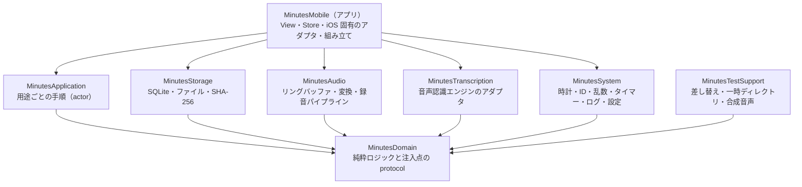

# MinutesMobile 詳細設計書 ── アーキテクチャ

| 項目 | 内容 |
| --- | --- |
| 版 | 1.0（初版・実装前） |
| 作成日 | 2026-11-16（技術情報の確認日 2026-11-16） |
| 満たす要件 ID | FR-FIN-03、FR-REC-04・07、NFR-PWR-02、NFR-MNT-01〜05、SEC-NET-01・05・06、SEC-DAT-07、SEC-LOG-01〜05、SEC-PLT-04・05、SEC-INP-01・03、TST-GEN-01〜08、INV-01〜10 |
| 関係する制約 | CON-01・04・07 |
| 対応する基本設計 | [../02-basic-design/architecture.md](../02-basic-design/architecture.md)（設計決定 BD-ARC-01〜08 を引用する） |
| 関連文書 | [dev-environment.md](dev-environment.md)・[recording.md](recording.md)・[storage.md](storage.md)・[transcription.md](transcription.md)・[ui.md](ui.md)・[export.md](export.md) |

本書は、ほかの 5 文書が共通で使う土台（ターゲットの分割、共通の型、状態遷移、注入点、並行性、エラー、ログ、テストの規約）を定める。個別機能の型とアルゴリズムは関連文書にある。

**本書のコード片は、実装前に一時の Package でビルドとテストを通したものである**（§13.3）。実ファイルはまだないので、照合の印（`<!-- file: -->`）は付けていない。実装の作業で印を付ける（[README.md](README.md) §3）。

---

## 1. 位置づけと範囲

満たす要件: NFR-MNT-02・04 ／ 決定: BD-ARC-01・02、UD-10

| 本書で決めること | 節 |
| --- | --- |
| Package のターゲット分割、ファイルの置き場所、静的解析の例外の場所 | §2 |
| 会議 ID・連番・世代番号などの共通の型と検証 | §3 |
| 2 つの時間軸の変換 | §4 |
| 会議の状態遷移（状態 × 事象 × 副作用） | §5 |
| 依存の注入点（protocol、本番の実装、テストの差し替え） | §6 |
| 実行コンテキストと、録音パイプラインを起こす合図 | §7 |
| エラーの分類と、利用者に見せる問題への写像 | §8 |
| 型付きログのイベント一覧と privacy の指定 | §9 |
| アプリの組み立てと、差し替え用の起動の引数 | §10 |
| テストコードの規約 | §11 |

実装の単位は「共通基盤」（[../../PROGRESS.md](../../PROGRESS.md) §1）で、§2〜§11 の型と、テスト用の差し替え（§6.3）を作る。機能のコードはまだ書かない。

---

## 2. Package とターゲット

満たす要件: NFR-MNT-01・02・03、TST-GEN-04、TST-CI-02 ／ 制約: CON-04 ／ 決定: BD-ARC-02・07、BD-DEV-04

### 2.1 ターゲットの分割

基本設計 §2.3 の 4 つ（Domain・Storage・Audio・Transcription）に、手順を置く `MinutesApplication`、注入用の本番実装を置く `MinutesSystem`、テスト用の差し替えを置く `MinutesTestSupport` を足す。



| ターゲット | 置くもの | import してよいもの | 依存 |
| --- | --- | --- | --- |
| `MinutesDomain` | 状態遷移、Barrier、Chunk 分割、WAV の符号化と検証、時間軸、統合、再試行の判定、容量の判定、入力の検証、ZIP のヘッダの組み立て、エラーの型、ログのイベント、**注入点の protocol** | Foundation だけ | なし |
| `MinutesApplication` | 録音・確定・復旧・削除・文字起こし・書き出しの手順（actor）。判断は Domain に委ね、I/O は protocol 越しに行う | Foundation | Domain |
| `MinutesStorage` | 保存ルート、SQLite のラッパー、Chunk とメタデータの保存、アーカイブの書き出し | Foundation・SQLite3・CryptoKit・zlib | Domain |
| `MinutesAudio` | リングバッファ、変換、録音パイプライン、音声入力（AVAudioEngine） | AVFAudio・Synchronization・Dispatch | Domain |
| `MinutesTranscription` | `SpeechAnalyzer` を包むエンジンの実装 | Speech・AVFAudio・CoreMedia | Domain |
| `MinutesSystem` | 時計・UUID・乱数・周期の合図・`os.Logger`・`UserDefaults` の本番実装 | Foundation・os・Dispatch | Domain |
| `MinutesTestSupport` | 手動の時計、連番の ID、固定の乱数、ログの記録、一時ディレクトリ、合成音声、各 protocol の差し替え | Foundation・Synchronization | Domain |

分割の理由:

- **依存の向きをビルドで強制する**（BD-ARC-02 ③）。Storage・Audio・Transcription・System は互いを参照できず、Application は I/O の実装を参照できない。層をまたぐ呼び出しを書くとビルドが通らない。
- **手順（Application）を Mac 上の `swift test` で回せる**。差し替えた protocol だけで録音から確定までを通せる（TST-GEN-04）。
- iOS にしかない API（`AVAudioSession`・UIKit・ActivityKit・BackgroundTasks・UserNotifications）のアダプタはアプリターゲットに置く。macOS でもビルドできる API（AVAudioEngine・AVAudioConverter・Speech・SQLite・CryptoKit・zlib）のアダプタは Package に置き、Mac 上のテストの対象にする。
- `MinutesDomain` が Foundation 以外を import していないことは、ビルドでは強制できない。レビューで確かめる（§12 の NS-A-03）。

### 2.2 `Packages/MinutesKit/Package.swift`

[dev-environment.md](dev-environment.md) §11.1 の内容を、次のとおり確定する（作業単位 2 でこの内容のファイルを作る）。Swift 6.4.2 でビルドとテストが通ることを確かめた。

```swift
// swift-tools-version: 6.4
import PackageDescription

let strict: [SwiftSetting] = [.treatAllWarnings(as: .error)]

let package = Package(
    name: "MinutesKit",
    platforms: [
        .iOS("27.2"),
        .macOS("27.2"),
    ],
    products: [
        .library(
            name: "MinutesKit",
            targets: [
                "MinutesDomain", "MinutesApplication", "MinutesStorage",
                "MinutesAudio", "MinutesTranscription", "MinutesSystem",
            ]
        ),
        .library(name: "MinutesTestSupport", targets: ["MinutesTestSupport"]),
    ],
    targets: [
        .target(name: "MinutesDomain", swiftSettings: strict),
        .target(name: "MinutesApplication", dependencies: ["MinutesDomain"], swiftSettings: strict),
        .target(name: "MinutesStorage", dependencies: ["MinutesDomain"], swiftSettings: strict),
        .target(name: "MinutesAudio", dependencies: ["MinutesDomain"], swiftSettings: strict),
        .target(name: "MinutesTranscription", dependencies: ["MinutesDomain"], swiftSettings: strict),
        .target(name: "MinutesSystem", dependencies: ["MinutesDomain"], swiftSettings: strict),
        .target(name: "MinutesTestSupport", dependencies: ["MinutesDomain"], swiftSettings: strict),
        .testTarget(
            name: "MinutesDomainTests",
            dependencies: ["MinutesDomain", "MinutesTestSupport"],
            swiftSettings: strict
        ),
        .testTarget(
            name: "MinutesApplicationTests",
            dependencies: ["MinutesApplication", "MinutesTestSupport"],
            swiftSettings: strict
        ),
        .testTarget(
            name: "MinutesStorageTests",
            dependencies: ["MinutesStorage", "MinutesTestSupport"],
            swiftSettings: strict
        ),
        .testTarget(
            name: "MinutesAudioTests",
            dependencies: ["MinutesAudio", "MinutesTestSupport"],
            swiftSettings: strict
        ),
        .testTarget(
            name: "MinutesTranscriptionTests",
            dependencies: ["MinutesTranscription", "MinutesTestSupport"],
            swiftSettings: strict
        ),
    ],
    swiftLanguageModes: [.v6]
)
```

- 外部の依存は 0 件のままである（BD-ARC-07）。
- `MinutesTestSupport` は製品 `MinutesKit` に含めない。アプリには組み込まれず、テストターゲットだけが使う。
- テストターゲットは 5 つに分かれるが、入れ子の静的解析の設定は `Packages/MinutesKit/Tests/.swiftlint.yml` の 1 つで全部に効く（[dev-environment.md](dev-environment.md) §6.4。変更なし）。

### 2.3 ディレクトリ

```text
Packages/MinutesKit/
  Package.swift
  Sources/
    MinutesDomain/
      Identifiers.swift  AudioTimeline.swift  MeetingStateMachine.swift
      Ports.swift  Failures.swift  Logging.swift          # 本書
      Recording/  Storage/  Transcription/  Export/  Interface/   # 各文書の純粋ロジック
    MinutesApplication/
      RecordingService.swift  FinalizationService.swift  RecoveryService.swift
      DeletionService.swift  TranscriptionService.swift  ExportService.swift
      LaunchConfiguration.swift
    MinutesStorage/
      Storage/StorageRoot.swift                            # ディレクトリを作ってよい唯一の型
      Files/  SQLite/  Chunks/  Meetings/  Jobs/  Archive/
    MinutesAudio/
    MinutesTranscription/
    MinutesSystem/
      SystemDependencies/                                  # 時計・UUID・乱数・タイマーを直接呼んでよい場所
      Logging/AppLogger.swift                              # os.Logger を直接使ってよい唯一のファイル
      Settings/SettingsStore.swift                         # UserDefaults を直接使ってよい唯一のファイル
    MinutesTestSupport/
      TestSupport/TemporaryDirectory.swift                 # テスト用に一時領域と UUID を使ってよい唯一のファイル
  Tests/
    .swiftlint.yml
    MinutesDomainTests/  MinutesApplicationTests/  MinutesStorageTests/
    MinutesAudioTests/  MinutesTranscriptionTests/
MinutesMobile/
  App/            # 起動・組み立て（AppEnvironment）・アプリのデリゲート
  Features/       # 画面ごとの View と Store（ui.md）
  Platform/       # iOS 固有のアダプタ（AVAudioSession・通知・Live Activity・継続処理タスク・端末の状態）
  Clipboard/ClipboardWriter.swift                          # UIPasteboard を直接使ってよい唯一のファイル
```

### 2.4 静的解析の例外の場所（確定）

[dev-environment.md](dev-environment.md) §6.3 の仮のパスを、**変更せずに確定する**。`.swiftlint.yml` の `excluded` と `tools/lint-fixtures/` は変えない。

| 例外の場所 | 確定したパス | 対象の規則 |
| --- | --- | --- |
| ログの型 | `Packages/MinutesKit/Sources/MinutesSystem/Logging/AppLogger.swift` | `no_direct_logger` |
| 設定の型 | `Packages/MinutesKit/Sources/MinutesSystem/Settings/SettingsStore.swift` | `no_direct_user_defaults` |
| 保存ルートの型 | `Packages/MinutesKit/Sources/MinutesStorage/Storage/StorageRoot.swift` | `no_direct_directory_access` |
| コピーの型 | `MinutesMobile/Clipboard/ClipboardWriter.swift` | `no_direct_pasteboard` |
| 注入用の本番実装 | `Packages/MinutesKit/Sources/MinutesSystem/SystemDependencies/` の下 | `no_direct_clock`・`no_direct_uuid`・`no_direct_sleep_timer`・`no_direct_random` |
| テスト用の一時ディレクトリの型 | `Packages/MinutesKit/Sources/MinutesTestSupport/TestSupport/TemporaryDirectory.swift` | `no_direct_directory_access`・`no_direct_uuid` |

例外のパターンはディレクトリ名とファイル名で一致する（`.*/Logging/AppLogger\.swift` など）。同じ名前のファイルを別のターゲットに作ると、そこも例外になってしまう。**上の表以外の場所に、同じディレクトリ名とファイル名の組を作らない**（§12 の NS-A-04）。

---

## 3. 共通の型

満たす要件: SEC-INP-01・03、TST-GEN-05、FR-REC-03 ／ 決定: BD-STO-06

### 3.1 会議 ID と連番

パスの部品になる値は、形式を検証した型でしか作れないようにする。利用者の入力（タイトル）を受け取る入口は持たない（BD-STO-06）。

```swift
import Foundation

/// 会議 ID。UUID の形式（小文字・ハイフンつき 36 文字）だけを受け付ける（SEC-INP-01、BD-STO-06）
public struct MeetingID: Hashable, Sendable, Codable, CustomStringConvertible {
    public let uuid: UUID

    public init(_ uuid: UUID) {
        self.uuid = uuid
    }

    /// 永続データ・パスの部品から読むときの入口。形式が合わなければ nil（SEC-INP-03）
    public init?(validating text: String) {
        guard text.utf8.count == 36, let uuid = UUID(uuidString: text), uuid.uuidString.lowercased() == text else {
            return nil
        }
        self.uuid = uuid
    }

    /// パスと永続データに使う表記（小文字）
    public var description: String {
        uuid.uuidString.lowercased()
    }

    public init(from decoder: any Decoder) throws {
        let text = try decoder.singleValueContainer().decode(String.self)
        guard let value = MeetingID(validating: text) else {
            throw PersistedDataError.invalidValue(field: .meetingID)
        }
        self = value
    }

    public func encode(to encoder: any Encoder) throws {
        var container = encoder.singleValueContainer()
        try container.encode(description)
    }
}

/// Chunk の連番。0〜999,999（ファイル名は 6 桁。storage.md §2）
public struct ChunkSequence: Hashable, Comparable, Sendable, Codable {
    public static let range = 0 ... 999_999
    public let value: Int

    public init?(_ value: Int) {
        guard Self.range.contains(value) else { return nil }
        self.value = value
    }

    public static func < (lhs: ChunkSequence, rhs: ChunkSequence) -> Bool {
        lhs.value < rhs.value
    }

    /// ファイル名の部品（例: "000007"）
    public var fileStem: String {
        let digits = String(value)
        return String(repeating: "0", count: 6 - digits.count) + digits
    }
}
```

- `ChunkSequence` の `Codable` も `MeetingID` と同じ形で、範囲外の値を `PersistedDataError.invalidValue(field: .sequenceNo)` で拒否する。
- 大文字の UUID は拒否する。同じ会議が大文字と小文字の 2 つのディレクトリに分かれるのを防ぐ（大文字と小文字を区別するファイルシステムを前提にする）。
- 連番の上限 999,999 は約 347 日分に当たり、実用上は届かない。届いた場合は録音を停止する（ファイル名の桁を超えるため）。

### 3.2 世代番号と永続データの検証の失敗

```swift
/// 非同期の応答を要求と対応付ける世代番号（TST-GEN-05）。進めるたびに古い応答は捨てられる
public struct Generation: Hashable, Sendable {
    public private(set) var value: UInt64

    public init() {
        value = 0
    }

    public mutating func advance() -> Generation {
        value += 1
        return self
    }
}

/// 永続データの検証の失敗。値そのものは持たない（SEC-LOG-04、§8）
public enum PersistedDataError: Error, Equatable, Sendable {
    case unsupportedFormatVersion(found: Int)
    case invalidValue(field: PersistedField)
    case missingField(PersistedField)
    case malformed
}
```

世代番号を使う場所と、何が古い応答になるかを次に固定する。

| 場所 | 世代を進めるとき | 捨てる応答 |
| --- | --- | --- |
| 録音セッション（[recording.md](recording.md) §5） | 入力の開始・再構築・停止を始めるたび | 前の世代の「最初のバッファ到着」「再構築の完了」「再開の完了」 |
| 文字起こしのジョブ（[transcription.md](transcription.md) §5） | `processing` に入るたび（UUID の実行世代。回数は使わない） | 前の実行の成功・失敗・中止の通知 |
| Store（[ui.md](ui.md) §5） | 画面が要求を出すたび | 前の要求への応答 |
| 書き出し（[export.md](export.md) §3） | 書き出しを始めるたび（書き出し ID） | 中止した書き出しの完了 |

`PersistedField` は、どの項目が不正だったかを示す閉じた列挙型で、ログにも書ける（§9）。値そのもの（タイトルや日時）は持たない。

---

## 4. 2 つの時間軸

満たす要件: FR-REC-04、FR-TRV-03、INV-08 ／ 決定: BD-ARC-04、BD-UI-02

基本設計 §6 の式をそのまま関数にする。入力はサンプル番号と空白区間だけで、時計を読まない。

```swift
/// 音声の固定値（FR-REC-01）
public enum AudioConstants {
    public static let sampleRate = 16000
    public static let chunkSamples = 480_000
    public static let bytesPerSample = 2
    public static let wavHeaderBytes = 44
}

/// 空白区間。位置は「空白の直後に来るサンプルの番号」（基本設計 architecture.md §6）
public struct RecordingGap: Equatable, Sendable {
    public let position: Int64
    /// ミリ秒。長さが分からない空白（割り込み中に終了した会議の末尾）は nil（storage.md §9）
    public let durationMs: Int64?

    public init(position: Int64, durationMs: Int64?) {
        self.position = position
        self.durationMs = durationMs
    }
}

/// 2 つの時間軸の変換（BD-ARC-04、INV-08）。入力はサンプル番号だけで、時計を読まない
public struct AudioTimeline: Equatable, Sendable {
    /// 位置の昇順
    public let gaps: [RecordingGap]

    public init(gaps: [RecordingGap]) {
        self.gaps = gaps.sorted { $0.position < $1.position }
    }

    /// サンプル s から始まる区間の開始時刻（ms）。位置が s 以下の空白を足す
    public func startTimeMs(ofSample sample: Int64) -> Int64 {
        Self.audioMs(sample) + gapTotalMs { $0.position <= sample }
    }

    /// 終了位置 e（e を含まない）の終了時刻（ms）。位置が e 未満の空白を足す
    public func endTimeMs(ofSample end: Int64) -> Int64 {
        Self.audioMs(end) + gapTotalMs { $0.position < end }
    }

    /// 録音中の経過時間（ms）。閉じた空白だけを数える（BD-UI-02）
    public static func elapsedMs(totalSamples: Int64, closedGapTotalMs: Int64) -> Int64 {
        audioMs(totalSamples) + closedGapTotalMs
    }

    /// 16 kHz では 1 ms が 16 サンプル。端数は切り捨てる
    private static func audioMs(_ samples: Int64) -> Int64 {
        samples / Int64(AudioConstants.sampleRate / 1000)
    }

    private func gapTotalMs(where included: (RecordingGap) -> Bool) -> Int64 {
        gaps.reduce(into: Int64(0)) { total, gap in
            if included(gap) {
                total += gap.durationMs ?? 0
            }
        }
    }
}
```

確かめた値（10 秒の位置＝サンプル 160,000 に 120 秒の空白がある場合）:

| 入力 | 結果 | 意味 |
| --- | --- | --- |
| `endTimeMs(ofSample: 160_000)` | 10,000 | 空白の直前で終わる区間には空白を足さない |
| `startTimeMs(ofSample: 160_000)` | 130,000 | 再開後の最初のサンプルから始まる区間には足す |
| `startTimeMs(ofSample: 159_999)` | 9,999 | 空白の前のサンプル |
| `endTimeMs(ofSample: 160_001)` | 130,000 | 空白をまたいで終わる区間 |

- 位置・サンプル数は `Int64` で持つ。120 分は 115,200,000 サンプルで 32 bit にも収まるが、バイト数との積で桁あふれを起こさないよう 64 bit に統一する。
- 長さが分からない空白は 0 として数える。この空白は録音の末尾にしかないので、どのセグメントの時刻も変わらない（[storage.md](storage.md) §9）。
- 画面の時刻表示（`hh:mm:ss`）への整形は UI の関数で、この型は ms までを扱う。

---

## 5. 会議の状態遷移

満たす要件: FR-FIN-03、FR-INT-05、FR-STT-05、TST-GEN-06 ／ 決定: BD-ARC-01

### 5.1 遷移の表

要件 §5.5 の図の MVP の範囲を、状態 × 事象の表にする。**この表にない組み合わせはすべて拒否する**（`reduce` が `nil` を返す）。

| 現在の状態 | 事象 | 次の状態 | 副作用の指示（順に実行する） |
| --- | --- | --- | --- |
| `recording` | `stopRequested(理由)` | `stop_requested` | 停止理由と検出時刻を記録 → 状態を保存 → 中断通知を取り消す → オーディオセッションを無効化 |
| `stop_requested` | `finalizationStarted` | `finalizing` | 状態を保存 → Barrier を評価 |
| `finalizing` | `barrierPassed` | `finalized` | 確定方式 `barrier` を記録 → 状態を保存 → 文字起こしの開始条件を評価 → 保護クラスを見直す |
| `finalizing` | `barrierFailed` | `stop_requested` | 状態を保存（理由は Barrier の結果として別に保存する） |
| `stop_requested` | `lossAcknowledged` | `finalized` | 確定方式 `acknowledged_loss` を記録 → 状態を保存 → 文字起こしの開始条件を評価 → 保護クラスを見直す |
| `finalized` | `transcriptionStarted` | `transcribing` | 状態を保存 |
| `transcribed` | `transcriptionStarted` | `transcribing` | 状態を保存 |
| `transcribing` | `transcriptionPartiallyFailed` | `transcribing` | なし |
| `transcribing` | `transcriptionCompleted` | `transcribed` | 状態を保存 → 保護クラスを見直す |

- `stopRequested` の理由は `manual`・`interruption_unresumed`・`no_input`・`disk_full`・`terminated`（FR-INT-05）。起動時の復旧で `recording` の会議を止める場合も同じ事象を使う（理由が `terminated` または `interruption_unresumed`）。
- `finalizationStarted` は「末尾の Chunk の保存が終わった」と「確定待ちからの再試行」の両方で使う（どちらも `stop_requested` → `finalizing`）。
- `transcriptionStarted` は、最初の文字起こし・再文字起こし・失敗区間の再試行で共通に使う。
- 「状態を保存」は、SQLite と `meeting.json` の両方への保存を指す。順序と失敗時の扱いは [storage.md](storage.md) §5 にある。
- P2 の状態（`summarizing`・`completed`）は、この列挙型にまだない。永続データに未知の状態があれば、検証の失敗として「読めない会議」にする（クラッシュも削除もしない。TST-RCV-04）。

### 5.2 コード

```swift
/// 会議の状態（FR-FIN-03）。rawValue は永続データの表記
public enum MeetingStatus: String, Sendable, CaseIterable, Codable, LogSymbolSource {
    case recording
    case stopRequested = "stop_requested"
    case finalizing
    case finalized
    case transcribing
    case transcribed
}

public enum MeetingEvent: Equatable, Sendable {
    /// 停止操作・入力喪失・容量枯渇・起動時の復旧（理由で区別する）
    case stopRequested(StopReason)
    /// 末尾の Chunk の保存が終わった／確定待ちからの再試行
    case finalizationStarted
    case barrierPassed
    case barrierFailed
    case lossAcknowledged
    /// 最初の文字起こし・再文字起こし・失敗区間の再試行
    case transcriptionStarted
    case transcriptionPartiallyFailed
    case transcriptionCompleted
}

/// サービスが実行する副作用の指示。reduce 自身は何も実行しない（BD-ARC-01）
public enum MeetingEffect: Equatable, Sendable {
    case persistStatus(MeetingStatus)
    case recordStopReason(StopReason)
    case cancelInterruptionNotice
    case deactivateAudioSession
    case evaluateBarrier
    case recordFinalization(FinalizationMode)
    case evaluateTranscriptionStart
    case reviewProtection
}

public struct MeetingTransition: Equatable, Sendable {
    public let next: MeetingStatus
    public let effects: [MeetingEffect]
}

public enum MeetingStateMachine {
    /// 許されない遷移は nil を返す
    public static func reduce(_ state: MeetingStatus, _ event: MeetingEvent) -> MeetingTransition? {
        switch (state, event) {
        case let (.recording, .stopRequested(reason)):
            let record: [MeetingEffect] = [.recordStopReason(reason), .persistStatus(.stopRequested)]
            return MeetingTransition(
                next: .stopRequested,
                effects: record + [.cancelInterruptionNotice, .deactivateAudioSession],
            )
        case (.stopRequested, .finalizationStarted):
            return MeetingTransition(next: .finalizing, effects: [.persistStatus(.finalizing), .evaluateBarrier])
        case (.finalizing, .barrierPassed):
            return finalized(.barrier)
        case (.finalizing, .barrierFailed):
            return MeetingTransition(next: .stopRequested, effects: [.persistStatus(.stopRequested)])
        case (.stopRequested, .lossAcknowledged):
            return finalized(.acknowledgedLoss)
        case (.finalized, .transcriptionStarted), (.transcribed, .transcriptionStarted):
            return MeetingTransition(next: .transcribing, effects: [.persistStatus(.transcribing)])
        case (.transcribing, .transcriptionPartiallyFailed):
            return MeetingTransition(next: .transcribing, effects: [])
        case (.transcribing, .transcriptionCompleted):
            return MeetingTransition(next: .transcribed, effects: [.persistStatus(.transcribed), .reviewProtection])
        default:
            return nil
        }
    }

    private static func finalized(_ mode: FinalizationMode) -> MeetingTransition {
        let record: [MeetingEffect] = [.recordFinalization(mode), .persistStatus(.finalized)]
        return MeetingTransition(next: .finalized, effects: record + [.evaluateTranscriptionStart, .reviewProtection])
    }
}
```

`StopReason`（5 種）と `FinalizationMode`（`barrier`・`acknowledged_loss`）は、`MeetingStatus` と同じ形の列挙型で、rawValue が永続データの表記になる。

### 5.3 サービスの決まり

- サービスは、**`reduce` が返した遷移だけを保存する**。`nil` が返った事象は捨てて、ログに `meeting_status_changed` を出さない。状態を直接書き換える入口（`setStatus` のような関数）を保存の側に作らない。
- 同じ事象が 2 回届いても、2 回目は表にない組み合わせになって拒否される（例: `finalized` に `barrierPassed`）。冪等性を状態遷移で担保する。
- 録音セッションの状態遷移（プロセス内だけ）は [recording.md](recording.md) §5、ジョブの状態遷移は [transcription.md](transcription.md) §5 にある。どちらも同じ形（状態 + 事象 → 次の状態 + 副作用の指示）で書く。

---

## 6. 依存の注入点

満たす要件: TST-GEN-01・02・04・07、NFR-MNT-02

### 6.1 一覧

基本設計 §7 の仮の名称を確定する。protocol はすべて `MinutesDomain` に置き、本番の実装とテストの差し替えは別のターゲットに置く。

| 注入するもの | protocol | 本番の実装（置き場所） | テストの差し替え | 定義 |
| --- | --- | --- | --- | --- |
| 壁時計 | `WallClock` | `SystemWallClock`（System） | `ManualClock` | §6.2 |
| 単調時計 | `MonotonicClock` | `SystemMonotonicClock`（System） | `ManualClock` | §6.2 |
| ID の生成 | `IDGenerator` | `SystemIDGenerator`（System） | `SequentialIDGenerator` | §6.2 |
| 乱数 | `RandomSource` | `SystemRandomSource`（System） | `FixedRandomSource` | §6.2 |
| ルートディレクトリ | —（`StorageRoot` の初期化に URL を渡す） | Application Support の下 | `TemporaryDirectory` | [storage.md](storage.md) §2 |
| 音声入力 | `AudioInput` | `EngineAudioInput`（Audio） | `ScriptedAudioInput` | [recording.md](recording.md) §3 |
| オーディオセッション | `AudioSessionControlling` | `SystemAudioSession`（アプリ） | `FakeAudioSession` | [recording.md](recording.md) §3 |
| 取り出しの合図 | `DrainSignal` | `TimerDrainSignal`（System） | 合図を使わず `drainOnce()` を直接呼ぶ | §7.2 |
| 待ち合わせ（時間切れ・再試行の間隔） | `Scheduler` | `SystemScheduler`（System） | `ManualScheduler` | §6.2 |
| 音声認識エンジン | `SpeechEngine` | `AnalyzerSpeechEngine`（Transcription） | `ScriptedSpeechEngine` | [transcription.md](transcription.md) §3 |
| 空き容量 | `FreeSpaceProviding` | `VolumeFreeSpace`（Storage） | `FixedFreeSpace` | [storage.md](storage.md) §7 |
| ファイル書き込みの失敗 | `FileSystem` | `PosixFileSystem`（Storage） | `FaultInjectingFileSystem`（本番の実装を包み、指定した段で失敗させる） | [storage.md](storage.md) §4 |
| 温度・低電力・保護データ | `DeviceConditionsProviding` | `SystemDeviceConditions`（アプリ） | `FakeDeviceConditions` | §6.2 |
| バックグラウンド実行 | `BackgroundExecution` | `ContinuedProcessingExecution`（アプリ） | `FakeBackgroundExecution` | [transcription.md](transcription.md) §9 |
| 録音の状態表示 | `RecordingStatusPresenting` | `LiveActivityPresenter`（アプリ） | `StatusPresenterSpy` | [ui.md](ui.md) §8 |
| 中断の通知 | `InterruptionNoticeScheduling` | `LocalNoticeScheduler`（アプリ） | `NoticeSchedulerSpy` | [recording.md](recording.md) §7 |
| ログの出力先 | `LogSink` | `AppLogger`（System） | `RecordingLogSink` | §9 |
| 設定値 | `SettingsStoring` | `SettingsStore`（System） | `InMemorySettings` | [ui.md](ui.md) §4.6 |
| Apple Intelligence の可否 | `SummaryModelAvailabilityProviding` | `SystemSummaryModelAvailability`（アプリ） | `FixedSummaryModelAvailability` | [ui.md](ui.md) §4.6 |
| LLM（P2） | —（P2 の基本設計で決める） | — | — | — |

### 6.2 時計・ID・乱数・端末の状態

```swift
import Foundation

/// 壁時計。表示用の日時と記録にだけ使う（Chunk の位置には使わない。INV-08）
public protocol WallClock: Sendable {
    func now() -> Date
}

/// 単調時計の時刻。起点はプロセスごとに決まり、プロセスをまたいで比べられない
public struct MonotonicInstant: Comparable, Sendable {
    public let nanoseconds: Int64

    public init(nanoseconds: Int64) {
        self.nanoseconds = nanoseconds
    }

    public static func < (lhs: MonotonicInstant, rhs: MonotonicInstant) -> Bool {
        lhs.nanoseconds < rhs.nanoseconds
    }

    public func milliseconds(since earlier: MonotonicInstant) -> Int64 {
        (nanoseconds - earlier.nanoseconds) / 1_000_000
    }
}

/// 単調時計。空白区間の長さと計測値にだけ使う
public protocol MonotonicClock: Sendable {
    func now() -> MonotonicInstant
}

public protocol IDGenerator: Sendable {
    func makeUUID() -> UUID
}

/// 再試行のゆらぎ用。0 以上 1 未満
public protocol RandomSource: Sendable {
    func nextUnit() -> Double
}

/// 待ち合わせ（注入点）。再試行の間隔と時間切れにだけ使う。時刻を数える用途には使わない（INV-08）
public protocol Scheduler: Sendable {
    /// duration だけ待つ。待っている間に Task が取り消されたら CancellationError を投げる
    func sleep(for duration: Duration) async throws
}

/// 温度・低電力・保護データの可否
public protocol DeviceConditionsProviding: Sendable {
    func current() async -> DeviceConditions
    /// 値が変わるたびに最新の値を流す
    func changes() -> AsyncStream<DeviceConditions>
}
```

`DeviceConditions` は、温度（`ThermalLevel`: `nominal`・`fair`・`serious`・`critical`。大小を比べられる）・低電力モード・保護データを読めるか、の 3 つを持つ値型である。

本番の実装（`MinutesSystem/SystemDependencies/SystemClocks.swift`）:

```swift
import Foundation
import MinutesDomain

/// 注入用の本番実装。時計・UUID・乱数を直接呼んでよいのは SystemDependencies/ の下だけ
/// （.swiftlint.yml の no_direct_clock・no_direct_uuid・no_direct_random の例外）
public struct SystemWallClock: WallClock {
    public init() {}

    public func now() -> Date {
        Date()
    }
}

/// スリープ中も進む時計を使う。割り込み中に端末がスリープしても空白区間の長さを測れる
public struct SystemMonotonicClock: MonotonicClock {
    private let origin: ContinuousClock.Instant

    public init() {
        origin = ContinuousClock.now
    }

    public func now() -> MonotonicInstant {
        let elapsed = ContinuousClock.now - origin
        let (seconds, attoseconds) = elapsed.components
        return MonotonicInstant(nanoseconds: seconds * 1_000_000_000 + attoseconds / 1_000_000_000)
    }
}
```

| 決めたこと | 理由 |
| --- | --- |
| 単調時計は `ContinuousClock`（スリープ中も進む）を使う。`SuspendingClock`・`ProcessInfo.systemUptime` は使わない | 割り込み中はアプリがサスペンドされ、端末がスリープしうる。スリープで止まる時計では、空白区間の長さが実際より短くなる |
| 単調時計の値を永続化しない | 起点がプロセスごとに違う。再起動をまたぐと比べられない。強制終了で開いたままになった空白区間の長さは「不明」にする（[storage.md](storage.md) §9） |
| プライバシーマニフェストから「システムの起動時間」（`35F9.1`）の申告を外す | Apple の一覧で対象になっているのは `systemUptime` と `mach_absolute_time()` で、どちらも呼ばない（[dev-environment.md](dev-environment.md) §14.1 を同じ作業で直した）。`no_direct_clock` がこの 2 つを `SystemDependencies/` の外で禁止している |
| 待ち合わせは `Scheduler.sleep(for:)` の 1 つだけ。本番の実装（`SystemScheduler`）は `Task.sleep` を呼ぶ（`no_direct_sleep_timer` の例外の場所に置く） | 最初のバッファの時間切れ（[recording.md](recording.md) §3.4）と、ジョブの再試行の間隔・時間切れ（[transcription.md](transcription.md)）に使う。待った時間を時刻として数えない（INV-08） |
| ID は `makeUUID()` の 1 つだけ | 会議 ID・書き出し ID・ジョブの実行世代のどれも UUID で足りる。用途ごとの型（`MeetingID` など）へは呼び出し側で包む |

### 6.3 テスト用の差し替え（`MinutesTestSupport`）

```swift
import Foundation
import MinutesDomain
import Synchronization

/// 手動で進める時計（TST-GEN-01）。実時間を待たない
public final class ManualClock: WallClock, MonotonicClock, Sendable {
    private struct State {
        var wall: Date
        var monotonicNs: Int64
    }

    private let state: Mutex<State>

    public init(wall: Date = Date(timeIntervalSince1970: 1_800_000_000), monotonicNs: Int64 = 0) {
        state = Mutex(State(wall: wall, monotonicNs: monotonicNs))
    }

    public func now() -> Date {
        state.withLock { $0.wall }
    }

    public func now() -> MonotonicInstant {
        state.withLock { MonotonicInstant(nanoseconds: $0.monotonicNs) }
    }

    /// 両方の時計を同じだけ進める
    public func advance(milliseconds: Int64) {
        state.withLock {
            $0.monotonicNs += milliseconds * 1_000_000
            $0.wall = $0.wall.addingTimeInterval(Double(milliseconds) / 1000)
        }
    }

    /// 壁時計だけを動かす（時刻の変更の再現。TST-AUD-06）
    public func shiftWallClock(seconds: TimeInterval) {
        state.withLock { $0.wall = $0.wall.addingTimeInterval(seconds) }
    }
}
```

| 差し替え | 振る舞い |
| --- | --- |
| `ManualClock` | 壁時計と単調時計の両方に準拠する。`advance` で同時に進め、`shiftWallClock` で壁時計だけを動かす（時刻の変更の再現） |
| `SequentialIDGenerator` | `00000000-0000-4000-8000-000000000001` から 1 ずつ増える UUID を返す |
| `FixedRandomSource` | 決めた値を返す（ゆらぎの上限・下限を検証できる） |
| `ManualScheduler` | `advance(by:)` で進めた分だけ、待っている処理が期限の早い順に起きる。取り消された待ちは `CancellationError` になる。実時間を待たない |
| `RecordingLogSink` | 受け取ったイベントをメモリに貯める（TST-SEC-07） |
| `TemporaryDirectory` | テストごとに一意のディレクトリを作る。後始末は `remove()` |

差し替えは `Mutex`（Synchronization。iOS 18 以降）で状態を守り、`Sendable` にする。テストが並列に走っても、差し替えを共有しない限り干渉しない（TST-GEN-02）。

---

## 7. 並行性と実行コンテキスト

満たす要件: NFR-MNT-01、NFR-PRF-01、NFR-PWR-02、TST-GEN-05、INV-01・08 ／ 制約: CON-04

### 7.1 実行コンテキストと型

| 実行コンテキスト | 型 | 分離の方法 |
| --- | --- | --- |
| 音声コールバック | `CaptureRingBuffer` の書き込み側（[recording.md](recording.md) §4） | actor に入らない。原子操作だけ（`Synchronization.Atomic`） |
| 録音パイプライン | `RecordingPipeline`（Audio） | actor。専用の直列キューを実行器にする（§7.2） |
| 保存 | `MeetingStore`（Storage） | actor。SQLite の書き込みの接続を 1 本だけ持つ |
| 手順 | `RecordingService`・`FinalizationService`・`RecoveryService`・`DeletionService`・`TranscriptionService`・`ExportService`（Application） | actor |
| 音声認識 | `AnalyzerSpeechEngine`（Transcription） | actor |
| 画面 | Store・View（アプリ） | MainActor（アプリターゲットの既定の分離） |

規則:

- actor の間を渡すのは `Sendable` の値型だけにする。`AVAudioPCMBuffer`・`AVAudioFile`・`OpaquePointer`（SQLite の接続）は、それを持つ actor の外へ出さない。
- **録音の経路（コールバック → パイプライン → 保存）は、文字起こしの型を参照しない**（INV-01、BD-ARC-08）。`MinutesAudio` は `MinutesTranscription` に依存できないので、ビルドで担保される。
- actor の中の `await` の前後で状態が変わりうる（再入）。`await` の後は、世代番号（§3.2）か状態を読み直してから続ける。「確かめてから実行する」を `await` をまたいで書かない。
- アプリターゲットは既定の分離が MainActor である。アプリターゲットに置くアダプタ（`Platform/`）は、MainActor で動く必要のないものに `nonisolated` を明示する。
- `Task.detached` と `DispatchQueue.main.async` は使わない。前者は分離を見失い、後者は Swift 6 の検査の外になる。

### 7.2 録音パイプラインを起こす合図

基本設計 §4 の申し送り（合図の方式）を、**周期的な合図（初期値 100 ms）を非同期の列として受け取る**方式に決める。

| 方式 | 判定 | 理由 |
| --- | --- | --- |
| 周期的な合図（タイマー）を列で受け取る | **採用** | コールバックは合図を出さないので、コールバックの中の処理が「コピーとカウンタの更新」だけで済む（NFR-PRF-01）。合図が遅れても、失うのはリングバッファの容量を超えた分だけで、時刻は狂わない |
| コールバックからパイプラインを起こす（セマフォ・`AsyncStream` の `yield`） | 不採用 | コールバックの中でロックやメモリ確保が起きうる |
| 取り出しをタイマーの発火時刻で数える | 不採用 | INV-08 に反する |

```swift
/// 録音パイプラインを起こす合図（注入点）。合図は時計ではない。時刻はサンプル数で数える（INV-08）
public protocol DrainSignal: Sendable {
    /// 合図のたびに要素を 1 つ流す。遅れた合図はまとめてよい（取りこぼしても時刻は狂わない）
    func ticks() -> AsyncStream<Void>
}
```

本番の実装（`MinutesSystem/SystemDependencies/TimerDrainSignal.swift`）:

```swift
import Dispatch
import MinutesDomain

/// 周期的な合図の本番実装。タイマーを直接使ってよいのは SystemDependencies/ の下だけ
/// （.swiftlint.yml の no_direct_sleep_timer の例外）
public struct TimerDrainSignal: DrainSignal {
    private let intervalMs: Int

    public init(intervalMs: Int = 100) {
        self.intervalMs = intervalMs
    }

    public func ticks() -> AsyncStream<Void> {
        // 溜まった合図は 1 つにまとめる（取り出しは 1 回で全部を処理する）
        AsyncStream(bufferingPolicy: .bufferingNewest(1)) { continuation in
            let timer = DispatchSource.makeTimerSource(queue: DispatchQueue.global(qos: .userInitiated))
            timer.schedule(deadline: .now() + .milliseconds(intervalMs), repeating: .milliseconds(intervalMs))
            timer.setEventHandler { continuation.yield() }
            continuation.onTermination = { _ in timer.cancel() }
            timer.resume()
        }
    }
}
```

パイプラインの側（骨組み。中身は [recording.md](recording.md) §4）:

```swift
import Dispatch
import MinutesDomain

/// 録音パイプラインの実行コンテキスト。専用の直列キューを actor の実行器にする（基本設計 §4）
public actor RecordingPipelineSkeleton {
    private let queue = DispatchSerialQueue(label: "MinutesMobile.recording-pipeline", qos: .userInitiated)
    private var drainTask: Task<Void, Never>?
    public private(set) var drainCount = 0

    public nonisolated var unownedExecutor: UnownedSerialExecutor {
        queue.asUnownedSerialExecutor()
    }

    public init() {}

    /// 合図のたびに取り出す。テストは合図を使わず drainOnce() を直接呼ぶ
    public func startDraining(with signal: some DrainSignal) {
        drainTask?.cancel()
        let ticks = signal.ticks()
        drainTask = Task { [weak self] in
            for await _ in ticks {
                await self?.drainOnce()
            }
        }
    }

    public func stopDraining() {
        drainTask?.cancel()
        drainTask = nil
    }

    /// リングバッファにあるだけ取り出して変換・組み立てへ渡す（中身は recording.md §4）
    public func drainOnce() {
        drainCount += 1
    }
}
```

- **停止・割り込み・再構築での排出は、合図を待たない。** 手順の側が `drainOnce()` を直接呼び、リングバッファが空になるまで繰り返す（[recording.md](recording.md) §5）。合図はふだんの取り出しにだけ使う。
- テストは合図を差し替えない。`drainOnce()` を 1 回ずつ直接呼ぶので、実時間を待たず、取り出しの回数と順序を決められる（TST-GEN-01）。
- 専用の直列キューを実行器にするのは、取り出し・変換・追記を、ほかの actor の処理に割り込まれない 1 本のスレッドの流れにするためである。優先度は `userInitiated` とし、UI より下・背景の処理より上にする。

---

## 8. エラーの分類と問題への写像

満たす要件: SEC-LOG-04、SEC-INP-03、NFR-UX-04 ／ 決定: BD-UI-09

### 8.1 分類

エラーの値が持ってよいのは、会議 ID・連番・件数・分類名・OS の結果コードだけである。**本文・タイトル・日時・絶対パス・OS のエラーの説明文は持たない**（型に `String` と `URL` の欄を作らない）。

| 領域 | 型 | 内容 | 定義 |
| --- | --- | --- | --- |
| 録音の開始 | `RecordingStartFailure` | 録音中・権限なし・会議の作成の失敗・セッションの有効化の失敗・入力の開始の失敗・最初のバッファの時間切れ | 下のコード |
| 録音中 | `RecordingIssue` | 再開できない・再構築の失敗・入力の喪失・取りこぼし・通知の予約の失敗。**録音を止める理由にしない**（`inputLost` だけは物理的に続けられない） | 下のコード |
| 保存 | `StorageFailure` | 種類（`StorageFailureKind` 11 種）・段（`StorageStage` 16 種）・OS の結果コード | 下のコード |
| 確定 | `FinalizationBlocker` | 欠番・ファイル欠損・不正なヘッダ・隔離・ハッシュ不一致・メモリ上の未保存・失われた未保存 | [storage.md](storage.md) §6 |
| 文字起こし | `TranscriptionFailureClass` | 基本設計 transcription.md §4.2 の 7 分類 | [transcription.md](transcription.md) §5 |
| 書き出し | `ExportFailure` | 録音中・削除中・容量不足・上限超過・長さが不明な欠落・範囲の不整合・版の破損・中止・保存の失敗 | [export.md](export.md) §3 |
| 永続データ | `PersistedDataError` | 形式の版・不正な値・欠けた項目・壊れた形式 | §3.2 |

```swift
/// 保存の失敗の分類。パスと本文は持たない（§8）
public struct StorageFailure: Error, Equatable, Sendable {
    public let kind: StorageFailureKind
    public let stage: StorageStage
    /// errno または SQLite の結果コード。なければ 0
    public let osCode: Int32

    public init(kind: StorageFailureKind, stage: StorageStage, osCode: Int32 = 0) {
        self.kind = kind
        self.stage = stage
        self.osCode = osCode
    }
}

public enum StorageFailureKind: String, Sendable, CaseIterable, Codable, LogSymbolSource {
    case diskFull = "disk_full"
    case permissionDenied = "permission_denied"
    case protectedDataUnavailable = "protected_data_unavailable"
    case alreadyExists = "already_exists"
    case notFound = "not_found"
    case ioError = "io_error"
    case databaseBusy = "database_busy"
    case databaseCorrupt = "database_corrupt"
    case constraintViolation = "constraint_violation"
    case verificationMismatch = "verification_mismatch"
    case invalidPath = "invalid_path"
}

/// 録音を開始できなかった理由（recording.md §3）
public enum RecordingStartFailure: Error, Equatable, Sendable {
    case alreadyRecording
    case microphoneDenied
    case meetingCreationFailed(StorageFailure)
    case sessionActivationFailed(osCode: Int32)
    case inputStartFailed(osCode: Int32)
    case firstBufferTimedOut
}

/// 録音中に起きた問題。録音は止めずに記録と表示へ回す（Recording-First）
public enum RecordingIssue: Equatable, Sendable {
    case interruptedNotResumed(GapReason)
    case rebuildFailed(GapReason)
    case inputLost
    case samplesDropped(frames: Int64)
    case noticeSchedulingFailed
    /// 入力の閉鎖の手続きで、マイクを閉じたことを上限までに確かめられない（recording.md §5.4）
    case microphoneCloseUnconfirmed
}
```

- OS のエラー（`NSError`・`errno`・SQLite の結果コード）は、境界のアダプタで上の型に写す。**`localizedDescription` と `userInfo` は捨てる**（ファイルのパスや発話が入りうる）。残すのはコードの数値だけにする。
- `errno` から `StorageFailureKind` への写像は [storage.md](storage.md) §4 にある（`ENOSPC`・`EDQUOT` → `disk_full`、`EACCES`・`EPERM` → `permission_denied` など）。
- Swift 6 の型付きの `throws`（`throws(StorageFailure)`）を使い、どの関数がどの分類を返すかを型で示す。`any Error` を上の層へ漏らさない。

### 8.2 問題の種類への写像

利用者に見せるときは、エラーを**問題の種類**（`ProblemKind`）に写し、種類ごとに 1 つだけ定義した 3 点の文言（[ui.md](ui.md) §6）で表示する。画面ごとに文言を組み立てない（BD-UI-09）。

| エラー・状態 | 問題の種類 | 録音の安否（ui.md で文言にする） |
| --- | --- | --- |
| `RecordingStartFailure.microphoneDenied` | `microphone_denied` | 録音は始まっていない |
| `RecordingStartFailure.alreadyRecording` | `already_recording` | 進行中の録音は続いている |
| `RecordingStartFailure` のその他 | `recording_start_failed` | 録音は始まっていない |
| `RecordingIssue.interruptedNotResumed`・`rebuildFailed` | `recording_interrupted` | 中断の前までは保存済み。今は録音できていない |
| `RecordingIssue.inputLost` | `input_lost` | 停止した。保存済みの分は無事 |
| `RecordingIssue.samplesDropped` | `audio_dropped` | 一部（長さを示す）を取りこぼした。録音は続いている |
| `RecordingIssue.noticeSchedulingFailed` | `notifications_denied` | 録音に影響はない |
| `RecordingIssue.microphoneCloseUnconfirmed` | `microphone_close_unconfirmed` | 保存済みの分は無事。マイクを閉じたことを確かめられていない（確かめ続ける） |
| 空き容量の段階 1 | `storage_low` | 録音は続いている |
| 空き容量の段階 2 | `storage_critical` | 録音は続いている |
| 空き容量の段階 3（`StorageFailure` で Chunk をメモリに保持） | `chunk_unsaved` | 録音は続いている。保持中の分は終了すると失われる |
| 物理的な限界（`disk_full` で停止） | `storage_exhausted` | 停止した。保持中の分は終了すると失われる |
| `FinalizationBlocker`（1 つ以上） | `finalization_blocked` | 欠けている範囲を示す |
| `PersistedDataError`（会議の読み込み） | `unreadable_meeting` | 録音のファイルは残っている |
| 復旧で `recording` の会議を検出 | `recovered_after_termination` | 保存済みの分は無事。直近の未保存分は失われた可能性がある |
| 書きかけを隔離 | `part_files_quarantined` | 隔離した分は文字起こしに使えない |
| DB を退避して作り直した | `database_rebuilt` | 録音は無事（ファイルから作り直した） |
| エンジンの可否が `available` 以外 | `engine_unavailable` | 録音は無事 |
| 文字起こしの延期（高温・低電力・録音中） | `transcription_deferred` | 録音は無事 |
| `transcribe_chunk` が `failed` | `transcription_segment_failed` | 録音は無事。その区間は再試行できる |
| `merge_transcript` が `failed` | `merge_failed` | 録音は無事。以前の版を表示している |
| 版のファイルの照合の失敗・`ExportFailure.transcriptVersionRejected` | `transcript_version_rejected` | 録音は無事。再文字起こしで作り直せる |
| `ExportFailure.insufficientSpace` | `export_insufficient_space` | 録音は無事 |
| 書き出し前のハッシュ不一致 | `export_integrity_warning` | 録音の一部が保存時と異なる |
| `ExportFailure` の録音中・削除中・上限超過・長さが不明な欠落・範囲の不整合 | `export_unavailable` | 録音は無事 |
| `ExportFailure.cancelled`・`storage` | `export_failed` | 録音は無事 |
| 削除の完了を確認できない | `deletion_incomplete` | 次の起動で続きを行う |

写像は、型ごとに網羅する関数（`ProblemMapping.kind(for:)`）で書く。`switch` に `default` を書かないので、エラーの分類を足すと、写像を足すまでビルドが通らない。

```swift
/// エラーから問題の種類への写像（§8.2 の表）。写像のないエラーを作れないよう、型ごとに網羅する
public enum ProblemMapping {
    public static func kind(for failure: RecordingStartFailure) -> ProblemKind {
        switch failure {
        case .alreadyRecording: .alreadyRecording
        case .microphoneDenied: .microphoneDenied
        case .meetingCreationFailed, .sessionActivationFailed: .recordingStartFailed
        case .inputStartFailed, .firstBufferTimedOut: .recordingStartFailed
        }
    }

    public static func kind(for issue: RecordingIssue) -> ProblemKind {
        switch issue {
        case .interruptedNotResumed, .rebuildFailed: .recordingInterrupted
        case .inputLost: .inputLost
        case .samplesDropped: .audioDropped
        case .noticeSchedulingFailed: .notificationsDenied
        case .microphoneCloseUnconfirmed: .microphoneCloseUnconfirmed
        }
    }
}
```

---

## 9. 型付きログ

満たす要件: SEC-LOG-01〜05、TST-SEC-07 ／ 決定: BD-ARC-06

### 9.1 型

ログの入口は `LogSink.record(_:)` の 1 つだけで、受け取るのは `LogEvent` だけである。**`LogEvent` には `String`・`URL`・`Date` を渡せる欄がない。** 欄の値は整数・真偽値・閉じた列挙型の名前の 3 種に限る。本文・タイトル・日時・絶対パスをログへ渡すコードは、型が合わずビルドできない。

```swift
/// ログに書ける名前の出どころ。閉じた列挙型だけが準拠する（BD-ARC-06）。
/// String・URL・Date を値に取る入口を作らないことで、D1〜D3 と絶対パスをログへ渡す経路を型で塞ぐ
public protocol LogSymbolSource: RawRepresentable, CaseIterable, Sendable where RawValue == String {}

public struct LogSymbol: Equatable, Sendable {
    public let text: String

    public init(_ source: some LogSymbolSource) {
        text = source.rawValue
    }
}

public enum LogValue: Equatable, Sendable {
    case integer(Int64)
    case flag(Bool)
    case symbol(LogSymbol)
}

public struct LogField: Equatable, Sendable {
    public let key: LogFieldKey
    public let value: LogValue

    public init(_ key: LogFieldKey, _ value: LogValue) {
        self.key = key
        self.value = value
    }
}

public struct LogEvent: Equatable, Sendable {
    public let category: LogCategory
    public let level: LogLevel
    public let name: LogEventName
    /// 会議 ID は出力時にハッシュで伏せる（§9.3）
    public let meeting: MeetingID?
    public let fields: [LogField]

    public init(
        _ name: LogEventName,
        category: LogCategory,
        level: LogLevel = .info,
        meeting: MeetingID? = nil,
        fields: [LogField] = [],
    ) {
        self.category = category
        self.level = level
        self.name = name
        self.meeting = meeting
        self.fields = fields
    }
}

/// ログの出力先（注入点）。本番は AppLogger、テストは RecordingLogSink
public protocol LogSink: Sendable {
    func record(_ event: LogEvent)
}
```

- `LogCategory` は `app`・`recording`・`storage`・`finalization`・`recovery`・`transcription`・`export`・`interface` の 8 つ。
- `LogFieldKey` は `sequence`・`count`・`samples`・`bytes`・`duration_ms`・`attempt`・`os_code`・`state`・`reason`・`kind`・`stage`・`route`・`sample_rate`・`channels`・`version`・`run`・`resumed` の 17 個。
- `LogSymbolSource` に準拠させてよいのは、`MinutesDomain` の閉じた列挙型だけである。準拠には `CaseIterable` が要るので、任意の文字列を包んだ型は準拠させにくい。新しい準拠を足す PR は、その列挙型の rawValue が D1〜D3 を含みえないことをレビューで確かめる（§12 の NS-A-01）。

### 9.2 イベントの一覧

| イベント名 | 区分 | 水準 | 会議 ID | 欄 |
| --- | --- | --- | --- | --- |
| `app_launched` | app | info | — | `count`（復旧した会議の数） |
| `storage_attributes_repaired` | storage | notice | — | `count`、`kind` |
| `database_quarantined` | storage | error | — | `reason`、`os_code` |
| `migration_applied` | storage | notice | — | `version` |
| `recording_start_requested` | recording | info | あり | — |
| `recording_started` | recording | info | あり | `route`、`sample_rate`、`channels`、`duration_ms`（開始までの時間） |
| `recording_start_failed` | recording | error | あり | `reason`、`os_code` |
| `recording_state_changed` | recording | info | あり | `state` |
| `recording_stopped` | recording | notice | あり | `reason`、`samples`、`count`（Chunk の数） |
| `gap_opened` | recording | notice | あり | `reason`、`samples`（位置） |
| `gap_closed` | recording | notice | あり | `reason`、`duration_ms`、`resumed` |
| `route_changed` | recording | info | あり | `route`、`sample_rate`、`channels`、`reason` |
| `ring_overrun` | recording | error | あり | `count`（落としたフレーム数） |
| `chunk_sealed` | storage | debug | あり | `sequence`、`samples`、`bytes` |
| `chunk_write_failed` | storage | error | あり | `sequence`、`reason`、`stage`、`os_code` |
| `chunk_conflict` | storage | error | あり | `sequence`、`kind` |
| `unsaved_chunk_held` | storage | error | あり | `sequence`、`count`（保持中の件数） |
| `unsaved_chunk_saved` | storage | notice | あり | `sequence`、`count` |
| `free_space_stage_changed` | storage | notice | — | `stage`、`count`（残りの分数） |
| `meeting_status_changed` | finalization | info | あり | `state` |
| `barrier_evaluated` | finalization | info | あり | `count`（不成立の理由の数）、`kind` |
| `loss_acknowledged` | finalization | notice | あり | `count`（欠落した Chunk の数） |
| `recovery_completed` | recovery | notice | — | `count`、`duration_ms` |
| `part_file_salvaged` | recovery | notice | あり | `sequence`、`samples` |
| `part_file_quarantined` | recovery | error | あり | `sequence`、`reason` |
| `protection_changed` | storage | info | あり | `state` |
| `meeting_deleted` | storage | notice | あり | `stage` |
| `transcription_deferred` | transcription | info | あり | `reason` |
| `transcription_run_started` | transcription | info | あり | `run`、`count`（ジョブの数） |
| `job_finished` | transcription | info | あり | `sequence`、`state`、`reason`、`attempt`、`duration_ms` |
| `job_reclaimed` | transcription | notice | あり | `sequence`、`state`、`attempt` |
| `stale_completion_dropped` | transcription | notice | あり | `sequence`、`kind` |
| `engine_stop_unconfirmed` | transcription | error | あり | `run`、`sequence`（停止を待つ上限を過ぎた。[transcription.md](transcription.md) §5.2・§8.3） |
| `engine_stop_confirmed` | transcription | notice | あり | `run`、`sequence`、`duration_ms`（中止の指示から停止の確認まで） |
| `transcript_merged` | transcription | info | あり | `version`、`run`、`count`（採用した件数） |
| `transcript_version_rejected` | transcription | error | あり | `version`、`reason` |
| `background_task_changed` | transcription | info | — | `state` |
| `export_started` | export | info | あり | `kind` |
| `export_finished` | export | info | あり | `kind`、`state`、`bytes` |
| `export_cleaned` | export | info | — | `count` |
| `problem_presented` | interface | info | — | `kind`（`ProblemKind`） |

- **イベントを足すときは、この表と `LogEventName` を同じ作業で直す**（NFR-MNT-04）。
- 欄 `bytes`・`samples`・`duration_ms` は大きさと長さで、内容ではない。会議の長さ（D3）を 1 つの値として出すことは避け、`recording_stopped` の `samples` も Chunk の数と合わせた記録に留める。**開始日時・確定日時などの日付と時刻は欄にしない**（SEC-LOG-02）。
- ログは診断のためのもので、処理の記録（ジョブの状態・計測値）の代わりにしない。永続化が要る値は SQLite に置く（[storage.md](storage.md) §3）。

### 9.3 出力と privacy の指定

`os.Logger` を直接使うのは `AppLogger` だけである（`no_direct_logger` の例外）。

```swift
import MinutesDomain
import os

/// os.Logger を直接使ってよいのはこのファイルだけ（.swiftlint.yml の no_direct_logger の例外）
public struct AppLogger: LogSink {
    private static let subsystem = "MinutesMobile"

    public init() {}

    public func record(_ event: LogEvent) {
        let logger = Logger(subsystem: Self.subsystem, category: event.category.rawValue)
        let name = event.name.rawValue
        let fields = LogRenderer.render(event.fields)
        let meeting = event.meeting?.description ?? "-"
        // 名前・欄は閉じた列挙型と数値だけからできているので public。会議 ID はハッシュで伏せる
        logger.log(
            level: Self.osLevel(event.level),
            "\(name, privacy: .public) meeting=\(meeting, privacy: .private(mask: .hash)) \(fields, privacy: .public)",
        )
    }

    private static func osLevel(_ level: LogLevel) -> OSLogType {
        switch level {
        case .debug: .debug
        case .info: .info
        case .notice: .default
        case .error: .error
        case .fault: .fault
        }
    }
}
```

| 値 | privacy | 理由 |
| --- | --- | --- |
| イベント名・区分 | `public` | コードに書いた固定の名前 |
| 欄（鍵=値の並び） | `public` | 閉じた列挙型の名前と数値だけ（`LogRenderer.render` が作る）。SEC-LOG-02 が public を認める範囲 |
| 会議 ID | `private(mask: .hash)` | D1〜D3 ではないが、会議ディレクトリの名前と結び付く。同じ会議のログを突き合わせられるよう、ハッシュで伏せる |

- 欄を文字列にするのは `LogRenderer.render` の 1 か所で、本番の出力もテストの検査も同じ関数を通す（確かめた出力: `sequence=3 reason=disk_full stage=append`）。
- subsystem は固定の文字列にする。Bundle Identifier は使わない（確定前でも変わらないようにするため。CON-09）。

---

## 10. アプリの組み立てと起動の引数

満たす要件: TST-GEN-04、TST-CI-08、SEC-PLT-04、NFR-MNT-02 ／ 決定: BD-DEV-04

### 10.1 組み立て

本番の実装を選んで各サービスに渡す処理は、アプリターゲットの `App/AppEnvironment.swift` の 1 か所に置く。ほかの場所で本番の実装（`SystemWallClock()` など）を作らない。

| 順 | 処理 |
| --- | --- |
| 1 | 起動の引数から構成を決める（§10.2。純粋関数） |
| 2 | 注入点の実装を作る（本番、または UI テスト用の差し替え） |
| 3 | `StorageRoot` を作り、属性を検証する（[storage.md](storage.md) §2） |
| 4 | 保護データを読めることを確かめてから、`MeetingStore`（SQLite）を開く（読めない間は開かず、読めるようになった通知を待つ）。退避して作り直すのは、種類が `database_corrupt` の場合と `PRAGMA quick_check` に通らない場合だけである。容量不足（`disk_full`）・権限（`permission_denied`）・一時的な失敗（`database_busy`・`io_error`）、保護データを読めない間の失敗では、退避も作り直しもしない（[storage.md](storage.md) §3.5） |
| 5 | サービスを作る |
| 6 | 起動時の復旧を実行する（[storage.md](storage.md) §9）。**完了するまで、録音の開始を受け付けない** |
| 7 | ルートの View に Store を渡す |

外部からの起動経路（URL スキーム・ユニバーサルリンク・共有拡張・`NSUserActivity`）は実装しない（SEC-PLT-04）。アプリのデリゲートは、キーボードの拡張の拒否（[ui.md](ui.md) §7）と継続処理タスクの登録（[transcription.md](transcription.md) §9）にだけ使う。

### 10.2 差し替え用の起動の引数（確定）

[dev-environment.md](dev-environment.md) §13 の 7 つの名前を、**変更せずに確定する**。

| 引数 | 値 | 不正な値の扱い |
| --- | --- | --- |
| `-uiTestMode` | `1` | `1` 以外は「指定なし」と同じ（下の引数をすべて無視する） |
| `-uiTestStorageRoot` | 一時ディレクトリの絶対パス | アプリの一時領域の下でなければ**起動を止める** |
| `-uiTestConsent` | `none`・`accepted` | 一覧にない値は起動を止める |
| `-uiTestMicrophone` | `granted`・`denied`・`undetermined` | 同上 |
| `-uiTestAudioInput` | `sine`・`silence`・`none` | 同上 |
| `-uiTestSpeechEngine` | `fake`・`unavailable` | 同上 |
| `-uiTestFreeSpace` | 0 以上の整数（バイト数） | 数値でなければ起動を止める |

- 引数から構成を決める処理は、`MinutesApplication` の純粋関数 `LaunchConfiguration.resolve(arguments:isDebugBuild:temporaryRoot:)` にする。戻り値は「本番の構成」「UI テストの構成（各差し替えの指定）」「不正（起動を止める）」の 3 通り。
- **`isDebugBuild` が偽なら、引数が何であっても本番の構成を返す。** 引数を読むコード（`ProcessInfo.processInfo.arguments` を渡す側）も `#if DEBUG` の中に置き、Release のビルドに含めない。
- 不正な値で起動を止めるのは、差し替えたつもりで本番の保存先に試験のデータを書くのを防ぐためである。
- `-uiTestStorageRoot` の検証は、パスを正規化（`..` とシンボリックリンクの解決）してから、一時領域の下にあることを確かめる。

---

## 11. テストコードの規約

満たす要件: TST-GEN-01・02・03・06・07、TST-CI-02・03

### 11.1 書き方

| 項目 | 規約 |
| --- | --- |
| 名前 | `@Test("TST-AUD-01 日本語で振る舞いを書く")` の形で、表示名の先頭に要件 ID を置く（TST-GEN-03）。対応する TST がない場合は FR・NFR・SEC・INV の ID を置く |
| まとまり | `@Suite("領域（要件 ID の群）")`。1 つの型・関数につき 1 つの Suite |
| 構成 | AAA（Arrange / Act / Assert）。1 つのテストで確かめる振る舞いは 1 つ |
| 状態遷移 | 表（状態 × 事象 → 次の状態）を配列で持ち、**全状態 × 全事象を回して、表にない組み合わせが拒否されること**まで確かめる（TST-GEN-06。下の例） |
| 時刻・ID・乱数 | `MinutesTestSupport` の差し替えだけを使う。`Task.sleep`・`Date()`・`UUID()`・乱数は静的解析が禁止している（テストコードにも適用） |
| ファイル | テストごとに `TemporaryDirectory()` を作り、`defer { directory.remove() }` で消す（TST-GEN-02） |
| 並列 | Swift Testing は並列に走る。テストの間で状態を共有しない。`static var` を書き換えない |
| 音声 | 合成した信号だけを使う（TST-GEN-08。[recording.md](recording.md) §11） |
| 実行 | Mac 上の `swift test` と、シミュレータの両方（TST-CI-02、BD-DEV-04） |

```swift
import MinutesDomain
import Testing

@Suite("会議の状態遷移（FR-FIN-03）")
struct MeetingStateMachineTests {
    struct Row: Sendable {
        let from: MeetingStatus
        let event: MeetingEvent
        let next: MeetingStatus
    }

    static let events: [MeetingEvent] = [.stopRequested(.manual), .finalizationStarted, .barrierPassed, .barrierFailed]
        + [.lossAcknowledged, .transcriptionStarted, .transcriptionPartiallyFailed, .transcriptionCompleted]

    static let allowed: [Row] = [
        Row(from: .recording, event: .stopRequested(.manual), next: .stopRequested),
        Row(from: .stopRequested, event: .finalizationStarted, next: .finalizing),
        Row(from: .finalizing, event: .barrierPassed, next: .finalized),
        Row(from: .finalizing, event: .barrierFailed, next: .stopRequested),
        Row(from: .stopRequested, event: .lossAcknowledged, next: .finalized),
        Row(from: .finalized, event: .transcriptionStarted, next: .transcribing),
        Row(from: .transcribed, event: .transcriptionStarted, next: .transcribing),
        Row(from: .transcribing, event: .transcriptionPartiallyFailed, next: .transcribing),
        Row(from: .transcribing, event: .transcriptionCompleted, next: .transcribed),
    ]

    @Test("TST-FIN-03 表にある遷移は許され、表にない組み合わせはすべて拒否される")
    func table() {
        for state in MeetingStatus.allCases {
            for event in Self.events {
                let expected = Self.allowed.first { $0.from == state && $0.event == event }?.next
                #expect(MeetingStateMachine.reduce(state, event)?.next == expected)
            }
        }
    }
}
```

### 11.2 検査の設定との食い違い（作業単位 2 で直す）

本書のコード片を、固定した版の SwiftFormat 0.64.7 と SwiftLint 0.65.1 に通して確かめたところ、**2 つの検査が互いに矛盾する箇所が 2 つ見つかった**（2026-11-16）。どちらも、現在のリポジトリに Swift のコードがほとんどないために表に出ていなかった。

| 食い違い | 起きること | 直し方（作業単位 2 の最初に行う） |
| --- | --- | --- |
| 複数行の配列の末尾カンマ | SwiftFormat の `trailingCommas` は末尾カンマを**付ける**。SwiftLint の `trailing_comma` は末尾カンマを**禁止する**。複数行の配列を書くと、どちらかの検査が必ず失敗する（上の `allowed` の配列がその例） | `.swiftlint.yml` に `trailing_comma` の `mandatory_comma: true` を設定し、SwiftFormat の向きに揃える |
| テストの名前 | SwiftFormat の `swiftTestingTestCaseNames` は、`@Test("表示名") func name()` を、表示名をそのまま関数名にした形（バッククォートで囲んだ名前）へ書き換える。書き換えた後の名前が日本語で始まると、SwiftLint の `identifier_name` が失敗する | `.swiftformat` に `--disable swiftTestingTestCaseNames` を足し、§11.1 の表示名の形に固定する |

- 直すときは、[dev-environment.md](dev-environment.md) §6・§7 の本文とコード片、`tools/lint-fixtures/` の試験を同じ作業で直し、`scripts/test-lint-rules.py` と `scripts/test-checks.py` を通す。検査を弱める変更ではなく、2 つの道具の向きを揃える変更である。
- 直すまでの間、Swift のテストコードは追加しない（最初のテストを書く前に直す）。
- このほかに、SwiftLint の既定の規則で次が失敗することを確かめた。規則は変えず、コードの側で守る: 識別子は 3 文字以上（`ui`・`id`・`db` は不可）、タプルは 2 要素まで、1 行は 120 文字まで。

---

## 12. セキュリティ

満たす要件: SEC-NET-01・05・06、SEC-DAT-07、SEC-LOG-01〜05、SEC-PLT-04・05、SEC-INP-01・03 ／ 脅威: T-03・05・09・10

| 観点 | 設計 | 要件・脅威 |
| --- | --- | --- |
| 通信しない | どのターゲットも通信 API を import しない。通信を集約する型は作らない（BD-ARC-05）。静的解析（`no_network_api`・`no_network_import`・`no_bsd_socket`）と、通信ゼロの自動テスト（§13.1） | SEC-NET-01、T-03 |
| 依存 | Package の外部の依存は 0 件（§2.2）。`Package.resolved` は作られない | SEC-NET-06、T-10 |
| ログ | 入口は `LogSink` の 1 つ。`String`・`URL`・`Date` を渡せない型（§9.1）。会議 ID はハッシュで伏せる | SEC-LOG-01〜03、T-05 |
| エラー | D1〜D3・絶対パス・OS の説明文を持てない型（§8.1）。握りつぶさず、分類して上へ返す | SEC-LOG-04 |
| クラッシュ報告 | SDK を組み込まない。調査は Xcode と端末の解析データで行う | SEC-LOG-05 |
| 入力の検証 | パスの部品は `MeetingID`・`ChunkSequence` だけ（§3.1）。永続データは `Codable` の検証つきの初期化で読む | SEC-INP-01・03、T-09 |
| 設定値 | `UserDefaults` を使うのは `SettingsStore` だけ。保存するのは D4（自動文字起こしのオン / オフ、初回説明を読んだか）だけ | SEC-DAT-07 |
| 外部からの起動 | 経路を実装しない（§10.1） | SEC-PLT-04 |
| WebView | 使わない（`no_webkit`） | SEC-PLT-05 |
| 差し替え用の引数 | Release では無効。不正な値は起動を止める（§10.2） | SEC-DAT-03 の趣旨 |

**実装・レビュー時の注意点**（基本設計 §12.2 の NS-01〜12 を、本書の型の単位に具体化したもの）:

| No. | 注意点 | 確かめ方 |
| --- | --- | --- |
| NS-A-01 | `LogSymbolSource` への準拠を足すときは、その列挙型の rawValue が固定の名前だけであることを確かめる。`String` を包んだ構造体を準拠させない | レビュー。準拠の一覧を §9.1 に保つ |
| NS-A-02 | エラーの型に `String`・`URL`・`Date`・`any Error` の欄を足さない。OS のエラーは数値のコードだけを残す | レビュー、単体（§13.1 のエラーの値の検査） |
| NS-A-03 | `MinutesDomain` に Foundation 以外の import を足さない。時計・ファイル・乱数・OS の API を呼ばない | レビュー。`MinutesDomain` のテストが Mac 上で I/O なしに通ること |
| NS-A-04 | 例外の場所（§2.4）と同じ「ディレクトリ名 + ファイル名」を、ほかの場所に作らない | レビュー（例外の場所を変える PR は規則の変更として扱う） |
| NS-A-05 | 本番の実装（`System…`）を作るのは `AppEnvironment` だけにする。サービスの中で `SystemWallClock()` などを作らない | レビュー。作ると、そのコードは時刻を固定できずテストが書けない |
| NS-A-06 | 状態を直接書き換える入口を作らない。状態の変更は `reduce` を通す（§5.3） | レビュー、単体（表にない遷移の拒否） |
| NS-A-07 | actor の外へ参照型（`AVAudioPCMBuffer`・SQLite の接続・`FileHandle`）を渡さない | Swift 6 の検査（`Sendable` でない値は渡せない）。`@unchecked Sendable` を足す PR は理由をレビューする |
| NS-A-08 | `@unchecked Sendable`・`nonisolated(unsafe)` を使うのは、リングバッファ（[recording.md](recording.md) §4）と、継続処理タスクの受け渡し（[transcription.md](transcription.md) §9）の 2 か所に限る。SQLite の接続には付けない（actor の中だけで持てることを確かめた。[storage.md](storage.md) §4.2） | レビュー。`grep` で数える |
| NS-A-09 | UI テスト用の差し替えを Release に含めない。`#if DEBUG` の外で `-uiTest…` の引数を読まない | 単体（`isDebugBuild: false` で本番の構成になること） |
| NS-A-10 | 永続データの `Codable` を自動生成に任せない。値の範囲を持つ型（ID・連番・状態・サンプルの範囲）は、検証つきの初期化を書く | 単体（範囲外・未知の値の拒否。TST-RCV-04） |

---

## 13. テスト観点

満たす要件: TST-GEN-01〜08、TST-FIN-03、TST-SEC-01・06・07、TST-RCV-04

### 13.1 先に書いて失敗させるテスト（共通基盤の実装の順）

実装より先にテストを書き、失敗を確かめてから実装する（Red の記録を PR の説明に残す）。上から順に書く。

| 順 | テスト | 確かめること | 要件 |
| --- | --- | --- | --- |
| 1 | 会議 ID の検証 | UUID の形式でない文字列（`../`・大文字・35 文字・空）が拒否される | TST-SEC-06 |
| 2 | 連番の検証 | −1・1,000,000 が拒否され、7 のファイル名が `000007` になる | TST-SEC-06 |
| 3 | 範囲外の値のデコード | 範囲外の連番・不正な会議 ID・未知の状態を含む JSON が、クラッシュせず `PersistedDataError` になる | TST-RCV-04 |
| 4 | 時間軸の境界 | §4 の表の 4 つの値。空白が 2 つある場合。長さが不明な空白 | TST-AUD-06 |
| 5 | 経過時間 | 累積サンプル数と閉じた空白の合計だけで決まる。時計を進めても変わらない | FR-REC-06 |
| 6 | 会議の状態遷移の網羅 | 全状態 × 全事象。表の 9 行だけが許される | TST-FIN-03 |
| 7 | 停止の副作用 | 5 つの停止理由のそれぞれで、理由の記録・中断通知の取り消し・セッションの無効化が指示される | TST-INT-07 |
| 8 | 世代番号 | 進めた後は、前の世代と一致しない | TST-GEN-05 |
| 9 | 手動の時計 | 進めた分だけ進む。壁時計だけを動かしても単調時計は変わらない | TST-GEN-01 |
| 10 | 連番の ID | 同じ順序で同じ UUID が出る。版と variant の位置が UUID として正しい | TST-GEN-07 |
| 11 | ログの文字列化 | 欄が「鍵=値」の並びになる。全イベント名・全欄の鍵が ASCII の英小文字と `_` だけである | TST-SEC-07 |
| 12 | エラーの値の検査 | すべてのエラーの型を `Mirror` でたどり、`String`・`URL`・`Date` の値を持たないこと | SEC-LOG-04 |
| 13 | 問題への写像の網羅 | すべてのエラーの分類が、いずれかの `ProblemKind` に写る | NFR-UX-04 |
| 14 | 起動の引数 | `isDebugBuild: false` では常に本番の構成。不正な値・一時領域の外のパスは「不正」 | TST-CI-08 |
| 15 | 通信ゼロ | 差し替えた構成で録音から書き出しまでを通し、URL 読み込みの差し替え（`URLProtocol`）への要求が 0 件 | TST-SEC-01 |

15 は、機能の実装が進むたびに通す範囲を広げる（共通基盤の時点では、差し替えの登録と「要求が 0 件」の検査の枠だけを作る）。`URLProtocol` の差し替えの登録はテストコードで行い、アプリのコードに `URLSession` を書かない。

### 13.2 シミュレータで確かめられないこと

| 事項 | 単体での扱い | 実機での確認 |
| --- | --- | --- |
| `ContinuousClock` がサスペンド・スリープ中も進む | 手動の時計で空白区間の長さの計算を確かめる | TST-DEV-02（着信に出て数分後に戻り、記録した空白の長さが実際と合うこと） |
| `os.Logger` の privacy の指定が効く | `LogRenderer` の出力を検査する | Mac のコンソールで、会議 ID がハッシュで表示されること（リリース前） |
| 通信しない | 15 のテストと静的解析 | TST-SEC-02・TST-DEV-07（App プライバシーレポート） |

### 13.3 実装前に確かめたこと（2026-11-16）

本書のコード片を一時の Package（リポジトリの外）に置き、次を確かめた。

| 項目 | 結果 |
| --- | --- |
| ビルド | Swift 6.4.2（Xcode 27.2）、Swift 6 言語モード、警告をエラーとして扱う設定で、7 つのターゲットがビルドできた |
| テスト | 10 件が通った（時間軸の境界 3 件、状態遷移 2 件、ID と検証 3 件、ログと差し替え 2 件）。§4 の表の値と §9.3 の出力はこの結果である |
| 見つけて直した不具合 | 連番の ID の生成で、UUID の variant のバイトを連番で上書きしていた（テストの期待値との不一致で見つけた） |
| 整形 | SwiftFormat 0.64.7 で整形済み（`swiftTestingTestCaseNames` を除く。§11.2） |
| 静的解析 | SwiftLint 0.65.1 で、テストの配列の末尾カンマ（§11.2）を除いて違反なし |

**設計・実装時の注意点:**

- 状態遷移の試験を「許される遷移が通ること」だけで終わらせない。拒否の側を全組み合わせで確かめる。
- 差し替えを共有の `static` に置かない。テストごとに作る。
- 「実時間を待てば通る」試験を書かない。待つ必要があると感じたら、注入点が足りていない。

---

## 14. 要件 ID ↔ テストの対応表

満たす要件: TST-GEN-03 ／ 決定: UD-06

状態はすべて「未実装」である（実装の作業で、テスト名と状態を書き換える）。

| 要件 | テスト（Suite / 表示名の先頭） | 置き場所 | 状態 |
| --- | --- | --- | --- |
| FR-FIN-03、TST-FIN-03 | 会議の状態遷移 / TST-FIN-03 表にある遷移は許され… | MinutesDomainTests | 未実装 |
| FR-INT-05、TST-INT-07 | 会議の状態遷移 / TST-INT-07 停止の遷移は停止理由の記録を指示する | MinutesDomainTests | 未実装 |
| FR-REC-04、INV-08、TST-AUD-06 | 時間軸 / TST-AUD-06 空白の直前で終わる区間には… | MinutesDomainTests | 未実装 |
| FR-REC-06 | 時間軸 / FR-REC-06 経過時間は累積サンプル数と… | MinutesDomainTests | 未実装 |
| SEC-INP-01、TST-SEC-06 | ID と検証 / TST-SEC-06 UUID の形式でない文字列は… | MinutesDomainTests | 未実装 |
| SEC-INP-03、TST-RCV-04 | ID と検証 / TST-RCV-04 範囲外の連番を含む永続データは… | MinutesDomainTests | 未実装 |
| SEC-LOG-02・03、TST-SEC-07 | ログ / TST-SEC-07 欄は閉じた列挙型と数値だけから… | MinutesDomainTests | 未実装 |
| SEC-LOG-04 | エラー / SEC-LOG-04 エラーの値は文字列・パス・日時を持たない | MinutesDomainTests | 未実装 |
| NFR-UX-04 | エラー / NFR-UX-04 すべての分類が問題の種類に写る | MinutesDomainTests | 未実装 |
| TST-GEN-01 | 差し替え / TST-GEN-01 手動の時計は進めた分だけ進む | MinutesDomainTests | 未実装 |
| TST-GEN-05 | 共通の型 / TST-GEN-05 世代を進めると前の世代と一致しない | MinutesDomainTests | 未実装 |
| TST-GEN-07 | 差し替え / TST-GEN-07 連番の ID は同じ順序で同じ値を返す | MinutesDomainTests | 未実装 |
| TST-GEN-02 | 各結合テストが `TemporaryDirectory` を使う（[storage.md](storage.md) §12） | MinutesStorageTests | 未実装 |
| TST-GEN-04 | 各サービスのテストが差し替えだけで動く（各文書） | MinutesApplicationTests | 未実装 |
| TST-GEN-06 | 状態遷移の表形式のテスト（本書・[recording.md](recording.md)・[transcription.md](transcription.md)） | MinutesDomainTests | 未実装 |
| TST-GEN-08 | 合成音声の生成（[recording.md](recording.md) §11） | MinutesAudioTests | 未実装 |
| SEC-NET-01、TST-SEC-01 | 通信 / TST-SEC-01 全工程を通しても通信の要求が 0 件 | MinutesMobileTests | 未実装 |
| SEC-NET-01・03 | 実機試験 TST-SEC-02・TST-DEV-07（App プライバシーレポートで本アプリの通信先が 0 件。§13.2） | 実機 | 未実施 |
| TST-CI-08 | 起動の引数 / TST-CI-08 Release では引数があっても本番の構成になる | MinutesApplicationTests | 未実装 |
| SEC-LOG-01 | 規則 `no_print_logging`・`no_direct_logger`（[dev-environment.md](dev-environment.md) §6） | 静的解析 | 通過 |
| SEC-NET-05・06、SEC-PLT-04・05、SEC-DAT-07 | 設定の検査・依存の検査・規則 `no_webkit`・`no_direct_user_defaults`（[dev-environment.md](dev-environment.md) §6・§8・§9） | 静的解析 | 通過（自己試験） |
| NFR-MNT-01 | `Package.swift` の言語モードと警告の設定（§2.2） | ビルド | 作業単位 2 の後 |

---

## 15. 基本設計の申し送りの解決

満たす要件: NFR-MNT-04

基本設計 [architecture.md](../02-basic-design/architecture.md) §14 の 5 項目。

| 申し送り | 解決 | 節 |
| --- | --- | --- |
| 型・protocol の名称と、Package のターゲット分割を確定する | ターゲットを 7 つに分けた。注入点の protocol・本番の実装・差し替えの名前を確定した | §2・§6 |
| 録音パイプラインを起こす合図の方式を確定する（§4） | 周期的な合図（100 ms）を非同期の列で受け取る。停止・割り込みの排出は合図を待たない | §7.2 |
| エラー分類の列挙と、利用者向けの文言への写像を確定する（§8） | 7 つの型に分類し、27 種の問題の種類へ網羅的に写す。文言は ui.md §6 | §8 |
| 型付きログのイベント一覧と、各値の privacy 指定を確定する（BD-ARC-06） | 41 イベント。名前と欄は public、会議 ID はハッシュで伏せる | §9 |
| 要件 ID ↔ テストの対応表を文書ごとに作る | 本書の対応表を作った。ほかの 5 文書もそれぞれ持つ | §14 |

---

## 16. 断定しない事項・確かめていない事項

満たす要件: NFR-MNT-01、NFR-PRF-01、TST-CI-02 ／ 制約: CON-02

| 事項 | 状態 | 確かめる時期・方法 |
| --- | --- | --- |
| 専用の直列キューを実行器にした actor が、録音中に音切れを起こさない | ビルドできることだけを確かめた。負荷のある状況での挙動は確かめていない | 録音の実装（合成音声での結合テスト）、TST-DEV-01 |
| 周期 100 ms の合図が、バックグラウンド・ロック中も届く | 確かめていない。届かなくても、失うのはリングバッファの容量（5 秒分）を超えた分だけで、空白区間として記録される | TST-DEV-01（あふれの回数を記録する） |
| `ContinuousClock` がサスペンド中も進み、空白区間の長さが合う | Swift の仕様上はスリープ中も進む時計だが、実機で確かめていない | TST-DEV-02 |
| `MinutesDomain` が Foundation だけに依存していること | ビルドでは強制できない | レビュー（NS-A-03） |
| アプリターゲット（既定の分離が MainActor）に置くアダプタの `nonisolated` の書き方 | アプリターゲットではビルドしていない（一時の Package で確かめたのは Package 側だけ） | 共通基盤の実装 |
| 型付きの `throws` を protocol の要件に使った場合の、差し替えの書きやすさ | `FreeSpaceProviding` の 1 つでだけ確かめた | 共通基盤の実装。書きにくければ `Result` を返す形に改める |
| Mac 上の `swift test` と、シミュレータ・実機で結果が一致する | Mac でだけ実行した | 作業単位 2（シミュレータでの実行）、各実機試験 |
| 2026-11-27 に変えたコード片（§8.1 の `RecordingStartFailure`・`RecordingIssue`、§8.2 の写像）がビルドできる | ビルドしていない | 共通基盤の実装 |
| §11.2 の直し方で、2 つの検査が両立する | 直した設定では確かめていない（SwiftFormat の側は、規則を無効にして整形できることだけを確かめた） | 作業単位 2 の最初 |

---

## 17. 出典

満たす要件: —（出典の一覧。満たす要件はない）

確認日 2026-11-16。

- Xcode 27.2（27B52）・Swift 6.4.2 の `swift build`・`swift test`（一時の Package で実行）
- iOS 27.2 SDK の `Synchronization.swiftinterface`（`Atomic`・`Mutex` は iOS 18 以降）
- SwiftFormat 0.64.7（`swiftformat --lint`・整形の実行結果）、SwiftLint 0.65.1（`swiftlint lint` の実行結果）。どちらもリポジトリの `.tools/` に導入した版
- [Apple Developer: Describing use of required reason API](https://developer.apple.com/documentation/bundleresources/describing-use-of-required-reason-api)（システムの起動時間の対象 API。[dev-environment.md](dev-environment.md) §14.1 で確認した内容を引用）
- [Apple Developer: Generating log messages from your code](https://developer.apple.com/documentation/os/generating-log-messages-from-your-code)（privacy の指定）
- Minutes `docs/design-local-phase1.md` §8・§9（別リポジトリ・読み取り専用）
